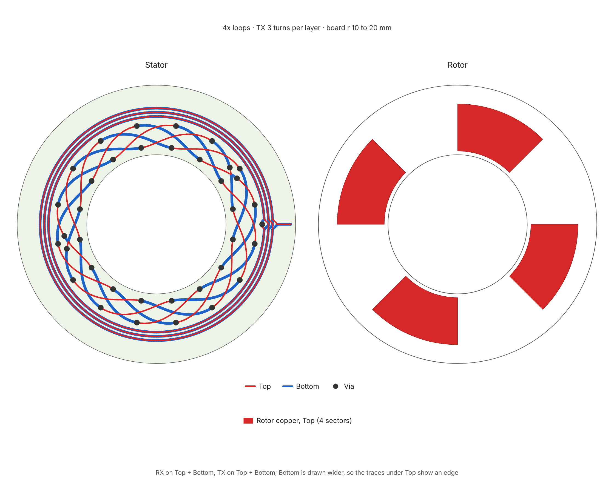
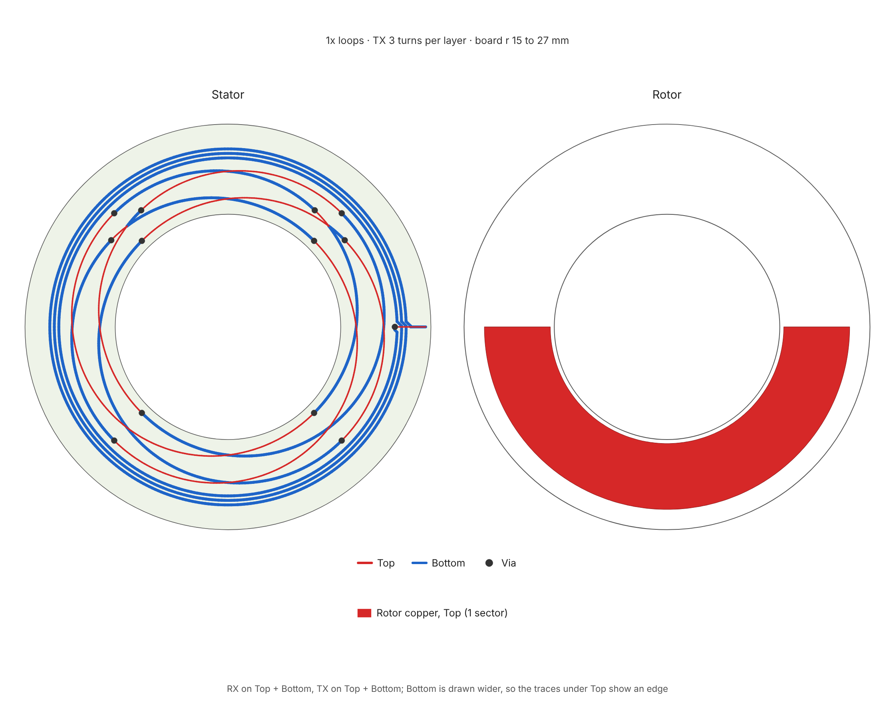
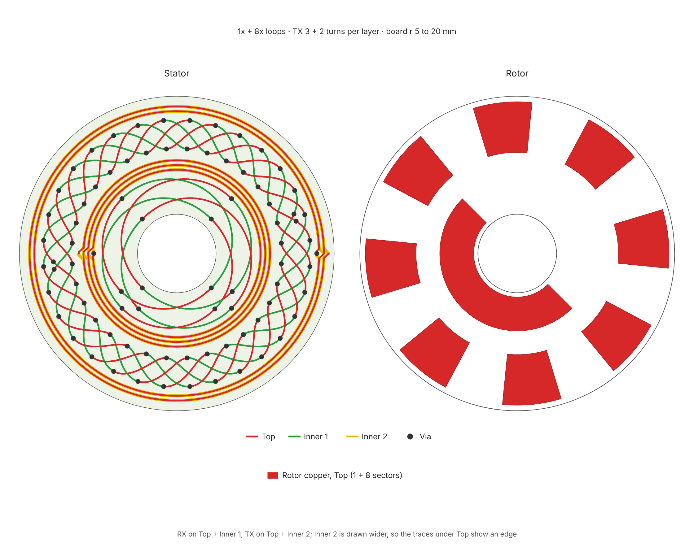
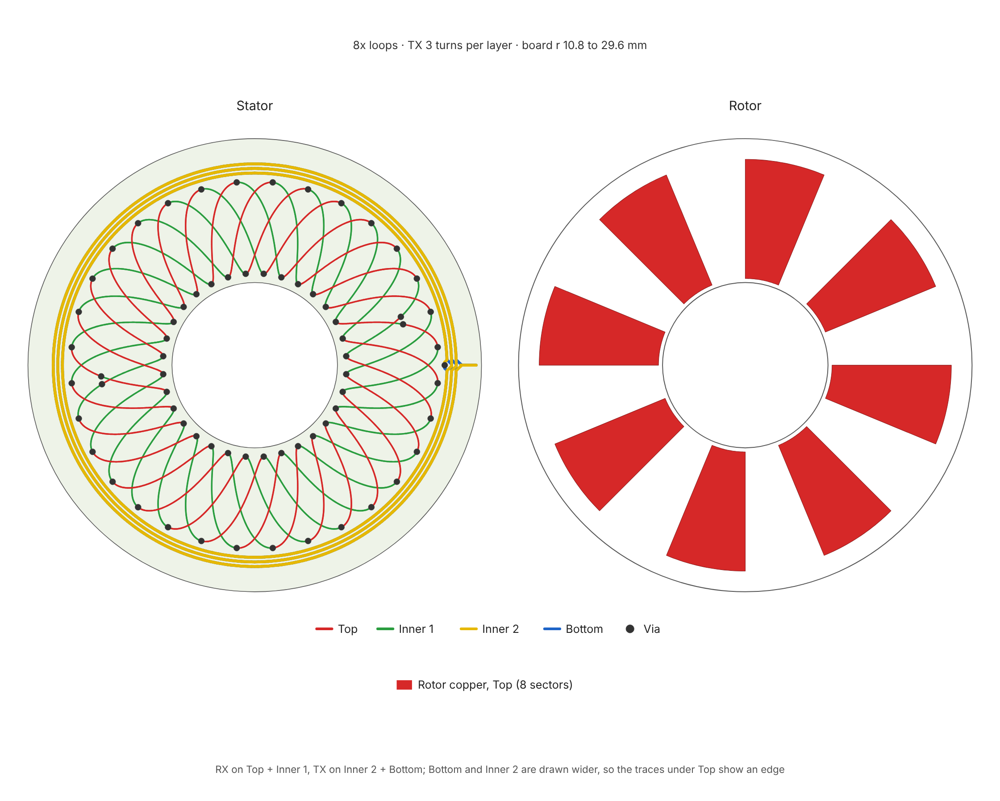
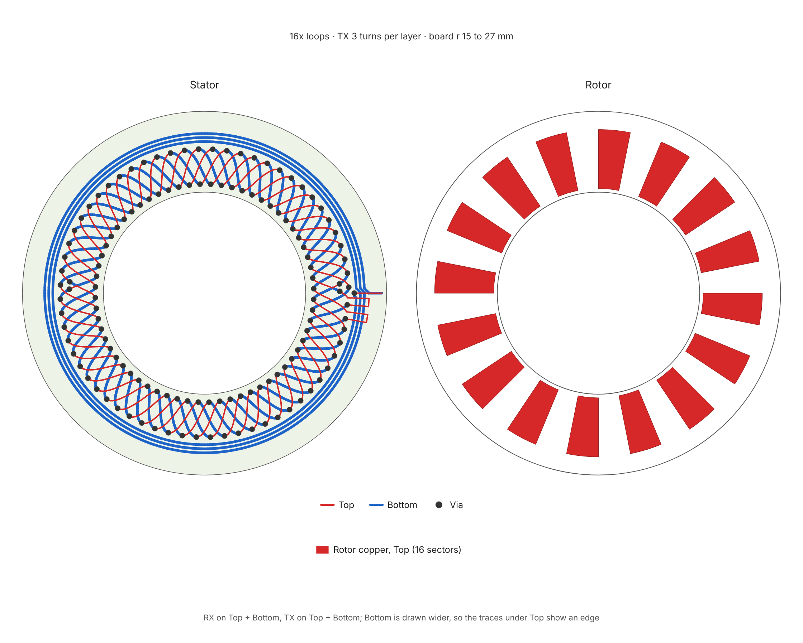
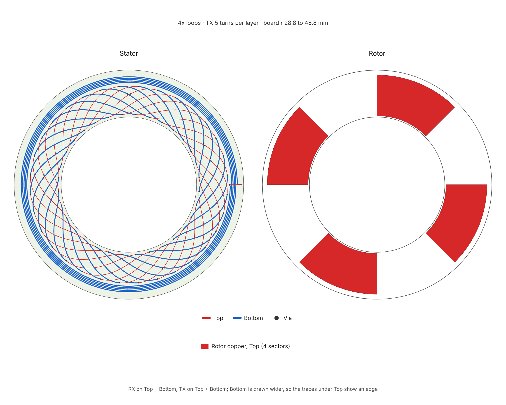
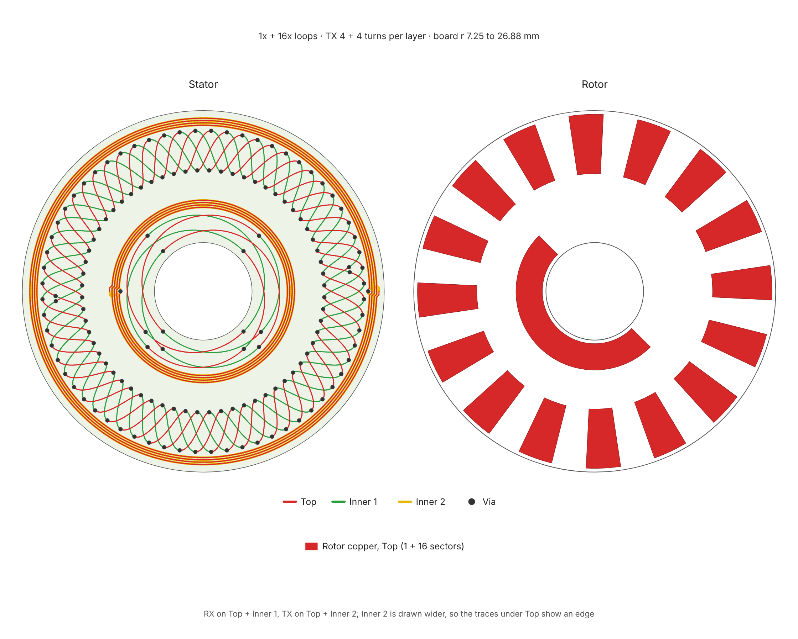
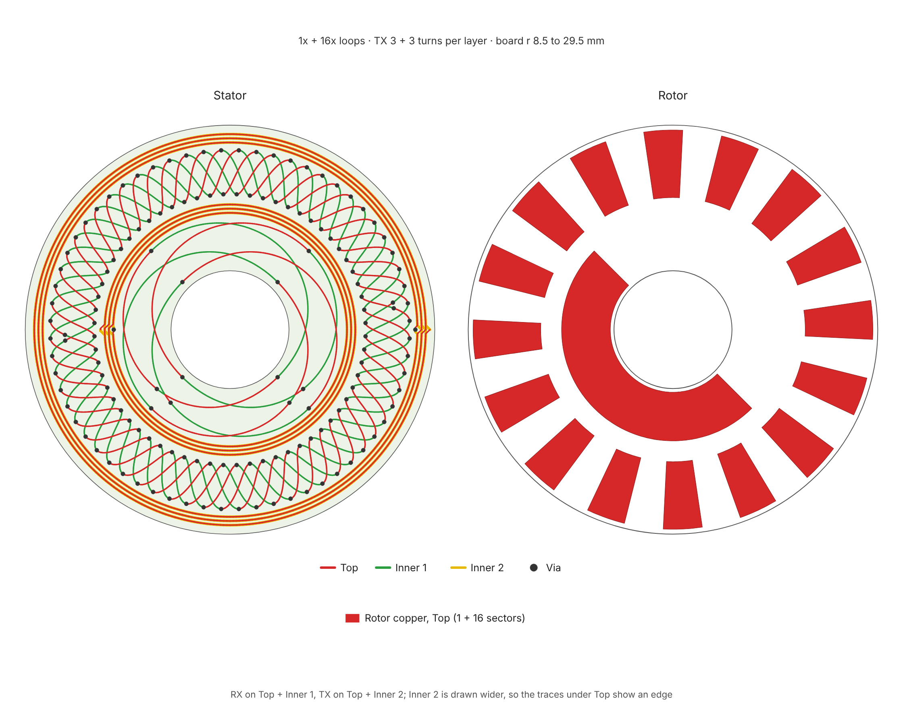
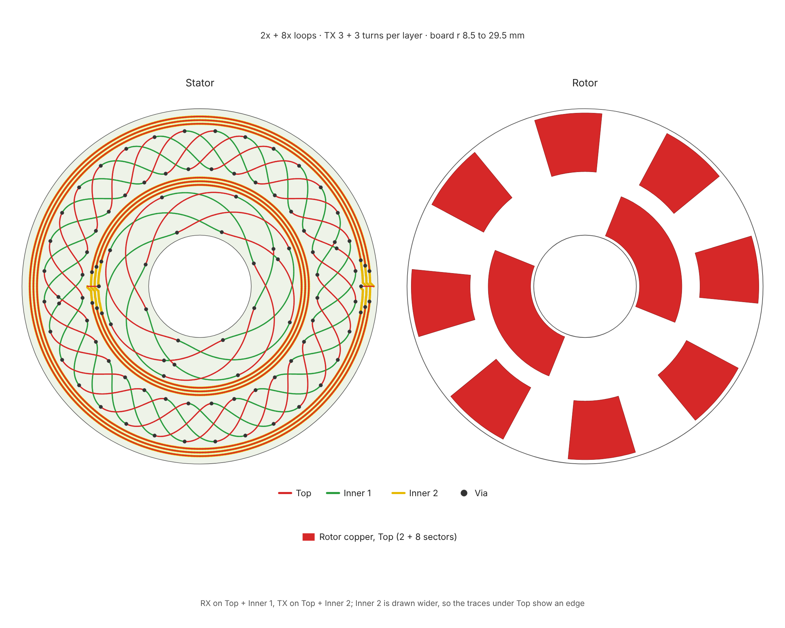
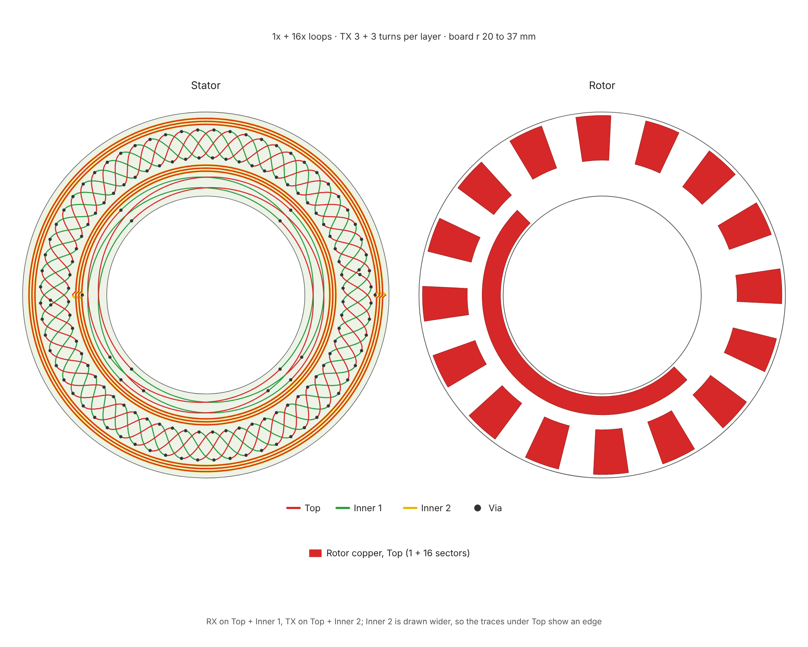

# 28. Elmer FEM Test Boards

The boards the Elmer bridge is proved on. The ten coil boards are drawn by the Sinusoidal Coil
Generator's own picture tool, the stator beside the rotor; E01 and E02 are drawn in the same style,
from above and in section. A board that has run links to its results; a board that has not is marked
**YET TO BE RUN**. Every board is a folder under `Examples/` on the `Elmer_Integration` branch, with
its KiCad files, its `simulation.py` and its `README.md`.

## 28.1 E01 Circular Loop

| Item | Value |
|---|---|
| Board | 30 mm × 30 mm, 1.6 mm thick, no stack-up |
| Copper | one trace on F.Cu, net `LOOP`: a circle of 10 mm radius to its centre line, 0.5 mm wide, 35 µm thick, opened by a 0.2 mm gap between its round ends |
| What Elmer checks | the loop's inductance L at 10 kHz (uniform current) and 3.5 MHz (the coil boards' frequency), its resistance R against the DC resistance, and the same L from the field's energy |
| References | Grover's ring formula with the trace's geometric mean distance, times the share of the circle the copper covers; the resistance of an annular sector |
| Status | **run**: [Elmer FEM Test Board Results](Elmer-FEM-Test-Board-Results.md#291-e01-circular-loop) |

## 28.2 E02 Coaxial Loops

| Item | Value |
|---|---|
| Board | 30 mm × 30 mm, 1.6 mm thick, no stack-up |
| Copper | E01's loop twice: TX on F.Cu and RX on B.Cu, one above the other, their centres about 1.565 mm apart in z |
| What Elmer checks | the mutual inductance M from the voltage the TX's 1 A induces in the open RX, and the TX's own L and R beside a second loop |
| References | Maxwell's formula for two coaxial circles, averaged over both traces' widths, times the share of the circle the copper covers |
| Status | **run**: [Elmer FEM Test Board Results](Elmer-FEM-Test-Board-Results.md#292-e02-coaxial-loops) |

## 28.3 The Ten Inductive Encoder Boards

Ten angle-encoder boards from the [Sinusoidal Coil Generator](https://github.com/RolandThsive/Sinusoidal-Inductive-Encoders-Coil-Generator),
in `Examples/Inductive Coils/` (non-commercial licence, see that folder's `LICENSE.md`). A stator
carries one TX and two RX coils (SIN and COS) per coil set, the single boards (S) one set and the dual
boards (D) two; a rotor with copper sectors sits 1.0 mm above it. The TX runs at 3 to 5 MHz, where
the boards are about 1/2000 of a wavelength across: magneto-quasi-static, Elmer's ground.

Per board Elmer gives the TX's L and R with the rotor away and present (C1, C2, C10), the direct TX
to RX coupling (C3), the coupling against the rotor's angle (C4), the SIN and COS match (C5), the angle
error (C6), the crosstalk between the two sets of a dual board (C7) and the rotor's loss (C10). The
single most important number is C2: how much the rotor lowers the TX's inductance, 12 to 21 % by the
generator and 2 to 7 % by the quasi-static reference.

S2 runs first. Its mesh is built and checked: 17 layers of wedges through the stator, 1,781,549
wedges and 479,322 tetrahedra, 979,420 nodes, and every coil's electrodes found (TX 24 and 24 faces,
SIN 233 and 233, COS 203 and 203). Elmer needs about 59 kB of memory per node on the test boards
([Elmer FEM Hardware](Elmer-FEM-Hardware.md)), so S2 needs about 59 GB, four times the test
machine's 15 GB. Every coil board is therefore held for a bigger PC; the memory below scales S2's
mesh by each stator's length of copper, about 61 GB per metre.

| # | Board | What it tests | Stator copper | Solves | Memory | Status |
|---|---|---|---|---|---|---|
| 1 | `S2_4x_OD40_2L_small` | the smallest single board, the cheapest model | 0.96 m | 9 | about 59 GB (its mesh: 979,420 nodes) | **meshed, YET TO BE RUN**: held for a bigger PC |
| 2 | `S1_1x_OD54_2L_baseline` | the generator's default, the simplest geometry; the mesh study C0 | 0.92 m | 9 | about 55 GB | **YET TO BE RUN**: held for a bigger PC |
| 3 | `D2_1x8x_OD40_small` | the smallest dual board, tight spacing between the sets | 1.56 m | 18 | about 95 GB | **YET TO BE RUN**: held for a bigger PC |
| 4 | `S3_8x_OD59_4L_series_wideband` | TX on the inner layers, far from the rotor; a wide band | 1.91 m | 9 | about 115 GB | **YET TO BE RUN**: held for a bigger PC |
| 5 | `S4_16x_OD54_2L_fingers` | the finest single pitch, and the bridging fingers | 1.30 m | 9 | about 80 GB | **YET TO BE RUN**: held for a bigger PC |
| 6 | `S5_4x_OD98_cosine_r_2subcoils_spiralTX` | the other RX profile, sub-coils, a spiral TX, the biggest board | 3.41 m | 9 | about 210 GB | **YET TO BE RUN**: held for a bigger PC |
| 7 | `D1_1x16x_OD54_Renesas_R145_size` | the dual default, a 3.2 mm board | 3.14 m | 18 | about 190 GB | **YET TO BE RUN**: held for a bigger PC |
| 8 | `D3_1x16x_OD59_fitted_bands` | a typical dual board | 3.07 m | 18 | about 190 GB | **YET TO BE RUN**: held for a bigger PC |
| 9 | `D4_2x8x_OD59_parallel_TX` | parallel TX wiring, a 2-period set | 2.74 m | 18 | about 170 GB | **YET TO BE RUN**: held for a bigger PC |
| 10 | `D5_1x16x_OD74_ID40_large` | a large thin ring | 3.96 m | 18 | about 240 GB | **YET TO BE RUN**: held for a bigger PC |

The boards, stator and rotor:

| | |
|:---:|:---:|
| `S2_4x_OD40_2L_small`  | `S1_1x_OD54_2L_baseline`  |
| `D2_1x8x_OD40_small`  | `S3_8x_OD59_4L_series_wideband`  |
| `S4_16x_OD54_2L_fingers`  | `S5_4x_OD98_cosine_r_2subcoils_spiralTX`  |
| `D1_1x16x_OD54_Renesas_R145_size`  | `D3_1x16x_OD59_fitted_bands`  |
| `D4_2x8x_OD59_parallel_TX`  | `D5_1x16x_OD74_ID40_large`  |

Each picture is the generator's own (`RepresentativeSVGMaker.py`, drawn from the two board files):
the stator on the left with every copper layer in its colour (Top red, Inner 1 green, Inner 2
yellow, Bottom blue) and the vias as dots, the rotor on the right with its copper sectors. Copper
under Top is drawn wider, so a trace that runs right under a Top trace shows as a coloured edge.

The pictures leave out the solder mask, so that the copper shows; the simulations keep it (20 µm,
εr 3.8, tan δ 0.02 on both faces of both boards, as each board's `test_spec.json` sets), though to
Elmer's magneto-quasi-static solve it is air.

| Previous | Next |
|:---|---:|
| [Elmer FEM Simulating Your Own Board](Elmer-FEM-Simulating-Your-Own-Board.md) | [Elmer FEM Test Board Results](Elmer-FEM-Test-Board-Results.md) |
