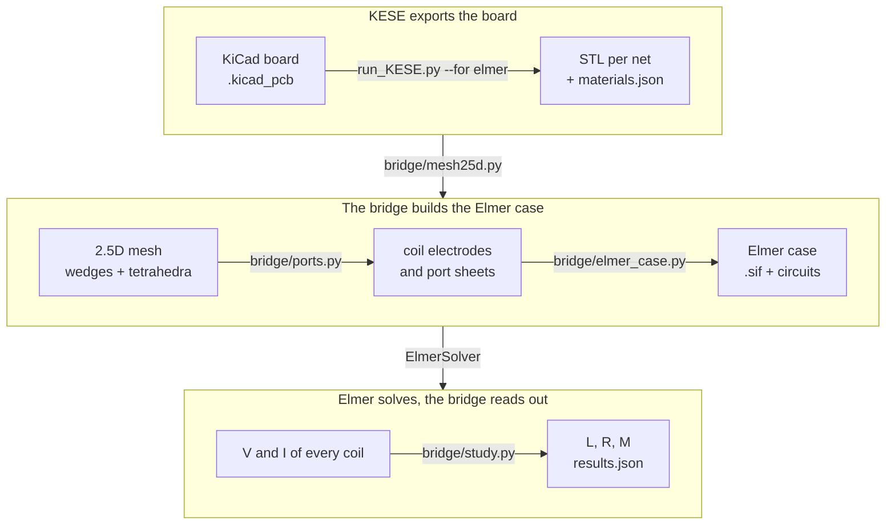

> [!CAUTION]
> The bridge lives on the [`Elmer_Integration`](https://github.com/RolandThsive/KiCad-EM-Stackup-Exporter-KESE/tree/Elmer_Integration) branch.

# 24. Elmer FEM Walkthrough

[Elmer](https://github.com/ElmerCSC/elmerfem) is an open-source finite element solver from CSC in
Finland. The **Elmer bridge** turns a KiCad board into an Elmer simulation: KESE exports the board's
3D geometry, the bridge meshes it, writes Elmer's case, runs ElmerSolver and reads the answer back.
KESE itself stays what it is,
a geometry exporter, and is never changed by the bridge. This page walks through it from top to
bottom: what Elmer does here, installing it, and every step from a board file to the numbers.

> [!NOTE]
> Three boards are shown in this category. The two proof boards, **E01** (one loop) and **E02** (two
> coaxial loops), check the bridge against textbook formulas. The inductive encoder coil
> **S0d2_1x_OD23_2L_tiny_TX3top_Cut** is a whole sensor, a stator and a rotor, solved at 16 rotor angles
> and 5 air gaps: 81 Elmer solves, every one of which passed its two checks. All three have run; their
> results are on [Elmer FEM Test Boards And Results](Elmer-FEM-Test-Boards-And-Results.md).

## 24.1 What Elmer Is Used For Here

At the frequencies of inductive position sensors and planar coils (kHz to a few MHz) a board is a
tiny fraction of a wavelength across: a 40 mm coil at 3.5 MHz is about 1/2000 of a wavelength. The
physics is then **magneto-quasi-static**: currents and magnetic fields, eddy currents in nearby
copper, and no wave propagation. Elmer's time-harmonic A-V solver with edge elements
(`WhitneyAVHarmonicSolver`) solves exactly this, so it is the main solver for:

| Quantity | How the bridge gets it |
|---|---|
| Inductance L of a coil | the imaginary part of the coil's impedance V / I, over ω |
| AC resistance R of a coil, with skin and proximity effect | the real part of V / I |
| DC resistance | from the potential that sets each coil's current direction |
| Mutual inductance M between two coils | the open-circuit voltage of the undriven coil over the driving current |
| The field energy, as a check on L | Elmer's field energy W gives L = 2W / I² |
| The eddy power, as a check on R | Elmer's eddy current power P gives R = 2P / I² |
| The effect of a conducting target (a rotor, a plate) | the same quantities with the conductor present and away |
| An encoder's SIN and COS curves and its angle error | M from the TX to each receiver at a series of rotor angles, fitted with a sine |

What Elmer does **not** give here: the coils' capacitance and self-resonance. An eddy-current
solve has no displacement current, so those need another solver; how the solvers of this project
divide the work is on [Solvers Comparison](Solvers-Comparison.md).

## 24.2 How It Fits Together



Each step is described below, from [24.8](#248-export-the-board-with-kese) on.

## 24.3 The Pages Of This Category

| Page | What it covers |
|---|---|
| Elmer FEM Walkthrough (this page) | What Elmer does here, installing it ([24.5](#245-linux-ubuntu-2404)), and every step from the board file to the numbers ([24.8](#248-export-the-board-with-kese) on) |
| [Elmer FEM Simulating Your Own Board](Elmer-FEM-Simulating-Your-Own-Board.md) | Every setting of an example's `simulation.py`, how to start a new one, and the memory a board needs |
| [Elmer FEM Test Boards And Results](Elmer-FEM-Test-Boards-And-Results.md) | E01, E02 and the coil board, and what came out on each |
| [Elmer FEM Accuracy](Elmer-FEM-Accuracy.md) | Where the errors come from and how big they are |
| [Elmer FEM Troubleshooting](Elmer-FEM-Troubleshooting.md) | What went wrong while building the bridge, and the fixes |

How Elmer sits beside the project's other solvers is on [Solvers Comparison](Solvers-Comparison.md).

## 24.4 Where The Code Is

| Folder on `Elmer_Integration` | What it holds |
|---|---|
| `bridge/` | The bridge, in Python: `geometry.py`, `mesh25d.py`, `ports.py`, `elmer_case.py`, `study.py`, and `setup_machine.sh`, which sets up a fresh Ubuntu 24.04 machine |
| `Examples/E01_circular_loop/`, `Examples/E02_coaxial_loops/` | The proof boards, each with its board, `make_board.py`, `simulation.py`, `README.md` and `results.md` |
| `Examples/Inductive Coils/S0d2_1x_OD23_2L_tiny_TX3top_Cut/` | The coil board: `Boards/` (from the generator), `3D_Geometry/` (KESE's export), `Elmer Simulation/` (`test_spec.json`, `simulation.py` and the chart scripts) and `Results/` (non-commercial licence, see that folder's `LICENSE.md`) |
| `Examples/Inductive Coils/new_coil.py` | Sets up any single coil set from the generator as a folder like the coil board's |
| `Solver_Elmer/install/` | The Elmer 26.2.1 build every example ran on, for Ubuntu 24.04 (see [24.5](#245-linux-ubuntu-2404)) |
| `3D_Geometry/` | Empty on purpose: KESE's `Generator/` is copied here from `main`, or `KESE_PATH` points at it |

The branch also solves five more coil boards made from the same small coil set; they are in
[`Examples/Inductive Coils/`](https://github.com/RolandThsive/KiCad-EM-Stackup-Exporter-KESE/tree/Elmer_Integration/Examples/Inductive%20Coils).

## 24.5 Linux (Ubuntu 24.04)

The bridge needs three things: Elmer with OpenMP and the MUMPS direct solver, a Python environment
with the bridge's packages, and a copy of KESE. The branch carries the Elmer every example ran on,
built for Ubuntu 24.04, in `Solver_Elmer/install/`; it never carries KESE, so `3D_Geometry/` is empty
on purpose and is filled by hand.

### The Committed Elmer

`Solver_Elmer/install/` is Elmer 26.2.1 with MUMPS, built for 64-bit Linux on Ubuntu 24.04. It only
needs the libraries it runs with, installed once:

```bash
sudo apt-get install -y libgfortran5 libgomp1 libopenblas0 libopenmpi3t64 libmumps-5.6t64
cd Solver_Elmer
ldd install/lib/elmersolver/libelmersolver.so | grep 'not found'     # prints nothing when every library is there
install/bin/ElmerSolver -v | grep -m1 Version
```

The bridge looks for `Solver_Elmer/install/bin/ElmerSolver` and tells Elmer that `install/` is its
home, so the folder works wherever the branch is checked out. To run Elmer by hand rather than through
the bridge, set `ELMER_HOME` to that `install` folder first; without it Elmer stops with
*elements.def not found*.

| What the build is | |
|---|---|
| Source | [ElmerCSC/elmerfem](https://github.com/ElmerCSC/elmerfem), tag `release-26.2.1`, commit `a19504a`, unmodified |
| Built | 15 November 2026, Ubuntu 24.04, GNU Fortran 13.3.0, Release |
| With | MPI (Open MPI), OpenMP, MUMPS 5.6 from Ubuntu; no ElmerGUI, no Hypre, no ParMETIS |
| Licence | GPL-2.0 or later, its library LGPL-2.1; the texts are in `install/share/elmersolver/license_texts/` |

### One Command For A Fresh Machine

```bash
bash bridge/setup_machine.sh
```

installs the libraries above, the system libraries gmsh's wheel needs, and the Python packages of
`requirements.txt` into `.venv` at the branch's root. It is safe to run again, and builds Elmer from
source only if `Solver_Elmer/install/bin/ElmerSolver` is missing.

### Building Elmer Yourself

The commands that made `install/`:

```bash
sudo apt-get update
sudo apt-get install -y build-essential cmake git gfortran libopenmpi-dev libblas-dev liblapack-dev \
    libopenblas-dev libmumps-dev libscalapack-openmpi-dev
cd Solver_Elmer
git clone --depth 1 --branch release-26.2.1 https://github.com/ElmerCSC/elmerfem.git elmerfem
mkdir build && cd build
cmake ../elmerfem -DCMAKE_BUILD_TYPE=Release -DWITH_ELMERGUI:BOOL=FALSE -DWITH_MPI:BOOL=TRUE \
    -DWITH_OpenMP:BOOL=TRUE -DWITH_Mumps:BOOL=TRUE -DCMAKE_INSTALL_PREFIX=$PWD/../install
make -j"$(nproc)" install
```

> [!NOTE]
> ParMETIS is left out on purpose: nothing in `install/` links it (checked with `ldd` on every binary
> and library), and its licence is not an open-source one. `elmerfem/` and `build/` stay out of git.

> [!IMPORTANT]
> Keep MUMPS in the build. The coil board solves its field with MUMPS, the bridge solves each coil's
> current direction with UMFPACK, and Elmer's `Circuit` preconditioner for the iterative solve
> factorises the circuit block with a direct solver; without one it stops with *Preconditioner
> "circuit" needs either Umfpack or MUMPS*.

### Python

```bash
python3 -m venv .venv
.venv/bin/pip install -r requirements.txt       # numpy, scipy, shapely, trimesh, gmsh, mapbox_earcut
```

### KESE

Copied from `main` so that `run_KESE.py` sits directly in `3D_Geometry/`:

```bash
git -C <your KESE clone> archive main Generator | tar -x --strip-components=1 -C 3D_Geometry
.venv/bin/python 3D_Geometry/run_KESE.py --help
```

or leave `3D_Geometry/` empty and point the bridge at any KESE with `export KESE_PATH=<path to
Generator>`. KESE runs inside the bridge's Python, so its own packages (`requirements.txt` in
`Generator/`) must be in the same environment. The coil board does not need KESE to run: its export
is committed in its own `3D_Geometry/` folder and is reused while the board is unchanged.

### Check The Whole Chain

With the first proof board, on its coarsest mesh at 3.5 MHz:

```bash
cd Examples/E01_circular_loop
../../.venv/bin/python simulation.py --levels 0.75 --freqs 3.5e6 --out case_check --results check.json
```

The committed results give L 52.93 nH and R 80.19 mOhm for this solve (3 minutes on the 4-core test
machine), the level 0.75 values of
[Elmer FEM Test Boards And Results](Elmer-FEM-Test-Boards-And-Results.md#261-e01-circular-loop); its own
`--results` file keeps the committed `results.json` as it is. Those results were made with the
bridge of 15 and 16 November ([Elmer FEM Test Boards And Results](Elmer-FEM-Test-Boards-And-Results.md#261-e01-circular-loop)), so today's bridge may differ in the last digits.

### A Swap File For The Coil Board

The coil board's direct solves need more memory than a 16 GB machine has
([Elmer FEM Simulating Your Own Board](Elmer-FEM-Simulating-Your-Own-Board.md#257-before-a-large-board)). On Linux a swap file makes up the
rest:

```bash
sudo fallocate -l 26G /swapfile && sudo chmod 600 /swapfile && sudo mkswap /swapfile && sudo swapon /swapfile
```

## 24.6 Windows

The committed build runs inside WSL with Ubuntu 24.04, the same way as on Linux. It does not run on
Windows itself, on macOS, or on another Linux release without its libraries at these versions.

| Route | Steps | Notes |
|---|---|---|
| **WSL 2 (recommended)** | Install Ubuntu 24.04 from the Microsoft Store, then follow [24.5](#245-linux-ubuntu-2404) inside it | The bridge, KESE and Elmer all run as on Linux. Keep the repository inside the WSL file system (not under `/mnt/c`), which is many times faster for the mesh files |
| **Native** | Build Elmer with the instructions in Elmer's repository (MSYS2) and install it into `Solver_Elmer\install`; install Python 3.11 or later from python.org; `py -m venv .venv` and `.venv\Scripts\pip install -r requirements.txt` | The bridge calls `ElmerSolver` from `Solver_Elmer/install/bin`, so that folder must hold `ElmerSolver.exe`. Not yet run on the test boards |

macOS has the same route as native Windows: build Elmer with the instructions in its repository and
install it into `Solver_Elmer/install`.

## 24.7 What The Test Machines Had

| Item | Version |
|---|---|
| OS | Ubuntu 24.04; E01 and E02 on 4 cores and 15 GB, the coil board on 16 GB machines with a swap file |
| Elmer | 26.2 (release 26.2.1, `a19504a`, OpenMP, MPI, MUMPS, UMFPACK) |
| Python | 3.13 |
| gmsh | 4.15.2 (from PyPI) |
| numpy, scipy, shapely, trimesh | 2.5.3, 1.18.1, 2.2.0, 5.2.1 |

Each example writes the versions it ran with into its results files, so every number on
[Elmer FEM Test Boards And Results](Elmer-FEM-Test-Boards-And-Results.md) names the software that made it.

## 24.8 Export The Board With KESE

The rest of this page is what happens between `python simulation.py` and the numbers in the results files, step by step. Every
step is one function of the bridge on the `Elmer_Integration` branch; the file is named with each.

`bridge/geometry.py` runs KESE as a program, never as a library:

```bash
python run_KESE.py board.kicad_pcb --for elmer --format step stl --out <folder> \
    --set Stackup.solder_mask=True ...
```

The `elmer` preset writes simulation-mode solids, one per net and one per dielectric, in mm on
KiCad's origin, with no surface finish ([Choosing An Export](Choosing-An-Export.md)). The bridge
asks for STL beside STEP and reads the STL files with `trimesh`, together with `materials.json`
for each part's role, net, layer and height. By default it asks for a 20 µm solder mask over copper
and laminate with tented vias, as the coil boards' brief does.

`bridge/study.py` keeps the export in one of two places. `kese_export` keeps it in a scratch cache
named by a hash of the board file (E01 and E02). `kese_geometry` keeps it in a folder meant to be
committed beside the board, with a `source.json` holding that hash (the coil board's `3D_Geometry/`).
Either way an unchanged board is not exported twice.

KESE writes the board with y up (y_model = −y_KiCad) and z = 0 in the middle of the board. The
bridge shifts z so that the top face of the F.Cu copper is z = 0.

## 24.9 Section The Parts Into Slabs

`bridge/mesh25d.py` builds a **2.5D mesh**, the shape a printed board has: everything is flat in z.
`Layout.build` takes every height at which some part starts or ends, which splits the board into
**slabs**, and cuts each part at the middle of each slab it spans, giving one 2D outline per part
and slab.

For the magneto-quasi-static solve an insulator with μr = 1 is air: the A-V solver has no
displacement current, so εr plays no part. `insulators=False` therefore leaves out FR-4 and mask
altogether, which removes their heights from the slabs; with `insulators=True` they are kept, and a
board or mask part that lies wholly outside the copper's heights is merged into the air anyway.
All three boards of this category run with `insulators=False`.

## 24.10 Triangulate The Footprint

One triangle mesh covers the whole footprint: a disc around the board (its rim sized to the far
field's element size), with every copper edge of every slab drawn into it as a line, so each
triangle lies wholly inside or outside the copper in every slab. The element size comes from a
raster: `h_edge` at copper edges, growing by `grade` per mm away from them, at most `h_in` inside
copper and `h_max` far away. Lines given in `extra_lines` (port sheets, the outline of a cut, a
rotor's copper at its angle) are drawn in too.

## 24.11 Stack The Wedges, Fill The Air

The triangle mesh is repeated at a series of heights in z and joined into wedges (prisms):

| Slab | Layer height |
|---|---|
| A copper foil (a slab with copper, at most `foil_max` = 0.15 mm thick) | at most `dz_copper` (E01 and E02 use 0.018 mm at level 1, about half copper's skin depth at 3.5 MHz) |
| Any other slab, including a dielectric that holds only via barrels, and the air gap to a rotor | at most `dz_max` |
| Above and below the boards | two thin air layers (`pads`), then tetrahedra |

Above and below the wedges, gmsh fills the air with tetrahedra out to the top and bottom of the
domain, growing from the wedges' size by `tet_grade` per mm up to `tet_max`, then optimises them
with Netgen. Each wedge gets the body of the part of highest priority whose outline holds its
triangle (copper over mask over board); a `void` part (air of higher priority than copper) takes
copper out, which is how a cut across a trace or a left-out via is made in the model while the
board file stays as it is.

## 24.12 Open Each Coil At Its Port

Elmer's 3D massive coils take their current's direction from a potential (`W`) that runs from 0 at
one electrode to 1 at the other, so a coil must be **open**. `bridge/ports.py` opens it where the
real board gets its leads:

| Port part | What it is | Boundary condition |
|---|---|---|
| Electrodes T1 and T2 | the coil's copper faces that border the gap (two separate groups) | W = 0 (T1), W = 1 (T2), and the scalar potential fixed (A re = A im = 0) |
| Sheet | faces inside the gap that join the two electrodes | n × A = 0 (`A re {e} = 0`, `A im {e} = 0`) |

The gap is wherever the coil's copper is absent:

| Coil | Opened at | Sheet |
|---|---|---|
| E01's loop, E02's TX and RX | the 0.2 mm gap between the trace's two round ends | across the gap at a level of the copper (`sheet_at_level`) |
| The coil board's TX | its two ends, stacked on F.Cu and B.Cu at one point | upright through the board between them (`sheet_vertical`, along a line drawn into the mesh) |
| The coil board's SIN and COS | a 0.2 mm cut across a top trace, 0.4 mm across, made in the model | across the cut's floor, at the copper's lower face, as on E01 |

With the sheet in place, the coil's voltage is IR + jω∮A·dl round the whole loop, gap included: the
coil's EMF, as a meter at its leads would read it.

![How the coil board sits in Elmer, drawn from the geometry the mesh is built from. Left, seen from above: the stator's TX in dark grey (three turns on F.Cu), SIN in blue and COS in orange, each on F.Cu and B.Cu, with the rotor's two quarter-ring copper sectors in grey at 0 degrees, 1 mm above and copper face down; SIN's and COS's ports are ringed where a 0.2 mm cut crosses a top trace, and the TX port at its two stacked ends at KiCad (111, 100). Top right, a section through the stack with heights stretched: the rotor copper 1 mm above the stator, FR-4 and mask treated as air, and air out to 35.1 mm from the axis and 35.1 mm above and below. Bottom right: the SIN port, the cut's two faces as electrodes and a dashed port sheet across the gap's floor, with 0 A forced through SIN so the voltage across the cut is its open-circuit EMF; and the TX port, an electrode on each stacked end and a hatched port sheet between them, where 1 A is driven at 3.5 MHz](https://raw.githubusercontent.com/RolandThsive/KiCad-EM-Stackup-Exporter-KESE/main/docs/images/Elmer-FEM-Workflow/S0d2_1x_OD23_2L_tiny_TX3top_Cut/elmerworkflow_1_setup.webp)

The coil board's three ports, drawn by its `rig_picture.py`.

The coil board's cuts are made in the model; the board files stay as the generator wrote them. Each
is the spot on the receiver's top trace nearest its layer-change via where a 0.2 mm cut has at least
0.45 mm of free board round it and sits at least 0.75 mm from any via centre: 0.86 mm from the via on
both receivers, at KiCad (96.591, 100.496) for SIN and (97.239, 97.940) for COS. The two spots are
45° apart about the axis, a quarter of the electrical period, as SIN and COS are.

![Where SIN and COS are opened. Left, the stator from above with the TX in dark grey, SIN in blue and COS in orange, each on F.Cu (dark) and B.Cu (light); a small white box marks each cut and the TX port is ringed at the right. Right, close-ups: SIN cut at KiCad (96.59, 100.50) and COS cut at KiCad (97.24, 97.94), each a 0.2 mm white box across the top trace 0.86 mm from the via, which stays, with 0.46 mm clear of other copper; and the TX's two ends, F.Cu over B.Cu, at KiCad (111.00, 100.00), not cut. A note says the copper inside each box is taken out, the two cut faces become the electrodes and the port sheet spans the gap at the trace's lower face](https://raw.githubusercontent.com/RolandThsive/KiCad-EM-Stackup-Exporter-KESE/main/docs/images/Elmer-FEM-Test-Boards/S0d2_1x_OD23_2L_tiny_TX3top_Cut/elmerboards_2_cuts.webp)

## 24.13 Write The Elmer Case

`bridge/elmer_case.py` writes one `.sif` per frequency:

| Solver | What it does |
|---|---|
| 1 `WPotentialSolver` | W in each coil, once, before everything, with a direct solve (UMFPACK) |
| 2 `CircuitsAndDynamicsHarmonic` | one circuit per coil: a current source of 1 A for the driven coil and 0 A for a sensing coil |
| 3 `WhitneyAVHarmonicSolver` | A (edge elements) and V in the conductors, complex, with the circuits; iterative or direct, below |
| 4 `MagnetoDynamicsCalcFields` | current density, field energy and eddy power |
| 5 `CircuitsOutput` | every circuit's V and I |
| 6 `SaveScalars` | the scalars to `res_<name>/scalars_<name>.dat` |

The A-V solve has two modes (`Case.solver`):

| Mode | What Elmer is told | Used by |
|---|---|---|
| `iterative` (the default) | BiCGStab(l) of degree 4 or GCR, with Elmer's `Circuit` preconditioner, optionally with an ILU of the field's block (`ilu_order`, shifted by `ilu_factor`); the run goes on at the iteration cap (`Linear System Abort Not Converged = False`) | E01 and E02 (BiCGStab(l), no ILU) |
| `mumps` | a direct solve with serial MUMPS (`mumpslocal`), `Use Tree Gauge = False` and `Mumps Solve Singular = True`, so A stays ungauged and MUMPS handles the null pivots of the gradients | the coil board |

Every coil is a massive component (`Coil Type = Massive`). Conductors that are not coils (a rotor)
are ordinary conducting bodies, with their own scalar potential fixed to 0 by default
(`conductor_potential=False`), so there E = −jωA. The outer boundary has n × A = 0. Coordinates stay
in mm (`Coordinate Scaling = 0.001`).

> [!NOTE]
> `Activate Constraint` on the massive coils is off by default today (`constraint=False`), and the
> eddy power is then a second check on R. E01 and E02 ran on 15 and 16 November with it on, the
> bridge's setting then; the coil board ran on 17 November with it off.

## 24.14 Solve And Read Back

`bridge/study.py` runs ElmerSolver once per frequency (OpenMP threads set by `threads`, the stack
limit lifted for serial MUMPS), reads the scalars and, for an iterative solve, the last iteration
count and residual from its log, and records Elmer's peak memory. Per coil it reports:

| Result | From |
|---|---|
| V, I, Z = V / I | the circuit outputs |
| R = Re Z, L = Im Z / ω | Z |
| M, the mutual inductance to the driven coil | Im(V_sense / I_drive) / ω, for a coil with no current |
| R_dc | Elmer's `r_component`, from ∫σ\|∇W\|² |
| L from the field energy | 2W / I², a check on L that does not go through the circuit |
| R from the eddy power | 2P / I², a check on R (right only with `Activate Constraint` off) |

All of it, with the mesh's size, the run's time, memory and the software versions, is written to the
example's results files; each example's results page sets it against the reference.

## 24.15 A Rotor Over A Stator

The coil board adds a second board. `load_parts` turns the rotor copper side down without mirroring
it, lifts its copper face to the air gap above z = 0, and turns it about the axis (KiCad's point
(100, 100)) by the rotor angle. Every angle gets its own mesh, with the rotor's copper at that angle
drawn into it, and one solve; a run with the rotor's copper made air gives the TX with the rotor
away. The receivers' M at each angle is fitted with a sine, and the angle read back as
atan2(SIN, COS) gives the angle error ([Elmer FEM Test Boards And Results](Elmer-FEM-Test-Boards-And-Results.md#263-s0d2_1x_od23_2l_tiny_tx3top_cut)).

| Previous | Next |
|:---|---:|
| [openEMS Workflow](OpenEMS-Workflow.md) | [Elmer FEM Simulating Your Own Board](Elmer-FEM-Simulating-Your-Own-Board.md) |
