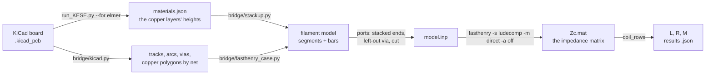

# 52. FastHenry Introduction

[FastHenry](https://github.com/ediloren/FastHenry2) is the magneto-quasi-static inductance and resistance extractor
written at M.I.T. by Mattan Kamon, Lou Silveira and others (1994 to 1996), kept up by FastFieldSolvers as release
3.0.1. The **FastHenry bridge** turns a KiCad board into a FastHenry simulation: KESE exports the board's stack-up,
the bridge reads the copper itself from the `.kicad_pcb`, writes FastHenry's input, runs it and reads the impedance
matrix back. The bridge lives on the `FastHenry_Integration` branch of the repository; KESE itself stays what it is,
a geometry exporter, and is never changed by the bridge.

> [!NOTE]
> Every board on this category's pages has run: the two proof boards E01 and E02, and the coil board
> `S0d2_1x_OD23_2L_tiny_TX3top_Cut` at five air gaps and 16 rotor angles (see
> [FastHenry Test Board Results](FastHenry-Test-Board-Results.md)). Every solve fitted the 4-core, 15 GB test
> machine.

## 52.1 What FastHenry Is Used For Here

At the frequencies of inductive position sensors (3 to 5 MHz) a coil board is about 1/2000 of a wavelength across,
so the physics is **magneto-quasi-static**: currents and magnetic fields, eddy currents in nearby copper, and no wave
propagation. FastHenry solves exactly this, in a way of its own: it cuts the conductors into straight **filaments**,
each carrying a uniform current along its length, and couples every filament to every other through its partial
inductance. Only the copper is discretised; the air needs no mesh and has no boundary.

| Quantity | How the bridge gets it |
|---|---|
| Inductance L of a coil | Im(Z) / ω of the coil's port, from FastHenry's impedance matrix |
| AC resistance R of a coil, with skin and proximity effect | Re(Z) of the coil's port; the filaments across a track let the current crowd to its edges |
| Mutual inductance M between two coils | Im(Z[receiver][TX]) / ω: with 1 A into the TX and the receiver open, its voltage is its open-circuit EMF |
| Reciprocity, as a check on every solve | M from the receiver back to the TX, Im(Z[TX][receiver]) / ω, which an exact solve makes equal |
| The effect of a conducting target (a rotor) | the same quantities with the rotor's copper, a grid of bars, turned to each angle and raised by the air gap |
| SIN and COS against the rotor's angle, and the angle error | one solve per angle, a best sine fit per channel, and the angle read back by atan2 |

What FastHenry does **not** give here: capacitance, self-resonance, temperature or stress. Its solve has no
displacement current.

## 52.2 How It Fits Together

Each step is described on [FastHenry Workflow](FastHenry-Workflow.md).

## 52.3 The Pages Of This Category

| Page | What it covers |
|---|---|
| [FastHenry Installation](FastHenry-Installation.md) | The committed FastHenry 3.0.1 build, rebuilding it, and setting up the bridge on Linux and Windows |
| [FastHenry Workflow](FastHenry-Workflow.md) | Every step from the board file to the numbers |
| [FastHenry Simulating Your Own Board](FastHenry-Simulating-Your-Own-Board.md) | Every setting of an example's `simulation.py`, and how to start a new one |
| [FastHenry Test Boards](FastHenry-Test-Boards.md) | The three boards, and what FastHenry checks on each |
| [FastHenry Test Board Results](FastHenry-Test-Board-Results.md) | What came out, against the references, with charts |
| [FastHenry Accuracy](FastHenry-Accuracy.md) | Where the errors come from and how big they are |
| [FastHenry Hardware](FastHenry-Hardware.md) | Memory and time, measured, and how to estimate a board |
| [FastHenry Troubleshooting](FastHenry-Troubleshooting.md) | What went wrong while building the bridge, and the fixes |

How FastHenry compares with the other solvers of the project is on
[Solvers Comparison](Solvers-Comparison.md).

## 52.4 Where The Code Is

| Folder on `FastHenry_Integration` | What it holds |
|---|---|
| `bridge/` | The bridge, in Python, general to any board: `kicad.py`, `stackup.py`, `fasthenry_case.py`, and `setup_machine.sh` |
| `Solver_FastHenry/` | FastHenry 3.0.1 built for 64-bit Linux (`install/bin/fasthenry`), the script that builds the same file from source, and its licence |
| `Examples/E01_circular_loop/`, `Examples/E02_coaxial_loops/` | The proof boards, each with its board, `make_board.py`, `simulation.py`, `README.md`, `results.md` and `results.json` |
| `Examples/Inductive Coils/S0d2_1x_OD23_2L_tiny_TX3top_Cut/` | The coil board of this category: `Boards/` from the coil generator, `FastHenry Simulation/` with its scripts and `test_spec.json`, and `Results/` at every air gap |
| `Examples/Inductive Coils/new_coil.py` | Sets up any single coil set from the generator for FastHenry in one command |
| `Examples/kicad_writer.py`, `Examples/references.py` | Shared by the proof boards: a small KiCad board writer, and the textbook values they are checked against |
| `3D_Geometry/` | Empty on purpose: KESE's `Generator/` is copied here from `main`, or `KESE_PATH` points at it |

The branch solves five more coil boards of the same family the same way; they are listed in the branch's
[`Examples/Inductive Coils/README.md`](https://github.com/RolandThsive/KiCad-EM-Stackup-Exporter-KESE/blob/FastHenry_Integration/Examples/Inductive%20Coils/README.md).

| Previous | Next |
|:---|---:|
| [PyPEEC Troubleshooting](PyPEEC-Troubleshooting.md) | [FastHenry Installation](FastHenry-Installation.md) |
