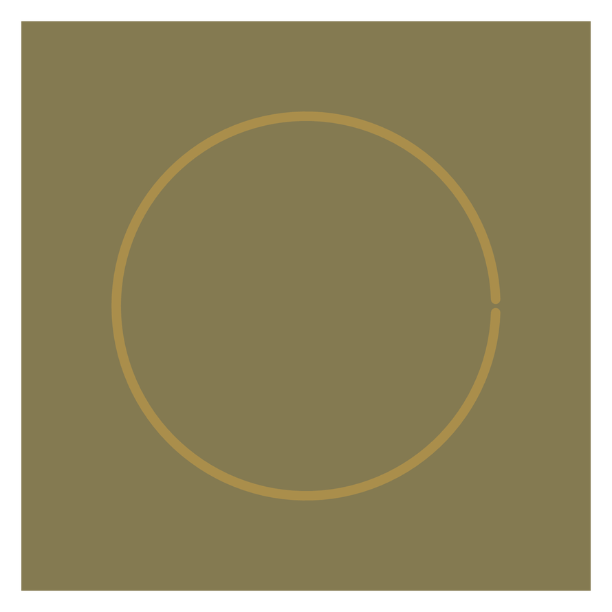

# 36. FastHenry Test Boards And Results

The three boards the FastHenry bridge is proved on, and what FastHenry gave on each, against numbers known without
any solver. Each is a folder under `Examples/` on the `FastHenry_Integration` branch, with its KiCad files, its
`simulation.py`, its `README.md` and its results files, which hold every number below with the settings, the
versions, the model's size, and the time and peak memory of every solve. The branch solves five more coil boards of
the same family the same way; they are listed in its
[`Examples/Inductive Coils/README.md`](https://github.com/RolandThsive/KiCad-EM-Stackup-Exporter-KESE/blob/FastHenry_Integration/Examples/Inductive%20Coils/README.md).

## 36.1 E01 Circular Loop

One circular trace on F.Cu, 10 mm in radius to its centre line, 0.5 mm wide and 35 µm thick, opened by a 0.2 mm gap
where FastHenry drives 1 A between its two ends; rendered by KESE's static renderer from the board's own export.

| Top | Bottom |
|:---:|:---:|
|  | The bottom face carries no copper: B.Cu is empty, and the branch's render of it is blank |

| Filaments (across × through) | 1 × 1 | 3 × 1 | 5 × 1 | 9 × 1 | 9 × 3 | 15 × 3 |
|---|---|---|---|---|---|---|
| Filaments in the model | 126 | 378 | 630 | 1,134 | 3,402 | 5,670 |
| L at 10 kHz (reference 55.590 nH) | 55.343 nH (−0.44 %) | 55.474 nH (−0.21 %) | 55.516 nH (−0.13 %) | 55.538 nH (−0.09 %) | 55.579 nH (−0.02 %) | 55.580 nH (−0.02 %) |
| R at 10 kHz (reference 61.201 mΩ) | 61.207 mΩ | 61.208 mΩ | 61.208 mΩ | 61.208 mΩ | 61.208 mΩ | 61.208 mΩ |
| L at 3.5 MHz (estimate about 55.04 nH) | 55.343 nH | 54.899 nH | 54.783 nH | 54.771 nH | 54.801 nH | 54.797 nH |
| R at 3.5 MHz | 61.207 mΩ | 69.946 mΩ | 74.351 mΩ | 75.099 mΩ | 75.375 mΩ | 75.433 mΩ |
| R at 3.5 MHz over R at 10 kHz | 1.00 | 1.14 | 1.21 | 1.23 | 1.23 | 1.23 |

L settles from below onto Neumann's double integral over the open arc (55.590 nH, with the rectangle's geometric mean
distance after Grover) and stops 0.02 % under it from 9 × 3 on, the size of the integral's own approximations. R at
10 kHz is 61.208 mΩ whatever the filaments: the DC resistance of the model's 126 straight chords, 0.011 % over the
annular sector's 61.201 mΩ. At 3.5 MHz, where the skin depth equals the copper's thickness, the current crowds to the
trace's edges and R rises to 1.23 times its DC value, which only filaments across the trace can show: one filament
holds the current uniform and misses the rise altogether. Run on 17 November 2026 with FastHenry 3.0.1's dense direct
solve on KESE 3.4.0's stack-up.

## 36.2 E02 Coaxial Loops

E01's loop twice, TX on F.Cu and RX on B.Cu right under it, 1.565 mm apart, with 1 A in the TX and the RX open so that
the voltage across its gap gives the mutual inductance M; rendered by KESE from its own export.

| Top | Bottom |
|:---:|:---:|
|  |  |

| Filaments (across × through, each loop) | 1 × 1 | 3 × 1 | 5 × 1 | 9 × 1 | 9 × 3 |
|---|---|---|---|---|---|
| Filaments in the model | 252 | 756 | 1,260 | 2,268 | 6,804 |
| M at 10 kHz (reference 23.886 nH) | 23.891 nH (+0.022 %) | 23.892 nH (+0.024 %) | 23.892 nH (+0.024 %) | 23.892 nH (+0.024 %) | 23.892 nH (+0.024 %) |
| M back from the RX to the TX at 10 kHz | the same to the last digit | the same | the same | the same | the same |
| M at 3.5 MHz | 23.891 nH | 23.865 nH | 23.859 nH | 23.857 nH | 23.856 nH |
| TX's L at 10 kHz (E01's at the same filaments) | 55.343 nH (55.343) | 55.474 nH (55.474) | 55.516 nH (55.516) | 55.538 nH (55.538) | 55.578 nH (55.579) |
| TX's R at 3.5 MHz (E01's) | 61.207 mΩ (61.207) | 69.955 mΩ (69.946) | 74.361 mΩ (74.351) | 75.110 mΩ (75.099) | 75.423 mΩ (75.375) |

M is 0.024 % over Neumann's double integral for the two open arcs, averaged over 21 × 21 filaments across both
traces' widths, and the filaments hardly move it: FastHenry works out the coupling of two bars from their whole
cross-sections, so even one filament per segment reads 23.891 nH. M from the RX back to the TX is the same number to
the last digit at every rung and both frequencies, as the direct solve of a symmetric system gives. The open RX leaves
the TX's L as E01's at 10 kHz; at 3.5 MHz eddy currents across the RX's trace take a little power from the TX, so its
R rises 0.01 to 0.06 % over E01's and M falls 0.15 % from its 10 kHz value.

## 36.3 S0d2_1x_OD23_2L_tiny_TX3top_Cut

An angle-encoder coil set from the [Sinusoidal Coil Generator](https://github.com/RolandThsive/Sinusoidal-Inductive-Encoders-Coil-Generator)
(non-commercial licence): a 23.4 mm stator with a TX of three turns on the top layer and SIN and COS of two
electrical periods per turn, each opened by a 0.2 mm cut across a top trace, under a rotor of two quarter-ring copper
sectors, with 1 A at 3.5 MHz in the TX; drawn by the generator, the stator beside the rotor. How each coil is opened
is on [FastHenry Walkthrough](FastHenry-Walkthrough.md#3411-open-each-coil-at-its-port).

| Air gap | Amplitude SIN / COS | Angle error | SIN to COS | L TX over the turn | R TX over the turn | Solves read |
|---|---|---|---|---|---|---|
| 2 mm | 1.95 / 1.95 nH (43 / 43 mV) | 0.1° rms, 0.3° peak | 89.9° | 282.1 to 282.2 nH | 425.6 to 425.8 mΩ | 16 of 16 |
| 1.5 mm | 3.03 / 3.03 nH (67 / 67 mV) | 0.1° rms, 0.3° peak | 89.9° | 277.3 to 277.5 nH | 429.6 to 429.8 mΩ | 16 of 16 |
| 1 mm | 4.73 / 4.74 nH (104 / 104 mV) | 0.2° rms, 0.3° peak | 90.0° | 269.5 to 269.8 nH | 435.8 to 436.1 mΩ | 16 of 16 |
| 0.5 mm | 7.28 / 7.28 nH (160 / 160 mV) | 0.3° rms, 0.5° peak | 90.0° | 255.6 to 256.1 nH | 447.2 to 447.6 mΩ | 16 of 16 |
| 0.1 mm | 9.76 / 9.77 nH (215 / 215 mV) | 0.9° rms, 1.1° peak | 90.0° | 233.0 to 233.6 nH | 474.6 to 475.0 mΩ | 16 of 16 |
| Rotor away | −0.026 / −0.027 nH | | | 294.6 nH | 413.2 mΩ | 1 of 1 |

All 81 solves (16 angles at each of five air gaps, and the rotor away once) are reciprocal to the last digit, and SIN
and COS trace a matched sine and cosine twice per turn: within 0.2 % of each other in amplitude and 89.9° to 90.0°
apart at every gap. The signal grows five times from 2 mm to 0.1 mm (SIN 1.95 to 9.76 nH, 43 to 215 mV of EMF at 1 A),
while the angle error stays at 0.1° to 0.3° rms down to 0.5 mm and reaches 0.9° rms at 0.1 mm, where it alternates in
sign from angle to angle, as third or fifth harmonics of the coupling would make it. The rotor's eddy currents lower
L TX from 294.6 nH with the rotor away (0.9 % over the generator's estimate of 292 nH) to 233.3 nH at 0.1 mm, and raise
R TX from 413.2 to 475 mΩ. Each model has 9,264 filaments, and each solve took 2.9 to 5.9 min and 1.1 GB on one core.

| Previous | Next |
|:---|---:|
| [FastHenry Simulating Your Own Board](FastHenry-Simulating-Your-Own-Board.md) | [FastHenry Accuracy](FastHenry-Accuracy.md) |
