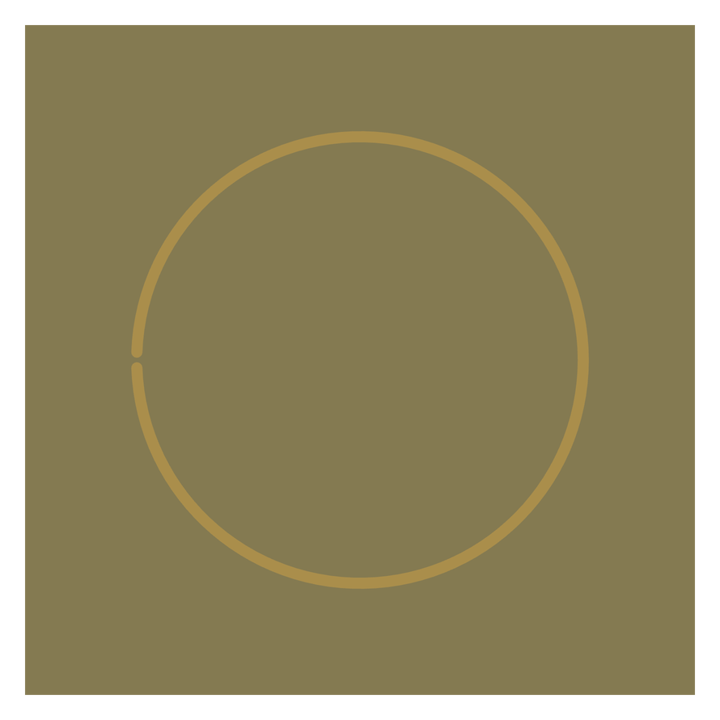

# 56. FastHenry Test Boards

The boards the FastHenry bridge is proved on: two proof boards whose answers are known without any solver, and one
inductive encoder board from the Sinusoidal Coil Generator. E01 and E02 are rendered by KESE's static renderer from
the boards' own exports; the coil board is drawn by the generator's own picture tool, the stator beside the rotor.
Every board has run and links to its results. Every board is a folder under `Examples/` on the
`FastHenry_Integration` branch, with its KiCad files, its `simulation.py` and its `README.md`.

## 56.1 E01 Circular Loop

| Item | Value |
|---|---|
| Board | 30 mm × 30 mm, two copper layers, 1.6 mm, no stack-up; B.Cu empty |
| Copper | one trace on F.Cu, net `LOOP`: a circle of 10 mm radius to its centre line, 0.5 mm wide, 35 µm thick, opened at +x by a 0.2 mm gap between its two round ends |
| In the model | two KiCad arcs, cut into 126 chords of at most 5° and 0.5 mm; the port between the nodes at the trace's ends, the centres of its round ends, 0.7 mm apart across the gap |
| What FastHenry checks | L and R at 10 kHz (uniform current) and 3.5 MHz (the coil board's frequency), with a filament ladder from 1 × 1 to 15 × 3 across and through the trace |
| References | the partial inductance of the open arc (356°) by Neumann's double integral with the rectangle's geometric mean distance g = 0.2235 (w + t), 55.590 nH; the DC resistance of an annular sector, 61.201 mΩ |
| Made by | `make_board.py`, with `Examples/kicad_writer.py` |
| Status | **run**: [FastHenry Test Board Results](FastHenry-Test-Board-Results.md#571-e01-circular-loop) |

## 56.2 E02 Coaxial Loops

| Top | Bottom |
|:---:|:---:|
|  |  |

| Item | Value |
|---|---|
| Board | 30 mm × 30 mm, two copper layers, 1.6 mm, no stack-up |
| Copper | E01's loop on F.Cu, net `TX`, and the same loop on B.Cu, net `RX`, directly under it, each opened at +x by a 0.2 mm gap |
| Loop to loop | 1.565 mm between the two coppers' middles (1.6 mm less one copper thickness, from KESE's stack-up) |
| What FastHenry checks | M from the TX's 1 A to the open RX, M from the RX back to the TX (reciprocity), and the TX's L and R beside the open RX, with a filament ladder from 1 × 1 to 9 × 3 |
| References | the mutual inductance of the two open arcs by Neumann's double integral, averaged over 21 × 21 filaments across both traces' widths, 23.886 nH; for scale, the closed rings by the same integral (Maxwell's formula) give 24.400 nH |
| Status | **run**: [FastHenry Test Board Results](FastHenry-Test-Board-Results.md#572-e02-coaxial-loops) |

## 56.3 S0d2_1x_OD23_2L_tiny_TX3top_Cut

An angle-encoder coil set from the [Sinusoidal Coil Generator](https://github.com/RolandThsive/Sinusoidal-Inductive-Encoders-Coil-Generator)
(`Coil_2_11.7_2_1_3_Single_SteppedDiagonal`), in `Examples/Inductive Coils/S0d2_1x_OD23_2L_tiny_TX3top_Cut/`
(non-commercial licence, see that folder's `LICENSE.md`). A **stator** carries a TX coil and two RX coils, SIN and
COS; a **rotor** with copper sectors sits over it. The TX runs at 3.5 MHz, the rotor's eddy currents change how much
of the TX's field reaches each RX coil, and the two RX voltages follow the sine and cosine of the rotor's angle.

| Item | Value |
|---|---|
| Stator | bore and outer radius 2 and 11.7 mm (23.4 mm across), 2 copper layers, board 0.8 mm, copper 35 µm |
| TX | three turns, all on F.Cu, at r = 7.2, 7.8 and 8.4 mm; a short tail runs under the turns on B.Cu to the terminal, where the two ends sit stacked at KiCad (111, 100) |
| SIN and COS | in the band r = 3.2 to 6.1 mm, each making **two electrical periods per turn**, on F.Cu and B.Cu joined by vias; the two are a quarter of the electrical period (45°) apart about the axis |
| Rotor | two quarter-ring copper sectors, r = 2.52 to 9.0 mm, so the curves repeat every 180° and an angle reading covers half a turn |
| Placement | the rotor as drawn, not mirrored, copper side down, its copper face 1 mm over the stator's top copper by default; it turns about KiCad's (100, 100) |
| Frequency | 3.5 MHz, where the skin depth (35 µm) equals the copper's thickness |
| What FastHenry checks | the TX's L and R with the rotor away and over the stator; M from the TX to SIN and COS at 16 angles over the whole turn, at air gaps of 0.1, 0.5, 1, 1.5 and 2 mm; SIN and COS's match; the angle error; reciprocity on every solve |
| References | the generator's estimates: the TX at 292 nH with the rotor away and 226 nH with it (an upper estimate of the drop), 0.38 Ω DC |
| Status | **run**, 81 solves: [FastHenry Test Board Results](FastHenry-Test-Board-Results.md#573-s0d2_1x_od23_2l_tiny_tx3top_cut) |

**SIN and COS are opened by a 0.2 mm cut across a top trace**, because that is how the real board is opened and
routed to the IC. The cut is made in the model; the board files are as the generator wrote them, and the receivers'
layer-change vias all stay in.

| Coil | Net | Opened at (KiCad mm) | How |
|---|---|---|---|
| TX | `TX` | (111, 100), F.Cu and B.Cu | between its two stacked ends, where 1 A is driven |
| SIN | `2` | cut at (96.591, 100.496), F.Cu | a 0.2 mm gap across the top trace; the via at (97.044, 101.225) stays |
| COS | `1` | cut at (97.239, 97.940), F.Cu | a 0.2 mm gap across the top trace; the via at (97.044, 98.775) stays |

Each cut is the spot on the receiver's top trace nearest its layer-change via where a 0.2 mm cut has at least 0.45 mm
of free board round it and sits at least 0.75 mm from any via centre. The generator itself found no spot with room
for two lead vias on either receiver, and warned so; it also warned that the TX tank's parallel resistance may be as
low as 32 Ω where the IPS2550 needs 250 Ω, which does not matter to the simulation.

KESE exports both boards with solder mask on both faces (20 µm); FR-4 and mask are insulators with μr 1, which to
these fields are air, so only the copper is modelled.

The branch solves five more coil boards of the same family; they are listed in its
[`Examples/Inductive Coils/README.md`](https://github.com/RolandThsive/KiCad-EM-Stackup-Exporter-KESE/blob/FastHenry_Integration/Examples/Inductive%20Coils/README.md).

| Previous | Next |
|:---|---:|
| [FastHenry Simulating Your Own Board](FastHenry-Simulating-Your-Own-Board.md) | [FastHenry Test Board Results](FastHenry-Test-Board-Results.md) |
