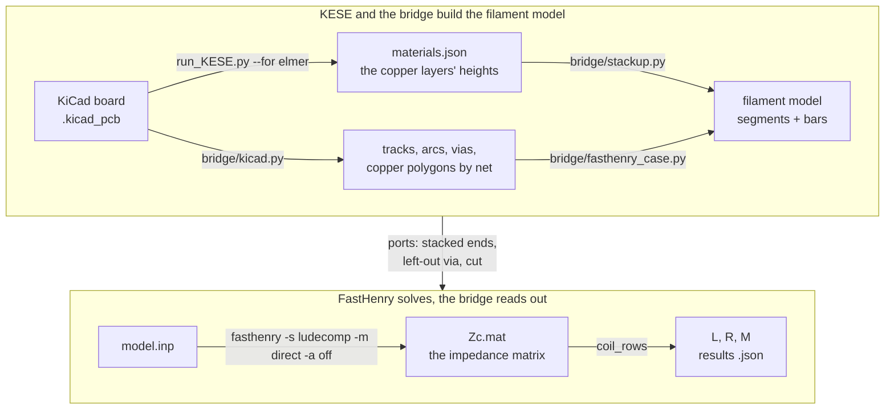

> [!CAUTION]
> The bridge lives on the [`FastHenry_Integration`](https://github.com/RolandThsive/KiCad-EM-Stackup-Exporter-KESE/tree/FastHenry_Integration) branch.

# 24.3 FastHenry Walkthrough

[FastHenry](https://github.com/ediloren/FastHenry2) is the magneto-quasi-static inductance and resistance extractor
written at M.I.T. by Mattan Kamon, Lou Silveira and others (1994 to 1996), kept up by FastFieldSolvers as release
3.0.1. The **FastHenry bridge** turns a KiCad board into a FastHenry simulation: KESE exports the board's stack-up,
the bridge reads the copper itself from the `.kicad_pcb`, writes FastHenry's input, runs it and reads the impedance
matrix back. KESE itself stays what it is,
a geometry exporter, and is never changed by the bridge.

> [!NOTE]
> Every board on the FastHenry pages has run: the two proof boards E01 and E02, and the coil board
> `S0d2_1x_OD23_2L_tiny_TX3top_Cut` at five air gaps and 16 rotor angles (see
> [FastHenry Test Boards And Results](FastHenry-Test-Boards-And-Results.md)). Every solve fitted the 4-core, 15 GB test
> machine.

## 24.3.1 What FastHenry Is Used For Here

At the frequencies of inductive position sensors (3 to 5 MHz) a coil board is about 1/2000 of a wavelength across,
so the physics is **magneto-quasi-static**: currents and magnetic fields, eddy currents in nearby copper, and no wave
propagation. FastHenry solves exactly this, in a way of its own: it cuts the conductors into straight **filaments**,
each carrying a uniform current along its length, and couples every filament to every other through its partial
inductance. Only the copper is discretised; the air needs no mesh and has no boundary.

| Quantity | How the bridge gets it |
|---|---|
| Inductance L of a coil | Im(Z) / ω of the coil's port, from FastHenry's impedance matrix |
| AC resistance R of a coil, with skin and proximity effect | Re(Z) of the coil's port; the filaments across a track let the current crowd to its edges |
| Mutual inductance M between two coils | Im(Z[receiver][TX]) / ω: with 1 A into the TX and the receiver open, its voltage is its open-circuit EMF |
| Reciprocity, as a check on every solve | M from the receiver back to the TX, Im(Z[TX][receiver]) / ω, which an exact solve makes equal |
| The effect of a conducting target (a rotor) | the same quantities with the rotor's copper, a grid of bars, turned to each angle and raised by the air gap |
| SIN and COS against the rotor's angle, and the angle error | one solve per angle, a best sine fit per channel, and the angle read back by atan2 |

What FastHenry does **not** give here: capacitance, self-resonance, temperature or stress. Its solve has no
displacement current.

## 24.3.2 How It Fits Together



Each step is described in [24.3.8](#2438-export-the-stack-up-with-kese) to [24.3.14](#24314-sin-cos-and-the-angle-error) below.

## 24.3.3 The FastHenry Pages

| Page | What it covers |
|---|---|
| FastHenry Walkthrough (this page) | What FastHenry does here ([24.3.1](#2431-what-fasthenry-is-used-for-here)), installing it ([24.3.5](#2435-installing-on-linux-ubuntu-2404)), and every step from the board file to the numbers ([24.3.8](#2438-export-the-stack-up-with-kese)) |
| [FastHenry Simulating Your Own Board](FastHenry-Simulating-Your-Own-Board.md) | Every setting of an example's `simulation.py`, and how to start a new one |
| [FastHenry Test Boards And Results](FastHenry-Test-Boards-And-Results.md) | The three boards and what came out on each, against the references, with charts |
| [FastHenry Accuracy](FastHenry-Accuracy.md) | Where the errors come from and how big they are |
| [FastHenry Troubleshooting](FastHenry-Troubleshooting.md) | What went wrong while building the bridge, and the fixes |

How FastHenry compares with the other solvers of the project is on
[Solvers Comparison](Solvers-Comparison.md).

## 24.3.4 Where The Code Is

| Folder on `FastHenry_Integration` | What it holds |
|---|---|
| `bridge/` | The bridge, in Python, general to any board: `kicad.py`, `stackup.py`, `fasthenry_case.py`, and `setup_machine.sh` |
| `Solver_FastHenry/` | FastHenry 3.0.1 built for 64-bit Linux (`install/bin/fasthenry`), the script that builds the same file from source, and its licence |
| `Examples/E01_circular_loop/`, `Examples/E02_coaxial_loops/` | The proof boards, each with its board, `make_board.py`, `simulation.py`, `README.md`, `results.md` and `results.json` |
| `Examples/Inductive Coils/S0d2_1x_OD23_2L_tiny_TX3top_Cut/` | The coil board of the FastHenry pages: `Boards/` from the coil generator, `FastHenry Simulation/` with its scripts and `test_spec.json`, and `Results/` at every air gap |
| `Examples/Inductive Coils/new_coil.py` | Sets up any single coil set from the generator for FastHenry in one command |
| `Examples/kicad_writer.py`, `Examples/references.py` | Shared by the proof boards: a small KiCad board writer, and the textbook values they are checked against |
| `3D_Geometry/` | Empty on purpose: KESE's `Generator/` is copied here from `main`, or `KESE_PATH` points at it |

The branch solves five more coil boards of the same family the same way; they are listed in the branch's
[`Examples/Inductive Coils/README.md`](https://github.com/RolandThsive/KiCad-EM-Stackup-Exporter-KESE/blob/FastHenry_Integration/Examples/Inductive%20Coils/README.md).

## 24.3.5 Installing On Linux (Ubuntu 24.04)

The bridge needs three things: FastHenry, a Python environment with the bridge's packages, and, only to export a
board whose `3D_Geometry/` is not committed, a copy of KESE. Unlike the other solvers' branches, this one carries its
solver: `Solver_FastHenry/install/bin/fasthenry` is the build every simulation on the branch ran with, one small
program (460 kB) that needs nothing but the C library.


This is the route the test boards ran on. One script sets up a fresh machine:

```bash
bash bridge/setup_machine.sh
```

It makes `.venv` at the branch's root with the packages of `requirements.txt`, at the versions the examples ran
with, and builds FastHenry from source only if the committed program does not run. It needs Python 3.12 or newer
(numpy 2.5 and scipy 1.18 need it) and is safe to run again.

**FastHenry**, committed and ready:

```bash
Solver_FastHenry/install/bin/fasthenry -h | head -3        # FastHenry Version 3.0.1 (28May12)
```

The bridge finds the program by itself: `$FASTHENRY` if it is set, else `Solver_FastHenry/install/bin/fasthenry`,
else `fasthenry` on the PATH (`fasthenry_exe` in `bridge/fasthenry_case.py`).

| Item | Value |
|---|---|
| Program | FastHenry 3.0.1, from FastFieldSolvers' Linux/Unix release: [github.com/ediloren/FastHenry2](https://github.com/ediloren/FastHenry2), branch `master`, commit `363e43e` |
| Build | `Solver_FastHenry/build_fasthenry.sh`: its `x64` configuration, GCC 13.3 with `-O3 -DFOUR -m64 -fcommon`, on Ubuntu 24.04; the script makes the very same file again, byte for byte |
| Runs on | 64-bit Linux with glibc 2.34 or newer (Ubuntu 22.04 and up); it needs only `libc` and `libm` |
| Licence | M.I.T.'s, as M.I.T. re-released FastHenry in 2003: use, copy, modify, sell and distribute for any purpose, without royalty, keeping the notice (`Solver_FastHenry/LICENSE.md`) |

**To build FastHenry again from source** (git, make and a C compiler; about ten seconds), from the branch's root:

```bash
bash Solver_FastHenry/build_fasthenry.sh
```

It clones FastFieldSolvers' repository at commit `363e43e` into a temporary folder, configures it for x64, compiles
it and puts the program in `install/bin`. `SRC=...` keeps the source in a folder of your choosing.

> [!IMPORTANT]
> Keep `-fcommon` in the flags. GCC 10 and newer otherwise refuse the program's shared global variables. `-O3` in
> place of the release's `-O` makes it a few per cent faster and changes no result: on a full coil model it gave the
> same `Zc.mat`, digit for digit.

**Python**, if you set it up by hand instead of with the script:

```bash
python3 -m venv .venv
.venv/bin/pip install -r requirements.txt       # numpy, scipy, shapely, matplotlib, pillow
```

numpy and shapely are the bridge's; matplotlib and pillow draw the coil examples' charts and pictures.

**KESE**, only to export a board whose `3D_Geometry/` is not committed (the three boards of the FastHenry pages have
theirs committed). Copy it from `main` so that `run_KESE.py` sits directly in `3D_Geometry/`:

```bash
git -C <your KESE clone> archive main Generator | tar -x --strip-components=1 -C 3D_Geometry
.venv/bin/python 3D_Geometry/run_KESE.py --help
```

or leave `3D_Geometry/` empty and point the bridge at any KESE with `export KESE_PATH=<path to Generator>`. KESE
runs inside the bridge's Python, so its own packages (`requirements.txt` in `Generator/`) must be in the same
environment.

**Check the whole chain** with the first proof board, at nine filaments across its trace:

```bash
cd Examples/E01_circular_loop
../../.venv/bin/python simulation.py --nwinc 9
```

Each solve takes under a second. It should print L about 55.538 nH and R about 61.208 mOhm at 10 kHz, the 9 × 1
values of [FastHenry Test Board Results](FastHenry-Test-Boards-And-Results.md#2631-e01-circular-loop). A rerun replaces
that rung in the committed `results.json`, with the same numbers.

## 24.3.6 Installing On Windows

The committed program is a Linux build. Two routes:

| Route | Steps | Notes |
|---|---|---|
| **WSL 2 (recommended)** | Install Ubuntu 24.04 from the Microsoft Store, then follow [24.3.5](#2435-installing-on-linux-ubuntu-2404) inside it | The bridge, KESE and the committed FastHenry all run as on Linux. Keep the repository inside the WSL file system (not under `/mnt/c`) |
| **Native** | Use FastFieldSolvers' FastHenry2 for Windows, set `FASTHENRY` to its program, and set up Python with `py -m venv .venv` and `.venv\Scripts\pip install -r requirements.txt` | Not run on the test boards. The bridge passes `-s ludecomp -m direct -a off` and reads `Zc.mat`; check that the Windows build takes those options and writes that file |

## 24.3.7 What The Test Machine Had

| Item | Version |
|---|---|
| OS | Ubuntu 24.04, 4 cores, 15 GB of memory |
| FastHenry | 3.0.1 (the committed build) |
| Python | 3.13 (3.13.18) |
| numpy, scipy, shapely | 2.5.5, 1.18.1, 2.2.0 |
| matplotlib, pillow | 3.11.2, 13.0.0 |
| KESE | 3.4.0, for the stack-up exports committed with each board |

Each example writes the versions it ran with into its results file, so every number on
[FastHenry Test Boards And Results](FastHenry-Test-Boards-And-Results.md) names the software that made it.

## 24.3.8 Export The Stack-Up With KESE

What happens between `python simulation.py` and the numbers in the results file, step by step. Every step is one
function of the bridge on the `FastHenry_Integration` branch; the file is named with each. The bridge is general:
nothing in it names a board, a coil or an example. Each example adds only what belongs to its own board: which nets
are coils, where each coil is opened, what to sweep, and what to compare the answer with.

`bridge/stackup.py` runs KESE as a program, never as a library:

```bash
python run_KESE.py board.kicad_pcb --for elmer --format step stl --out <folder> \
    --set Stackup.solder_mask=True --set SolderMask.MASK_OVER_COPPER_MM=0.020 ...
```

The `elmer` preset is KESE's solver preset: one STL per solid and a `materials.json`
([Choosing An Export](Choosing-An-Export.md)). The solder mask is set to 20 µm over copper and laminate, with vias
tented, so the export is the same for any solver; to FastHenry it is air. From `materials.json` the bridge takes the
height and thickness of every copper layer: each dielectric says which two layers it lies between, and each copper
part gives its layer's thickness (`copper_layers`). The export is kept beside the board (the coil board keeps it in
`3D_Geometry/`) with a `source.json` holding the board file's hash, so an unchanged board is not exported twice
(`kese_geometry`).

What FastHenry takes from KESE is the stack-up only. The model's coordinates: x and y as KiCad's with y up
(y_model = −y_KiCad), and z shifted so that the top face of the top copper is z = 0.

## 24.3.9 Read The Copper From The Board File

`bridge/kicad.py` (`read`) reads the `.kicad_pcb` itself (KiCad 6 to 9): every track and arc, every via, and every
copper polygon (`gr_poly` on a copper layer, and zones' filled polygons), with its net and layer. A KiCad track is a
centre line with a width, which is exactly a FastHenry segment, so the board file is where the conductors come from.

## 24.3.10 Build The Filament Model

`bridge/fasthenry_case.py` (`add_board`, `add_polygon`) turns the copper into FastHenry's nodes and segments:

| Copper | In the model |
|---|---|
| A track | a segment between nodes at its ends, at the middle of its layer's copper, as wide as the track and as thick as the copper, split into `nwinc` filaments across its width (the edge ones `rw` times narrower than the next in, so the current can crowd to the edges) and `nhinc` through its thickness |
| An arc | chords of at most 5° and 0.5 mm, each a segment as above |
| Tracks of one net that meet | one shared node |
| Two consecutive pieces of a trace straight to within 0.01° | one segment (`merge_collinear`), for the reason in [FastHenry Troubleshooting](FastHenry-Troubleshooting.md#2831-nan-in-the-impedance-matrix) |
| A via | a vertical bar between its nodes on the layers it joins, a square with the copper section of a barrel plated 25 µm; its pads are left out |
| A copper polygon (the rotor) | a grid of bars at its layer's height, each as wide as the cell it stands for: a polar grid graded towards all four edges where the polygon is a sector of a ring, so its arcs are not stair steps; a square grid clipped to it otherwise |

A board can be turned copper side down, raised by an air gap and turned about an axis: that is how a rotor is placed
over a stator. Only the stator's filaments stay where they are, and only the rotor's grid turns from angle to angle,
so there is no meshing noise between angles.

![How S0d2_1x_OD23_2L_tiny_TX3top_Cut is set up in FastHenry. Left, seen from above: the TX's three turns on F.Cu in dark grey round SIN in blue and COS in orange (F.Cu strong, B.Cu pale), and the rotor at 0° in grey, its two quarter-ring sectors drawn as a grid of bars finer at their edges; the SIN and COS ports are ringed where a 0.2 mm cut crosses each top trace, the TX port where its two ends lie stacked at the right. Top right, a section through the stack true to scale: the stator's tracks at z = 0 and −0.76 mm, the rotor's bars 1 mm above, and a TX track magnified, 3 filaments across with the edge ones twice as narrow, 1 through its 35 µm. Bottom right, in 3D: SIN's port between the two cut faces of its top trace, and the TX's port between its two stacked ends on F.Cu and B.Cu](https://raw.githubusercontent.com/RolandThsive/KiCad-EM-Stackup-Exporter-KESE/main/docs/images/FastHenry-Workflow/S0d2_1x_OD23_2L_tiny_TX3top_Cut/S0d2_1x_OD23_2L_tiny_TX3top_Cut_fasthenry_setup.webp)

The coil board as FastHenry solves it, drawn by its `rig_picture.py` from the model's own segments. FR-4 and solder
mask are air to this solve, so the section shows nothing round the copper: nothing bounds the air. The counts in the
picture's title (9,306 filaments, 1,602 track segments) are from before straight pieces of a trace were merged; the
solves have 9,264 filaments and 1,588 stator segments.

## 24.3.11 Open Each Coil At Its Port

A FastHenry port (`.external`) is a pair of nodes. The bridge opens each coil where the real board gets its leads;
the example says where, since the bridge does not guess:

| Coil opened at | Port | Function |
|---|---|---|
| Two trace ends stacked on two layers (the TX) | between those two nodes | `nearest_node`, `via_nodes` |
| A via left out | between where the coil's tracks reach the via on its two layers; the via's bar is left out | `via_nodes`, `add_board(open_vias=...)` |
| A cut across a trace (SIN and COS on the coil board) | the copper inside the cut is taken out of the trace, and the port is between the two cut faces | `cut_nodes`, `add_board(cuts=...)` |
| A gap between two trace ends on one layer (E01, E02) | between the nodes at the two trace ends | `nearest_node` |

FastHenry gives back the open-circuit impedance matrix between the ports: Z[i][j] is the voltage at port i over the
current into port j, with every other port open. So with 1 A into the TX, a receiver's voltage is its open-circuit
EMF, and its mutual inductance is M = Im(Z[receiver][TX]) / 2πf.

On `S0d2_1x_OD23_2L_tiny_TX3top_Cut`, **SIN and COS are opened by a 0.2 mm cut across a top trace**, because that is
how the real board is opened and routed to the IC. The cut is made in the model; the board files are as the
generator wrote them, and the receivers' layer-change vias all stay in.


| Coil | Net | Opened at (KiCad mm) | How |
|---|---|---|---|
| TX | `TX` | (111, 100), F.Cu and B.Cu | between its two stacked ends, where 1 A is driven |
| SIN | `2` | cut at (96.591, 100.496), F.Cu | a 0.2 mm gap across the top trace; the via at (97.044, 101.225) stays |
| COS | `1` | cut at (97.239, 97.940), F.Cu | a 0.2 mm gap across the top trace; the via at (97.044, 98.775) stays |

Each cut is the spot on the receiver's top trace nearest its layer-change via where a 0.2 mm cut has at least 0.45 mm
of free board round it and sits at least 0.75 mm from any via centre. The generator itself found no spot with room
for two lead vias on either receiver.

## 24.3.12 Write FastHenry's Input

`Model.text` writes one `model.inp` per solve, kept under the example's `case/` (which git ignores):

| Item | Value |
|---|---|
| Units | millimetres |
| Copper | σ = 5.8e7 S/m |
| Coordinates | x and y measured from the model's middle (rounded to the whole millimetre), to 12 significant digits, for the reason in [FastHenry Troubleshooting](FastHenry-Troubleshooting.md#2831-nan-in-the-impedance-matrix) |
| Content | the nodes, the segments with their width, height and filaments, the `.external` ports, and one frequency |

## 24.3.13 Solve And Read Back

`run` starts FastHenry in the case's folder with the dense direct solve:

```bash
fasthenry model.inp -s ludecomp -m direct -a off
```

| Option | What it does |
|---|---|
| `-s ludecomp` | the LU factorisation of the whole system |
| `-m direct` | builds the dense matrix of every filament's coupling to every other |
| `-a off` | the multipole refinement off: it splits filaments that come close, which the direct solve does not need |

This gives the exact answer of the filament model, with no iteration to converge, so the impedance matrix comes out
symmetric to the last digit. `run` measures FastHenry's peak memory and time and reads `Zc.mat`; `coil_rows` gives
per coil:

| Result | From |
|---|---|
| Z, R = Re Z, L = Im Z / ω of the driven coil | its diagonal entry |
| Zm, M = Im(Zm) / ω of each other coil | Z[coil][driven] |
| The reverse M | Z[driven][coil]: the reciprocity check |
| Each other coil's own L | its diagonal entry |

The examples write all of it, with the settings, the versions, the model's size and the time and memory of every
solve, to their results files; on the coil board each air gap gets its own folder in `Results/`, with
`results_gap<gap>mm.json`, a `.csv` and the chart, and `SINCOS_Results.md` gathers every gap on one page.

## 24.3.14 SIN, COS And The Angle Error

On the coil board, `simulation.py` solves the rotor away once, then each angle of `test_spec.json`.
`angle_error.py` then gives each channel its best sine over the rotor's period, M = offset + amplitude ×
sin(θ + phase), takes each channel's offset out and divides it by its amplitude, so both swing between −1 and +1, as
a decoder chip's offset and gain calibration does. The angle is read back as atan2(SIN, COS). The error at each angle
is that reading less the true angle, less the average of all of them, since a fixed offset only moves where zero is;
the rms and the worst of them are the angle error, in electrical degrees.

| Previous | Next |
|:---|---:|
| [PyPEEC Walkthrough](PyPEEC-Walkthrough.md) | [Palace Walkthrough](Palace-Walkthrough.md) |
