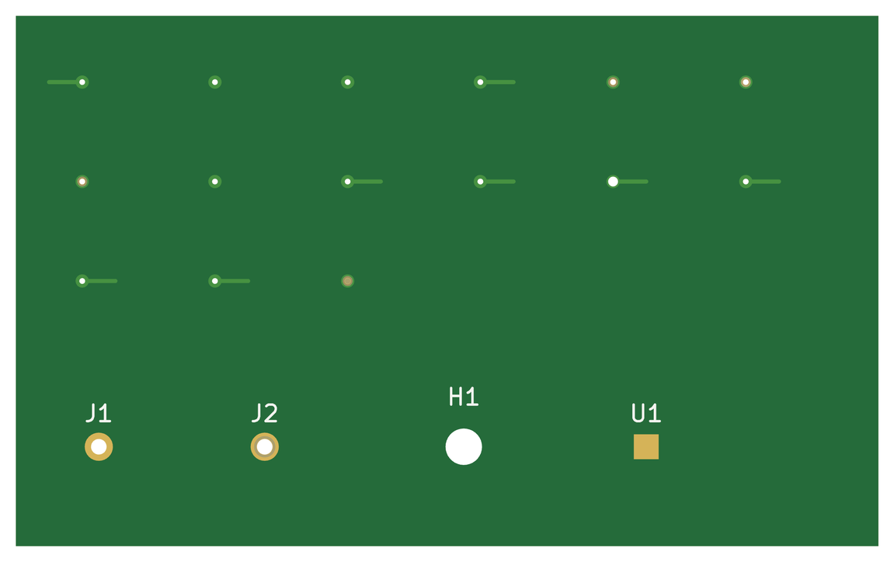
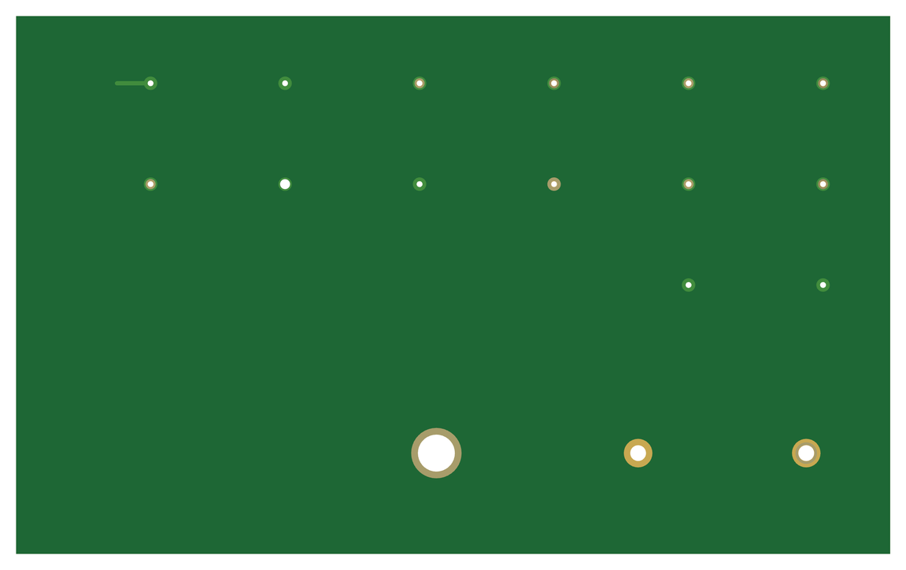
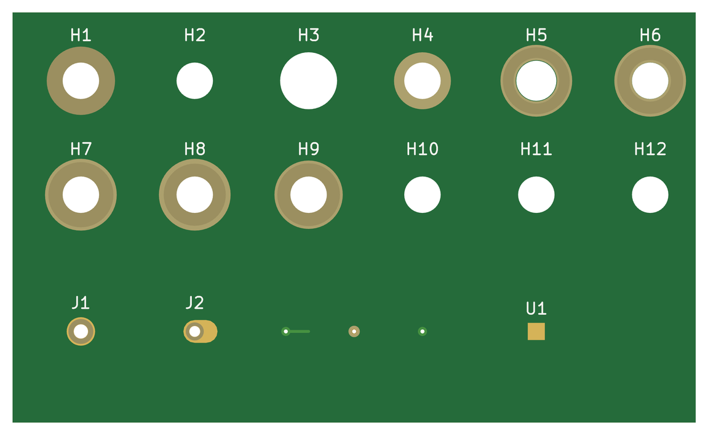
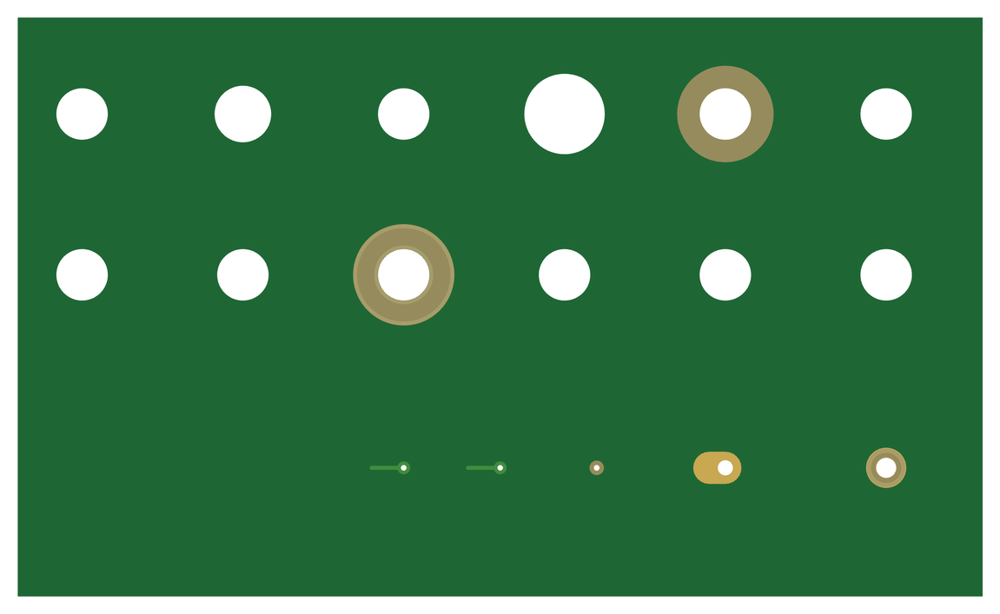
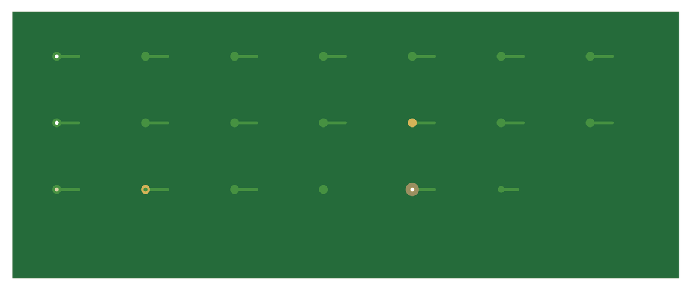
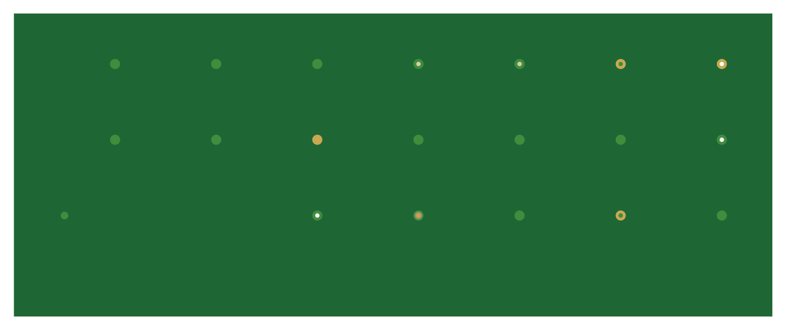

# 23. Feature Test Collection

Every board of `featureTest/`, section by section, with its top and bottom and where the time of a
run goes:

- [The folder's README](https://github.com/RolandThsive/KiCad-EM-Stackup-Exporter-KESE/blob/main/featureTest/README.md) says what each board holds.
- Each board was exported three times in each mode, with the Verifier, the solder mask and the
  silkscreen on, as the regression suite (`Generator/tests/test_boards.py`) runs them.
- Each bar is the median of the three runs for that stage, from the `timing` block of
  [`report.txt`](Project-Output-Organization.md#2022-reporttxt). All 240 runs passed the Verifier.
- Beside each board's facts, a second table gives the size of each model file the runs write and the
  most memory a run used at once: the proportional set size (PSS) of KESE's process and its workers,
  summed and sampled every 10 ms, the median of three more runs. MB is a million bytes.
- The commands, for board 11:

```text
python run_KESE.py ../featureTest/11_zones.kicad_pcb --mode simulation --format glb step --verify \
    --set SolderMask.SOLDER_MASK_ENABLED=True --set Silkscreen.SILKSCREEN_ENABLED=True
python run_KESE.py ../featureTest/11_zones.kicad_pcb --mode visual --format glb --verify \
    --set SolderMask.SOLDER_MASK_ENABLED=True --set Silkscreen.SILKSCREEN_ENABLED=True
```

**The runs used the default parameters otherwise, on one Linux machine with 4 cores (an Intel Xeon
at 2.1 GHz) and 16 GB of RAM, so `Parallel.WORKERS = 0` gave four workers ([Work Done In
Parallel](Working-Principle.md#74-work-done-in-parallel)). On another machine the seconds differ.**

## 23.1 Every Board At A Glance


All the feature boards but 16b and 25 take 0.2 to 3.5 s a run. The fixed part of a run, reading the
file and Python starting and exiting, takes 0.18 to 0.34 s of it; a board without text never reads the
stroke font, so boards 05, 08b, 19b and 26 read and collect in under 9 ms. Board 16b, a plated border
and 91 vias on four layers, takes 6.7 to 7.5 s; board 25, whose countersinks are built as steps,
4.1 to 5.8 s; and the example boards 9 to 20 s.

## 23.2 Holes And Vias

### 23.2.1 01 Slotted Holes

<p align="center">


</p>


| Mode | 1–2 read | 3 resolve | 4 geometry | 5 materials | 6 assemble | 7 write | 8 verify | start-up and exit | Total |
|---|---:|---:|---:|---:|---:|---:|---:|---:|---:|
| Simulation, GLB + STEP | 69 ms | 56 ms | 0.2 | 0.1 ms | 0.3 | 0.4 | 39 ms | 0.2 | 1.2 |
| Visual, GLB | 68 ms | 54 ms | 0.2 | 0.1 ms | 0.6 | 5 ms | 37 ms | 0.2 | 1.1 |

<table>
<tr>
<td valign="top">

| Board | `featureTest/`<br>`01_holes_slotted.kicad_pcb` |
|---|---|
| Outline | 40 × 26 mm |
| Thickness | 1.6 mm |
| Copper layers | 2 |
| Vias | none |
| Board edge | Plain |
| Mask, silkscreen,<br>finish | Not set (drawn green and white),<br>ENIG |

</td>
<td valign="top">

<table>
<tr><th>File type</th><th>File size</th><th>Peak memory used</th></tr>
<tr><th colspan="3" align="left">Simulation</th></tr>
<tr><td>GLB</td><td align="right">1.1 MB</td><td rowspan="2" align="right">69 MB</td></tr>
<tr><td>STEP</td><td align="right">5.8 MB</td></tr>
<tr><th colspan="3" align="left">Visual</th></tr>
<tr><td>GLB</td><td align="right">661 kB</td><td align="right">93 MB</td></tr>
</table>

</td>
</tr>
</table>

### 23.2.2 02 Round Holes

<p align="center">


</p>


| Mode | 1–2 read | 3 resolve | 4 geometry | 5 materials | 6 assemble | 7 write | 8 verify | start-up and exit | Total |
|---|---:|---:|---:|---:|---:|---:|---:|---:|---:|
| Simulation, GLB + STEP | 71 ms | 40 ms | 0.2 | 0.1 ms | 0.4 | 0.3 | 39 ms | 0.2 | 1.2 |
| Visual, GLB | 68 ms | 43 ms | 0.2 | 0.1 ms | 0.5 | 5 ms | 39 ms | 0.2 | 1.1 |

<table>
<tr>
<td valign="top">

| Board | `featureTest/`<br>`02_holes_round.kicad_pcb` |
|---|---|
| Outline | 34 × 20 mm |
| Thickness | 1.6 mm |
| Copper layers | 2 |
| Vias | none |
| Board edge | Plain |
| Mask, silkscreen,<br>finish | Not set (drawn green and white),<br>ENIG |

</td>
<td valign="top">

<table>
<tr><th>File type</th><th>File size</th><th>Peak memory used</th></tr>
<tr><th colspan="3" align="left">Simulation</th></tr>
<tr><td>GLB</td><td align="right">1.3 MB</td><td rowspan="2" align="right">70 MB</td></tr>
<tr><td>STEP</td><td align="right">4.1 MB</td></tr>
<tr><th colspan="3" align="left">Visual</th></tr>
<tr><td>GLB</td><td align="right">741 kB</td><td align="right">97 MB</td></tr>
</table>

</td>
</tr>
</table>

### 23.2.3 03 Through Vias

<p align="center">


</p>


| Mode | 1–2 read | 3 resolve | 4 geometry | 5 materials | 6 assemble | 7 write | 8 verify | start-up and exit | Total |
|---|---:|---:|---:|---:|---:|---:|---:|---:|---:|
| Simulation, GLB + STEP | 68 ms | 51 ms | 0.2 | 0.1 ms | 0.6 | 0.3 | 52 ms | 0.2 | 1.4 |
| Visual, GLB | 68 ms | 49 ms | 0.2 | 0.1 ms | 0.7 | 6 ms | 65 ms | 0.2 | 1.3 |

<table>
<tr>
<td valign="top">

| Board | `featureTest/`<br>`03_vias_through.kicad_pcb` |
|---|---|
| Outline | 32 × 20 mm |
| Thickness | 1.6 mm |
| Copper layers | 2 |
| Vias | 12 through |
| Board edge | Plain |
| Mask, silkscreen,<br>finish | Not set (drawn green and white),<br>ENIG |

</td>
<td valign="top">

<table>
<tr><th>File type</th><th>File size</th><th>Peak memory used</th></tr>
<tr><th colspan="3" align="left">Simulation</th></tr>
<tr><td>GLB</td><td align="right">1.7 MB</td><td rowspan="2" align="right">75 MB</td></tr>
<tr><td>STEP</td><td align="right">5.7 MB</td></tr>
<tr><th colspan="3" align="left">Visual</th></tr>
<tr><td>GLB</td><td align="right">834 kB</td><td align="right">113 MB</td></tr>
</table>

</td>
</tr>
</table>

### 23.2.4 03b KiCad 10 Via Options

<p align="center">


</p>


| Mode | 1–2 read | 3 resolve | 4 geometry | 5 materials | 6 assemble | 7 write | 8 verify | start-up and exit | Total |
|---|---:|---:|---:|---:|---:|---:|---:|---:|---:|
| Simulation, GLB + STEP | 67 ms | 0.2 | 0.3 | 0.1 ms | 0.6 | 0.8 | 0.1 | 0.2 | 2.2 |
| Visual, GLB | 74 ms | 0.1 | 0.3 | 0.1 ms | 2.7 | 14 ms | 88 ms | 0.2 | 3.5 |

<table>
<tr>
<td valign="top">

| Board | `featureTest/`<br>`03b_vias_k10.kicad_pcb` |
|---|---|
| Outline | 40 × 30 mm |
| Thickness | 1.6 mm |
| Copper layers | 4 |
| Vias | 18: 1 micro, 2 blind and buried,<br>15 through |
| Board edge | Plain |
| Mask, silkscreen,<br>finish | Not set (drawn green and white),<br>ENIG |

</td>
<td valign="top">

<table>
<tr><th>File type</th><th>File size</th><th>Peak memory used</th></tr>
<tr><th colspan="3" align="left">Simulation</th></tr>
<tr><td>GLB</td><td align="right">2.6 MB</td><td rowspan="2" align="right">179 MB</td></tr>
<tr><td>STEP</td><td align="right">7.1 MB</td></tr>
<tr><th colspan="3" align="left">Visual</th></tr>
<tr><td>GLB</td><td align="right">1.6 MB</td><td align="right">152 MB</td></tr>
</table>

</td>
</tr>
</table>

### 23.2.5 04 Blind And Buried Vias

<p align="center">


</p>


| Mode | 1–2 read | 3 resolve | 4 geometry | 5 materials | 6 assemble | 7 write | 8 verify | start-up and exit | Total |
|---|---:|---:|---:|---:|---:|---:|---:|---:|---:|
| Simulation, GLB + STEP | 66 ms | 54 ms | 65 ms | 0.1 ms | 0.2 | 0.1 | 27 ms | 0.2 | 0.7 |
| Visual, GLB | 66 ms | 53 ms | 74 ms | 0.1 ms | 0.4 | 5 ms | 37 ms | 0.2 | 0.9 |

<table>
<tr>
<td valign="top">

| Board | `featureTest/`<br>`04_vias_blind_buried.kicad_pcb` |
|---|---|
| Outline | 32 × 20 mm |
| Thickness | 1.6 mm |
| Copper layers | 6 |
| Vias | 6: 3 blind and buried, 3 through |
| Board edge | Plain |
| Mask, silkscreen,<br>finish | Not set (drawn green and white),<br>ENIG |

</td>
<td valign="top">

<table>
<tr><th>File type</th><th>File size</th><th>Peak memory used</th></tr>
<tr><th colspan="3" align="left">Simulation</th></tr>
<tr><td>GLB</td><td align="right">679 kB</td><td rowspan="2" align="right">65 MB</td></tr>
<tr><td>STEP</td><td align="right">1.5 MB</td></tr>
<tr><th colspan="3" align="left">Visual</th></tr>
<tr><td>GLB</td><td align="right">327 kB</td><td align="right">89 MB</td></tr>
</table>

</td>
</tr>
</table>

### 23.2.6 05 Microvias

<p align="center">


</p>


| Mode | 1–2 read | 3 resolve | 4 geometry | 5 materials | 6 assemble | 7 write | 8 verify | start-up and exit | Total |
|---|---:|---:|---:|---:|---:|---:|---:|---:|---:|
| Simulation, GLB + STEP | 3 ms | 64 ms | 69 ms | 0.1 ms | 0.2 | 0.1 | 22 ms | 0.2 | 0.6 |
| Visual, GLB | 2 ms | 61 ms | 57 ms | 0.1 ms | 0.3 | 3 ms | 54 ms | 0.2 | 0.7 |

<table>
<tr>
<td valign="top">

| Board | `featureTest/`<br>`05_vias_micro.kicad_pcb` |
|---|---|
| Outline | 30 × 16 mm |
| Thickness | 1.6 mm |
| Copper layers | 8 |
| Vias | 12: 10 micro, 2 blind and buried |
| Board edge | Plain |
| Mask, silkscreen,<br>finish | Mask colour not set (drawn green),<br>no silkscreen, ENIG |

</td>
<td valign="top">

<table>
<tr><th>File type</th><th>File size</th><th>Peak memory used</th></tr>
<tr><th colspan="3" align="left">Simulation</th></tr>
<tr><td>GLB</td><td align="right">584 kB</td><td rowspan="2" align="right">45 MB</td></tr>
<tr><td>STEP</td><td align="right">1.1 MB</td></tr>
<tr><th colspan="3" align="left">Visual</th></tr>
<tr><td>GLB</td><td align="right">206 kB</td><td align="right">80 MB</td></tr>
</table>

</td>
</tr>
</table>

### 23.2.7 24 Backdrills

<p align="center">


</p>


| Mode | 1–2 read | 3 resolve | 4 geometry | 5 materials | 6 assemble | 7 write | 8 verify | start-up and exit | Total |
|---|---:|---:|---:|---:|---:|---:|---:|---:|---:|
| Simulation, GLB + STEP | 73 ms | 0.2 | 0.3 | 0.2 ms | 0.6 | 0.8 | 0.1 | 0.2 | 2.3 |
| Visual, GLB | 82 ms | 0.2 | 0.3 | 0.2 ms | 1.6 | 15 ms | 88 ms | 0.2 | 2.5 |

<table>
<tr>
<td valign="top">

| Board | `featureTest/`<br>`24_backdrills.kicad_pcb` |
|---|---|
| Outline | 52 × 32 mm |
| Thickness | 1.6 mm |
| Copper layers | 6 |
| Vias | 15: 1 blind and buried, 14 through |
| Board edge | Plain |
| Mask, silkscreen,<br>finish | Not set (drawn green and white),<br>ENIG |

</td>
<td valign="top">

<table>
<tr><th>File type</th><th>File size</th><th>Peak memory used</th></tr>
<tr><th colspan="3" align="left">Simulation</th></tr>
<tr><td>GLB</td><td align="right">3.6 MB</td><td rowspan="2" align="right">185 MB</td></tr>
<tr><td>STEP</td><td align="right">10.0 MB</td></tr>
<tr><th colspan="3" align="left">Visual</th></tr>
<tr><td>GLB</td><td align="right">1.8 MB</td><td align="right">152 MB</td></tr>
</table>

</td>
</tr>
</table>

### 23.2.8 25 Counterbores And Countersinks

<p align="center">


</p>


| Mode | 1–2 read | 3 resolve | 4 geometry | 5 materials | 6 assemble | 7 write | 8 verify | start-up and exit | Total |
|---|---:|---:|---:|---:|---:|---:|---:|---:|---:|
| Simulation, GLB + STEP | 76 ms | 0.2 | 0.8 | 0.1 ms | 1.6 | 1.0 | 0.2 | 0.2 | 4.1 |
| Visual, GLB | 78 ms | 0.2 | 0.9 | 0.1 ms | 4.3 | 15 ms | 95 ms | 0.2 | 5.8 |

<table>
<tr>
<td valign="top">

| Board | `featureTest/`<br>`25_post_machining.kicad_pcb` |
|---|---|
| Outline | 60 × 36 mm |
| Thickness | 1.6 mm |
| Copper layers | 4 |
| Vias | 3 through |
| Board edge | Plain |
| Mask, silkscreen,<br>finish | Not set (drawn green and white),<br>ENIG |

</td>
<td valign="top">

<table>
<tr><th>File type</th><th>File size</th><th>Peak memory used</th></tr>
<tr><th colspan="3" align="left">Simulation</th></tr>
<tr><td>GLB</td><td align="right">2.7 MB</td><td rowspan="2" align="right">206 MB</td></tr>
<tr><td>STEP</td><td align="right">3.6 MB</td></tr>
<tr><th colspan="3" align="left">Visual</th></tr>
<tr><td>GLB</td><td align="right">2.2 MB</td><td align="right">172 MB</td></tr>
</table>

</td>
</tr>
</table>

### 23.2.9 26 Via Protection

<p align="center">


</p>


| Mode | 1–2 read | 3 resolve | 4 geometry | 5 materials | 6 assemble | 7 write | 8 verify | start-up and exit | Total |
|---|---:|---:|---:|---:|---:|---:|---:|---:|---:|
| Simulation, GLB + STEP | 5 ms | 0.1 | 0.2 | 0.1 ms | 0.6 | 1.0 | 73 ms | 0.2 | 2.1 |
| Visual, GLB | 5 ms | 0.1 | 0.2 | 0.2 ms | 1.3 | 8 ms | 97 ms | 0.2 | 2.0 |

<table>
<tr>
<td valign="top">

| Board | `featureTest/`<br>`26_via_protection.kicad_pcb` |
|---|---|
| Outline | 60 × 24 mm |
| Thickness | 1.6 mm |
| Copper layers | 4 |
| Vias | 22: 3 blind and buried, 19 through |
| Board edge | Plain |
| Mask, silkscreen,<br>finish | Mask colour not set (drawn green),<br>no silkscreen, ENIG |

</td>
<td valign="top">

<table>
<tr><th>File type</th><th>File size</th><th>Peak memory used</th></tr>
<tr><th colspan="3" align="left">Simulation</th></tr>
<tr><td>GLB</td><td align="right">2.2 MB</td><td rowspan="2" align="right">157 MB</td></tr>
<tr><td>STEP</td><td align="right">6.7 MB</td></tr>
<tr><th colspan="3" align="left">Visual</th></tr>
<tr><td>GLB</td><td align="right">1.1 MB</td><td align="right">130 MB</td></tr>
</table>

</td>
</tr>
</table>

## 23.3 Pads

### 23.3.1 06 Padstacks

<p align="center">


</p>


| Mode | 1–2 read | 3 resolve | 4 geometry | 5 materials | 6 assemble | 7 write | 8 verify | start-up and exit | Total |
|---|---:|---:|---:|---:|---:|---:|---:|---:|---:|
| Simulation, GLB + STEP | 69 ms | 51 ms | 98 ms | 0.1 ms | 0.3 | 0.2 | 31 ms | 0.2 | 0.9 |
| Visual, GLB | 64 ms | 51 ms | 98 ms | 0.2 ms | 0.5 | 5 ms | 38 ms | 0.2 | 1.0 |

<table>
<tr>
<td valign="top">

| Board | `featureTest/`<br>`06_padstacks.kicad_pcb` |
|---|---|
| Outline | 34 × 20 mm |
| Thickness | 1.6 mm |
| Copper layers | 4 |
| Vias | 3 through |
| Board edge | Plain |
| Mask, silkscreen,<br>finish | Not set (drawn green and white),<br>ENIG |

</td>
<td valign="top">

<table>
<tr><th>File type</th><th>File size</th><th>Peak memory used</th></tr>
<tr><th colspan="3" align="left">Simulation</th></tr>
<tr><td>GLB</td><td align="right">948 kB</td><td rowspan="2" align="right">68 MB</td></tr>
<tr><td>STEP</td><td align="right">2.6 MB</td></tr>
<tr><th colspan="3" align="left">Visual</th></tr>
<tr><td>GLB</td><td align="right">481 kB</td><td align="right">91 MB</td></tr>
</table>

</td>
</tr>
</table>

### 23.3.2 07 Pad Shapes

<p align="center">


</p>


| Mode | 1–2 read | 3 resolve | 4 geometry | 5 materials | 6 assemble | 7 write | 8 verify | start-up and exit | Total |
|---|---:|---:|---:|---:|---:|---:|---:|---:|---:|
| Simulation, GLB + STEP | 75 ms | 39 ms | 0.1 | 0.1 ms | 0.3 | 0.3 | 26 ms | 0.2 | 1.0 |
| Visual, GLB | 75 ms | 37 ms | 0.1 | 0.1 ms | 0.6 | 5 ms | 42 ms | 0.2 | 1.1 |

<table>
<tr>
<td valign="top">

| Board | `featureTest/`<br>`07_pad_shapes.kicad_pcb` |
|---|---|
| Outline | 44 × 30 mm |
| Thickness | 1.6 mm |
| Copper layers | 2 |
| Vias | none |
| Board edge | Plain |
| Mask, silkscreen,<br>finish | Not set (drawn green and white),<br>ENIG |

</td>
<td valign="top">

<table>
<tr><th>File type</th><th>File size</th><th>Peak memory used</th></tr>
<tr><th colspan="3" align="left">Simulation</th></tr>
<tr><td>GLB</td><td align="right">842 kB</td><td rowspan="2" align="right">71 MB</td></tr>
<tr><td>STEP</td><td align="right">3.7 MB</td></tr>
<tr><th colspan="3" align="left">Visual</th></tr>
<tr><td>GLB</td><td align="right">729 kB</td><td align="right">101 MB</td></tr>
</table>

</td>
</tr>
</table>

## 23.4 Copper Drawings, Text And Tracks

### 23.4.1 08 Copper Graphics

<p align="center">


</p>


| Mode | 1–2 read | 3 resolve | 4 geometry | 5 materials | 6 assemble | 7 write | 8 verify | start-up and exit | Total |
|---|---:|---:|---:|---:|---:|---:|---:|---:|---:|
| Simulation, GLB + STEP | 66 ms | 23 ms | 39 ms | 0.1 ms | 0.2 | 0.2 | 17 ms | 0.2 | 0.7 |
| Visual, GLB | 68 ms | 27 ms | 37 ms | 0.1 ms | 0.3 | 5 ms | 46 ms | 0.2 | 0.7 |

<table>
<tr>
<td valign="top">

| Board | `featureTest/`<br>`08_copper_graphics.kicad_pcb` |
|---|---|
| Outline | 30 × 24 mm |
| Thickness | 1.6 mm |
| Copper layers | 2 |
| Vias | none |
| Board edge | Plain |
| Mask, silkscreen,<br>finish | Not set (drawn green and white),<br>ENIG |

</td>
<td valign="top">

<table>
<tr><th>File type</th><th>File size</th><th>Peak memory used</th></tr>
<tr><th colspan="3" align="left">Simulation</th></tr>
<tr><td>GLB</td><td align="right">776 kB</td><td rowspan="2" align="right">73 MB</td></tr>
<tr><td>STEP</td><td align="right">4.4 MB</td></tr>
<tr><th colspan="3" align="left">Visual</th></tr>
<tr><td>GLB</td><td align="right">579 kB</td><td align="right">99 MB</td></tr>
</table>

</td>
</tr>
</table>

### 23.4.2 08b Copper Graphics On Nets

<p align="center">


</p>


| Mode | 1–2 read | 3 resolve | 4 geometry | 5 materials | 6 assemble | 7 write | 8 verify | start-up and exit | Total |
|---|---:|---:|---:|---:|---:|---:|---:|---:|---:|
| Simulation, GLB + STEP | 8 ms | 30 ms | 54 ms | 0.1 ms | 0.2 | 0.2 | 22 ms | 0.2 | 0.7 |
| Visual, GLB | 8 ms | 25 ms | 52 ms | 0.1 ms | 0.4 | 4 ms | 41 ms | 0.2 | 0.7 |

<table>
<tr>
<td valign="top">

| Board | `featureTest/`<br>`08b_copper_graphics_nets.kicad_pcb` |
|---|---|
| Outline | 36 × 24 mm, rounded corners |
| Thickness | 1.6 mm |
| Copper layers | 2 |
| Vias | none |
| Board edge | Plain |
| Mask, silkscreen,<br>finish | Not set (drawn green and white),<br>ENIG |

</td>
<td valign="top">

<table>
<tr><th>File type</th><th>File size</th><th>Peak memory used</th></tr>
<tr><th colspan="3" align="left">Simulation</th></tr>
<tr><td>GLB</td><td align="right">615 kB</td><td rowspan="2" align="right">49 MB</td></tr>
<tr><td>STEP</td><td align="right">3.3 MB</td></tr>
<tr><th colspan="3" align="left">Visual</th></tr>
<tr><td>GLB</td><td align="right">474 kB</td><td align="right">75 MB</td></tr>
</table>

</td>
</tr>
</table>

### 23.4.3 09 Copper Text

<p align="center">


</p>


| Mode | 1–2 read | 3 resolve | 4 geometry | 5 materials | 6 assemble | 7 write | 8 verify | start-up and exit | Total |
|---|---:|---:|---:|---:|---:|---:|---:|---:|---:|
| Simulation, GLB + STEP | 97 ms | 47 ms | 0.1 | 0.1 ms | 1.0 | 1.1 | 46 ms | 0.2 | 2.6 |
| Visual, GLB | 0.1 | 43 ms | 0.1 | 0.1 ms | 1.0 | 12 ms | 98 ms | 0.2 | 1.6 |

<table>
<tr>
<td valign="top">

| Board | `featureTest/`<br>`09_copper_text.kicad_pcb` |
|---|---|
| Outline | 44 × 40 mm |
| Thickness | 1.6 mm |
| Copper layers | 2 |
| Vias | none |
| Board edge | Plain |
| Mask, silkscreen,<br>finish | Not set (drawn green and white),<br>ENIG |

</td>
<td valign="top">

<table>
<tr><th>File type</th><th>File size</th><th>Peak memory used</th></tr>
<tr><th colspan="3" align="left">Simulation</th></tr>
<tr><td>GLB</td><td align="right">3.2 MB</td><td rowspan="2" align="right">210 MB</td></tr>
<tr><td>STEP</td><td align="right">18.9 MB</td></tr>
<tr><th colspan="3" align="left">Visual</th></tr>
<tr><td>GLB</td><td align="right">2.2 MB</td><td align="right">158 MB</td></tr>
</table>

</td>
</tr>
</table>

### 23.4.4 10 Tracks And Arcs

<p align="center">


</p>


| Mode | 1–2 read | 3 resolve | 4 geometry | 5 materials | 6 assemble | 7 write | 8 verify | start-up and exit | Total |
|---|---:|---:|---:|---:|---:|---:|---:|---:|---:|
| Simulation, GLB + STEP | 75 ms | 29 ms | 37 ms | 0.1 ms | 0.2 | 0.2 | 20 ms | 0.2 | 0.8 |
| Visual, GLB | 74 ms | 24 ms | 42 ms | 0.1 ms | 0.4 | 5 ms | 42 ms | 0.2 | 0.8 |

<table>
<tr>
<td valign="top">

| Board | `featureTest/`<br>`10_tracks_arcs.kicad_pcb` |
|---|---|
| Outline | 44 × 24 mm |
| Thickness | 1.6 mm |
| Copper layers | 2 |
| Vias | none |
| Board edge | Plain |
| Mask, silkscreen,<br>finish | Not set (drawn green and white),<br>ENIG |

</td>
<td valign="top">

<table>
<tr><th>File type</th><th>File size</th><th>Peak memory used</th></tr>
<tr><th colspan="3" align="left">Simulation</th></tr>
<tr><td>GLB</td><td align="right">560 kB</td><td rowspan="2" align="right">70 MB</td></tr>
<tr><td>STEP</td><td align="right">2.5 MB</td></tr>
<tr><th colspan="3" align="left">Visual</th></tr>
<tr><td>GLB</td><td align="right">521 kB</td><td align="right">96 MB</td></tr>
</table>

</td>
</tr>
</table>

### 23.4.5 27 Hatched Fills

<p align="center">


</p>


| Mode | 1–2 read | 3 resolve | 4 geometry | 5 materials | 6 assemble | 7 write | 8 verify | start-up and exit | Total |
|---|---:|---:|---:|---:|---:|---:|---:|---:|---:|
| Simulation, GLB + STEP | 0.1 | 89 ms | 0.2 | 0.1 ms | 1.0 | 0.8 | 57 ms | 0.2 | 2.4 |
| Visual, GLB | 0.1 | 96 ms | 0.2 | 0.2 ms | 0.9 | 12 ms | 82 ms | 0.2 | 1.6 |

<table>
<tr>
<td valign="top">

| Board | `featureTest/`<br>`27_hatched_fills.kicad_pcb` |
|---|---|
| Outline | 64 × 44 mm |
| Thickness | 1.6 mm |
| Copper layers | 2 |
| Vias | none |
| Board edge | Plain |
| Mask, silkscreen,<br>finish | Not set (drawn green and white),<br>ENIG |

</td>
<td valign="top">

<table>
<tr><th>File type</th><th>File size</th><th>Peak memory used</th></tr>
<tr><th colspan="3" align="left">Simulation</th></tr>
<tr><td>GLB</td><td align="right">2.0 MB</td><td rowspan="2" align="right">193 MB</td></tr>
<tr><td>STEP</td><td align="right">13.6 MB</td></tr>
<tr><th colspan="3" align="left">Visual</th></tr>
<tr><td>GLB</td><td align="right">1.7 MB</td><td align="right">125 MB</td></tr>
</table>

</td>
</tr>
</table>

## 23.5 Zones

### 23.5.1 11 Zones

<p align="center">


</p>


| Mode | 1–2 read | 3 resolve | 4 geometry | 5 materials | 6 assemble | 7 write | 8 verify | start-up and exit | Total |
|---|---:|---:|---:|---:|---:|---:|---:|---:|---:|
| Simulation, GLB + STEP | 93 ms | 0.1 | 0.3 | 0.1 ms | 0.6 | 0.8 | 87 ms | 0.2 | 2.2 |
| Visual, GLB | 89 ms | 0.1 | 0.4 | 0.2 ms | 1.3 | 11 ms | 62 ms | 0.2 | 2.2 |

<table>
<tr>
<td valign="top">

| Board | `featureTest/`<br>`11_zones.kicad_pcb` |
|---|---|
| Outline | 40 × 31 mm |
| Thickness | 1.6 mm |
| Copper layers | 4 |
| Vias | 1 through |
| Board edge | Plain |
| Mask, silkscreen,<br>finish | Not set (drawn green and white),<br>ENIG |

</td>
<td valign="top">

<table>
<tr><th>File type</th><th>File size</th><th>Peak memory used</th></tr>
<tr><th colspan="3" align="left">Simulation</th></tr>
<tr><td>GLB</td><td align="right">3.4 MB</td><td rowspan="2" align="right">188 MB</td></tr>
<tr><td>STEP</td><td align="right">13.6 MB</td></tr>
<tr><th colspan="3" align="left">Visual</th></tr>
<tr><td>GLB</td><td align="right">1.8 MB</td><td align="right">155 MB</td></tr>
</table>

</td>
</tr>
</table>

## 23.6 Board Outline

### 23.6.1 12 Board Outline Shapes

<p align="center">


</p>


| Mode | 1–2 read | 3 resolve | 4 geometry | 5 materials | 6 assemble | 7 write | 8 verify | start-up and exit | Total |
|---|---:|---:|---:|---:|---:|---:|---:|---:|---:|
| Simulation, GLB + STEP | 82 ms | 45 ms | 69 ms | 0.1 ms | 0.5 | 0.4 | 34 ms | 0.2 | 1.3 |
| Visual, GLB | 89 ms | 37 ms | 82 ms | 0.1 ms | 0.6 | 11 ms | 69 ms | 0.2 | 1.1 |

<table>
<tr>
<td valign="top">

| Board | `featureTest/`<br>`12_outline_shapes.kicad_pcb` |
|---|---|
| Outline | 40 × 30.9 mm, arcs, a Bezier edge,<br>a notch and cut-outs |
| Thickness | 1.6 mm |
| Copper layers | 2 |
| Vias | none |
| Board edge | Plain |
| Mask, silkscreen,<br>finish | Not set (drawn green and white),<br>ENIG |

</td>
<td valign="top">

<table>
<tr><th>File type</th><th>File size</th><th>Peak memory used</th></tr>
<tr><th colspan="3" align="left">Simulation</th></tr>
<tr><td>GLB</td><td align="right">1.6 MB</td><td rowspan="2" align="right">81 MB</td></tr>
<tr><td>STEP</td><td align="right">10.8 MB</td></tr>
<tr><th colspan="3" align="left">Visual</th></tr>
<tr><td>GLB</td><td align="right">1.5 MB</td><td align="right">111 MB</td></tr>
</table>

</td>
</tr>
</table>

### 23.6.2 13a No Board Outline

<p align="center">


</p>


| Mode | 1–2 read | 3 resolve | 4 geometry | 5 materials | 6 assemble | 7 write | 8 verify | start-up and exit | Total |
|---|---:|---:|---:|---:|---:|---:|---:|---:|---:|
| Simulation, GLB + STEP | 65 ms | 28 ms | 59 ms | 0.1 ms | 0.1 | 0.1 | 18 ms | 0.2 | 0.6 |
| Visual, GLB | 67 ms | 26 ms | 59 ms | 0.1 ms | 0.3 | 4 ms | 61 ms | 0.2 | 0.7 |

<table>
<tr>
<td valign="top">

| Board | `featureTest/`<br>`13a_outline_none.kicad_pcb` |
|---|---|
| Outline | 13.7 × 7.2 mm,<br>from the copper (no Edge.Cuts) |
| Thickness | 1.6 mm |
| Copper layers | 2 |
| Vias | 1 through |
| Board edge | Plain |
| Mask, silkscreen,<br>finish | Mask colour not set (drawn green),<br>no silkscreen, ENIG |

</td>
<td valign="top">

<table>
<tr><th>File type</th><th>File size</th><th>Peak memory used</th></tr>
<tr><th colspan="3" align="left">Simulation</th></tr>
<tr><td>GLB</td><td align="right">411 kB</td><td rowspan="2" align="right">65 MB</td></tr>
<tr><td>STEP</td><td align="right">1.6 MB</td></tr>
<tr><th colspan="3" align="left">Visual</th></tr>
<tr><td>GLB</td><td align="right">249 kB</td><td align="right">104 MB</td></tr>
</table>

</td>
</tr>
</table>

### 23.6.3 13b Two Board Outlines

<p align="center">


</p>


| Mode | 1–2 read | 3 resolve | 4 geometry | 5 materials | 6 assemble | 7 write | 8 verify | start-up and exit | Total |
|---|---:|---:|---:|---:|---:|---:|---:|---:|---:|
| Simulation, GLB + STEP | 76 ms | 26 ms | 49 ms | 0.1 ms | 99 ms | 84 ms | 19 ms | 0.2 | 0.5 |
| Visual, GLB | 74 ms | 24 ms | 39 ms | 0.1 ms | 0.3 | 4 ms | 30 ms | 0.2 | 0.7 |

<table>
<tr>
<td valign="top">

| Board | `featureTest/`<br>`13b_outline_two.kicad_pcb` |
|---|---|
| Outline | 40 × 20 mm,<br>two boards and a third in a hole |
| Thickness | 1.6 mm |
| Copper layers | 2 |
| Vias | none |
| Board edge | Plain |
| Mask, silkscreen,<br>finish | Not set (drawn green and white),<br>ENIG |

</td>
<td valign="top">

<table>
<tr><th>File type</th><th>File size</th><th>Peak memory used</th></tr>
<tr><th colspan="3" align="left">Simulation</th></tr>
<tr><td>GLB</td><td align="right">247 kB</td><td rowspan="2" align="right">66 MB</td></tr>
<tr><td>STEP</td><td align="right">1.0 MB</td></tr>
<tr><th colspan="3" align="left">Visual</th></tr>
<tr><td>GLB</td><td align="right">165 kB</td><td align="right">78 MB</td></tr>
</table>

</td>
</tr>
</table>

## 23.7 Stack-Up

### 23.7.1 14 Full Stack-Up

<p align="center">


</p>


| Mode | 1–2 read | 3 resolve | 4 geometry | 5 materials | 6 assemble | 7 write | 8 verify | start-up and exit | Total |
|---|---:|---:|---:|---:|---:|---:|---:|---:|---:|
| Simulation, GLB + STEP | 65 ms | 35 ms | 63 ms | 0.1 ms | 0.1 | 0.1 | 23 ms | 0.2 | 0.6 |
| Visual, GLB | 69 ms | 39 ms | 68 ms | 0.1 ms | 0.4 | 3 ms | 33 ms | 0.2 | 0.8 |

<table>
<tr>
<td valign="top">

| Board | `featureTest/`<br>`14_stackup_full.kicad_pcb` |
|---|---|
| Outline | 30 × 20 mm |
| Thickness | 1.58 mm |
| Copper layers | 4 |
| Vias | 1 through |
| Board edge | Plain |
| Mask, silkscreen,<br>finish | Green, white, ENIG |

</td>
<td valign="top">

<table>
<tr><th>File type</th><th>File size</th><th>Peak memory used</th></tr>
<tr><th colspan="3" align="left">Simulation</th></tr>
<tr><td>GLB</td><td align="right">433 kB</td><td rowspan="2" align="right">69 MB</td></tr>
<tr><td>STEP</td><td align="right">1.4 MB</td></tr>
<tr><th colspan="3" align="left">Visual</th></tr>
<tr><td>GLB</td><td align="right">281 kB</td><td align="right">87 MB</td></tr>
</table>

</td>
</tr>
</table>

### 23.7.2 15 No Stack-Up

<p align="center">


</p>


| Mode | 1–2 read | 3 resolve | 4 geometry | 5 materials | 6 assemble | 7 write | 8 verify | start-up and exit | Total |
|---|---:|---:|---:|---:|---:|---:|---:|---:|---:|
| Simulation, GLB + STEP | 68 ms | 36 ms | 55 ms | 0.1 ms | 0.1 | 99 ms | 22 ms | 0.2 | 0.6 |
| Visual, GLB | 69 ms | 34 ms | 60 ms | 0.1 ms | 0.4 | 3 ms | 29 ms | 0.2 | 0.8 |

<table>
<tr>
<td valign="top">

| Board | `featureTest/`<br>`15_stackup_none.kicad_pcb` |
|---|---|
| Outline | 30 × 20 mm |
| Thickness | 1.2 mm |
| Copper layers | 4 |
| Vias | 1 through |
| Board edge | Plain |
| Mask, silkscreen,<br>finish | Not set (drawn green and white),<br>ENIG |

</td>
<td valign="top">

<table>
<tr><th>File type</th><th>File size</th><th>Peak memory used</th></tr>
<tr><th colspan="3" align="left">Simulation</th></tr>
<tr><td>GLB</td><td align="right">353 kB</td><td rowspan="2" align="right">66 MB</td></tr>
<tr><td>STEP</td><td align="right">1.0 MB</td></tr>
<tr><th colspan="3" align="left">Visual</th></tr>
<tr><td>GLB</td><td align="right">203 kB</td><td align="right">83 MB</td></tr>
</table>

</td>
</tr>
</table>

## 23.8 Edge Plating

### 23.8.1 16 Castellated Pads And A Plated Edge

<p align="center">


</p>


| Mode | 1–2 read | 3 resolve | 4 geometry | 5 materials | 6 assemble | 7 write | 8 verify | start-up and exit | Total |
|---|---:|---:|---:|---:|---:|---:|---:|---:|---:|
| Simulation, GLB + STEP | 81 ms | 77 ms | 96 ms | 0.1 ms | 0.2 | 0.1 | 25 ms | 0.2 | 0.8 |
| Visual, GLB | 68 ms | 70 ms | 87 ms | 0.1 ms | 0.3 | 5 ms | 45 ms | 0.2 | 0.8 |

<table>
<tr>
<td valign="top">

| Board | `featureTest/`<br>`16_edge_plating_castellation.kicad_pcb` |
|---|---|
| Outline | 30 × 20 mm |
| Thickness | 1.6 mm |
| Copper layers | 2 |
| Vias | none |
| Board edge | Castellated pads on the right edge,<br>plated edge |
| Mask, silkscreen,<br>finish | Not set (drawn green and white),<br>immersion silver |

</td>
<td valign="top">

<table>
<tr><th>File type</th><th>File size</th><th>Peak memory used</th></tr>
<tr><th colspan="3" align="left">Simulation</th></tr>
<tr><td>GLB</td><td align="right">500 kB</td><td rowspan="2" align="right">67 MB</td></tr>
<tr><td>STEP</td><td align="right">2.6 MB</td></tr>
<tr><th colspan="3" align="left">Visual</th></tr>
<tr><td>GLB</td><td align="right">337 kB</td><td align="right">90 MB</td></tr>
</table>

</td>
</tr>
</table>

### 23.8.2 16b Plated Board Edge With A GND Border

<p align="center">


</p>


| Mode | 1–2 read | 3 resolve | 4 geometry | 5 materials | 6 assemble | 7 write | 8 verify | start-up and exit | Total |
|---|---:|---:|---:|---:|---:|---:|---:|---:|---:|
| Simulation, GLB + STEP | 0.1 | 0.5 | 2.1 | 0.2 ms | 2.1 | 1.4 | 0.2 | 0.2 | 6.7 |
| Visual, GLB | 0.1 | 0.4 | 2.1 | 0.3 ms | 4.4 | 30 ms | 0.2 | 0.3 | 7.5 |

<table>
<tr>
<td valign="top">

| Board | `featureTest/`<br>`16b_edge_plating_border.kicad_pcb` |
|---|---|
| Outline | 40 × 28 mm, a cut-out |
| Thickness | 1.6 mm |
| Copper layers | 4 |
| Vias | 91 through |
| Board edge | Plated all round<br>and in the cut-out |
| Mask, silkscreen,<br>finish | Green, white, ENIG |

</td>
<td valign="top">

<table>
<tr><th>File type</th><th>File size</th><th>Peak memory used</th></tr>
<tr><th colspan="3" align="left">Simulation</th></tr>
<tr><td>GLB</td><td align="right">14.8 MB</td><td rowspan="2" align="right">341 MB</td></tr>
<tr><td>STEP</td><td align="right">54.3 MB</td></tr>
<tr><th colspan="3" align="left">Visual</th></tr>
<tr><td>GLB</td><td align="right">4.5 MB</td><td align="right">246 MB</td></tr>
</table>

</td>
</tr>
</table>

### 23.8.3 28 Machining At A Plated Edge

<p align="center">


</p>


| Mode | 1–2 read | 3 resolve | 4 geometry | 5 materials | 6 assemble | 7 write | 8 verify | start-up and exit | Total |
|---|---:|---:|---:|---:|---:|---:|---:|---:|---:|
| Simulation, GLB + STEP | 70 ms | 83 ms | 0.3 | 0.1 ms | 0.6 | 0.2 | 54 ms | 0.2 | 1.5 |
| Visual, GLB | 71 ms | 85 ms | 0.3 | 0.1 ms | 1.1 | 7 ms | 36 ms | 0.2 | 1.8 |

<table>
<tr>
<td valign="top">

| Board | `featureTest/`<br>`28_plated_edge_machining.kicad_pcb` |
|---|---|
| Outline | 40 × 24 mm |
| Thickness | 1.6 mm |
| Copper layers | 4 |
| Vias | 3: 2 blind and buried, 1 through |
| Board edge | Plated all round,<br>cut by machining between two heights |
| Mask, silkscreen,<br>finish | Not set (drawn green and white),<br>ENIG |

</td>
<td valign="top">

<table>
<tr><th>File type</th><th>File size</th><th>Peak memory used</th></tr>
<tr><th colspan="3" align="left">Simulation</th></tr>
<tr><td>GLB</td><td align="right">926 kB</td><td rowspan="2" align="right">71 MB</td></tr>
<tr><td>STEP</td><td align="right">5.1 MB</td></tr>
<tr><th colspan="3" align="left">Visual</th></tr>
<tr><td>GLB</td><td align="right">504 kB</td><td align="right">95 MB</td></tr>
</table>

</td>
</tr>
</table>

## 23.9 Solder Mask And Silkscreen

### 23.9.1 17 Solder Mask And Silkscreen

<p align="center">


</p>


| Mode | 1–2 read | 3 resolve | 4 geometry | 5 materials | 6 assemble | 7 write | 8 verify | start-up and exit | Total |
|---|---:|---:|---:|---:|---:|---:|---:|---:|---:|
| Simulation, GLB + STEP | 77 ms | 76 ms | 0.1 | 0.1 ms | 0.2 | 0.2 | 20 ms | 0.2 | 0.8 |
| Visual, GLB | 75 ms | 66 ms | 0.1 | 0.1 ms | 0.4 | 6 ms | 45 ms | 0.2 | 0.9 |

<table>
<tr>
<td valign="top">

| Board | `featureTest/`<br>`17_mask_silk.kicad_pcb` |
|---|---|
| Outline | 40 × 30 mm |
| Thickness | 1.6 mm |
| Copper layers | 2 |
| Vias | 1 through |
| Board edge | Plain |
| Mask, silkscreen,<br>finish | Red, black, lead-free HASL |

</td>
<td valign="top">

<table>
<tr><th>File type</th><th>File size</th><th>Peak memory used</th></tr>
<tr><th colspan="3" align="left">Simulation</th></tr>
<tr><td>GLB</td><td align="right">645 kB</td><td rowspan="2" align="right">68 MB</td></tr>
<tr><td>STEP</td><td align="right">2.0 MB</td></tr>
<tr><th colspan="3" align="left">Visual</th></tr>
<tr><td>GLB</td><td align="right">561 kB</td><td align="right">94 MB</td></tr>
</table>

</td>
</tr>
</table>

### 23.9.2 17b Silkscreen Over Copper

<p align="center">


</p>


| Mode | 1–2 read | 3 resolve | 4 geometry | 5 materials | 6 assemble | 7 write | 8 verify | start-up and exit | Total |
|---|---:|---:|---:|---:|---:|---:|---:|---:|---:|
| Simulation, GLB + STEP | 77 ms | 36 ms | 0.1 | 0.2 ms | 0.2 | 0.2 | 28 ms | 0.2 | 0.9 |
| Visual, GLB | 72 ms | 32 ms | 0.1 | 0.2 ms | 0.5 | 5 ms | 36 ms | 0.2 | 1.0 |

<table>
<tr>
<td valign="top">

| Board | `featureTest/`<br>`17b_silk_over_copper.kicad_pcb` |
|---|---|
| Outline | 30 × 20 mm |
| Thickness | 1.6 mm |
| Copper layers | 2 |
| Vias | none |
| Board edge | Plain |
| Mask, silkscreen,<br>finish | White, black, ENIG |

</td>
<td valign="top">

<table>
<tr><th>File type</th><th>File size</th><th>Peak memory used</th></tr>
<tr><th colspan="3" align="left">Simulation</th></tr>
<tr><td>GLB</td><td align="right">589 kB</td><td rowspan="2" align="right">68 MB</td></tr>
<tr><td>STEP</td><td align="right">3.0 MB</td></tr>
<tr><th colspan="3" align="left">Visual</th></tr>
<tr><td>GLB</td><td align="right">513 kB</td><td align="right">88 MB</td></tr>
</table>

</td>
</tr>
</table>

## 23.10 Surface Finish

### 23.10.1 18 Gold Edge Fingers

<p align="center">


</p>


| Mode | 1–2 read | 3 resolve | 4 geometry | 5 materials | 6 assemble | 7 write | 8 verify | start-up and exit | Total |
|---|---:|---:|---:|---:|---:|---:|---:|---:|---:|
| Simulation, GLB + STEP | 69 ms | 40 ms | 53 ms | 0.1 ms | 0.2 | 0.1 | 20 ms | 0.2 | 0.7 |
| Visual, GLB | 68 ms | 36 ms | 48 ms | 0.1 ms | 0.4 | 5 ms | 51 ms | 0.2 | 0.8 |

<table>
<tr>
<td valign="top">

| Board | `featureTest/`<br>`18_finishes.kicad_pcb` |
|---|---|
| Outline | 30 × 16 mm |
| Thickness | 1.6 mm |
| Copper layers | 2 |
| Vias | 6 through |
| Board edge | Gold edge fingers<br>on a bevelled edge |
| Mask, silkscreen,<br>finish | Not set (drawn green and white),<br>hard gold |

</td>
<td valign="top">

<table>
<tr><th>File type</th><th>File size</th><th>Peak memory used</th></tr>
<tr><th colspan="3" align="left">Simulation</th></tr>
<tr><td>GLB</td><td align="right">500 kB</td><td rowspan="2" align="right">68 MB</td></tr>
<tr><td>STEP</td><td align="right">2.0 MB</td></tr>
<tr><th colspan="3" align="left">Visual</th></tr>
<tr><td>GLB</td><td align="right">482 kB</td><td align="right">103 MB</td></tr>
</table>

</td>
</tr>
</table>

### 23.10.2 18b Finish On Every Kind Of Bare Copper

<p align="center">


</p>


| Mode | 1–2 read | 3 resolve | 4 geometry | 5 materials | 6 assemble | 7 write | 8 verify | start-up and exit | Total |
|---|---:|---:|---:|---:|---:|---:|---:|---:|---:|
| Simulation, GLB + STEP | 68 ms | 38 ms | 0.1 | 0.1 ms | 0.2 | 0.2 | 27 ms | 0.2 | 0.8 |
| Visual, GLB | 69 ms | 36 ms | 0.1 | 0.1 ms | 0.5 | 4 ms | 41 ms | 0.2 | 1.0 |

<table>
<tr>
<td valign="top">

| Board | `featureTest/`<br>`18b_finish_pads.kicad_pcb` |
|---|---|
| Outline | 30 × 20 mm |
| Thickness | 1.6 mm |
| Copper layers | 2 |
| Vias | 1 through |
| Board edge | Plain |
| Mask, silkscreen,<br>finish | Green, white, ENIG |

</td>
<td valign="top">

<table>
<tr><th>File type</th><th>File size</th><th>Peak memory used</th></tr>
<tr><th colspan="3" align="left">Simulation</th></tr>
<tr><td>GLB</td><td align="right">635 kB</td><td rowspan="2" align="right">66 MB</td></tr>
<tr><td>STEP</td><td align="right">2.4 MB</td></tr>
<tr><th colspan="3" align="left">Visual</th></tr>
<tr><td>GLB</td><td align="right">415 kB</td><td align="right">92 MB</td></tr>
</table>

</td>
</tr>
</table>

### 23.10.3 18c Finish Before The Solder Mask

<p align="center">


</p>


| Mode | 1–2 read | 3 resolve | 4 geometry | 5 materials | 6 assemble | 7 write | 8 verify | start-up and exit | Total |
|---|---:|---:|---:|---:|---:|---:|---:|---:|---:|
| Simulation, GLB + STEP | 76 ms | 36 ms | 0.2 | 0.1 ms | 0.4 | 0.3 | 44 ms | 0.2 | 1.3 |
| Visual, GLB | 70 ms | 36 ms | 0.2 | 0.1 ms | 0.6 | 7 ms | 38 ms | 0.2 | 1.1 |

<table>
<tr>
<td valign="top">

| Board | `featureTest/`<br>`18c_finish_before_mask.kicad_pcb` |
|---|---|
| Outline | 30 × 20 mm |
| Thickness | 1.6 mm |
| Copper layers | 2 |
| Vias | 1 through |
| Board edge | Plain |
| Mask, silkscreen,<br>finish | Blue, white, ENEPIG |

</td>
<td valign="top">

<table>
<tr><th>File type</th><th>File size</th><th>Peak memory used</th></tr>
<tr><th colspan="3" align="left">Simulation</th></tr>
<tr><td>GLB</td><td align="right">1.2 MB</td><td rowspan="2" align="right">70 MB</td></tr>
<tr><td>STEP</td><td align="right">6.5 MB</td></tr>
<tr><th colspan="3" align="left">Visual</th></tr>
<tr><td>GLB</td><td align="right">546 kB</td><td align="right">92 MB</td></tr>
</table>

</td>
</tr>
</table>

## 23.11 Items KESE Skips

### 23.11.1 19 Items KESE Skips

<p align="center">


</p>


| Mode | 1–2 read | 3 resolve | 4 geometry | 5 materials | 6 assemble | 7 write | 8 verify | start-up and exit | Total |
|---|---:|---:|---:|---:|---:|---:|---:|---:|---:|
| Simulation, GLB + STEP | 67 ms | 19 ms | 21 ms | 0.1 ms | 45 ms | 45 ms | 9 ms | 0.2 | 0.4 |
| Visual, GLB | 61 ms | 20 ms | 21 ms | 0.1 ms | 0.1 | 3 ms | 26 ms | 0.2 | 0.4 |

<table>
<tr>
<td valign="top">

| Board | `featureTest/`<br>`19_skipped_items.kicad_pcb` |
|---|---|
| Outline | 40 × 30 mm |
| Thickness | 1.6 mm |
| Copper layers | 2 |
| Vias | none |
| Board edge | Plain |
| Mask, silkscreen,<br>finish | Not set (drawn green and white),<br>ENIG |

</td>
<td valign="top">

<table>
<tr><th>File type</th><th>File size</th><th>Peak memory used</th></tr>
<tr><th colspan="3" align="left">Simulation</th></tr>
<tr><td>GLB</td><td align="right">104 kB</td><td rowspan="2" align="right">67 MB</td></tr>
<tr><td>STEP</td><td align="right">510 kB</td></tr>
<tr><th colspan="3" align="left">Visual</th></tr>
<tr><td>GLB</td><td align="right">105 kB</td><td align="right">75 MB</td></tr>
</table>

</td>
</tr>
</table>

### 23.11.2 19b Items KESE Skips, KiCad 10

<p align="center">


</p>


| Mode | 1–2 read | 3 resolve | 4 geometry | 5 materials | 6 assemble | 7 write | 8 verify | start-up and exit | Total |
|---|---:|---:|---:|---:|---:|---:|---:|---:|---:|
| Simulation, GLB + STEP | 0.9 ms | 6 ms | 8 ms | 0.0 ms | 16 ms | 7 ms | 2 ms | 0.2 | 0.2 |
| Visual, GLB | 0.9 ms | 6 ms | 7 ms | 0.0 ms | 34 ms | 1 ms | 12 ms | 0.2 | 0.3 |

<table>
<tr>
<td valign="top">

| Board | `featureTest/`<br>`19b_skipped_items_k10.kicad_pcb` |
|---|---|
| Outline | 40 × 24 mm |
| Thickness | 1.6 mm |
| Copper layers | 2 |
| Vias | none |
| Board edge | Plain |
| Mask, silkscreen,<br>finish | Mask colour not set (drawn green),<br>no silkscreen, ENIG |

</td>
<td valign="top">

<table>
<tr><th>File type</th><th>File size</th><th>Peak memory used</th></tr>
<tr><th colspan="3" align="left">Simulation</th></tr>
<tr><td>GLB</td><td align="right">4 kB</td><td rowspan="2" align="right">39 MB</td></tr>
<tr><td>STEP</td><td align="right">19 kB</td></tr>
<tr><th colspan="3" align="left">Visual</th></tr>
<tr><td>GLB</td><td align="right">5 kB</td><td align="right">43 MB</td></tr>
</table>

</td>
</tr>
</table>

## 23.12 KiCad File Formats

### 23.12.1 20a KiCad 6 Format

<p align="center">


</p>


| Mode | 1–2 read | 3 resolve | 4 geometry | 5 materials | 6 assemble | 7 write | 8 verify | start-up and exit | Total |
|---|---:|---:|---:|---:|---:|---:|---:|---:|---:|
| Simulation, GLB + STEP | 72 ms | 32 ms | 63 ms | 0.1 ms | 0.2 | 0.1 | 20 ms | 0.2 | 0.7 |
| Visual, GLB | 69 ms | 34 ms | 68 ms | 0.1 ms | 0.4 | 4 ms | 34 ms | 0.2 | 0.8 |

<table>
<tr>
<td valign="top">

| Board | `featureTest/`<br>`20a_format_kicad6.kicad_pcb` |
|---|---|
| Outline | 24 × 16 mm |
| Thickness | 1.6 mm |
| Copper layers | 2 |
| Vias | 1 through |
| Board edge | Plain |
| Mask, silkscreen,<br>finish | Not set (drawn green and white),<br>ENIG |

</td>
<td valign="top">

<table>
<tr><th>File type</th><th>File size</th><th>Peak memory used</th></tr>
<tr><th colspan="3" align="left">Simulation</th></tr>
<tr><td>GLB</td><td align="right">512 kB</td><td rowspan="2" align="right">67 MB</td></tr>
<tr><td>STEP</td><td align="right">2.3 MB</td></tr>
<tr><th colspan="3" align="left">Visual</th></tr>
<tr><td>GLB</td><td align="right">413 kB</td><td align="right">86 MB</td></tr>
</table>

</td>
</tr>
</table>

### 23.12.2 20b KiCad 7 Format

<p align="center">


</p>


| Mode | 1–2 read | 3 resolve | 4 geometry | 5 materials | 6 assemble | 7 write | 8 verify | start-up and exit | Total |
|---|---:|---:|---:|---:|---:|---:|---:|---:|---:|
| Simulation, GLB + STEP | 71 ms | 29 ms | 62 ms | 0.1 ms | 0.2 | 0.2 | 31 ms | 0.2 | 0.7 |
| Visual, GLB | 72 ms | 30 ms | 70 ms | 0.1 ms | 0.4 | 5 ms | 39 ms | 0.2 | 0.8 |

<table>
<tr>
<td valign="top">

| Board | `featureTest/`<br>`20b_format_kicad7.kicad_pcb` |
|---|---|
| Outline | 24 × 16 mm |
| Thickness | 1.6 mm |
| Copper layers | 2 |
| Vias | 1 through |
| Board edge | Plain |
| Mask, silkscreen,<br>finish | Not set (drawn green and white),<br>ENIG |

</td>
<td valign="top">

<table>
<tr><th>File type</th><th>File size</th><th>Peak memory used</th></tr>
<tr><th colspan="3" align="left">Simulation</th></tr>
<tr><td>GLB</td><td align="right">506 kB</td><td rowspan="2" align="right">67 MB</td></tr>
<tr><td>STEP</td><td align="right">2.2 MB</td></tr>
<tr><th colspan="3" align="left">Visual</th></tr>
<tr><td>GLB</td><td align="right">406 kB</td><td align="right">86 MB</td></tr>
</table>

</td>
</tr>
</table>

### 23.12.3 20c KiCad 8 Format

<p align="center">


</p>


| Mode | 1–2 read | 3 resolve | 4 geometry | 5 materials | 6 assemble | 7 write | 8 verify | start-up and exit | Total |
|---|---:|---:|---:|---:|---:|---:|---:|---:|---:|
| Simulation, GLB + STEP | 70 ms | 35 ms | 77 ms | 0.1 ms | 0.1 | 0.1 | 24 ms | 0.2 | 0.7 |
| Visual, GLB | 69 ms | 31 ms | 69 ms | 0.1 ms | 0.4 | 4 ms | 38 ms | 0.2 | 0.8 |

<table>
<tr>
<td valign="top">

| Board | `featureTest/`<br>`20c_format_kicad8.kicad_pcb` |
|---|---|
| Outline | 24 × 16 mm |
| Thickness | 1.6 mm |
| Copper layers | 2 |
| Vias | 1 through |
| Board edge | Plain |
| Mask, silkscreen,<br>finish | Not set (drawn green and white),<br>ENIG |

</td>
<td valign="top">

<table>
<tr><th>File type</th><th>File size</th><th>Peak memory used</th></tr>
<tr><th colspan="3" align="left">Simulation</th></tr>
<tr><td>GLB</td><td align="right">515 kB</td><td rowspan="2" align="right">67 MB</td></tr>
<tr><td>STEP</td><td align="right">2.3 MB</td></tr>
<tr><th colspan="3" align="left">Visual</th></tr>
<tr><td>GLB</td><td align="right">415 kB</td><td align="right">87 MB</td></tr>
</table>

</td>
</tr>
</table>

### 23.12.4 20d KiCad 9 Format

<p align="center">


</p>


| Mode | 1–2 read | 3 resolve | 4 geometry | 5 materials | 6 assemble | 7 write | 8 verify | start-up and exit | Total |
|---|---:|---:|---:|---:|---:|---:|---:|---:|---:|
| Simulation, GLB + STEP | 72 ms | 31 ms | 65 ms | 0.1 ms | 0.1 | 0.1 | 23 ms | 0.2 | 0.7 |
| Visual, GLB | 70 ms | 29 ms | 67 ms | 0.1 ms | 0.4 | 4 ms | 32 ms | 0.2 | 0.8 |

<table>
<tr>
<td valign="top">

| Board | `featureTest/`<br>`20d_format_kicad9.kicad_pcb` |
|---|---|
| Outline | 24 × 16 mm |
| Thickness | 1.6 mm |
| Copper layers | 2 |
| Vias | 1 through |
| Board edge | Plain |
| Mask, silkscreen,<br>finish | Not set (drawn green and white),<br>ENIG |

</td>
<td valign="top">

<table>
<tr><th>File type</th><th>File size</th><th>Peak memory used</th></tr>
<tr><th colspan="3" align="left">Simulation</th></tr>
<tr><td>GLB</td><td align="right">512 kB</td><td rowspan="2" align="right">67 MB</td></tr>
<tr><td>STEP</td><td align="right">2.3 MB</td></tr>
<tr><th colspan="3" align="left">Visual</th></tr>
<tr><td>GLB</td><td align="right">413 kB</td><td align="right">86 MB</td></tr>
</table>

</td>
</tr>
</table>

### 23.12.5 20e KiCad 10 Format

<p align="center">


</p>


| Mode | 1–2 read | 3 resolve | 4 geometry | 5 materials | 6 assemble | 7 write | 8 verify | start-up and exit | Total |
|---|---:|---:|---:|---:|---:|---:|---:|---:|---:|
| Simulation, GLB + STEP | 70 ms | 31 ms | 68 ms | 0.1 ms | 0.2 | 0.1 | 21 ms | 0.2 | 0.7 |
| Visual, GLB | 69 ms | 30 ms | 66 ms | 0.1 ms | 0.4 | 4 ms | 29 ms | 0.2 | 0.8 |

<table>
<tr>
<td valign="top">

| Board | `featureTest/`<br>`20e_format_kicad10.kicad_pcb` |
|---|---|
| Outline | 24 × 16 mm |
| Thickness | 1.6 mm |
| Copper layers | 2 |
| Vias | 1 through |
| Board edge | Plain |
| Mask, silkscreen,<br>finish | Not set (drawn green and white),<br>ENIG |

</td>
<td valign="top">

<table>
<tr><th>File type</th><th>File size</th><th>Peak memory used</th></tr>
<tr><th colspan="3" align="left">Simulation</th></tr>
<tr><td>GLB</td><td align="right">517 kB</td><td rowspan="2" align="right">69 MB</td></tr>
<tr><td>STEP</td><td align="right">2.3 MB</td></tr>
<tr><th colspan="3" align="left">Visual</th></tr>
<tr><td>GLB</td><td align="right">418 kB</td><td align="right">86 MB</td></tr>
</table>

</td>
</tr>
</table>

## 23.13 Example Boards

### 23.13.1 21 RF Sensor Module

<p align="center">


</p>


| Mode | 1–2 read | 3 resolve | 4 geometry | 5 materials | 6 assemble | 7 write | 8 verify | start-up and exit | Total |
|---|---:|---:|---:|---:|---:|---:|---:|---:|---:|
| Simulation, GLB + STEP | 0.2 | 1.5 | 6.7 | 0.4 ms | 5.4 | 3.2 | 0.6 | 0.2 | 17.9 |
| Visual, GLB | 0.3 | 1.6 | 7.0 | 0.5 ms | 10.4 | 0.1 | 0.8 | 0.2 | 20.4 |

<table>
<tr>
<td valign="top">

| Board | `featureTest/`<br>`21_rf_module.kicad_pcb` ([5.1](Examples.md#51-rf-sensor-module)) |
|---|---|
| Outline | 64 × 44 mm, a cut-out |
| Thickness | 1.6 mm |
| Copper layers | 4 |
| Vias | 307 through |
| Board edge | Plated all round<br>and in the cut-out |
| Mask, silkscreen,<br>finish | Blue, white, ENIG |

</td>
<td valign="top">

<table>
<tr><th>File type</th><th>File size</th><th>Peak memory used</th></tr>
<tr><th colspan="3" align="left">Simulation</th></tr>
<tr><td>GLB</td><td align="right">47.2 MB</td><td rowspan="2" align="right">699 MB</td></tr>
<tr><td>STEP</td><td align="right">171.2 MB</td></tr>
<tr><th colspan="3" align="left">Visual</th></tr>
<tr><td>GLB</td><td align="right">21.6 MB</td><td align="right">546 MB</td></tr>
</table>

</td>
</tr>
</table>

### 23.13.2 22 HDI Radio Module

<p align="center">


</p>


| Mode | 1–2 read | 3 resolve | 4 geometry | 5 materials | 6 assemble | 7 write | 8 verify | start-up and exit | Total |
|---|---:|---:|---:|---:|---:|---:|---:|---:|---:|
| Simulation, GLB + STEP | 0.2 | 1.1 | 2.7 | 0.5 ms | 2.1 | 1.8 | 0.5 | 0.2 | 8.7 |
| Visual, GLB | 0.2 | 1.0 | 2.7 | 0.6 ms | 4.9 | 57 ms | 0.4 | 0.2 | 9.5 |

<table>
<tr>
<td valign="top">

| Board | `featureTest/`<br>`22_hdi_module.kicad_pcb` ([5.2](Examples.md#52-hdi-radio-module)) |
|---|---|
| Outline | 22 × 30 mm |
| Thickness | 0.925 mm |
| Copper layers | 6 |
| Vias | 150: 71 micro,<br>34 blind and buried, 45 through |
| Board edge | 43 castellated pads |
| Mask, silkscreen,<br>finish | Black, white, immersion silver |

</td>
<td valign="top">

<table>
<tr><th>File type</th><th>File size</th><th>Peak memory used</th></tr>
<tr><th colspan="3" align="left">Simulation</th></tr>
<tr><td>GLB</td><td align="right">21.0 MB</td><td rowspan="2" align="right">375 MB</td></tr>
<tr><td>STEP</td><td align="right">70.9 MB</td></tr>
<tr><th colspan="3" align="left">Visual</th></tr>
<tr><td>GLB</td><td align="right">10.6 MB</td><td align="right">304 MB</td></tr>
</table>

</td>
</tr>
</table>

### 23.13.3 23 PCIe x1 Card

<p align="center">


</p>


| Mode | 1–2 read | 3 resolve | 4 geometry | 5 materials | 6 assemble | 7 write | 8 verify | start-up and exit | Total |
|---|---:|---:|---:|---:|---:|---:|---:|---:|---:|
| Simulation, GLB + STEP | 0.3 | 1.2 | 4.1 | 0.5 ms | 3.7 | 2.9 | 0.6 | 0.2 | 13.1 |
| Visual, GLB | 0.3 | 1.2 | 4.1 | 0.7 ms | 8.0 | 0.1 | 0.8 | 0.3 | 14.8 |

<table>
<tr>
<td valign="top">

| Board | `featureTest/`<br>`23_pcie_card.kicad_pcb` ([5.3](Examples.md#53-pcie-x1-card)) |
|---|---|
| Outline | 80 × 64.4 mm with the fingers' tongue,<br>a slot |
| Thickness | 1.57 mm |
| Copper layers | 4 |
| Vias | 239 through |
| Board edge | 36 gold fingers on<br>a bevelled tongue |
| Mask, silkscreen,<br>finish | Green, white, hard gold |

</td>
<td valign="top">

<table>
<tr><th>File type</th><th>File size</th><th>Peak memory used</th></tr>
<tr><th colspan="3" align="left">Simulation</th></tr>
<tr><td>GLB</td><td align="right">41.1 MB</td><td rowspan="2" align="right">556 MB</td></tr>
<tr><td>STEP</td><td align="right">130.5 MB</td></tr>
<tr><th colspan="3" align="left">Visual</th></tr>
<tr><td>GLB</td><td align="right">22.5 MB</td><td align="right">550 MB</td></tr>
</table>

</td>
</tr>
</table>

## 23.14 The Numbers

Seconds, the median of three runs for each stage, unless marked ms; the total is the sum of the bars.

| Board | Mode | 1–2 read | 3 resolve | 4 geometry | 5 materials | 6 assemble | 7 write | 8 verify | start-up and exit | Total |
|---|---|---:|---:|---:|---:|---:|---:|---:|---:|---:|
| 01 Slotted holes | simulation, GLB + STEP | 69 ms | 56 ms | 0.2 | 0.1 ms | 0.3 | 0.4 | 39 ms | 0.2 | 1.2 |
| 01 Slotted holes | visual, GLB | 68 ms | 54 ms | 0.2 | 0.1 ms | 0.6 | 5 ms | 37 ms | 0.2 | 1.1 |
| 02 Round holes | simulation, GLB + STEP | 71 ms | 40 ms | 0.2 | 0.1 ms | 0.4 | 0.3 | 39 ms | 0.2 | 1.2 |
| 02 Round holes | visual, GLB | 68 ms | 43 ms | 0.2 | 0.1 ms | 0.5 | 5 ms | 39 ms | 0.2 | 1.1 |
| 03 Through vias | simulation, GLB + STEP | 68 ms | 51 ms | 0.2 | 0.1 ms | 0.6 | 0.3 | 52 ms | 0.2 | 1.4 |
| 03 Through vias | visual, GLB | 68 ms | 49 ms | 0.2 | 0.1 ms | 0.7 | 6 ms | 65 ms | 0.2 | 1.3 |
| 03b KiCad 10 via options | simulation, GLB + STEP | 67 ms | 0.2 | 0.3 | 0.1 ms | 0.6 | 0.8 | 0.1 | 0.2 | 2.2 |
| 03b KiCad 10 via options | visual, GLB | 74 ms | 0.1 | 0.3 | 0.1 ms | 2.7 | 14 ms | 88 ms | 0.2 | 3.5 |
| 04 Blind and buried vias | simulation, GLB + STEP | 66 ms | 54 ms | 65 ms | 0.1 ms | 0.2 | 0.1 | 27 ms | 0.2 | 0.7 |
| 04 Blind and buried vias | visual, GLB | 66 ms | 53 ms | 74 ms | 0.1 ms | 0.4 | 5 ms | 37 ms | 0.2 | 0.9 |
| 05 Microvias | simulation, GLB + STEP | 3 ms | 64 ms | 69 ms | 0.1 ms | 0.2 | 0.1 | 22 ms | 0.2 | 0.6 |
| 05 Microvias | visual, GLB | 2 ms | 61 ms | 57 ms | 0.1 ms | 0.3 | 3 ms | 54 ms | 0.2 | 0.7 |
| 06 Padstacks | simulation, GLB + STEP | 69 ms | 51 ms | 98 ms | 0.1 ms | 0.3 | 0.2 | 31 ms | 0.2 | 0.9 |
| 06 Padstacks | visual, GLB | 64 ms | 51 ms | 98 ms | 0.2 ms | 0.5 | 5 ms | 38 ms | 0.2 | 1.0 |
| 07 Pad shapes | simulation, GLB + STEP | 75 ms | 39 ms | 0.1 | 0.1 ms | 0.3 | 0.3 | 26 ms | 0.2 | 1.0 |
| 07 Pad shapes | visual, GLB | 75 ms | 37 ms | 0.1 | 0.1 ms | 0.6 | 5 ms | 42 ms | 0.2 | 1.1 |
| 08 Copper graphics | simulation, GLB + STEP | 66 ms | 23 ms | 39 ms | 0.1 ms | 0.2 | 0.2 | 17 ms | 0.2 | 0.7 |
| 08 Copper graphics | visual, GLB | 68 ms | 27 ms | 37 ms | 0.1 ms | 0.3 | 5 ms | 46 ms | 0.2 | 0.7 |
| 08b Copper graphics on nets | simulation, GLB + STEP | 8 ms | 30 ms | 54 ms | 0.1 ms | 0.2 | 0.2 | 22 ms | 0.2 | 0.7 |
| 08b Copper graphics on nets | visual, GLB | 8 ms | 25 ms | 52 ms | 0.1 ms | 0.4 | 4 ms | 41 ms | 0.2 | 0.7 |
| 09 Copper text | simulation, GLB + STEP | 97 ms | 47 ms | 0.1 | 0.1 ms | 1.0 | 1.1 | 46 ms | 0.2 | 2.6 |
| 09 Copper text | visual, GLB | 0.1 | 43 ms | 0.1 | 0.1 ms | 1.0 | 12 ms | 98 ms | 0.2 | 1.6 |
| 10 Tracks and arcs | simulation, GLB + STEP | 75 ms | 29 ms | 37 ms | 0.1 ms | 0.2 | 0.2 | 20 ms | 0.2 | 0.8 |
| 10 Tracks and arcs | visual, GLB | 74 ms | 24 ms | 42 ms | 0.1 ms | 0.4 | 5 ms | 42 ms | 0.2 | 0.8 |
| 11 Zones | simulation, GLB + STEP | 93 ms | 0.1 | 0.3 | 0.1 ms | 0.6 | 0.8 | 87 ms | 0.2 | 2.2 |
| 11 Zones | visual, GLB | 89 ms | 0.1 | 0.4 | 0.2 ms | 1.3 | 11 ms | 62 ms | 0.2 | 2.2 |
| 12 Board outline shapes | simulation, GLB + STEP | 82 ms | 45 ms | 69 ms | 0.1 ms | 0.5 | 0.4 | 34 ms | 0.2 | 1.3 |
| 12 Board outline shapes | visual, GLB | 89 ms | 37 ms | 82 ms | 0.1 ms | 0.6 | 11 ms | 69 ms | 0.2 | 1.1 |
| 13a No board outline | simulation, GLB + STEP | 65 ms | 28 ms | 59 ms | 0.1 ms | 0.1 | 0.1 | 18 ms | 0.2 | 0.6 |
| 13a No board outline | visual, GLB | 67 ms | 26 ms | 59 ms | 0.1 ms | 0.3 | 4 ms | 61 ms | 0.2 | 0.7 |
| 13b Two board outlines | simulation, GLB + STEP | 76 ms | 26 ms | 49 ms | 0.1 ms | 99 ms | 84 ms | 19 ms | 0.2 | 0.5 |
| 13b Two board outlines | visual, GLB | 74 ms | 24 ms | 39 ms | 0.1 ms | 0.3 | 4 ms | 30 ms | 0.2 | 0.7 |
| 14 Full stack-up | simulation, GLB + STEP | 65 ms | 35 ms | 63 ms | 0.1 ms | 0.1 | 0.1 | 23 ms | 0.2 | 0.6 |
| 14 Full stack-up | visual, GLB | 69 ms | 39 ms | 68 ms | 0.1 ms | 0.4 | 3 ms | 33 ms | 0.2 | 0.8 |
| 15 No stack-up | simulation, GLB + STEP | 68 ms | 36 ms | 55 ms | 0.1 ms | 0.1 | 99 ms | 22 ms | 0.2 | 0.6 |
| 15 No stack-up | visual, GLB | 69 ms | 34 ms | 60 ms | 0.1 ms | 0.4 | 3 ms | 29 ms | 0.2 | 0.8 |
| 16 Castellated pads and a plated edge | simulation, GLB + STEP | 81 ms | 77 ms | 96 ms | 0.1 ms | 0.2 | 0.1 | 25 ms | 0.2 | 0.8 |
| 16 Castellated pads and a plated edge | visual, GLB | 68 ms | 70 ms | 87 ms | 0.1 ms | 0.3 | 5 ms | 45 ms | 0.2 | 0.8 |
| 16b Plated board edge with a GND border | simulation, GLB + STEP | 0.1 | 0.5 | 2.1 | 0.2 ms | 2.1 | 1.4 | 0.2 | 0.2 | 6.7 |
| 16b Plated board edge with a GND border | visual, GLB | 0.1 | 0.4 | 2.1 | 0.3 ms | 4.4 | 30 ms | 0.2 | 0.3 | 7.5 |
| 17 Solder mask and silkscreen | simulation, GLB + STEP | 77 ms | 76 ms | 0.1 | 0.1 ms | 0.2 | 0.2 | 20 ms | 0.2 | 0.8 |
| 17 Solder mask and silkscreen | visual, GLB | 75 ms | 66 ms | 0.1 | 0.1 ms | 0.4 | 6 ms | 45 ms | 0.2 | 0.9 |
| 17b Silkscreen over copper | simulation, GLB + STEP | 77 ms | 36 ms | 0.1 | 0.2 ms | 0.2 | 0.2 | 28 ms | 0.2 | 0.9 |
| 17b Silkscreen over copper | visual, GLB | 72 ms | 32 ms | 0.1 | 0.2 ms | 0.5 | 5 ms | 36 ms | 0.2 | 1.0 |
| 18 Gold edge fingers | simulation, GLB + STEP | 69 ms | 40 ms | 53 ms | 0.1 ms | 0.2 | 0.1 | 20 ms | 0.2 | 0.7 |
| 18 Gold edge fingers | visual, GLB | 68 ms | 36 ms | 48 ms | 0.1 ms | 0.4 | 5 ms | 51 ms | 0.2 | 0.8 |
| 18b Finish on every kind of bare copper | simulation, GLB + STEP | 68 ms | 38 ms | 0.1 | 0.1 ms | 0.2 | 0.2 | 27 ms | 0.2 | 0.8 |
| 18b Finish on every kind of bare copper | visual, GLB | 69 ms | 36 ms | 0.1 | 0.1 ms | 0.5 | 4 ms | 41 ms | 0.2 | 1.0 |
| 18c Finish before the solder mask | simulation, GLB + STEP | 76 ms | 36 ms | 0.2 | 0.1 ms | 0.4 | 0.3 | 44 ms | 0.2 | 1.3 |
| 18c Finish before the solder mask | visual, GLB | 70 ms | 36 ms | 0.2 | 0.1 ms | 0.6 | 7 ms | 38 ms | 0.2 | 1.1 |
| 19 Items KESE skips | simulation, GLB + STEP | 67 ms | 19 ms | 21 ms | 0.1 ms | 45 ms | 45 ms | 9 ms | 0.2 | 0.4 |
| 19 Items KESE skips | visual, GLB | 61 ms | 20 ms | 21 ms | 0.1 ms | 0.1 | 3 ms | 26 ms | 0.2 | 0.4 |
| 19b Items KESE skips, KiCad 10 | simulation, GLB + STEP | 0.9 ms | 6 ms | 8 ms | 0.0 ms | 16 ms | 7 ms | 2 ms | 0.2 | 0.2 |
| 19b Items KESE skips, KiCad 10 | visual, GLB | 0.9 ms | 6 ms | 7 ms | 0.0 ms | 34 ms | 1 ms | 12 ms | 0.2 | 0.3 |
| 20a KiCad 6 format | simulation, GLB + STEP | 72 ms | 32 ms | 63 ms | 0.1 ms | 0.2 | 0.1 | 20 ms | 0.2 | 0.7 |
| 20a KiCad 6 format | visual, GLB | 69 ms | 34 ms | 68 ms | 0.1 ms | 0.4 | 4 ms | 34 ms | 0.2 | 0.8 |
| 20b KiCad 7 format | simulation, GLB + STEP | 71 ms | 29 ms | 62 ms | 0.1 ms | 0.2 | 0.2 | 31 ms | 0.2 | 0.7 |
| 20b KiCad 7 format | visual, GLB | 72 ms | 30 ms | 70 ms | 0.1 ms | 0.4 | 5 ms | 39 ms | 0.2 | 0.8 |
| 20c KiCad 8 format | simulation, GLB + STEP | 70 ms | 35 ms | 77 ms | 0.1 ms | 0.1 | 0.1 | 24 ms | 0.2 | 0.7 |
| 20c KiCad 8 format | visual, GLB | 69 ms | 31 ms | 69 ms | 0.1 ms | 0.4 | 4 ms | 38 ms | 0.2 | 0.8 |
| 20d KiCad 9 format | simulation, GLB + STEP | 72 ms | 31 ms | 65 ms | 0.1 ms | 0.1 | 0.1 | 23 ms | 0.2 | 0.7 |
| 20d KiCad 9 format | visual, GLB | 70 ms | 29 ms | 67 ms | 0.1 ms | 0.4 | 4 ms | 32 ms | 0.2 | 0.8 |
| 20e KiCad 10 format | simulation, GLB + STEP | 70 ms | 31 ms | 68 ms | 0.1 ms | 0.2 | 0.1 | 21 ms | 0.2 | 0.7 |
| 20e KiCad 10 format | visual, GLB | 69 ms | 30 ms | 66 ms | 0.1 ms | 0.4 | 4 ms | 29 ms | 0.2 | 0.8 |
| 21 RF sensor module | simulation, GLB + STEP | 0.2 | 1.5 | 6.7 | 0.4 ms | 5.4 | 3.2 | 0.6 | 0.2 | 17.9 |
| 21 RF sensor module | visual, GLB | 0.3 | 1.6 | 7.0 | 0.5 ms | 10.4 | 0.1 | 0.8 | 0.2 | 20.4 |
| 22 HDI radio module | simulation, GLB + STEP | 0.2 | 1.1 | 2.7 | 0.5 ms | 2.1 | 1.8 | 0.5 | 0.2 | 8.7 |
| 22 HDI radio module | visual, GLB | 0.2 | 1.0 | 2.7 | 0.6 ms | 4.9 | 57 ms | 0.4 | 0.2 | 9.5 |
| 23 PCIe x1 card | simulation, GLB + STEP | 0.3 | 1.2 | 4.1 | 0.5 ms | 3.7 | 2.9 | 0.6 | 0.2 | 13.1 |
| 23 PCIe x1 card | visual, GLB | 0.3 | 1.2 | 4.1 | 0.7 ms | 8.0 | 0.1 | 0.8 | 0.3 | 14.8 |
| 24 Backdrills | simulation, GLB + STEP | 73 ms | 0.2 | 0.3 | 0.2 ms | 0.6 | 0.8 | 0.1 | 0.2 | 2.3 |
| 24 Backdrills | visual, GLB | 82 ms | 0.2 | 0.3 | 0.2 ms | 1.6 | 15 ms | 88 ms | 0.2 | 2.5 |
| 25 Counterbores and countersinks | simulation, GLB + STEP | 76 ms | 0.2 | 0.8 | 0.1 ms | 1.6 | 1.0 | 0.2 | 0.2 | 4.1 |
| 25 Counterbores and countersinks | visual, GLB | 78 ms | 0.2 | 0.9 | 0.1 ms | 4.3 | 15 ms | 95 ms | 0.2 | 5.8 |
| 26 Via protection | simulation, GLB + STEP | 5 ms | 0.1 | 0.2 | 0.1 ms | 0.6 | 1.0 | 73 ms | 0.2 | 2.1 |
| 26 Via protection | visual, GLB | 5 ms | 0.1 | 0.2 | 0.2 ms | 1.3 | 8 ms | 97 ms | 0.2 | 2.0 |
| 27 Hatched fills | simulation, GLB + STEP | 0.1 | 89 ms | 0.2 | 0.1 ms | 1.0 | 0.8 | 57 ms | 0.2 | 2.4 |
| 27 Hatched fills | visual, GLB | 0.1 | 96 ms | 0.2 | 0.2 ms | 0.9 | 12 ms | 82 ms | 0.2 | 1.6 |
| 28 Machining at a plated edge | simulation, GLB + STEP | 70 ms | 83 ms | 0.3 | 0.1 ms | 0.6 | 0.2 | 54 ms | 0.2 | 1.5 |
| 28 Machining at a plated edge | visual, GLB | 71 ms | 85 ms | 0.3 | 0.1 ms | 1.1 | 7 ms | 36 ms | 0.2 | 1.8 |

| Previous | Next |
|:---|---:|
| [openEMS Workflow](OpenEMS-Workflow.md) | [Glossary](Glossary.md) |
