# 23. Feature Test Collection

Every board of `featureTest/`, section by section, with its top and bottom and where the time of a
run goes:

- [The folder's README](https://github.com/RolandThsive/KiCad-EM-Stackup-Exporter-KESE/blob/main/featureTest/README.md) says what each board holds.
- Each board was exported three times in each mode, with the Verifier, the solder mask and the
  silkscreen on, as the regression suite (`Generator/tests/test_boards.py`) runs them.
- Each bar is the median of the three runs for that stage, from the `timing` block of
  [`report.txt`](Project-Output-Organization.md#2022-reporttxt).
- The commands, for board 11:

```text
python run_KESE.py ../featureTest/11_zones.kicad_pcb --mode simulation --format glb step --verify \
    --set SolderMask.SOLDER_MASK_ENABLED=True --set Silkscreen.SILKSCREEN_ENABLED=True
python run_KESE.py ../featureTest/11_zones.kicad_pcb --mode visual --format glb --verify \
    --set SolderMask.SOLDER_MASK_ENABLED=True --set Silkscreen.SILKSCREEN_ENABLED=True
```

**The runs used the default parameters otherwise, on one Linux machine with 4 cores (an Intel Xeon
at 2.1 GHz) and 16 GB of RAM, so `Parallel.WORKERS = 0` gave four workers ([Work Done In
Parallel](Working-Principle.md#74-work-done-in-parallel)). On another machine the seconds differ.**

## 23.1 Every Board At A Glance


All the feature boards but 16b take 0.2 to 2.4 s a run. The fixed part of a run, reading the file and
Python starting and exiting, takes 0.16 to 0.29 s of it; a board without text never reads the stroke
font, so boards 05, 08b and 19b read and collect in under 5 ms. Board 16b, a plated border and 91
vias on four layers, takes 6.4 to 7.0 s, and the example boards 7 to 19 s.

## 23.2 Holes And Vias

### 23.2.1 01 Slotted Holes

<p align="center">
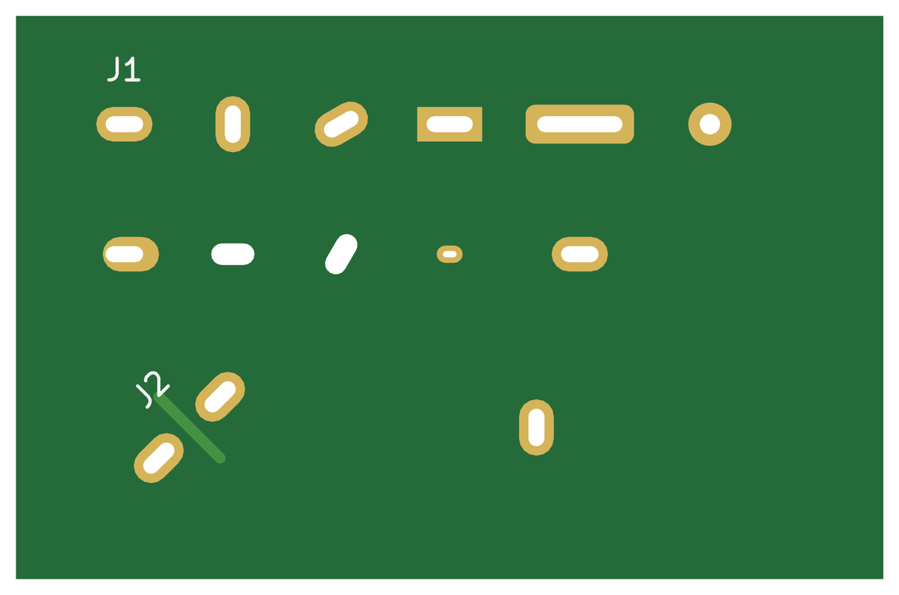

</p>


| Mode | 1–2 read | 3 resolve | 4 geometry | 5 materials | 6 assemble | 7 write | 8 verify | start-up and exit | Total |
|---|---:|---:|---:|---:|---:|---:|---:|---:|---:|
| Simulation, GLB + STEP | 72 ms | 55 ms | 0.2 | 0.1 ms | 0.3 | 0.4 | 38 ms | 0.2 | 1.2 |
| Visual, GLB | 74 ms | 51 ms | 0.2 | 0.1 ms | 0.6 | 5 ms | 43 ms | 0.2 | 1.1 |

<div align="center">

| Board | `featureTest/01_holes_slotted.kicad_pcb` |
|---|---|
| Outline | 40 × 26 mm |
| Thickness | 1.6 mm |
| Copper layers | 2 |
| Vias | none |
| Board edge | Plain |
| Mask, silkscreen, finish | Not set (drawn green and white), ENIG |

</div>

### 23.2.2 02 Round Holes

<p align="center">


</p>


| Mode | 1–2 read | 3 resolve | 4 geometry | 5 materials | 6 assemble | 7 write | 8 verify | start-up and exit | Total |
|---|---:|---:|---:|---:|---:|---:|---:|---:|---:|
| Simulation, GLB + STEP | 70 ms | 43 ms | 0.1 | 0.1 ms | 0.4 | 0.3 | 33 ms | 0.2 | 1.1 |
| Visual, GLB | 71 ms | 41 ms | 0.2 | 0.1 ms | 0.5 | 6 ms | 49 ms | 0.2 | 1.0 |

<div align="center">

| Board | `featureTest/02_holes_round.kicad_pcb` |
|---|---|
| Outline | 34 × 20 mm |
| Thickness | 1.6 mm |
| Copper layers | 2 |
| Vias | none |
| Board edge | Plain |
| Mask, silkscreen, finish | Not set (drawn green and white), ENIG |

</div>

### 23.2.3 03 Through Vias

<p align="center">


</p>


| Mode | 1–2 read | 3 resolve | 4 geometry | 5 materials | 6 assemble | 7 write | 8 verify | start-up and exit | Total |
|---|---:|---:|---:|---:|---:|---:|---:|---:|---:|
| Simulation, GLB + STEP | 80 ms | 59 ms | 0.2 | 0.1 ms | 0.5 | 0.3 | 49 ms | 0.2 | 1.5 |
| Visual, GLB | 70 ms | 48 ms | 0.2 | 0.2 ms | 0.6 | 6 ms | 59 ms | 0.2 | 1.2 |

<div align="center">

| Board | `featureTest/03_vias_through.kicad_pcb` |
|---|---|
| Outline | 32 × 20 mm |
| Thickness | 1.6 mm |
| Copper layers | 2 |
| Vias | 12 through |
| Board edge | Plain |
| Mask, silkscreen, finish | Not set (drawn green and white), ENIG |

</div>

### 23.2.4 03b KiCad 10 Via Options

<p align="center">
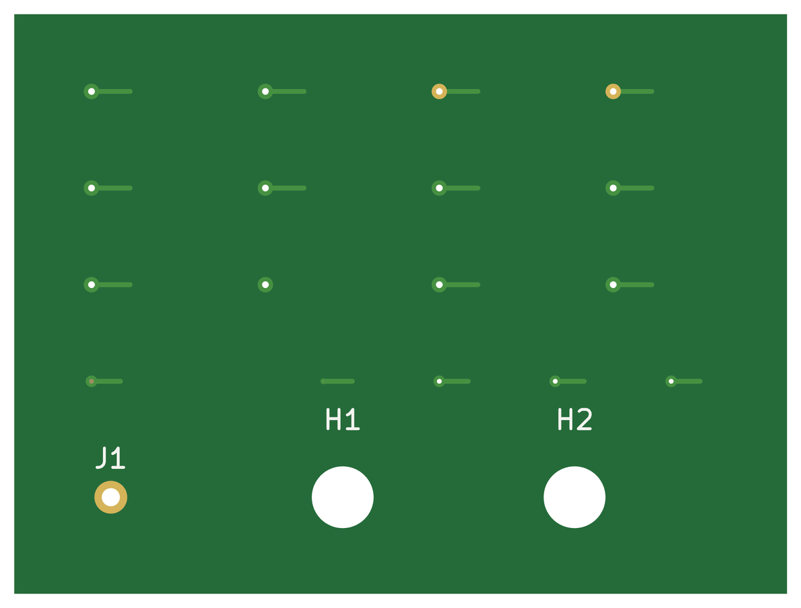

</p>


| Mode | 1–2 read | 3 resolve | 4 geometry | 5 materials | 6 assemble | 7 write | 8 verify | start-up and exit | Total |
|---|---:|---:|---:|---:|---:|---:|---:|---:|---:|
| Simulation, GLB + STEP | 73 ms | 0.1 | 0.2 | 0.1 ms | 0.5 | 0.7 | 49 ms | 0.2 | 1.8 |
| Visual, GLB | 71 ms | 0.1 | 0.2 | 0.2 ms | 1.2 | 9 ms | 66 ms | 0.2 | 1.8 |

<div align="center">

| Board | `featureTest/03b_vias_k10.kicad_pcb` |
|---|---|
| Outline | 40 × 30 mm |
| Thickness | 1.6 mm |
| Copper layers | 4 |
| Vias | 18: 1 micro, 2 blind and buried, 15 through |
| Board edge | Plain |
| Mask, silkscreen, finish | Not set (drawn green and white), ENIG |

</div>

### 23.2.5 04 Blind And Buried Vias

<p align="center">
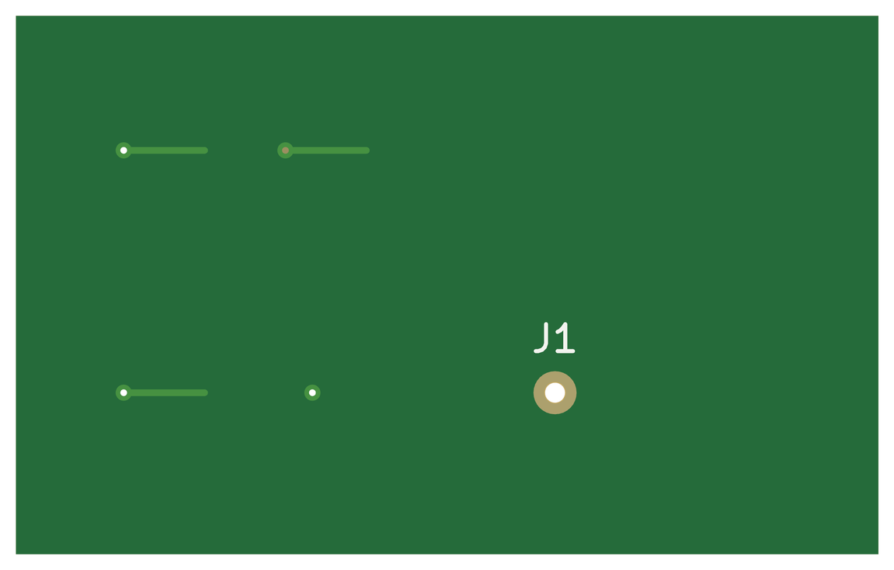

</p>


| Mode | 1–2 read | 3 resolve | 4 geometry | 5 materials | 6 assemble | 7 write | 8 verify | start-up and exit | Total |
|---|---:|---:|---:|---:|---:|---:|---:|---:|---:|
| Simulation, GLB + STEP | 68 ms | 59 ms | 78 ms | 0.1 ms | 0.2 | 0.1 | 21 ms | 0.2 | 0.7 |
| Visual, GLB | 71 ms | 52 ms | 58 ms | 0.1 ms | 0.4 | 4 ms | 34 ms | 0.2 | 0.8 |

<div align="center">

| Board | `featureTest/04_vias_blind_buried.kicad_pcb` |
|---|---|
| Outline | 32 × 20 mm |
| Thickness | 1.6 mm |
| Copper layers | 6 |
| Vias | 6: 3 blind and buried, 3 through |
| Board edge | Plain |
| Mask, silkscreen, finish | Not set (drawn green and white), ENIG |

</div>

### 23.2.6 05 Microvias

<p align="center">


</p>


| Mode | 1–2 read | 3 resolve | 4 geometry | 5 materials | 6 assemble | 7 write | 8 verify | start-up and exit | Total |
|---|---:|---:|---:|---:|---:|---:|---:|---:|---:|
| Simulation, GLB + STEP | 3 ms | 60 ms | 52 ms | 0.1 ms | 0.2 | 0.1 | 21 ms | 0.2 | 0.6 |
| Visual, GLB | 2 ms | 54 ms | 43 ms | 0.1 ms | 0.3 | 3 ms | 54 ms | 0.2 | 0.6 |

<div align="center">

| Board | `featureTest/05_vias_micro.kicad_pcb` |
|---|---|
| Outline | 30 × 16 mm |
| Thickness | 1.6 mm |
| Copper layers | 8 |
| Vias | 12: 10 micro, 2 blind and buried |
| Board edge | Plain |
| Mask, silkscreen, finish | Mask colour not set (drawn green), no silkscreen, ENIG |

</div>

## 23.3 Pads

### 23.3.1 06 Padstacks

<p align="center">

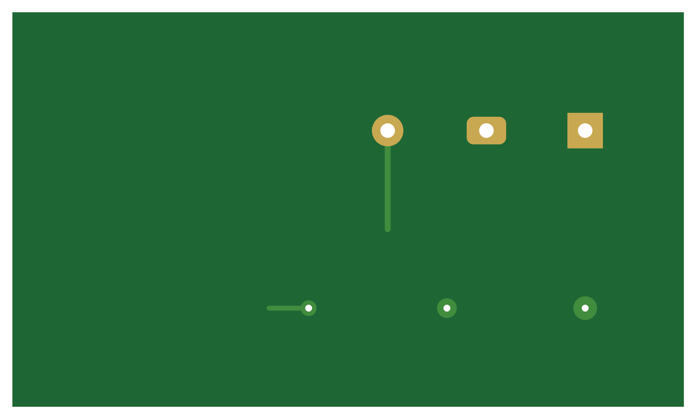
</p>


| Mode | 1–2 read | 3 resolve | 4 geometry | 5 materials | 6 assemble | 7 write | 8 verify | start-up and exit | Total |
|---|---:|---:|---:|---:|---:|---:|---:|---:|---:|
| Simulation, GLB + STEP | 60 ms | 45 ms | 89 ms | 0.1 ms | 0.3 | 0.2 | 38 ms | 0.2 | 1.0 |
| Visual, GLB | 71 ms | 46 ms | 79 ms | 0.1 ms | 0.5 | 4 ms | 36 ms | 0.2 | 0.9 |

<div align="center">

| Board | `featureTest/06_padstacks.kicad_pcb` |
|---|---|
| Outline | 34 × 20 mm |
| Thickness | 1.6 mm |
| Copper layers | 4 |
| Vias | 3 through |
| Board edge | Plain |
| Mask, silkscreen, finish | Not set (drawn green and white), ENIG |

</div>

### 23.3.2 07 Pad Shapes

<p align="center">


</p>


| Mode | 1–2 read | 3 resolve | 4 geometry | 5 materials | 6 assemble | 7 write | 8 verify | start-up and exit | Total |
|---|---:|---:|---:|---:|---:|---:|---:|---:|---:|
| Simulation, GLB + STEP | 71 ms | 37 ms | 0.1 | 0.1 ms | 0.3 | 0.3 | 27 ms | 0.2 | 1.0 |
| Visual, GLB | 75 ms | 40 ms | 0.1 | 0.1 ms | 0.5 | 5 ms | 40 ms | 0.2 | 1.0 |

<div align="center">

| Board | `featureTest/07_pad_shapes.kicad_pcb` |
|---|---|
| Outline | 44 × 30 mm |
| Thickness | 1.6 mm |
| Copper layers | 2 |
| Vias | none |
| Board edge | Plain |
| Mask, silkscreen, finish | Not set (drawn green and white), ENIG |

</div>

## 23.4 Copper Drawings, Text And Tracks

### 23.4.1 08 Copper Graphics

<p align="center">


</p>


| Mode | 1–2 read | 3 resolve | 4 geometry | 5 materials | 6 assemble | 7 write | 8 verify | start-up and exit | Total |
|---|---:|---:|---:|---:|---:|---:|---:|---:|---:|
| Simulation, GLB + STEP | 71 ms | 25 ms | 41 ms | 0.1 ms | 0.2 | 0.2 | 16 ms | 0.2 | 0.7 |
| Visual, GLB | 61 ms | 23 ms | 35 ms | 0.1 ms | 0.3 | 4 ms | 44 ms | 0.2 | 0.6 |

<div align="center">

| Board | `featureTest/08_copper_graphics.kicad_pcb` |
|---|---|
| Outline | 30 × 24 mm |
| Thickness | 1.6 mm |
| Copper layers | 2 |
| Vias | none |
| Board edge | Plain |
| Mask, silkscreen, finish | Not set (drawn green and white), ENIG |

</div>

### 23.4.2 08b Copper Graphics On Nets

<p align="center">


</p>


| Mode | 1–2 read | 3 resolve | 4 geometry | 5 materials | 6 assemble | 7 write | 8 verify | start-up and exit | Total |
|---|---:|---:|---:|---:|---:|---:|---:|---:|---:|
| Simulation, GLB + STEP | 4 ms | 21 ms | 45 ms | 0.1 ms | 0.2 | 0.2 | 19 ms | 0.2 | 0.6 |
| Visual, GLB | 4 ms | 21 ms | 48 ms | 0.1 ms | 0.3 | 4 ms | 45 ms | 0.2 | 0.6 |

<div align="center">

| Board | `featureTest/08b_copper_graphics_nets.kicad_pcb` |
|---|---|
| Outline | 36 × 24 mm, rounded corners |
| Thickness | 1.6 mm |
| Copper layers | 2 |
| Vias | none |
| Board edge | Plain |
| Mask, silkscreen, finish | Not set (drawn green and white), ENIG |

</div>

### 23.4.3 09 Copper Text

<p align="center">

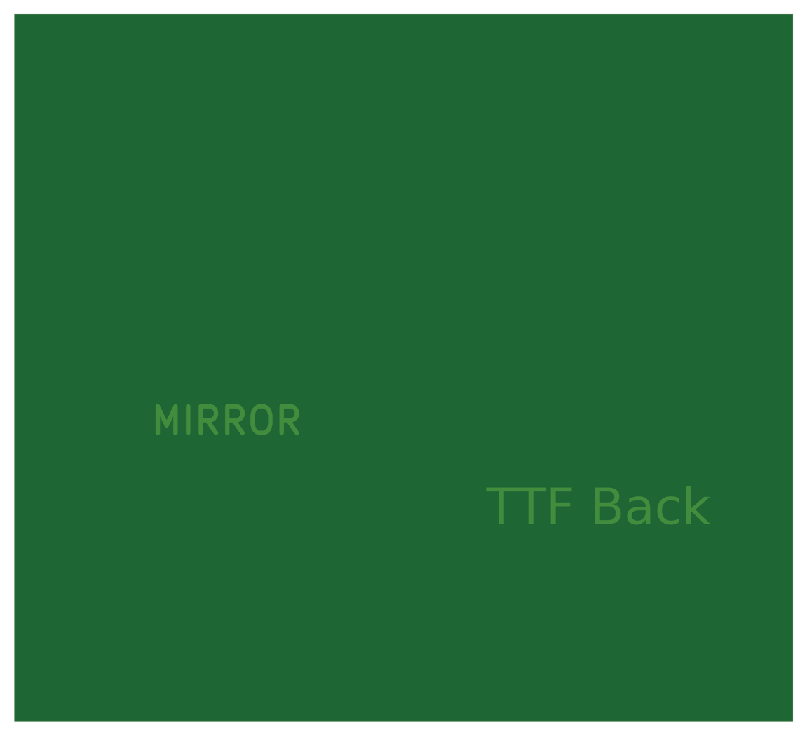
</p>


| Mode | 1–2 read | 3 resolve | 4 geometry | 5 materials | 6 assemble | 7 write | 8 verify | start-up and exit | Total |
|---|---:|---:|---:|---:|---:|---:|---:|---:|---:|
| Simulation, GLB + STEP | 81 ms | 36 ms | 0.1 | 0.1 ms | 1.0 | 1.0 | 37 ms | 0.2 | 2.4 |
| Visual, GLB | 82 ms | 38 ms | 0.1 | 0.1 ms | 0.9 | 8 ms | 82 ms | 0.2 | 1.4 |

<div align="center">

| Board | `featureTest/09_copper_text.kicad_pcb` |
|---|---|
| Outline | 44 × 40 mm |
| Thickness | 1.6 mm |
| Copper layers | 2 |
| Vias | none |
| Board edge | Plain |
| Mask, silkscreen, finish | Not set (drawn green and white), ENIG |

</div>

### 23.4.4 10 Tracks And Arcs

<p align="center">
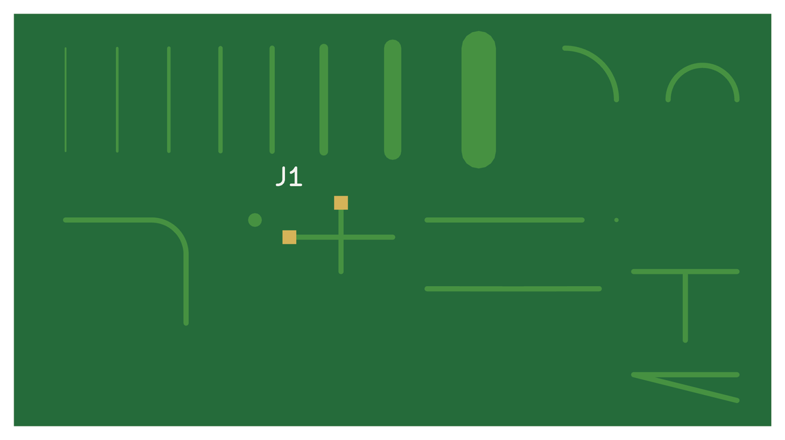

</p>


| Mode | 1–2 read | 3 resolve | 4 geometry | 5 materials | 6 assemble | 7 write | 8 verify | start-up and exit | Total |
|---|---:|---:|---:|---:|---:|---:|---:|---:|---:|
| Simulation, GLB + STEP | 73 ms | 28 ms | 35 ms | 0.1 ms | 0.2 | 0.2 | 17 ms | 0.2 | 0.7 |
| Visual, GLB | 68 ms | 24 ms | 31 ms | 0.1 ms | 0.4 | 4 ms | 39 ms | 0.2 | 0.7 |

<div align="center">

| Board | `featureTest/10_tracks_arcs.kicad_pcb` |
|---|---|
| Outline | 44 × 24 mm |
| Thickness | 1.6 mm |
| Copper layers | 2 |
| Vias | none |
| Board edge | Plain |
| Mask, silkscreen, finish | Not set (drawn green and white), ENIG |

</div>

## 23.5 Zones

### 23.5.1 11 Zones

<p align="center">


</p>


| Mode | 1–2 read | 3 resolve | 4 geometry | 5 materials | 6 assemble | 7 write | 8 verify | start-up and exit | Total |
|---|---:|---:|---:|---:|---:|---:|---:|---:|---:|
| Simulation, GLB + STEP | 83 ms | 0.1 | 0.3 | 0.2 ms | 0.6 | 0.8 | 75 ms | 0.2 | 2.2 |
| Visual, GLB | 77 ms | 0.1 | 0.4 | 0.2 ms | 1.4 | 9 ms | 67 ms | 0.2 | 2.2 |

<div align="center">

| Board | `featureTest/11_zones.kicad_pcb` |
|---|---|
| Outline | 40 × 31 mm |
| Thickness | 1.6 mm |
| Copper layers | 4 |
| Vias | 1 through |
| Board edge | Plain |
| Mask, silkscreen, finish | Not set (drawn green and white), ENIG |

</div>

## 23.6 Board Outline

### 23.6.1 12 Board Outline Shapes

<p align="center">
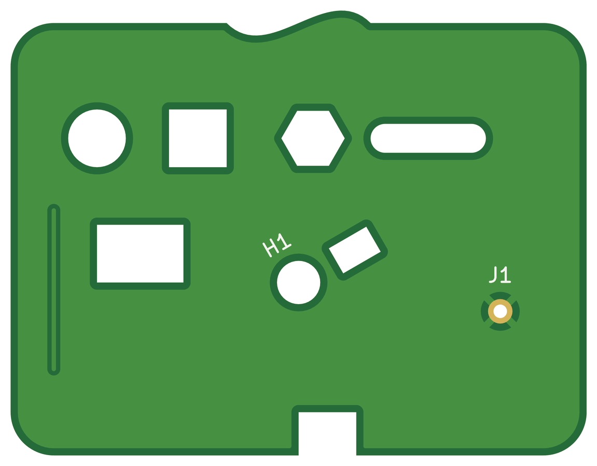

</p>


| Mode | 1–2 read | 3 resolve | 4 geometry | 5 materials | 6 assemble | 7 write | 8 verify | start-up and exit | Total |
|---|---:|---:|---:|---:|---:|---:|---:|---:|---:|
| Simulation, GLB + STEP | 73 ms | 44 ms | 78 ms | 0.1 ms | 0.4 | 0.8 | 24 ms | 0.2 | 1.6 |
| Visual, GLB | 80 ms | 35 ms | 67 ms | 0.1 ms | 0.5 | 8 ms | 61 ms | 0.2 | 0.9 |

<div align="center">

| Board | `featureTest/12_outline_shapes.kicad_pcb` |
|---|---|
| Outline | 40 × 30.9 mm, arcs, a Bezier edge, a notch and cut-outs |
| Thickness | 1.6 mm |
| Copper layers | 2 |
| Vias | none |
| Board edge | Plain |
| Mask, silkscreen, finish | Not set (drawn green and white), ENIG |

</div>

### 23.6.2 13a No Board Outline

<p align="center">

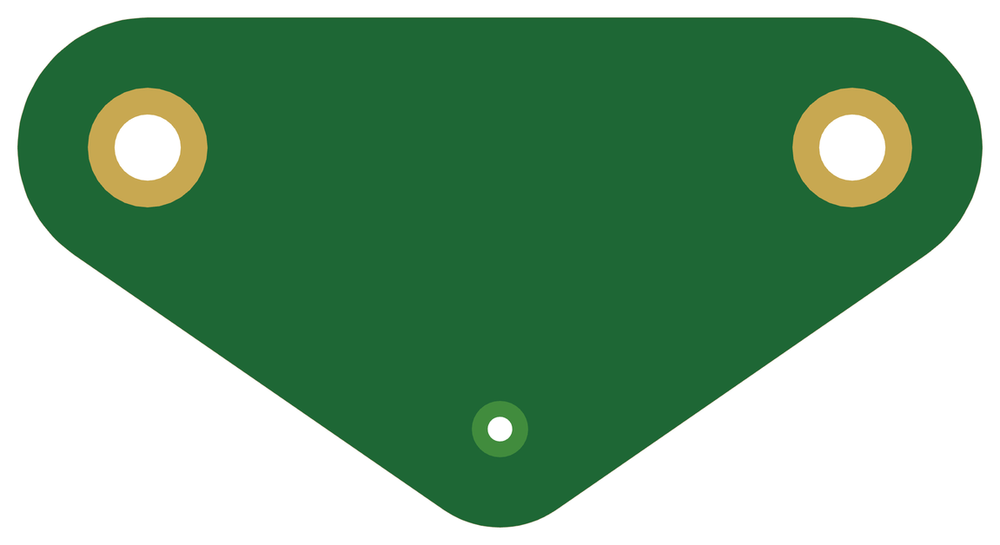
</p>


| Mode | 1–2 read | 3 resolve | 4 geometry | 5 materials | 6 assemble | 7 write | 8 verify | start-up and exit | Total |
|---|---:|---:|---:|---:|---:|---:|---:|---:|---:|
| Simulation, GLB + STEP | 57 ms | 24 ms | 53 ms | 0.1 ms | 0.1 | 0.1 | 17 ms | 0.2 | 0.5 |
| Visual, GLB | 62 ms | 25 ms | 46 ms | 0.1 ms | 0.2 | 4 ms | 79 ms | 0.2 | 0.6 |

<div align="center">

| Board | `featureTest/13a_outline_none.kicad_pcb` |
|---|---|
| Outline | 13.7 × 7.2 mm, from the copper (no Edge.Cuts) |
| Thickness | 1.6 mm |
| Copper layers | 2 |
| Vias | 1 through |
| Board edge | Plain |
| Mask, silkscreen, finish | Mask colour not set (drawn green), no silkscreen, ENIG |

</div>

### 23.6.3 13b Two Board Outlines

<p align="center">


</p>


| Mode | 1–2 read | 3 resolve | 4 geometry | 5 materials | 6 assemble | 7 write | 8 verify | start-up and exit | Total |
|---|---:|---:|---:|---:|---:|---:|---:|---:|---:|
| Simulation, GLB + STEP | 70 ms | 21 ms | 38 ms | 0.1 ms | 83 ms | 97 ms | 14 ms | 0.2 | 0.5 |
| Visual, GLB | 58 ms | 20 ms | 40 ms | 0.1 ms | 0.2 | 3 ms | 25 ms | 0.2 | 0.5 |

<div align="center">

| Board | `featureTest/13b_outline_two.kicad_pcb` |
|---|---|
| Outline | 40 × 20 mm, two boards and a third in a hole |
| Thickness | 1.6 mm |
| Copper layers | 2 |
| Vias | none |
| Board edge | Plain |
| Mask, silkscreen, finish | Not set (drawn green and white), ENIG |

</div>

## 23.7 Stack-Up

### 23.7.1 14 Full Stack-Up

<p align="center">


</p>


| Mode | 1–2 read | 3 resolve | 4 geometry | 5 materials | 6 assemble | 7 write | 8 verify | start-up and exit | Total |
|---|---:|---:|---:|---:|---:|---:|---:|---:|---:|
| Simulation, GLB + STEP | 67 ms | 33 ms | 72 ms | 0.1 ms | 0.1 | 0.1 | 19 ms | 0.2 | 0.6 |
| Visual, GLB | 71 ms | 32 ms | 64 ms | 0.1 ms | 0.3 | 3 ms | 37 ms | 0.2 | 0.7 |

<div align="center">

| Board | `featureTest/14_stackup_full.kicad_pcb` |
|---|---|
| Outline | 30 × 20 mm |
| Thickness | 1.58 mm |
| Copper layers | 4 |
| Vias | 1 through |
| Board edge | Plain |
| Mask, silkscreen, finish | Green, white, ENIG |

</div>

### 23.7.2 15 No Stack-Up

<p align="center">


</p>


| Mode | 1–2 read | 3 resolve | 4 geometry | 5 materials | 6 assemble | 7 write | 8 verify | start-up and exit | Total |
|---|---:|---:|---:|---:|---:|---:|---:|---:|---:|
| Simulation, GLB + STEP | 69 ms | 35 ms | 51 ms | 0.1 ms | 0.1 | 0.1 | 18 ms | 0.2 | 0.6 |
| Visual, GLB | 64 ms | 31 ms | 55 ms | 0.1 ms | 0.3 | 3 ms | 32 ms | 0.2 | 0.7 |

<div align="center">

| Board | `featureTest/15_stackup_none.kicad_pcb` |
|---|---|
| Outline | 30 × 20 mm |
| Thickness | 1.2 mm |
| Copper layers | 4 |
| Vias | 1 through |
| Board edge | Plain |
| Mask, silkscreen, finish | Not set (drawn green and white), ENIG |

</div>

## 23.8 Edge Plating

### 23.8.1 16 Castellated Pads And A Plated Edge

<p align="center">


</p>


| Mode | 1–2 read | 3 resolve | 4 geometry | 5 materials | 6 assemble | 7 write | 8 verify | start-up and exit | Total |
|---|---:|---:|---:|---:|---:|---:|---:|---:|---:|
| Simulation, GLB + STEP | 70 ms | 66 ms | 82 ms | 0.1 ms | 0.2 | 0.1 | 25 ms | 0.2 | 0.8 |
| Visual, GLB | 60 ms | 72 ms | 97 ms | 0.1 ms | 0.3 | 3 ms | 31 ms | 0.2 | 0.7 |

<div align="center">

| Board | `featureTest/16_edge_plating_castellation.kicad_pcb` |
|---|---|
| Outline | 30 × 20 mm |
| Thickness | 1.6 mm |
| Copper layers | 2 |
| Vias | none |
| Board edge | Castellated pads on the right edge, plated edge |
| Mask, silkscreen, finish | Not set (drawn green and white), immersion silver |

</div>

### 23.8.2 16b Plated Board Edge With A GND Border

<p align="center">
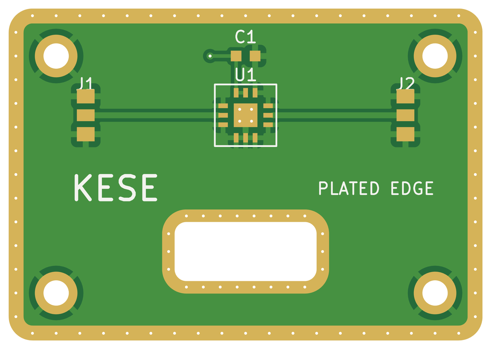
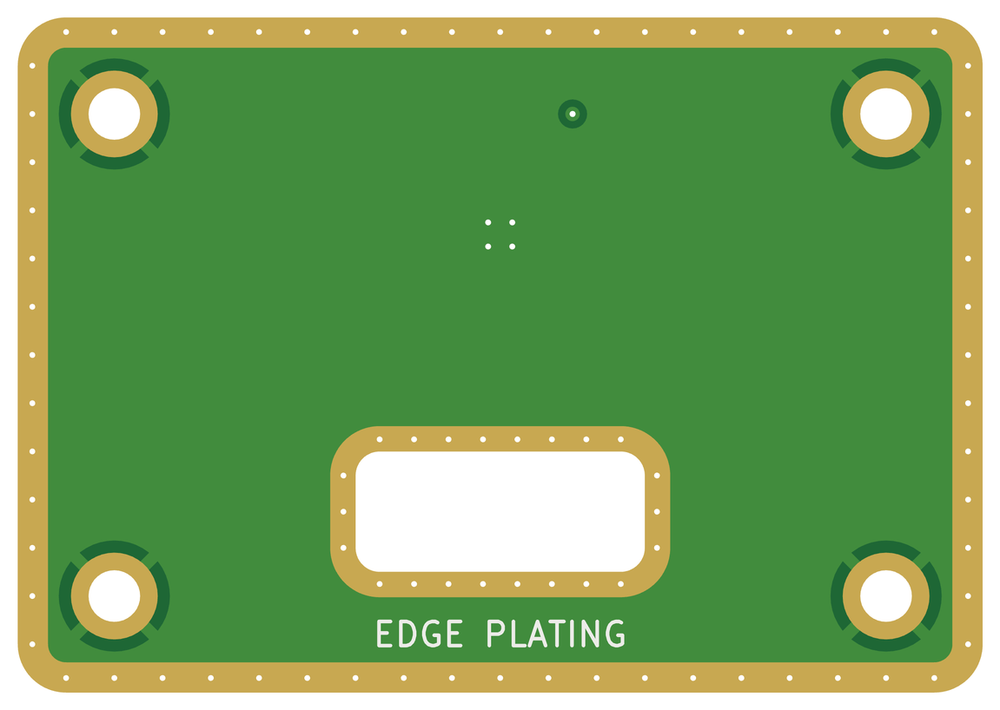
</p>


| Mode | 1–2 read | 3 resolve | 4 geometry | 5 materials | 6 assemble | 7 write | 8 verify | start-up and exit | Total |
|---|---:|---:|---:|---:|---:|---:|---:|---:|---:|
| Simulation, GLB + STEP | 0.1 | 0.4 | 1.9 | 0.2 ms | 2.1 | 1.4 | 0.2 | 0.2 | 6.4 |
| Visual, GLB | 98 ms | 0.4 | 2.0 | 0.2 ms | 4.2 | 20 ms | 0.1 | 0.2 | 7.0 |

<div align="center">

| Board | `featureTest/16b_edge_plating_border.kicad_pcb` |
|---|---|
| Outline | 40 × 28 mm, a cut-out |
| Thickness | 1.6 mm |
| Copper layers | 4 |
| Vias | 91 through |
| Board edge | Plated all round and in the cut-out |
| Mask, silkscreen, finish | Green, white, ENIG |

</div>

## 23.9 Solder Mask And Silkscreen

### 23.9.1 17 Solder Mask And Silkscreen

<p align="center">
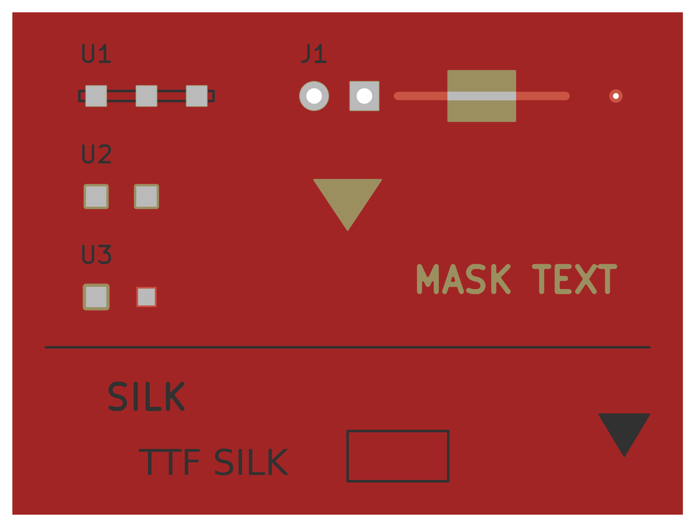
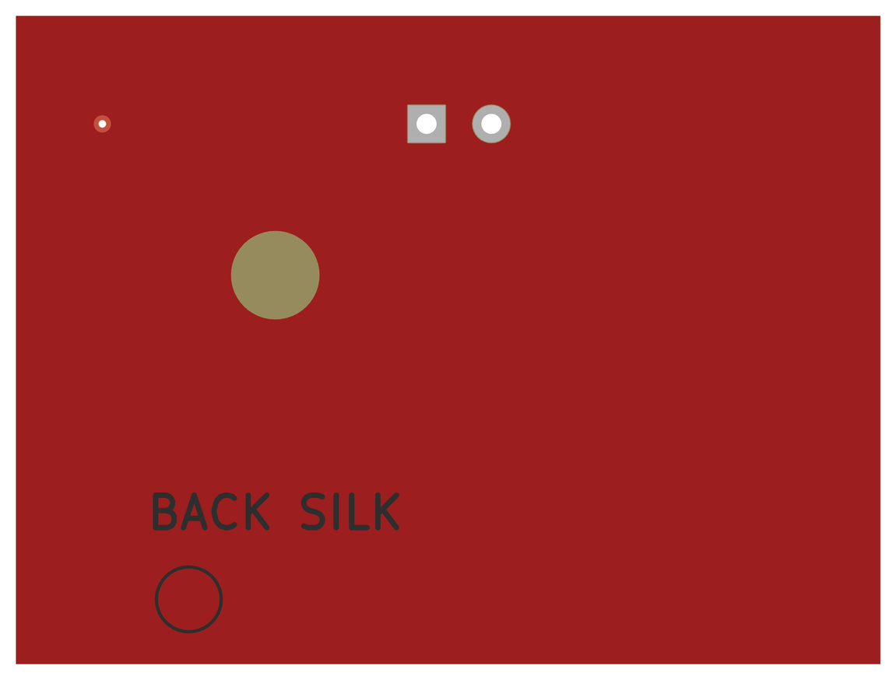
</p>


| Mode | 1–2 read | 3 resolve | 4 geometry | 5 materials | 6 assemble | 7 write | 8 verify | start-up and exit | Total |
|---|---:|---:|---:|---:|---:|---:|---:|---:|---:|
| Simulation, GLB + STEP | 71 ms | 63 ms | 91 ms | 0.1 ms | 0.2 | 0.2 | 18 ms | 0.2 | 0.8 |
| Visual, GLB | 71 ms | 80 ms | 0.1 | 0.1 ms | 0.3 | 5 ms | 40 ms | 0.2 | 0.8 |

<div align="center">

| Board | `featureTest/17_mask_silk.kicad_pcb` |
|---|---|
| Outline | 40 × 30 mm |
| Thickness | 1.6 mm |
| Copper layers | 2 |
| Vias | 1 through |
| Board edge | Plain |
| Mask, silkscreen, finish | Red, black, lead-free HASL |

</div>

### 23.9.2 17b Silkscreen Over Copper

<p align="center">


</p>


| Mode | 1–2 read | 3 resolve | 4 geometry | 5 materials | 6 assemble | 7 write | 8 verify | start-up and exit | Total |
|---|---:|---:|---:|---:|---:|---:|---:|---:|---:|
| Simulation, GLB + STEP | 62 ms | 30 ms | 0.1 | 0.1 ms | 0.2 | 0.2 | 28 ms | 0.2 | 0.8 |
| Visual, GLB | 75 ms | 36 ms | 0.2 | 0.1 ms | 0.5 | 5 ms | 35 ms | 0.2 | 1.1 |

<div align="center">

| Board | `featureTest/17b_silk_over_copper.kicad_pcb` |
|---|---|
| Outline | 30 × 20 mm |
| Thickness | 1.6 mm |
| Copper layers | 2 |
| Vias | none |
| Board edge | Plain |
| Mask, silkscreen, finish | White, black, ENIG |

</div>

## 23.10 Surface Finish

### 23.10.1 18 Gold Edge Fingers

<p align="center">
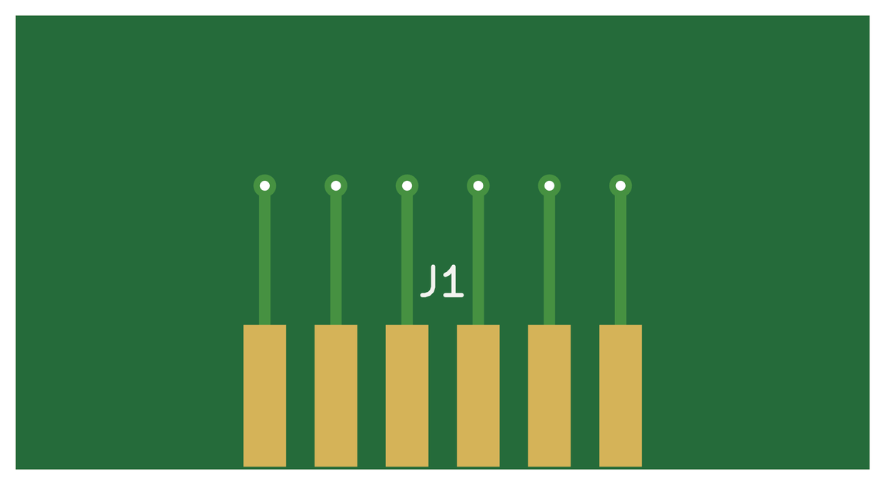

</p>


| Mode | 1–2 read | 3 resolve | 4 geometry | 5 materials | 6 assemble | 7 write | 8 verify | start-up and exit | Total |
|---|---:|---:|---:|---:|---:|---:|---:|---:|---:|
| Simulation, GLB + STEP | 70 ms | 32 ms | 42 ms | 0.1 ms | 0.2 | 0.1 | 16 ms | 0.2 | 0.6 |
| Visual, GLB | 59 ms | 30 ms | 46 ms | 0.1 ms | 0.3 | 4 ms | 61 ms | 0.2 | 0.7 |

<div align="center">

| Board | `featureTest/18_finishes.kicad_pcb` |
|---|---|
| Outline | 30 × 16 mm |
| Thickness | 1.6 mm |
| Copper layers | 2 |
| Vias | 6 through |
| Board edge | Gold edge fingers on a bevelled edge |
| Mask, silkscreen, finish | Not set (drawn green and white), hard gold |

</div>

### 23.10.2 18b Finish On Every Kind Of Bare Copper

<p align="center">
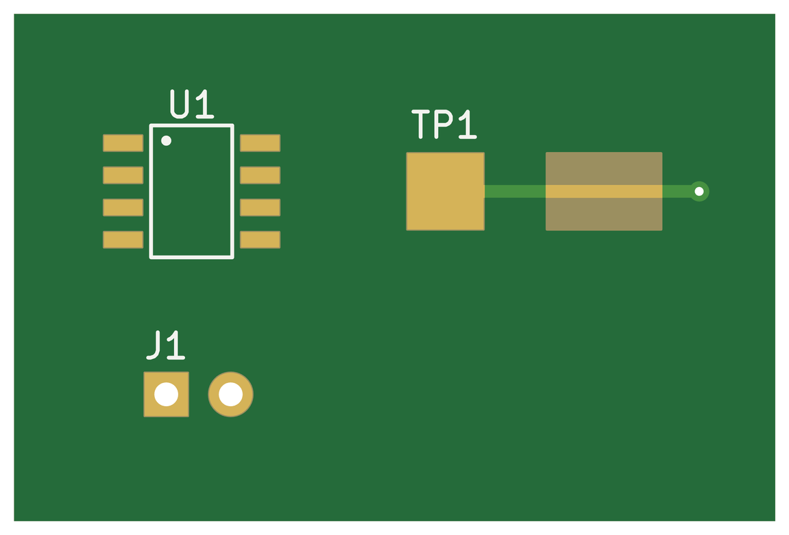
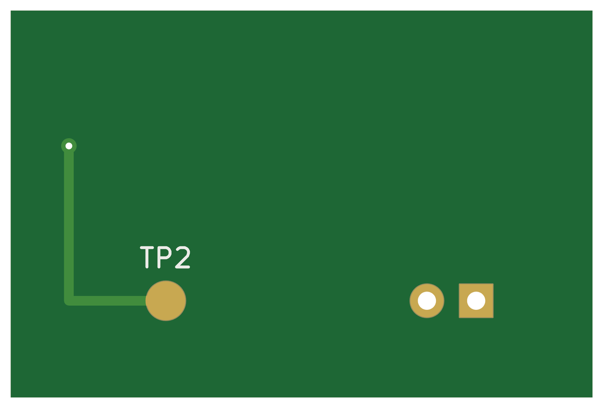
</p>


| Mode | 1–2 read | 3 resolve | 4 geometry | 5 materials | 6 assemble | 7 write | 8 verify | start-up and exit | Total |
|---|---:|---:|---:|---:|---:|---:|---:|---:|---:|
| Simulation, GLB + STEP | 73 ms | 32 ms | 92 ms | 0.1 ms | 0.2 | 0.2 | 24 ms | 0.2 | 0.8 |
| Visual, GLB | 70 ms | 34 ms | 95 ms | 0.1 ms | 0.4 | 4 ms | 43 ms | 0.2 | 0.9 |

<div align="center">

| Board | `featureTest/18b_finish_pads.kicad_pcb` |
|---|---|
| Outline | 30 × 20 mm |
| Thickness | 1.6 mm |
| Copper layers | 2 |
| Vias | 1 through |
| Board edge | Plain |
| Mask, silkscreen, finish | Green, white, ENIG |

</div>

### 23.10.3 18c Finish Before The Solder Mask

<p align="center">
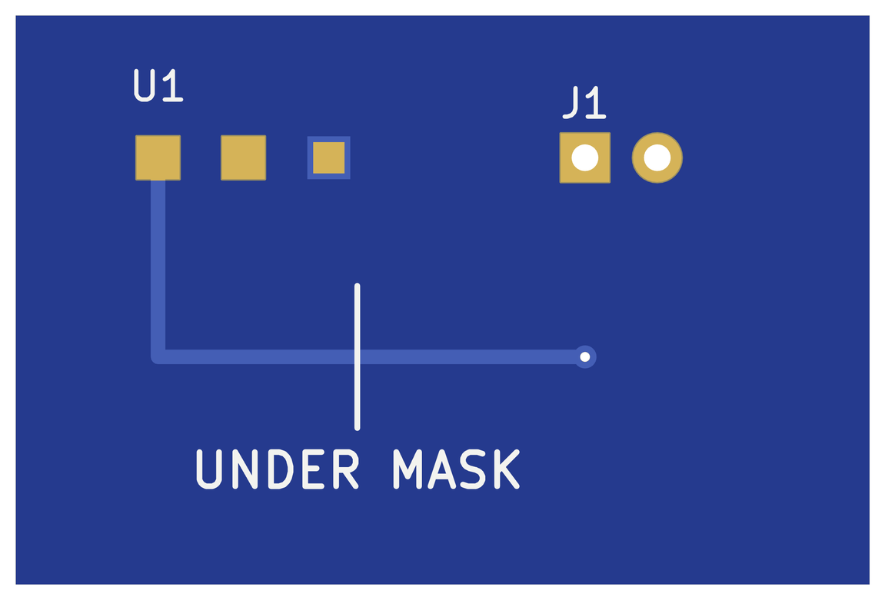

</p>


| Mode | 1–2 read | 3 resolve | 4 geometry | 5 materials | 6 assemble | 7 write | 8 verify | start-up and exit | Total |
|---|---:|---:|---:|---:|---:|---:|---:|---:|---:|
| Simulation, GLB + STEP | 71 ms | 34 ms | 0.1 | 0.1 ms | 0.3 | 0.3 | 34 ms | 0.2 | 1.1 |
| Visual, GLB | 77 ms | 35 ms | 0.2 | 0.1 ms | 0.6 | 5 ms | 37 ms | 0.2 | 1.1 |

<div align="center">

| Board | `featureTest/18c_finish_before_mask.kicad_pcb` |
|---|---|
| Outline | 30 × 20 mm |
| Thickness | 1.6 mm |
| Copper layers | 2 |
| Vias | 1 through |
| Board edge | Plain |
| Mask, silkscreen, finish | Blue, white, ENEPIG |

</div>

## 23.11 Items KESE Skips

### 23.11.1 19 Items KESE Skips

<p align="center">
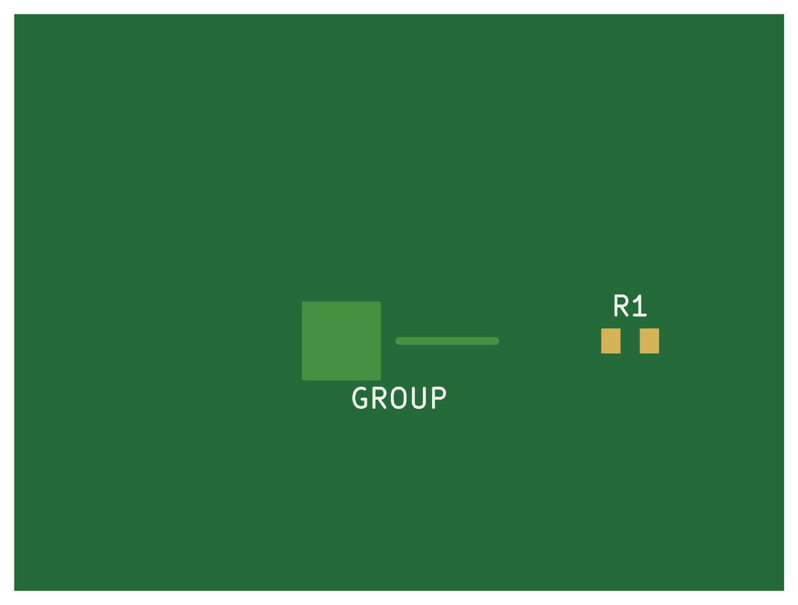

</p>


| Mode | 1–2 read | 3 resolve | 4 geometry | 5 materials | 6 assemble | 7 write | 8 verify | start-up and exit | Total |
|---|---:|---:|---:|---:|---:|---:|---:|---:|---:|
| Simulation, GLB + STEP | 70 ms | 17 ms | 21 ms | 0.1 ms | 44 ms | 45 ms | 8 ms | 0.2 | 0.4 |
| Visual, GLB | 58 ms | 13 ms | 21 ms | 0.1 ms | 0.1 | 2 ms | 21 ms | 0.2 | 0.4 |

<div align="center">

| Board | `featureTest/19_skipped_items.kicad_pcb` |
|---|---|
| Outline | 40 × 30 mm |
| Thickness | 1.6 mm |
| Copper layers | 2 |
| Vias | none |
| Board edge | Plain |
| Mask, silkscreen, finish | Not set (drawn green and white), ENIG |

</div>

### 23.11.2 19b Items KESE Skips, KiCad 10

<p align="center">


</p>


| Mode | 1–2 read | 3 resolve | 4 geometry | 5 materials | 6 assemble | 7 write | 8 verify | start-up and exit | Total |
|---|---:|---:|---:|---:|---:|---:|---:|---:|---:|
| Simulation, GLB + STEP | 0.7 ms | 5 ms | 11 ms | 0.0 ms | 16 ms | 7 ms | 2 ms | 0.2 | 0.2 |
| Visual, GLB | 0.7 ms | 4 ms | 11 ms | 0.0 ms | 31 ms | 1 ms | 11 ms | 0.2 | 0.2 |

<div align="center">

| Board | `featureTest/19b_skipped_items_k10.kicad_pcb` |
|---|---|
| Outline | 40 × 24 mm |
| Thickness | 1.6 mm |
| Copper layers | 2 |
| Vias | none |
| Board edge | Plain |
| Mask, silkscreen, finish | Mask colour not set (drawn green), no silkscreen, ENIG |

</div>

## 23.12 KiCad File Formats

### 23.12.1 20a KiCad 6 Format

<p align="center">
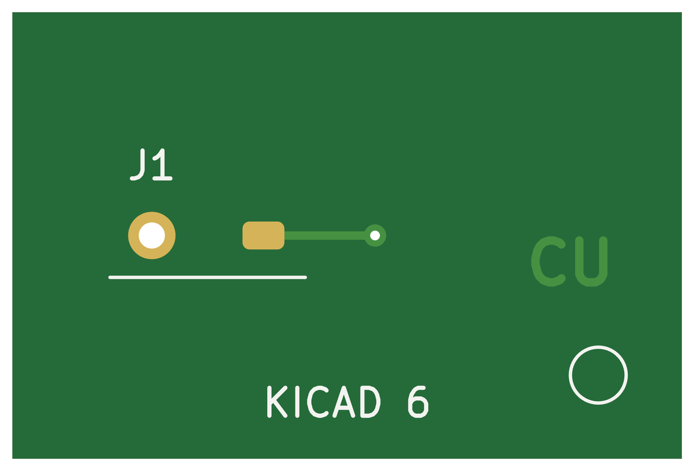

</p>


| Mode | 1–2 read | 3 resolve | 4 geometry | 5 materials | 6 assemble | 7 write | 8 verify | start-up and exit | Total |
|---|---:|---:|---:|---:|---:|---:|---:|---:|---:|
| Simulation, GLB + STEP | 68 ms | 27 ms | 59 ms | 0.1 ms | 0.1 | 0.1 | 16 ms | 0.2 | 0.6 |
| Visual, GLB | 68 ms | 31 ms | 63 ms | 0.1 ms | 0.3 | 4 ms | 31 ms | 0.2 | 0.7 |

<div align="center">

| Board | `featureTest/20a_format_kicad6.kicad_pcb` |
|---|---|
| Outline | 24 × 16 mm |
| Thickness | 1.6 mm |
| Copper layers | 2 |
| Vias | 1 through |
| Board edge | Plain |
| Mask, silkscreen, finish | Not set (drawn green and white), ENIG |

</div>

### 23.12.2 20b KiCad 7 Format

<p align="center">


</p>


| Mode | 1–2 read | 3 resolve | 4 geometry | 5 materials | 6 assemble | 7 write | 8 verify | start-up and exit | Total |
|---|---:|---:|---:|---:|---:|---:|---:|---:|---:|
| Simulation, GLB + STEP | 65 ms | 26 ms | 63 ms | 0.1 ms | 0.2 | 0.1 | 16 ms | 0.2 | 0.7 |
| Visual, GLB | 66 ms | 28 ms | 56 ms | 0.1 ms | 0.3 | 4 ms | 34 ms | 0.2 | 0.6 |

<div align="center">

| Board | `featureTest/20b_format_kicad7.kicad_pcb` |
|---|---|
| Outline | 24 × 16 mm |
| Thickness | 1.6 mm |
| Copper layers | 2 |
| Vias | 1 through |
| Board edge | Plain |
| Mask, silkscreen, finish | Not set (drawn green and white), ENIG |

</div>

### 23.12.3 20c KiCad 8 Format

<p align="center">

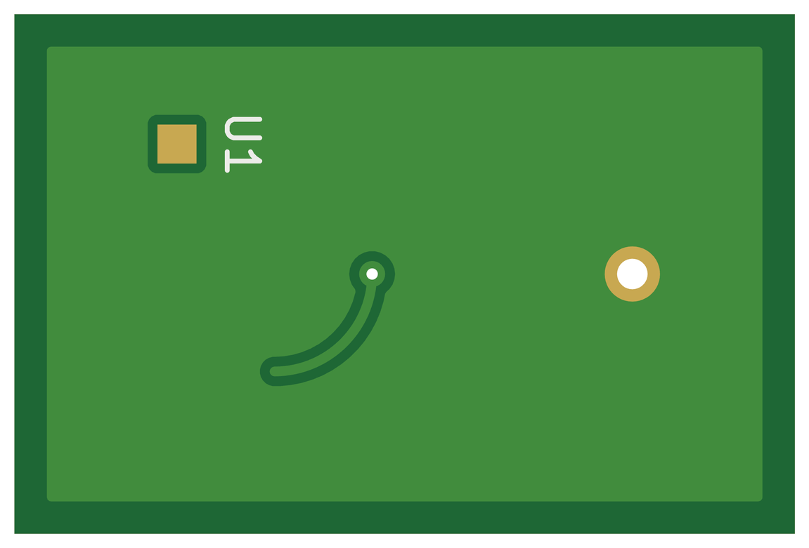
</p>


| Mode | 1–2 read | 3 resolve | 4 geometry | 5 materials | 6 assemble | 7 write | 8 verify | start-up and exit | Total |
|---|---:|---:|---:|---:|---:|---:|---:|---:|---:|
| Simulation, GLB + STEP | 71 ms | 28 ms | 59 ms | 0.1 ms | 0.1 | 0.1 | 19 ms | 0.2 | 0.6 |
| Visual, GLB | 66 ms | 28 ms | 53 ms | 0.1 ms | 0.3 | 4 ms | 35 ms | 0.2 | 0.7 |

<div align="center">

| Board | `featureTest/20c_format_kicad8.kicad_pcb` |
|---|---|
| Outline | 24 × 16 mm |
| Thickness | 1.6 mm |
| Copper layers | 2 |
| Vias | 1 through |
| Board edge | Plain |
| Mask, silkscreen, finish | Not set (drawn green and white), ENIG |

</div>

### 23.12.4 20d KiCad 9 Format

<p align="center">


</p>


| Mode | 1–2 read | 3 resolve | 4 geometry | 5 materials | 6 assemble | 7 write | 8 verify | start-up and exit | Total |
|---|---:|---:|---:|---:|---:|---:|---:|---:|---:|
| Simulation, GLB + STEP | 71 ms | 27 ms | 59 ms | 0.1 ms | 0.2 | 0.2 | 20 ms | 0.2 | 0.7 |
| Visual, GLB | 69 ms | 31 ms | 59 ms | 0.1 ms | 0.3 | 4 ms | 34 ms | 0.2 | 0.7 |

<div align="center">

| Board | `featureTest/20d_format_kicad9.kicad_pcb` |
|---|---|
| Outline | 24 × 16 mm |
| Thickness | 1.6 mm |
| Copper layers | 2 |
| Vias | 1 through |
| Board edge | Plain |
| Mask, silkscreen, finish | Not set (drawn green and white), ENIG |

</div>

### 23.12.5 20e KiCad 10 Format

<p align="center">


</p>


| Mode | 1–2 read | 3 resolve | 4 geometry | 5 materials | 6 assemble | 7 write | 8 verify | start-up and exit | Total |
|---|---:|---:|---:|---:|---:|---:|---:|---:|---:|
| Simulation, GLB + STEP | 70 ms | 30 ms | 60 ms | 0.1 ms | 0.2 | 0.2 | 18 ms | 0.2 | 0.7 |
| Visual, GLB | 68 ms | 32 ms | 62 ms | 0.1 ms | 0.3 | 4 ms | 31 ms | 0.2 | 0.7 |

<div align="center">

| Board | `featureTest/20e_format_kicad10.kicad_pcb` |
|---|---|
| Outline | 24 × 16 mm |
| Thickness | 1.6 mm |
| Copper layers | 2 |
| Vias | 1 through |
| Board edge | Plain |
| Mask, silkscreen, finish | Not set (drawn green and white), ENIG |

</div>

## 23.13 Example Boards

### 23.13.1 21 RF Sensor Module

<p align="center">
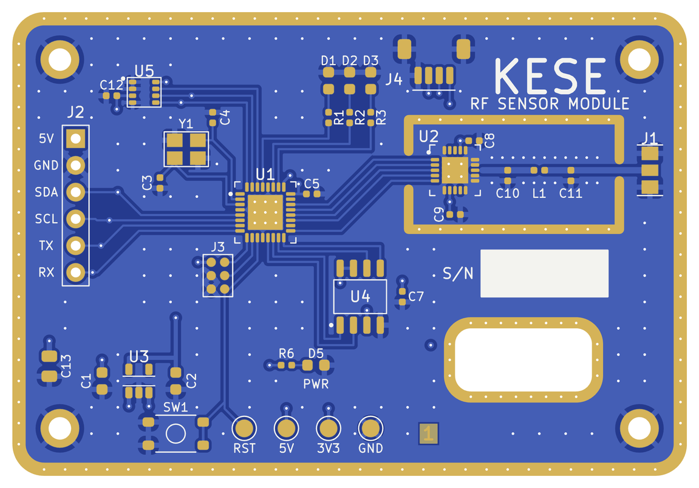

</p>


| Mode | 1–2 read | 3 resolve | 4 geometry | 5 materials | 6 assemble | 7 write | 8 verify | start-up and exit | Total |
|---|---:|---:|---:|---:|---:|---:|---:|---:|---:|
| Simulation, GLB + STEP | 0.2 | 1.4 | 6.3 | 0.4 ms | 5.5 | 3.3 | 0.5 | 0.2 | 17.4 |
| Visual, GLB | 0.2 | 1.5 | 6.2 | 0.4 ms | 9.8 | 96 ms | 1.0 | 0.2 | 19.1 |

<div align="center">

| Board | `featureTest/21_rf_module.kicad_pcb` ([5.1](Examples.md#51-rf-sensor-module)) |
|---|---|
| Outline | 64 × 44 mm, a cut-out |
| Thickness | 1.6 mm |
| Copper layers | 4 |
| Vias | 307 through |
| Board edge | Plated all round and in the cut-out |
| Mask, silkscreen, finish | Blue, white, ENIG |

</div>

### 23.13.2 22 HDI Radio Module

<p align="center">

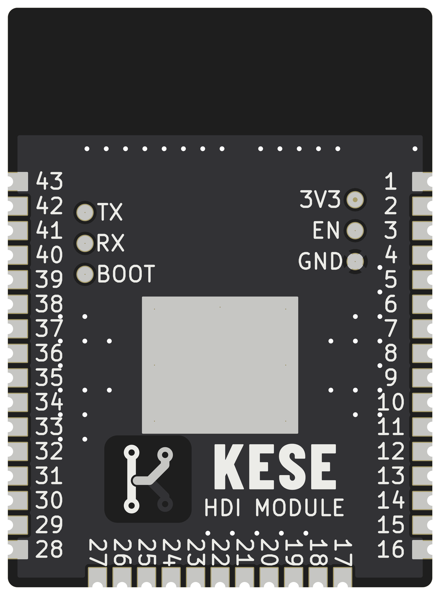
</p>


| Mode | 1–2 read | 3 resolve | 4 geometry | 5 materials | 6 assemble | 7 write | 8 verify | start-up and exit | Total |
|---|---:|---:|---:|---:|---:|---:|---:|---:|---:|
| Simulation, GLB + STEP | 0.2 | 0.9 | 2.2 | 0.4 ms | 1.8 | 1.6 | 0.4 | 0.2 | 7.5 |
| Visual, GLB | 0.2 | 1.0 | 2.2 | 0.4 ms | 5.8 | 39 ms | 0.3 | 0.2 | 9.7 |

<div align="center">

| Board | `featureTest/22_hdi_module.kicad_pcb` ([5.2](Examples.md#52-hdi-radio-module)) |
|---|---|
| Outline | 22 × 30 mm |
| Thickness | 0.925 mm |
| Copper layers | 6 |
| Vias | 150: 71 micro, 34 blind and buried, 45 through |
| Board edge | 43 castellated pads |
| Mask, silkscreen, finish | Black, white, immersion silver |

</div>

### 23.13.3 23 PCIe x1 Card

<p align="center">
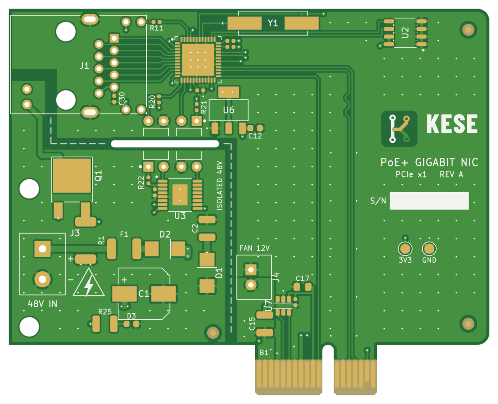
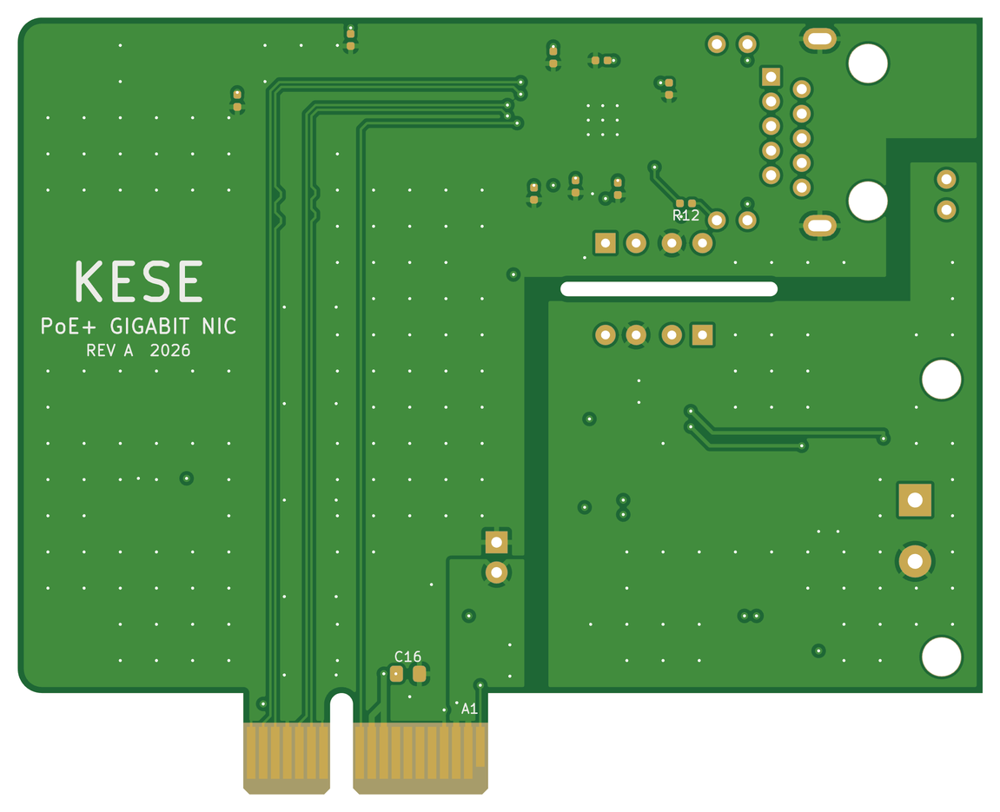
</p>


| Mode | 1–2 read | 3 resolve | 4 geometry | 5 materials | 6 assemble | 7 write | 8 verify | start-up and exit | Total |
|---|---:|---:|---:|---:|---:|---:|---:|---:|---:|
| Simulation, GLB + STEP | 0.2 | 1.1 | 3.4 | 0.5 ms | 3.5 | 2.9 | 0.6 | 0.2 | 12.0 |
| Visual, GLB | 0.3 | 1.1 | 3.4 | 0.5 ms | 9.9 | 88 ms | 1.0 | 0.2 | 15.9 |

<div align="center">

| Board | `featureTest/23_pcie_card.kicad_pcb` ([5.3](Examples.md#53-pcie-x1-card)) |
|---|---|
| Outline | 80 × 64.4 mm with the fingers' tongue, a slot |
| Thickness | 1.57 mm |
| Copper layers | 4 |
| Vias | 239 through |
| Board edge | 36 gold fingers on a bevelled tongue |
| Mask, silkscreen, finish | Green, white, hard gold |

</div>

## 23.14 The Numbers

Seconds, the median of three runs for each stage, unless marked ms; the total is the sum of the bars.

| Board | Mode | 1–2 read | 3 resolve | 4 geometry | 5 materials | 6 assemble | 7 write | 8 verify | start-up and exit | Total |
|---|---|---:|---:|---:|---:|---:|---:|---:|---:|---:|
| 01 Slotted holes | simulation, GLB + STEP | 72 ms | 55 ms | 0.2 | 0.1 ms | 0.3 | 0.4 | 38 ms | 0.2 | 1.2 |
| 01 Slotted holes | visual, GLB | 74 ms | 51 ms | 0.2 | 0.1 ms | 0.6 | 5 ms | 43 ms | 0.2 | 1.1 |
| 02 Round holes | simulation, GLB + STEP | 70 ms | 43 ms | 0.1 | 0.1 ms | 0.4 | 0.3 | 33 ms | 0.2 | 1.1 |
| 02 Round holes | visual, GLB | 71 ms | 41 ms | 0.2 | 0.1 ms | 0.5 | 6 ms | 49 ms | 0.2 | 1.0 |
| 03 Through vias | simulation, GLB + STEP | 80 ms | 59 ms | 0.2 | 0.1 ms | 0.5 | 0.3 | 49 ms | 0.2 | 1.5 |
| 03 Through vias | visual, GLB | 70 ms | 48 ms | 0.2 | 0.2 ms | 0.6 | 6 ms | 59 ms | 0.2 | 1.2 |
| 03b KiCad 10 via options | simulation, GLB + STEP | 73 ms | 0.1 | 0.2 | 0.1 ms | 0.5 | 0.7 | 49 ms | 0.2 | 1.8 |
| 03b KiCad 10 via options | visual, GLB | 71 ms | 0.1 | 0.2 | 0.2 ms | 1.2 | 9 ms | 66 ms | 0.2 | 1.8 |
| 04 Blind and buried vias | simulation, GLB + STEP | 68 ms | 59 ms | 78 ms | 0.1 ms | 0.2 | 0.1 | 21 ms | 0.2 | 0.7 |
| 04 Blind and buried vias | visual, GLB | 71 ms | 52 ms | 58 ms | 0.1 ms | 0.4 | 4 ms | 34 ms | 0.2 | 0.8 |
| 05 Microvias | simulation, GLB + STEP | 3 ms | 60 ms | 52 ms | 0.1 ms | 0.2 | 0.1 | 21 ms | 0.2 | 0.6 |
| 05 Microvias | visual, GLB | 2 ms | 54 ms | 43 ms | 0.1 ms | 0.3 | 3 ms | 54 ms | 0.2 | 0.6 |
| 06 Padstacks | simulation, GLB + STEP | 60 ms | 45 ms | 89 ms | 0.1 ms | 0.3 | 0.2 | 38 ms | 0.2 | 1.0 |
| 06 Padstacks | visual, GLB | 71 ms | 46 ms | 79 ms | 0.1 ms | 0.5 | 4 ms | 36 ms | 0.2 | 0.9 |
| 07 Pad shapes | simulation, GLB + STEP | 71 ms | 37 ms | 0.1 | 0.1 ms | 0.3 | 0.3 | 27 ms | 0.2 | 1.0 |
| 07 Pad shapes | visual, GLB | 75 ms | 40 ms | 0.1 | 0.1 ms | 0.5 | 5 ms | 40 ms | 0.2 | 1.0 |
| 08 Copper graphics | simulation, GLB + STEP | 71 ms | 25 ms | 41 ms | 0.1 ms | 0.2 | 0.2 | 16 ms | 0.2 | 0.7 |
| 08 Copper graphics | visual, GLB | 61 ms | 23 ms | 35 ms | 0.1 ms | 0.3 | 4 ms | 44 ms | 0.2 | 0.6 |
| 08b Copper graphics on nets | simulation, GLB + STEP | 4 ms | 21 ms | 45 ms | 0.1 ms | 0.2 | 0.2 | 19 ms | 0.2 | 0.6 |
| 08b Copper graphics on nets | visual, GLB | 4 ms | 21 ms | 48 ms | 0.1 ms | 0.3 | 4 ms | 45 ms | 0.2 | 0.6 |
| 09 Copper text | simulation, GLB + STEP | 81 ms | 36 ms | 0.1 | 0.1 ms | 1.0 | 1.0 | 37 ms | 0.2 | 2.4 |
| 09 Copper text | visual, GLB | 82 ms | 38 ms | 0.1 | 0.1 ms | 0.9 | 8 ms | 82 ms | 0.2 | 1.4 |
| 10 Tracks and arcs | simulation, GLB + STEP | 73 ms | 28 ms | 35 ms | 0.1 ms | 0.2 | 0.2 | 17 ms | 0.2 | 0.7 |
| 10 Tracks and arcs | visual, GLB | 68 ms | 24 ms | 31 ms | 0.1 ms | 0.4 | 4 ms | 39 ms | 0.2 | 0.7 |
| 11 Zones | simulation, GLB + STEP | 83 ms | 0.1 | 0.3 | 0.2 ms | 0.6 | 0.8 | 75 ms | 0.2 | 2.2 |
| 11 Zones | visual, GLB | 77 ms | 0.1 | 0.4 | 0.2 ms | 1.4 | 9 ms | 67 ms | 0.2 | 2.2 |
| 12 Board outline shapes | simulation, GLB + STEP | 73 ms | 44 ms | 78 ms | 0.1 ms | 0.4 | 0.8 | 24 ms | 0.2 | 1.6 |
| 12 Board outline shapes | visual, GLB | 80 ms | 35 ms | 67 ms | 0.1 ms | 0.5 | 8 ms | 61 ms | 0.2 | 0.9 |
| 13a No board outline | simulation, GLB + STEP | 57 ms | 24 ms | 53 ms | 0.1 ms | 0.1 | 0.1 | 17 ms | 0.2 | 0.5 |
| 13a No board outline | visual, GLB | 62 ms | 25 ms | 46 ms | 0.1 ms | 0.2 | 4 ms | 79 ms | 0.2 | 0.6 |
| 13b Two board outlines | simulation, GLB + STEP | 70 ms | 21 ms | 38 ms | 0.1 ms | 83 ms | 97 ms | 14 ms | 0.2 | 0.5 |
| 13b Two board outlines | visual, GLB | 58 ms | 20 ms | 40 ms | 0.1 ms | 0.2 | 3 ms | 25 ms | 0.2 | 0.5 |
| 14 Full stack-up | simulation, GLB + STEP | 67 ms | 33 ms | 72 ms | 0.1 ms | 0.1 | 0.1 | 19 ms | 0.2 | 0.6 |
| 14 Full stack-up | visual, GLB | 71 ms | 32 ms | 64 ms | 0.1 ms | 0.3 | 3 ms | 37 ms | 0.2 | 0.7 |
| 15 No stack-up | simulation, GLB + STEP | 69 ms | 35 ms | 51 ms | 0.1 ms | 0.1 | 0.1 | 18 ms | 0.2 | 0.6 |
| 15 No stack-up | visual, GLB | 64 ms | 31 ms | 55 ms | 0.1 ms | 0.3 | 3 ms | 32 ms | 0.2 | 0.7 |
| 16 Castellated pads and a plated edge | simulation, GLB + STEP | 70 ms | 66 ms | 82 ms | 0.1 ms | 0.2 | 0.1 | 25 ms | 0.2 | 0.8 |
| 16 Castellated pads and a plated edge | visual, GLB | 60 ms | 72 ms | 97 ms | 0.1 ms | 0.3 | 3 ms | 31 ms | 0.2 | 0.7 |
| 16b Plated board edge with a GND border | simulation, GLB + STEP | 0.1 | 0.4 | 1.9 | 0.2 ms | 2.1 | 1.4 | 0.2 | 0.2 | 6.4 |
| 16b Plated board edge with a GND border | visual, GLB | 98 ms | 0.4 | 2.0 | 0.2 ms | 4.2 | 20 ms | 0.1 | 0.2 | 7.0 |
| 17 Solder mask and silkscreen | simulation, GLB + STEP | 71 ms | 63 ms | 91 ms | 0.1 ms | 0.2 | 0.2 | 18 ms | 0.2 | 0.8 |
| 17 Solder mask and silkscreen | visual, GLB | 71 ms | 80 ms | 0.1 | 0.1 ms | 0.3 | 5 ms | 40 ms | 0.2 | 0.8 |
| 17b Silkscreen over copper | simulation, GLB + STEP | 62 ms | 30 ms | 0.1 | 0.1 ms | 0.2 | 0.2 | 28 ms | 0.2 | 0.8 |
| 17b Silkscreen over copper | visual, GLB | 75 ms | 36 ms | 0.2 | 0.1 ms | 0.5 | 5 ms | 35 ms | 0.2 | 1.1 |
| 18 Gold edge fingers | simulation, GLB + STEP | 70 ms | 32 ms | 42 ms | 0.1 ms | 0.2 | 0.1 | 16 ms | 0.2 | 0.6 |
| 18 Gold edge fingers | visual, GLB | 59 ms | 30 ms | 46 ms | 0.1 ms | 0.3 | 4 ms | 61 ms | 0.2 | 0.7 |
| 18b Finish on every kind of bare copper | simulation, GLB + STEP | 73 ms | 32 ms | 92 ms | 0.1 ms | 0.2 | 0.2 | 24 ms | 0.2 | 0.8 |
| 18b Finish on every kind of bare copper | visual, GLB | 70 ms | 34 ms | 95 ms | 0.1 ms | 0.4 | 4 ms | 43 ms | 0.2 | 0.9 |
| 18c Finish before the solder mask | simulation, GLB + STEP | 71 ms | 34 ms | 0.1 | 0.1 ms | 0.3 | 0.3 | 34 ms | 0.2 | 1.1 |
| 18c Finish before the solder mask | visual, GLB | 77 ms | 35 ms | 0.2 | 0.1 ms | 0.6 | 5 ms | 37 ms | 0.2 | 1.1 |
| 19 Items KESE skips | simulation, GLB + STEP | 70 ms | 17 ms | 21 ms | 0.1 ms | 44 ms | 45 ms | 8 ms | 0.2 | 0.4 |
| 19 Items KESE skips | visual, GLB | 58 ms | 13 ms | 21 ms | 0.1 ms | 0.1 | 2 ms | 21 ms | 0.2 | 0.4 |
| 19b Items KESE skips, KiCad 10 | simulation, GLB + STEP | 0.7 ms | 5 ms | 11 ms | 0.0 ms | 16 ms | 7 ms | 2 ms | 0.2 | 0.2 |
| 19b Items KESE skips, KiCad 10 | visual, GLB | 0.7 ms | 4 ms | 11 ms | 0.0 ms | 31 ms | 1 ms | 11 ms | 0.2 | 0.2 |
| 20a KiCad 6 format | simulation, GLB + STEP | 68 ms | 27 ms | 59 ms | 0.1 ms | 0.1 | 0.1 | 16 ms | 0.2 | 0.6 |
| 20a KiCad 6 format | visual, GLB | 68 ms | 31 ms | 63 ms | 0.1 ms | 0.3 | 4 ms | 31 ms | 0.2 | 0.7 |
| 20b KiCad 7 format | simulation, GLB + STEP | 65 ms | 26 ms | 63 ms | 0.1 ms | 0.2 | 0.1 | 16 ms | 0.2 | 0.7 |
| 20b KiCad 7 format | visual, GLB | 66 ms | 28 ms | 56 ms | 0.1 ms | 0.3 | 4 ms | 34 ms | 0.2 | 0.6 |
| 20c KiCad 8 format | simulation, GLB + STEP | 71 ms | 28 ms | 59 ms | 0.1 ms | 0.1 | 0.1 | 19 ms | 0.2 | 0.6 |
| 20c KiCad 8 format | visual, GLB | 66 ms | 28 ms | 53 ms | 0.1 ms | 0.3 | 4 ms | 35 ms | 0.2 | 0.7 |
| 20d KiCad 9 format | simulation, GLB + STEP | 71 ms | 27 ms | 59 ms | 0.1 ms | 0.2 | 0.2 | 20 ms | 0.2 | 0.7 |
| 20d KiCad 9 format | visual, GLB | 69 ms | 31 ms | 59 ms | 0.1 ms | 0.3 | 4 ms | 34 ms | 0.2 | 0.7 |
| 20e KiCad 10 format | simulation, GLB + STEP | 70 ms | 30 ms | 60 ms | 0.1 ms | 0.2 | 0.2 | 18 ms | 0.2 | 0.7 |
| 20e KiCad 10 format | visual, GLB | 68 ms | 32 ms | 62 ms | 0.1 ms | 0.3 | 4 ms | 31 ms | 0.2 | 0.7 |
| 21 RF sensor module | simulation, GLB + STEP | 0.2 | 1.4 | 6.3 | 0.4 ms | 5.5 | 3.3 | 0.5 | 0.2 | 17.4 |
| 21 RF sensor module | visual, GLB | 0.2 | 1.5 | 6.2 | 0.4 ms | 9.8 | 96 ms | 1.0 | 0.2 | 19.1 |
| 22 HDI radio module | simulation, GLB + STEP | 0.2 | 0.9 | 2.2 | 0.4 ms | 1.8 | 1.6 | 0.4 | 0.2 | 7.5 |
| 22 HDI radio module | visual, GLB | 0.2 | 1.0 | 2.2 | 0.4 ms | 5.8 | 39 ms | 0.3 | 0.2 | 9.7 |
| 23 PCIe x1 card | simulation, GLB + STEP | 0.2 | 1.1 | 3.4 | 0.5 ms | 3.5 | 2.9 | 0.6 | 0.2 | 12.0 |
| 23 PCIe x1 card | visual, GLB | 0.3 | 1.1 | 3.4 | 0.5 ms | 9.9 | 88 ms | 1.0 | 0.2 | 15.9 |

| Previous | Next |
|:---|---:|
| [openEMS Workflow](OpenEMS-Workflow.md) | [Glossary](Glossary.md) |
