# 23. Feature Test Collection

Every board of `featureTest/`, section by section, with its top and bottom and where the time of a
run goes:

- [The folder's README](https://github.com/RolandThsive/KiCad-EM-Stackup-Exporter-KESE/blob/main/featureTest/README.md) says what each board holds.
- Each board was exported in every format KESE writes, one format a run: GLB, STEP, STL and OBJ in
  simulation mode, and GLB and OBJ in visual mode. Each of those six runs was made three times, with
  the Verifier, the solder mask and the silkscreen on and the board's own settings, as the
  regression suite (`Generator/tests/test_boards.py`) sets them.
- Each bar is the median of the three runs for that stage, from the `timing` block of
  [`report.txt`](Project-Output-Organization.md#2022-reporttxt). All 720 runs passed the Verifier.
- Beside each board's facts, a second table gives, for each of the six runs, the size of the model
  file it writes and the most memory it used at once: the proportional set size (PSS) of KESE's
  process and its workers, summed and sampled every 10 ms, the median of three more runs. The STL
  size is that of the `stl/` folder, one file a part, and the OBJ size includes its `.mtl`. MB is a
  million bytes.
- The command for board 11, simulation mode with GLB; the other five runs differ only in
  `--format step`, `stl` or `obj`, or in `--mode visual` with `--format glb` or `obj`:

```text
python run_KESE.py ../featureTest/11_zones.kicad_pcb --mode simulation --format glb --verify \
    --set SolderMask.SOLDER_MASK_ENABLED=True --set Silkscreen.SILKSCREEN_ENABLED=True
```

**The runs used the default parameters otherwise, on one Linux machine with 4 cores (an Intel Xeon
at 2.1 GHz) and 16 GB of RAM, so `Parallel.WORKERS = 0` gave four workers ([Work Done In
Parallel](Working-Principle.md#74-work-done-in-parallel)). On another machine the seconds differ.**

## 23.1 Every Board At A Glance

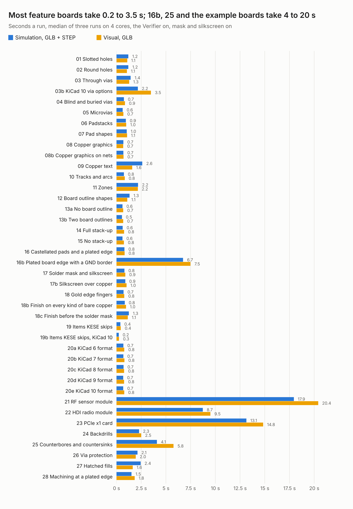

All the feature boards but 16b and 25 take 0.2 to 3.5 s a run, in any format. The fixed part of a
run, reading the file and Python starting and exiting, takes 0.16 to 0.33 s of it; a board without
text never reads the stroke font, so boards 05, 08b, 19b and 26 read and collect in under 11 ms.
Board 16b, a plated border and 91 vias on four layers, takes 5.6 to 8.6 s; board 25, whose
countersinks are built as steps, 2.9 to 5.4 s; and the example boards 6.6 to 23.4 s. Simulation
with GLB or STL is the quickest of the six runs on every board but 09 and 27, where visual GLB is.

## 23.2 Holes And Vias

### 23.2.1 01 Slotted Holes

<p align="center">

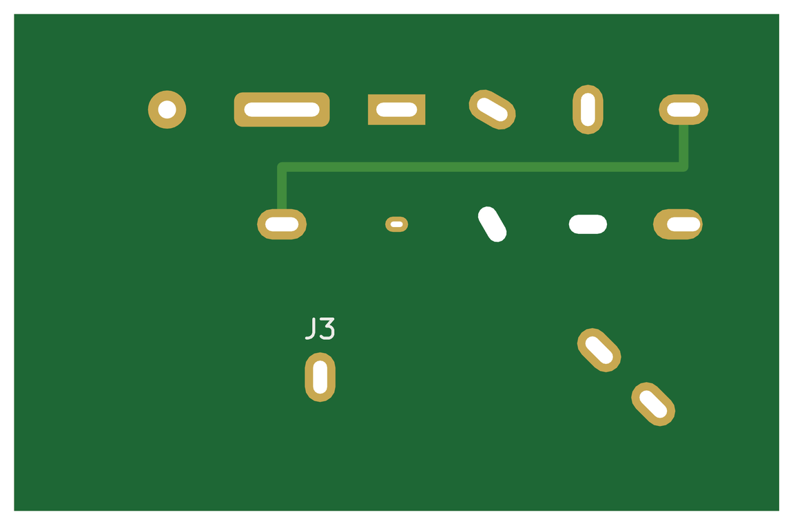
</p>

![01 Slotted holes: stacked bars of seconds per stage, one format a run; stages 4 and 6 take 42% to 64% of a run. Simulation with GLB takes 0.9 s: read 70 ms, resolve 56 ms, geometry 0.2, materials 0.2 ms, assemble 0.3, write 8 ms, verify 41 ms, start-up and exit 0.2. Simulation with STEP takes 1.3 s: read 74 ms, resolve 55 ms, geometry 0.2, materials 0.1 ms, assemble 0.4, write 0.4, verify 36 ms, start-up and exit 0.2. Simulation with STL takes 0.9 s: read 69 ms, resolve 51 ms, geometry 0.2, materials 0.1 ms, assemble 0.4, write 11 ms, verify 40 ms, start-up and exit 0.2. Simulation with OBJ takes 1.2 s: read 74 ms, resolve 53 ms, geometry 0.2, materials 0.1 ms, assemble 0.4, write 0.2, verify 41 ms, start-up and exit 0.2. Visual with GLB takes 1.1 s: read 83 ms, resolve 56 ms, geometry 0.2, materials 0.1 ms, assemble 0.5, write 7 ms, verify 40 ms, start-up and exit 0.2. Visual with OBJ takes 1.2 s: read 68 ms, resolve 53 ms, geometry 0.2, materials 0.2 ms, assemble 0.5, write 0.1, verify 40 ms, start-up and exit 0.2](https://raw.githubusercontent.com/RolandThsive/KiCad-EM-Stackup-Exporter-KESE/main/docs/images/Feature-Test-Collection/feature_01_holes_slotted.webp)

| Mode and format | 1–2 read | 3 resolve | 4 geometry | 5 materials | 6 assemble | 7 write | 8 verify | start-up and exit | Total |
|---|---:|---:|---:|---:|---:|---:|---:|---:|---:|
| Simulation, GLB | 70&nbsp;ms | 56&nbsp;ms | 0.2 | 0.2&nbsp;ms | 0.3 | 8&nbsp;ms | 41&nbsp;ms | 0.2 | 0.9 |
| Simulation, STEP | 74&nbsp;ms | 55&nbsp;ms | 0.2 | 0.1&nbsp;ms | 0.4 | 0.4 | 36&nbsp;ms | 0.2 | 1.3 |
| Simulation, STL | 69&nbsp;ms | 51&nbsp;ms | 0.2 | 0.1&nbsp;ms | 0.4 | 11&nbsp;ms | 40&nbsp;ms | 0.2 | 0.9 |
| Simulation, OBJ | 74&nbsp;ms | 53&nbsp;ms | 0.2 | 0.1&nbsp;ms | 0.4 | 0.2 | 41&nbsp;ms | 0.2 | 1.2 |
| Visual, GLB | 83&nbsp;ms | 56&nbsp;ms | 0.2 | 0.1&nbsp;ms | 0.5 | 7&nbsp;ms | 40&nbsp;ms | 0.2 | 1.1 |
| Visual, OBJ | 68&nbsp;ms | 53&nbsp;ms | 0.2 | 0.2&nbsp;ms | 0.5 | 0.1 | 40&nbsp;ms | 0.2 | 1.2 |

<table align="center">
<tr>
<td valign="top">

| Board | `featureTest/`<br>`01_holes_slotted.kicad_pcb` |
|---|---|
| Outline | 40 × 26 mm |
| Thickness | 1.6 mm |
| Copper&nbsp;layers | 2 |
| Vias | none |
| Board&nbsp;edge | Plain |
| Mask,&nbsp;silkscreen,&nbsp;finish | Not set (drawn green and white),<br>ENIG |

</td>
<td valign="top">

<table>
<tr><th>File<br>type</th><th>File<br>size</th><th>Peak memory<br>used</th></tr>
<tr><th colspan="3" align="left">Simulation</th></tr>
<tr><td>GLB</td><td align="right">1.1 MB</td><td align="right">69 MB</td></tr>
<tr><td>STEP</td><td align="right">5.8 MB</td><td align="right">72 MB</td></tr>
<tr><td>STL</td><td align="right">1.8 MB</td><td align="right">69 MB</td></tr>
<tr><td>OBJ</td><td align="right">3.2 MB</td><td align="right">76 MB</td></tr>
<tr><th colspan="3" align="left">Visual</th></tr>
<tr><td>GLB</td><td align="right">661 kB</td><td align="right">95 MB</td></tr>
<tr><td>OBJ</td><td align="right">1.8 MB</td><td align="right">97 MB</td></tr>
</table>

</td>
</tr>
</table>

### 23.2.2 02 Round Holes

<p align="center">
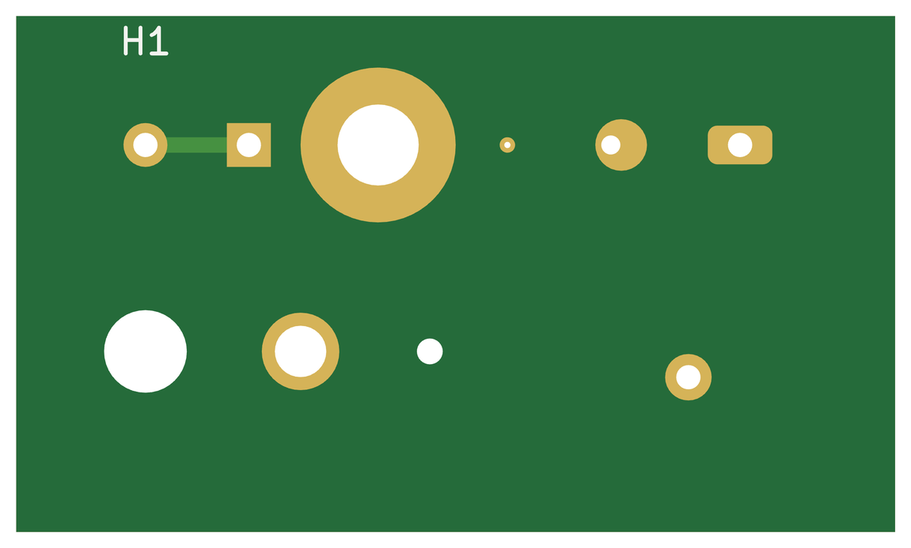
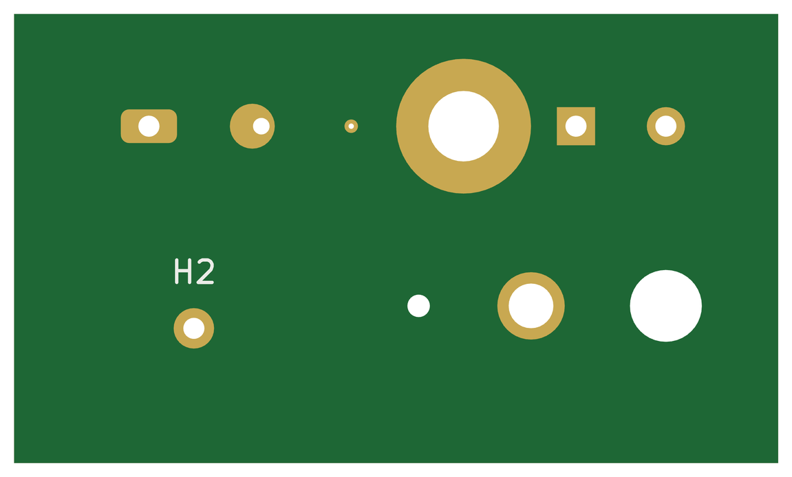
</p>

![02 Round holes: stacked bars of seconds per stage, one format a run; stages 4 and 6 take 45% to 62% of a run. Simulation with GLB takes 0.9 s: read 76 ms, resolve 45 ms, geometry 0.2, materials 0.1 ms, assemble 0.4, write 8 ms, verify 34 ms, start-up and exit 0.2. Simulation with STEP takes 1.2 s: read 73 ms, resolve 46 ms, geometry 0.2, materials 0.1 ms, assemble 0.4, write 0.3, verify 31 ms, start-up and exit 0.2. Simulation with STL takes 0.9 s: read 67 ms, resolve 42 ms, geometry 0.2, materials 0.1 ms, assemble 0.4, write 12 ms, verify 31 ms, start-up and exit 0.2. Simulation with OBJ takes 1.1 s: read 72 ms, resolve 49 ms, geometry 0.2, materials 0.1 ms, assemble 0.4, write 0.2, verify 31 ms, start-up and exit 0.2. Visual with GLB takes 1.0 s: read 71 ms, resolve 46 ms, geometry 0.2, materials 0.1 ms, assemble 0.4, write 6 ms, verify 42 ms, start-up and exit 0.2. Visual with OBJ takes 1.1 s: read 66 ms, resolve 39 ms, geometry 0.2, materials 0.1 ms, assemble 0.4, write 0.1, verify 43 ms, start-up and exit 0.2](https://raw.githubusercontent.com/RolandThsive/KiCad-EM-Stackup-Exporter-KESE/main/docs/images/Feature-Test-Collection/feature_02_holes_round.webp)

| Mode and format | 1–2 read | 3 resolve | 4 geometry | 5 materials | 6 assemble | 7 write | 8 verify | start-up and exit | Total |
|---|---:|---:|---:|---:|---:|---:|---:|---:|---:|
| Simulation, GLB | 76&nbsp;ms | 45&nbsp;ms | 0.2 | 0.1&nbsp;ms | 0.4 | 8&nbsp;ms | 34&nbsp;ms | 0.2 | 0.9 |
| Simulation, STEP | 73&nbsp;ms | 46&nbsp;ms | 0.2 | 0.1&nbsp;ms | 0.4 | 0.3 | 31&nbsp;ms | 0.2 | 1.2 |
| Simulation, STL | 67&nbsp;ms | 42&nbsp;ms | 0.2 | 0.1&nbsp;ms | 0.4 | 12&nbsp;ms | 31&nbsp;ms | 0.2 | 0.9 |
| Simulation, OBJ | 72&nbsp;ms | 49&nbsp;ms | 0.2 | 0.1&nbsp;ms | 0.4 | 0.2 | 31&nbsp;ms | 0.2 | 1.1 |
| Visual, GLB | 71&nbsp;ms | 46&nbsp;ms | 0.2 | 0.1&nbsp;ms | 0.4 | 6&nbsp;ms | 42&nbsp;ms | 0.2 | 1.0 |
| Visual, OBJ | 66&nbsp;ms | 39&nbsp;ms | 0.2 | 0.1&nbsp;ms | 0.4 | 0.1 | 43&nbsp;ms | 0.2 | 1.1 |

<table align="center">
<tr>
<td valign="top">

| Board | `featureTest/`<br>`02_holes_round.kicad_pcb` |
|---|---|
| Outline | 34 × 20 mm |
| Thickness | 1.6 mm |
| Copper&nbsp;layers | 2 |
| Vias | none |
| Board&nbsp;edge | Plain |
| Mask,&nbsp;silkscreen,&nbsp;finish | Not set (drawn green and white),<br>ENIG |

</td>
<td valign="top">

<table>
<tr><th>File<br>type</th><th>File<br>size</th><th>Peak memory<br>used</th></tr>
<tr><th colspan="3" align="left">Simulation</th></tr>
<tr><td>GLB</td><td align="right">1.3 MB</td><td align="right">68 MB</td></tr>
<tr><td>STEP</td><td align="right">4.1 MB</td><td align="right">72 MB</td></tr>
<tr><td>STL</td><td align="right">1.9 MB</td><td align="right">70 MB</td></tr>
<tr><td>OBJ</td><td align="right">3.4 MB</td><td align="right">79 MB</td></tr>
<tr><th colspan="3" align="left">Visual</th></tr>
<tr><td>GLB</td><td align="right">741 kB</td><td align="right">99 MB</td></tr>
<tr><td>OBJ</td><td align="right">2.0 MB</td><td align="right">99 MB</td></tr>
</table>

</td>
</tr>
</table>

### 23.2.3 03 Through Vias

<p align="center">
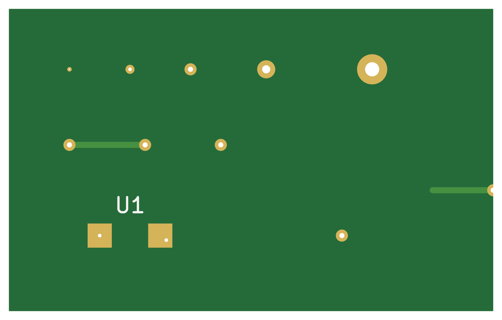
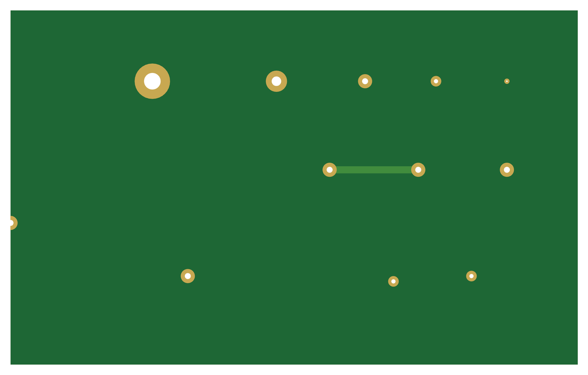
</p>

![03 Through vias: stacked bars of seconds per stage, one format a run; stages 4 and 6 take 55% to 68% of a run. Simulation with GLB takes 1.2 s: read 67 ms, resolve 51 ms, geometry 0.2, materials 0.1 ms, assemble 0.5, write 11 ms, verify 44 ms, start-up and exit 0.2. Simulation with STEP takes 1.6 s: read 71 ms, resolve 58 ms, geometry 0.2, materials 0.1 ms, assemble 0.6, write 0.3, verify 49 ms, start-up and exit 0.2. Simulation with STL takes 1.2 s: read 67 ms, resolve 51 ms, geometry 0.2, materials 0.1 ms, assemble 0.6, write 20 ms, verify 48 ms, start-up and exit 0.2. Simulation with OBJ takes 1.5 s: read 66 ms, resolve 55 ms, geometry 0.2, materials 0.1 ms, assemble 0.6, write 0.3, verify 55 ms, start-up and exit 0.2. Visual with GLB takes 1.2 s: read 67 ms, resolve 55 ms, geometry 0.2, materials 0.1 ms, assemble 0.6, write 6 ms, verify 67 ms, start-up and exit 0.2. Visual with OBJ takes 1.3 s: read 82 ms, resolve 60 ms, geometry 0.2, materials 0.1 ms, assemble 0.6, write 0.1, verify 60 ms, start-up and exit 0.2](https://raw.githubusercontent.com/RolandThsive/KiCad-EM-Stackup-Exporter-KESE/main/docs/images/Feature-Test-Collection/feature_03_vias_through.webp)

| Mode and format | 1–2 read | 3 resolve | 4 geometry | 5 materials | 6 assemble | 7 write | 8 verify | start-up and exit | Total |
|---|---:|---:|---:|---:|---:|---:|---:|---:|---:|
| Simulation, GLB | 67&nbsp;ms | 51&nbsp;ms | 0.2 | 0.1&nbsp;ms | 0.5 | 11&nbsp;ms | 44&nbsp;ms | 0.2 | 1.2 |
| Simulation, STEP | 71&nbsp;ms | 58&nbsp;ms | 0.2 | 0.1&nbsp;ms | 0.6 | 0.3 | 49&nbsp;ms | 0.2 | 1.6 |
| Simulation, STL | 67&nbsp;ms | 51&nbsp;ms | 0.2 | 0.1&nbsp;ms | 0.6 | 20&nbsp;ms | 48&nbsp;ms | 0.2 | 1.2 |
| Simulation, OBJ | 66&nbsp;ms | 55&nbsp;ms | 0.2 | 0.1&nbsp;ms | 0.6 | 0.3 | 55&nbsp;ms | 0.2 | 1.5 |
| Visual, GLB | 67&nbsp;ms | 55&nbsp;ms | 0.2 | 0.1&nbsp;ms | 0.6 | 6&nbsp;ms | 67&nbsp;ms | 0.2 | 1.2 |
| Visual, OBJ | 82&nbsp;ms | 60&nbsp;ms | 0.2 | 0.1&nbsp;ms | 0.6 | 0.1 | 60&nbsp;ms | 0.2 | 1.3 |

<table align="center">
<tr>
<td valign="top">

| Board | `featureTest/`<br>`03_vias_through.kicad_pcb` |
|---|---|
| Outline | 32 × 20 mm |
| Thickness | 1.6 mm |
| Copper&nbsp;layers | 2 |
| Vias | 12 through |
| Board&nbsp;edge | Plain |
| Mask,&nbsp;silkscreen,&nbsp;finish | Not set (drawn green and white),<br>ENIG |

</td>
<td valign="top">

<table>
<tr><th>File<br>type</th><th>File<br>size</th><th>Peak memory<br>used</th></tr>
<tr><th colspan="3" align="left">Simulation</th></tr>
<tr><td>GLB</td><td align="right">1.7 MB</td><td align="right">72 MB</td></tr>
<tr><td>STEP</td><td align="right">5.7 MB</td><td align="right">77 MB</td></tr>
<tr><td>STL</td><td align="right">2.6 MB</td><td align="right">74 MB</td></tr>
<tr><td>OBJ</td><td align="right">4.7 MB</td><td align="right">92 MB</td></tr>
<tr><th colspan="3" align="left">Visual</th></tr>
<tr><td>GLB</td><td align="right">834 kB</td><td align="right">111 MB</td></tr>
<tr><td>OBJ</td><td align="right">2.3 MB</td><td align="right">117 MB</td></tr>
</table>

</td>
</tr>
</table>

### 23.2.4 03b KiCad 10 Via Options

<p align="center">
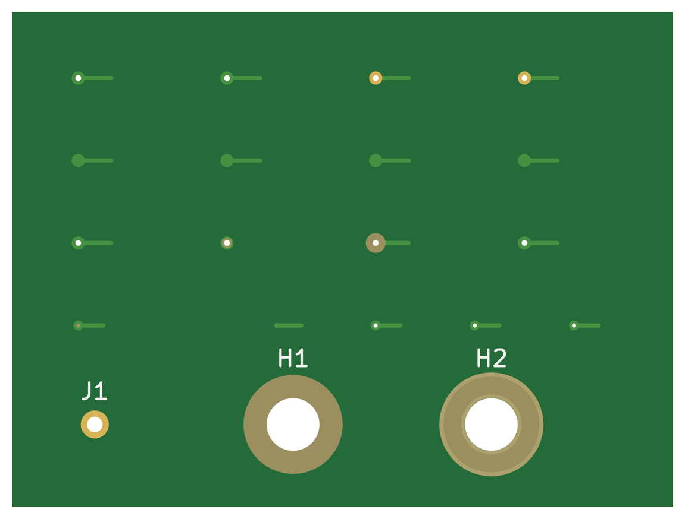
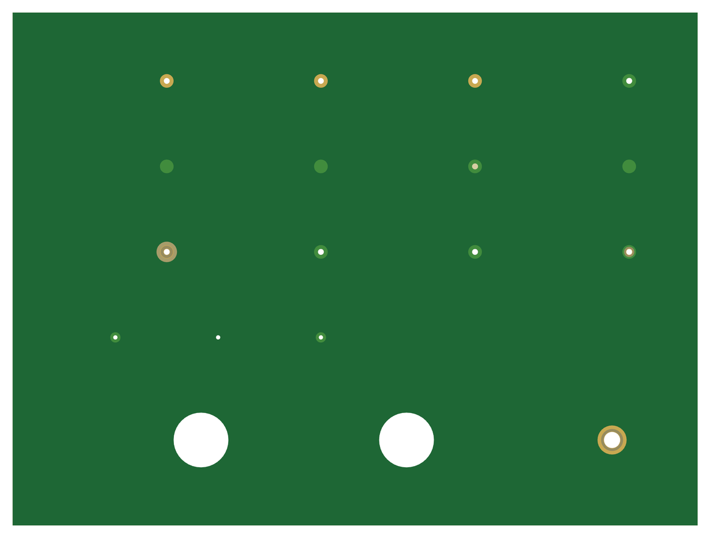
</p>

![03b KiCad 10 via options: stacked bars of seconds per stage, one format a run; stages 4 and 6 take 42% to 82% of a run. Simulation with GLB takes 1.5 s: read 69 ms, resolve 0.1, geometry 0.3, materials 0.1 ms, assemble 0.7, write 16 ms, verify 0.1, start-up and exit 0.2. Simulation with STEP takes 2.2 s: read 80 ms, resolve 0.2, geometry 0.3, materials 0.1 ms, assemble 0.6, write 0.7, verify 0.1, start-up and exit 0.2. Simulation with STL takes 1.4 s: read 76 ms, resolve 0.1, geometry 0.3, materials 0.2 ms, assemble 0.6, write 25 ms, verify 97 ms, start-up and exit 0.2. Simulation with OBJ takes 1.8 s: read 75 ms, resolve 0.1, geometry 0.3, materials 0.2 ms, assemble 0.6, write 0.4, verify 94 ms, start-up and exit 0.2. Visual with GLB takes 3.2 s: read 92 ms, resolve 0.2, geometry 0.3, materials 0.1 ms, assemble 2.4, write 14 ms, verify 90 ms, start-up and exit 0.2. Visual with OBJ takes 3.5 s: read 74 ms, resolve 0.2, geometry 0.3, materials 0.1 ms, assemble 2.4, write 0.3, verify 78 ms, start-up and exit 0.2](https://raw.githubusercontent.com/RolandThsive/KiCad-EM-Stackup-Exporter-KESE/main/docs/images/Feature-Test-Collection/feature_03b_vias_k10.webp)

| Mode and format | 1–2 read | 3 resolve | 4 geometry | 5 materials | 6 assemble | 7 write | 8 verify | start-up and exit | Total |
|---|---:|---:|---:|---:|---:|---:|---:|---:|---:|
| Simulation, GLB | 69&nbsp;ms | 0.1 | 0.3 | 0.1&nbsp;ms | 0.7 | 16&nbsp;ms | 0.1 | 0.2 | 1.5 |
| Simulation, STEP | 80&nbsp;ms | 0.2 | 0.3 | 0.1&nbsp;ms | 0.6 | 0.7 | 0.1 | 0.2 | 2.2 |
| Simulation, STL | 76&nbsp;ms | 0.1 | 0.3 | 0.2&nbsp;ms | 0.6 | 25&nbsp;ms | 97&nbsp;ms | 0.2 | 1.4 |
| Simulation, OBJ | 75&nbsp;ms | 0.1 | 0.3 | 0.2&nbsp;ms | 0.6 | 0.4 | 94&nbsp;ms | 0.2 | 1.8 |
| Visual, GLB | 92&nbsp;ms | 0.2 | 0.3 | 0.1&nbsp;ms | 2.4 | 14&nbsp;ms | 90&nbsp;ms | 0.2 | 3.2 |
| Visual, OBJ | 74&nbsp;ms | 0.2 | 0.3 | 0.1&nbsp;ms | 2.4 | 0.3 | 78&nbsp;ms | 0.2 | 3.5 |

<table align="center">
<tr>
<td valign="top">

| Board | `featureTest/`<br>`03b_vias_k10.kicad_pcb` |
|---|---|
| Outline | 40 × 30 mm |
| Thickness | 1.6 mm |
| Copper&nbsp;layers | 4 |
| Vias | 18: 1 micro, 2 blind and buried,<br>15 through |
| Board&nbsp;edge | Plain |
| Mask,&nbsp;silkscreen,&nbsp;finish | Not set (drawn green and white),<br>ENIG |

</td>
<td valign="top">

<table>
<tr><th>File<br>type</th><th>File<br>size</th><th>Peak memory<br>used</th></tr>
<tr><th colspan="3" align="left">Simulation</th></tr>
<tr><td>GLB</td><td align="right">2.6 MB</td><td align="right">171 MB</td></tr>
<tr><td>STEP</td><td align="right">7.1 MB</td><td align="right">177 MB</td></tr>
<tr><td>STL</td><td align="right">4.0 MB</td><td align="right">173 MB</td></tr>
<tr><td>OBJ</td><td align="right">7.4 MB</td><td align="right">173 MB</td></tr>
<tr><th colspan="3" align="left">Visual</th></tr>
<tr><td>GLB</td><td align="right">1.6 MB</td><td align="right">153 MB</td></tr>
<tr><td>OBJ</td><td align="right">4.6 MB</td><td align="right">153 MB</td></tr>
</table>

</td>
</tr>
</table>

### 23.2.5 04 Blind And Buried Vias

<p align="center">

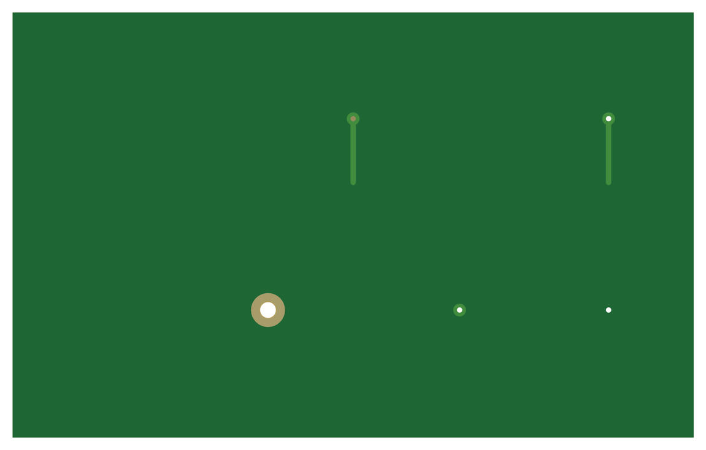
</p>

![04 Blind and buried vias: stacked bars of seconds per stage, one format a run; stages 4 and 6 take 37% to 54% of a run. Simulation with GLB takes 0.7 s: read 73 ms, resolve 51 ms, geometry 62 ms, materials 0.1 ms, assemble 0.2, write 5 ms, verify 26 ms, start-up and exit 0.2. Simulation with STEP takes 0.8 s: read 68 ms, resolve 50 ms, geometry 59 ms, materials 0.1 ms, assemble 0.2, write 0.2, verify 22 ms, start-up and exit 0.2. Simulation with STL takes 0.6 s: read 68 ms, resolve 51 ms, geometry 59 ms, materials 0.1 ms, assemble 0.2, write 8 ms, verify 21 ms, start-up and exit 0.2. Simulation with OBJ takes 0.7 s: read 66 ms, resolve 55 ms, geometry 62 ms, materials 0.1 ms, assemble 0.2, write 0.1, verify 22 ms, start-up and exit 0.2. Visual with GLB takes 0.8 s: read 70 ms, resolve 54 ms, geometry 59 ms, materials 0.1 ms, assemble 0.4, write 5 ms, verify 37 ms, start-up and exit 0.2. Visual with OBJ takes 0.8 s: read 69 ms, resolve 53 ms, geometry 63 ms, materials 0.1 ms, assemble 0.4, write 47 ms, verify 32 ms, start-up and exit 0.2](https://raw.githubusercontent.com/RolandThsive/KiCad-EM-Stackup-Exporter-KESE/main/docs/images/Feature-Test-Collection/feature_04_vias_blind_buried.webp)

| Mode and format | 1–2 read | 3 resolve | 4 geometry | 5 materials | 6 assemble | 7 write | 8 verify | start-up and exit | Total |
|---|---:|---:|---:|---:|---:|---:|---:|---:|---:|
| Simulation, GLB | 73&nbsp;ms | 51&nbsp;ms | 62&nbsp;ms | 0.1&nbsp;ms | 0.2 | 5&nbsp;ms | 26&nbsp;ms | 0.2 | 0.7 |
| Simulation, STEP | 68&nbsp;ms | 50&nbsp;ms | 59&nbsp;ms | 0.1&nbsp;ms | 0.2 | 0.2 | 22&nbsp;ms | 0.2 | 0.8 |
| Simulation, STL | 68&nbsp;ms | 51&nbsp;ms | 59&nbsp;ms | 0.1&nbsp;ms | 0.2 | 8&nbsp;ms | 21&nbsp;ms | 0.2 | 0.6 |
| Simulation, OBJ | 66&nbsp;ms | 55&nbsp;ms | 62&nbsp;ms | 0.1&nbsp;ms | 0.2 | 0.1 | 22&nbsp;ms | 0.2 | 0.7 |
| Visual, GLB | 70&nbsp;ms | 54&nbsp;ms | 59&nbsp;ms | 0.1&nbsp;ms | 0.4 | 5&nbsp;ms | 37&nbsp;ms | 0.2 | 0.8 |
| Visual, OBJ | 69&nbsp;ms | 53&nbsp;ms | 63&nbsp;ms | 0.1&nbsp;ms | 0.4 | 47&nbsp;ms | 32&nbsp;ms | 0.2 | 0.8 |

<table align="center">
<tr>
<td valign="top">

| Board | `featureTest/`<br>`04_vias_blind_buried.kicad_pcb` |
|---|---|
| Outline | 32 × 20 mm |
| Thickness | 1.6 mm |
| Copper&nbsp;layers | 6 |
| Vias | 6: 3 blind and buried, 3 through |
| Board&nbsp;edge | Plain |
| Mask,&nbsp;silkscreen,&nbsp;finish | Not set (drawn green and white),<br>ENIG |

</td>
<td valign="top">

<table>
<tr><th>File<br>type</th><th>File<br>size</th><th>Peak memory<br>used</th></tr>
<tr><th colspan="3" align="left">Simulation</th></tr>
<tr><td>GLB</td><td align="right">679 kB</td><td align="right">69 MB</td></tr>
<tr><td>STEP</td><td align="right">1.5 MB</td><td align="right">67 MB</td></tr>
<tr><td>STL</td><td align="right">1.0 MB</td><td align="right">66 MB</td></tr>
<tr><td>OBJ</td><td align="right">1.8 MB</td><td align="right">70 MB</td></tr>
<tr><th colspan="3" align="left">Visual</th></tr>
<tr><td>GLB</td><td align="right">327 kB</td><td align="right">91 MB</td></tr>
<tr><td>OBJ</td><td align="right">815 kB</td><td align="right">92 MB</td></tr>
</table>

</td>
</tr>
</table>

### 23.2.6 05 Microvias

<p align="center">


</p>

![05 Microvias: stacked bars of seconds per stage, one format a run; stages 4 and 6 take 40% to 54% of a run. Simulation with GLB takes 0.6 s: read 3 ms, resolve 54 ms, geometry 61 ms, materials 0.1 ms, assemble 0.2, write 5 ms, verify 21 ms, start-up and exit 0.2. Simulation with STEP takes 0.6 s: read 3 ms, resolve 55 ms, geometry 49 ms, materials 0.1 ms, assemble 0.2, write 0.1, verify 20 ms, start-up and exit 0.2. Simulation with STL takes 0.6 s: read 3 ms, resolve 50 ms, geometry 57 ms, materials 0.1 ms, assemble 0.2, write 6 ms, verify 25 ms, start-up and exit 0.2. Simulation with OBJ takes 0.6 s: read 3 ms, resolve 58 ms, geometry 49 ms, materials 0.1 ms, assemble 0.2, write 97 ms, verify 22 ms, start-up and exit 0.2. Visual with GLB takes 0.7 s: read 4 ms, resolve 60 ms, geometry 52 ms, materials 0.1 ms, assemble 0.3, write 3 ms, verify 49 ms, start-up and exit 0.2. Visual with OBJ takes 0.7 s: read 3 ms, resolve 59 ms, geometry 55 ms, materials 0.1 ms, assemble 0.3, write 30 ms, verify 49 ms, start-up and exit 0.2](https://raw.githubusercontent.com/RolandThsive/KiCad-EM-Stackup-Exporter-KESE/main/docs/images/Feature-Test-Collection/feature_05_vias_micro.webp)

| Mode and format | 1–2 read | 3 resolve | 4 geometry | 5 materials | 6 assemble | 7 write | 8 verify | start-up and exit | Total |
|---|---:|---:|---:|---:|---:|---:|---:|---:|---:|
| Simulation, GLB | 3&nbsp;ms | 54&nbsp;ms | 61&nbsp;ms | 0.1&nbsp;ms | 0.2 | 5&nbsp;ms | 21&nbsp;ms | 0.2 | 0.6 |
| Simulation, STEP | 3&nbsp;ms | 55&nbsp;ms | 49&nbsp;ms | 0.1&nbsp;ms | 0.2 | 0.1 | 20&nbsp;ms | 0.2 | 0.6 |
| Simulation, STL | 3&nbsp;ms | 50&nbsp;ms | 57&nbsp;ms | 0.1&nbsp;ms | 0.2 | 6&nbsp;ms | 25&nbsp;ms | 0.2 | 0.6 |
| Simulation, OBJ | 3&nbsp;ms | 58&nbsp;ms | 49&nbsp;ms | 0.1&nbsp;ms | 0.2 | 97&nbsp;ms | 22&nbsp;ms | 0.2 | 0.6 |
| Visual, GLB | 4&nbsp;ms | 60&nbsp;ms | 52&nbsp;ms | 0.1&nbsp;ms | 0.3 | 3&nbsp;ms | 49&nbsp;ms | 0.2 | 0.7 |
| Visual, OBJ | 3&nbsp;ms | 59&nbsp;ms | 55&nbsp;ms | 0.1&nbsp;ms | 0.3 | 30&nbsp;ms | 49&nbsp;ms | 0.2 | 0.7 |

<table align="center">
<tr>
<td valign="top">

| Board | `featureTest/`<br>`05_vias_micro.kicad_pcb` |
|---|---|
| Outline | 30 × 16 mm |
| Thickness | 1.6 mm |
| Copper&nbsp;layers | 8 |
| Vias | 12: 10 micro, 2 blind and buried |
| Board&nbsp;edge | Plain |
| Mask,&nbsp;silkscreen,&nbsp;finish | Mask colour not set (drawn green),<br>no silkscreen, ENIG |

</td>
<td valign="top">

<table>
<tr><th>File<br>type</th><th>File<br>size</th><th>Peak memory<br>used</th></tr>
<tr><th colspan="3" align="left">Simulation</th></tr>
<tr><td>GLB</td><td align="right">584 kB</td><td align="right">45 MB</td></tr>
<tr><td>STEP</td><td align="right">1.1 MB</td><td align="right">47 MB</td></tr>
<tr><td>STL</td><td align="right">859 kB</td><td align="right">46 MB</td></tr>
<tr><td>OBJ</td><td align="right">1.5 MB</td><td align="right">50 MB</td></tr>
<tr><th colspan="3" align="left">Visual</th></tr>
<tr><td>GLB</td><td align="right">206 kB</td><td align="right">80 MB</td></tr>
<tr><td>OBJ</td><td align="right">497 kB</td><td align="right">82 MB</td></tr>
</table>

</td>
</tr>
</table>

### 23.2.7 24 Backdrills

<p align="center">


</p>

![24 Backdrills: stacked bars of seconds per stage, one format a run; stages 4 and 6 take 40% to 75% of a run. Simulation with GLB takes 1.5 s: read 82 ms, resolve 0.2, geometry 0.3, materials 0.1 ms, assemble 0.6, write 22 ms, verify 90 ms, start-up and exit 0.2. Simulation with STEP takes 2.2 s: read 73 ms, resolve 0.2, geometry 0.3, materials 0.2 ms, assemble 0.6, write 0.8, verify 90 ms, start-up and exit 0.2. Simulation with STL takes 1.3 s: read 72 ms, resolve 0.2, geometry 0.2, materials 0.2 ms, assemble 0.6, write 28 ms, verify 86 ms, start-up and exit 0.2. Simulation with OBJ takes 1.9 s: read 70 ms, resolve 0.2, geometry 0.2, materials 0.2 ms, assemble 0.6, write 0.5, verify 90 ms, start-up and exit 0.2. Visual with GLB takes 2.0 s: read 70 ms, resolve 0.2, geometry 0.3, materials 0.2 ms, assemble 1.3, write 12 ms, verify 75 ms, start-up and exit 0.2. Visual with OBJ takes 2.3 s: read 72 ms, resolve 0.2, geometry 0.3, materials 0.1 ms, assemble 1.3, write 0.3, verify 68 ms, start-up and exit 0.2](https://raw.githubusercontent.com/RolandThsive/KiCad-EM-Stackup-Exporter-KESE/main/docs/images/Feature-Test-Collection/feature_24_backdrills.webp)

| Mode and format | 1–2 read | 3 resolve | 4 geometry | 5 materials | 6 assemble | 7 write | 8 verify | start-up and exit | Total |
|---|---:|---:|---:|---:|---:|---:|---:|---:|---:|
| Simulation, GLB | 82&nbsp;ms | 0.2 | 0.3 | 0.1&nbsp;ms | 0.6 | 22&nbsp;ms | 90&nbsp;ms | 0.2 | 1.5 |
| Simulation, STEP | 73&nbsp;ms | 0.2 | 0.3 | 0.2&nbsp;ms | 0.6 | 0.8 | 90&nbsp;ms | 0.2 | 2.2 |
| Simulation, STL | 72&nbsp;ms | 0.2 | 0.2 | 0.2&nbsp;ms | 0.6 | 28&nbsp;ms | 86&nbsp;ms | 0.2 | 1.3 |
| Simulation, OBJ | 70&nbsp;ms | 0.2 | 0.2 | 0.2&nbsp;ms | 0.6 | 0.5 | 90&nbsp;ms | 0.2 | 1.9 |
| Visual, GLB | 70&nbsp;ms | 0.2 | 0.3 | 0.2&nbsp;ms | 1.3 | 12&nbsp;ms | 75&nbsp;ms | 0.2 | 2.0 |
| Visual, OBJ | 72&nbsp;ms | 0.2 | 0.3 | 0.1&nbsp;ms | 1.3 | 0.3 | 68&nbsp;ms | 0.2 | 2.3 |

<table align="center">
<tr>
<td valign="top">

| Board | `featureTest/`<br>`24_backdrills.kicad_pcb` |
|---|---|
| Outline | 52 × 32 mm |
| Thickness | 1.6 mm |
| Copper&nbsp;layers | 6 |
| Vias | 15: 1 blind and buried, 14 through |
| Board&nbsp;edge | Plain |
| Mask,&nbsp;silkscreen,&nbsp;finish | Not set (drawn green and white),<br>ENIG |

</td>
<td valign="top">

<table>
<tr><th>File<br>type</th><th>File<br>size</th><th>Peak memory<br>used</th></tr>
<tr><th colspan="3" align="left">Simulation</th></tr>
<tr><td>GLB</td><td align="right">3.6 MB</td><td align="right">173 MB</td></tr>
<tr><td>STEP</td><td align="right">10.0 MB</td><td align="right">180 MB</td></tr>
<tr><td>STL</td><td align="right">5.4 MB</td><td align="right">173 MB</td></tr>
<tr><td>OBJ</td><td align="right">10.0 MB</td><td align="right">172 MB</td></tr>
<tr><th colspan="3" align="left">Visual</th></tr>
<tr><td>GLB</td><td align="right">1.8 MB</td><td align="right">151 MB</td></tr>
<tr><td>OBJ</td><td align="right">5.0 MB</td><td align="right">151 MB</td></tr>
</table>

</td>
</tr>
</table>

### 23.2.8 25 Counterbores And Countersinks

<p align="center">

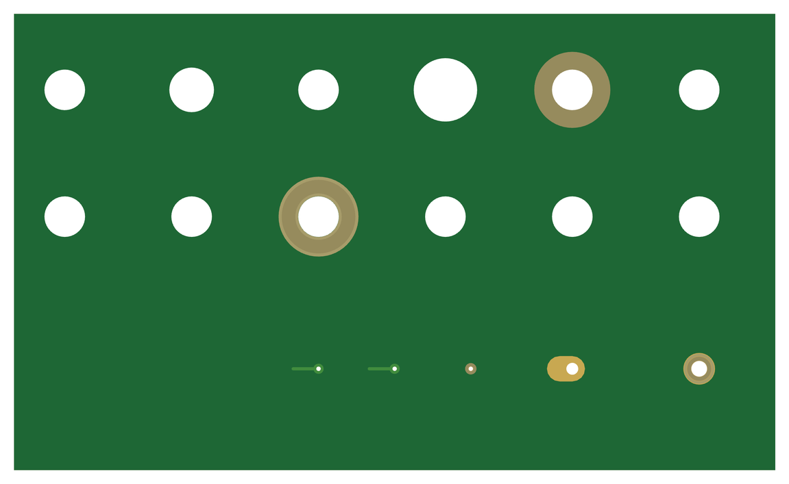
</p>

![25 Counterbores and countersinks: stacked bars of seconds per stage, one format a run; stages 4 and 6 take 63% to 89% of a run. Simulation with GLB takes 2.9 s: read 76 ms, resolve 0.1, geometry 0.8, materials 0.1 ms, assemble 1.5, write 15 ms, verify 0.1, start-up and exit 0.2. Simulation with STEP takes 3.8 s: read 75 ms, resolve 0.1, geometry 0.8, materials 0.1 ms, assemble 1.6, write 0.9, verify 0.1, start-up and exit 0.2. Simulation with STL takes 3.0 s: read 74 ms, resolve 0.2, geometry 0.9, materials 0.1 ms, assemble 1.5, write 21 ms, verify 0.1, start-up and exit 0.2. Simulation with OBJ takes 3.5 s: read 74 ms, resolve 0.1, geometry 0.9, materials 0.1 ms, assemble 1.6, write 0.4, verify 0.2, start-up and exit 0.2. Visual with GLB takes 4.9 s: read 75 ms, resolve 0.1, geometry 0.9, materials 0.1 ms, assemble 3.5, write 14 ms, verify 88 ms, start-up and exit 0.2. Visual with OBJ takes 5.4 s: read 81 ms, resolve 0.1, geometry 0.9, materials 0.1 ms, assemble 3.6, write 0.4, verify 77 ms, start-up and exit 0.2](https://raw.githubusercontent.com/RolandThsive/KiCad-EM-Stackup-Exporter-KESE/main/docs/images/Feature-Test-Collection/feature_25_post_machining.webp)

| Mode and format | 1–2 read | 3 resolve | 4 geometry | 5 materials | 6 assemble | 7 write | 8 verify | start-up and exit | Total |
|---|---:|---:|---:|---:|---:|---:|---:|---:|---:|
| Simulation, GLB | 76&nbsp;ms | 0.1 | 0.8 | 0.1&nbsp;ms | 1.5 | 15&nbsp;ms | 0.1 | 0.2 | 2.9 |
| Simulation, STEP | 75&nbsp;ms | 0.1 | 0.8 | 0.1&nbsp;ms | 1.6 | 0.9 | 0.1 | 0.2 | 3.8 |
| Simulation, STL | 74&nbsp;ms | 0.2 | 0.9 | 0.1&nbsp;ms | 1.5 | 21&nbsp;ms | 0.1 | 0.2 | 3.0 |
| Simulation, OBJ | 74&nbsp;ms | 0.1 | 0.9 | 0.1&nbsp;ms | 1.6 | 0.4 | 0.2 | 0.2 | 3.5 |
| Visual, GLB | 75&nbsp;ms | 0.1 | 0.9 | 0.1&nbsp;ms | 3.5 | 14&nbsp;ms | 88&nbsp;ms | 0.2 | 4.9 |
| Visual, OBJ | 81&nbsp;ms | 0.1 | 0.9 | 0.1&nbsp;ms | 3.6 | 0.4 | 77&nbsp;ms | 0.2 | 5.4 |

<table align="center">
<tr>
<td valign="top">

| Board | `featureTest/`<br>`25_post_machining.kicad_pcb` |
|---|---|
| Outline | 60 × 36 mm |
| Thickness | 1.6 mm |
| Copper&nbsp;layers | 4 |
| Vias | 3 through |
| Board&nbsp;edge | Plain |
| Mask,&nbsp;silkscreen,&nbsp;finish | Not set (drawn green and white),<br>ENIG |

</td>
<td valign="top">

<table>
<tr><th>File<br>type</th><th>File<br>size</th><th>Peak memory<br>used</th></tr>
<tr><th colspan="3" align="left">Simulation</th></tr>
<tr><td>GLB</td><td align="right">2.7 MB</td><td align="right">205 MB</td></tr>
<tr><td>STEP</td><td align="right">3.6 MB</td><td align="right">204 MB</td></tr>
<tr><td>STL</td><td align="right">3.7 MB</td><td align="right">208 MB</td></tr>
<tr><td>OBJ</td><td align="right">7.4 MB</td><td align="right">204 MB</td></tr>
<tr><th colspan="3" align="left">Visual</th></tr>
<tr><td>GLB</td><td align="right">2.2 MB</td><td align="right">173 MB</td></tr>
<tr><td>OBJ</td><td align="right">6.3 MB</td><td align="right">173 MB</td></tr>
</table>

</td>
</tr>
</table>

### 23.2.9 26 Via Protection

<p align="center">


</p>

![26 Via protection: stacked bars of seconds per stage, one format a run; stages 4 and 6 take 38% to 73% of a run. Simulation with GLB takes 1.1 s: read 6 ms, resolve 0.1, geometry 0.2, materials 0.1 ms, assemble 0.5, write 16 ms, verify 59 ms, start-up and exit 0.2. Simulation with STEP takes 1.7 s: read 5 ms, resolve 0.1, geometry 0.1, materials 0.1 ms, assemble 0.5, write 0.7, verify 62 ms, start-up and exit 0.2. Simulation with STL takes 1.1 s: read 5 ms, resolve 0.1, geometry 0.2, materials 0.1 ms, assemble 0.5, write 20 ms, verify 59 ms, start-up and exit 0.2. Simulation with OBJ takes 1.5 s: read 5 ms, resolve 0.1, geometry 0.2, materials 0.2 ms, assemble 0.5, write 0.4, verify 62 ms, start-up and exit 0.2. Visual with GLB takes 1.6 s: read 5 ms, resolve 0.1, geometry 0.2, materials 0.2 ms, assemble 1.0, write 8 ms, verify 0.1, start-up and exit 0.2. Visual with OBJ takes 1.9 s: read 5 ms, resolve 0.1, geometry 0.2, materials 0.2 ms, assemble 1.1, write 0.2, verify 73 ms, start-up and exit 0.2](https://raw.githubusercontent.com/RolandThsive/KiCad-EM-Stackup-Exporter-KESE/main/docs/images/Feature-Test-Collection/feature_26_via_protection.webp)

| Mode and format | 1–2 read | 3 resolve | 4 geometry | 5 materials | 6 assemble | 7 write | 8 verify | start-up and exit | Total |
|---|---:|---:|---:|---:|---:|---:|---:|---:|---:|
| Simulation, GLB | 6&nbsp;ms | 0.1 | 0.2 | 0.1&nbsp;ms | 0.5 | 16&nbsp;ms | 59&nbsp;ms | 0.2 | 1.1 |
| Simulation, STEP | 5&nbsp;ms | 0.1 | 0.1 | 0.1&nbsp;ms | 0.5 | 0.7 | 62&nbsp;ms | 0.2 | 1.7 |
| Simulation, STL | 5&nbsp;ms | 0.1 | 0.2 | 0.1&nbsp;ms | 0.5 | 20&nbsp;ms | 59&nbsp;ms | 0.2 | 1.1 |
| Simulation, OBJ | 5&nbsp;ms | 0.1 | 0.2 | 0.2&nbsp;ms | 0.5 | 0.4 | 62&nbsp;ms | 0.2 | 1.5 |
| Visual, GLB | 5&nbsp;ms | 0.1 | 0.2 | 0.2&nbsp;ms | 1.0 | 8&nbsp;ms | 0.1 | 0.2 | 1.6 |
| Visual, OBJ | 5&nbsp;ms | 0.1 | 0.2 | 0.2&nbsp;ms | 1.1 | 0.2 | 73&nbsp;ms | 0.2 | 1.9 |

<table align="center">
<tr>
<td valign="top">

| Board | `featureTest/`<br>`26_via_protection.kicad_pcb` |
|---|---|
| Outline | 60 × 24 mm |
| Thickness | 1.6 mm |
| Copper&nbsp;layers | 4 |
| Vias | 22: 3 blind and buried, 19 through |
| Board&nbsp;edge | Plain |
| Mask,&nbsp;silkscreen,&nbsp;finish | Mask colour not set (drawn green),<br>no silkscreen, ENIG |

</td>
<td valign="top">

<table>
<tr><th>File<br>type</th><th>File<br>size</th><th>Peak memory<br>used</th></tr>
<tr><th colspan="3" align="left">Simulation</th></tr>
<tr><td>GLB</td><td align="right">2.2 MB</td><td align="right">154 MB</td></tr>
<tr><td>STEP</td><td align="right">6.7 MB</td><td align="right">155 MB</td></tr>
<tr><td>STL</td><td align="right">3.6 MB</td><td align="right">152 MB</td></tr>
<tr><td>OBJ</td><td align="right">6.7 MB</td><td align="right">150 MB</td></tr>
<tr><th colspan="3" align="left">Visual</th></tr>
<tr><td>GLB</td><td align="right">1.1 MB</td><td align="right">131 MB</td></tr>
<tr><td>OBJ</td><td align="right">3.1 MB</td><td align="right">130 MB</td></tr>
</table>

</td>
</tr>
</table>

## 23.3 Pads

### 23.3.1 06 Padstacks

<p align="center">
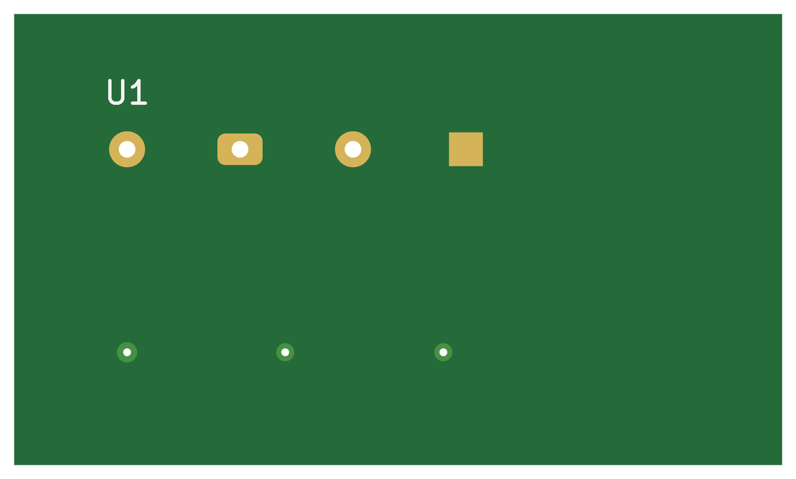

</p>

![06 Padstacks: stacked bars of seconds per stage, one format a run; stages 4 and 6 take 44% to 64% of a run. Simulation with GLB takes 0.7 s: read 68 ms, resolve 48 ms, geometry 92 ms, materials 0.1 ms, assemble 0.3, write 7 ms, verify 29 ms, start-up and exit 0.2. Simulation with STEP takes 1.0 s: read 69 ms, resolve 47 ms, geometry 99 ms, materials 0.1 ms, assemble 0.3, write 0.2, verify 30 ms, start-up and exit 0.2. Simulation with STL takes 0.8 s: read 71 ms, resolve 51 ms, geometry 93 ms, materials 0.1 ms, assemble 0.3, write 9 ms, verify 32 ms, start-up and exit 0.2. Simulation with OBJ takes 0.9 s: read 80 ms, resolve 46 ms, geometry 89 ms, materials 0.1 ms, assemble 0.3, write 0.2, verify 35 ms, start-up and exit 0.2. Visual with GLB takes 0.9 s: read 65 ms, resolve 47 ms, geometry 0.1, materials 0.1 ms, assemble 0.5, write 4 ms, verify 33 ms, start-up and exit 0.2. Visual with OBJ takes 0.9 s: read 68 ms, resolve 48 ms, geometry 93 ms, materials 0.1 ms, assemble 0.4, write 73 ms, verify 32 ms, start-up and exit 0.2](https://raw.githubusercontent.com/RolandThsive/KiCad-EM-Stackup-Exporter-KESE/main/docs/images/Feature-Test-Collection/feature_06_padstacks.webp)

| Mode and format | 1–2 read | 3 resolve | 4 geometry | 5 materials | 6 assemble | 7 write | 8 verify | start-up and exit | Total |
|---|---:|---:|---:|---:|---:|---:|---:|---:|---:|
| Simulation, GLB | 68&nbsp;ms | 48&nbsp;ms | 92&nbsp;ms | 0.1&nbsp;ms | 0.3 | 7&nbsp;ms | 29&nbsp;ms | 0.2 | 0.7 |
| Simulation, STEP | 69&nbsp;ms | 47&nbsp;ms | 99&nbsp;ms | 0.1&nbsp;ms | 0.3 | 0.2 | 30&nbsp;ms | 0.2 | 1.0 |
| Simulation, STL | 71&nbsp;ms | 51&nbsp;ms | 93&nbsp;ms | 0.1&nbsp;ms | 0.3 | 9&nbsp;ms | 32&nbsp;ms | 0.2 | 0.8 |
| Simulation, OBJ | 80&nbsp;ms | 46&nbsp;ms | 89&nbsp;ms | 0.1&nbsp;ms | 0.3 | 0.2 | 35&nbsp;ms | 0.2 | 0.9 |
| Visual, GLB | 65&nbsp;ms | 47&nbsp;ms | 0.1 | 0.1&nbsp;ms | 0.5 | 4&nbsp;ms | 33&nbsp;ms | 0.2 | 0.9 |
| Visual, OBJ | 68&nbsp;ms | 48&nbsp;ms | 93&nbsp;ms | 0.1&nbsp;ms | 0.4 | 73&nbsp;ms | 32&nbsp;ms | 0.2 | 0.9 |

<table align="center">
<tr>
<td valign="top">

| Board | `featureTest/`<br>`06_padstacks.kicad_pcb` |
|---|---|
| Outline | 34 × 20 mm |
| Thickness | 1.6 mm |
| Copper&nbsp;layers | 4 |
| Vias | 3 through |
| Board&nbsp;edge | Plain |
| Mask,&nbsp;silkscreen,&nbsp;finish | Not set (drawn green and white),<br>ENIG |

</td>
<td valign="top">

<table>
<tr><th>File<br>type</th><th>File<br>size</th><th>Peak memory<br>used</th></tr>
<tr><th colspan="3" align="left">Simulation</th></tr>
<tr><td>GLB</td><td align="right">948 kB</td><td align="right">70 MB</td></tr>
<tr><td>STEP</td><td align="right">2.6 MB</td><td align="right">69 MB</td></tr>
<tr><td>STL</td><td align="right">1.4 MB</td><td align="right">68 MB</td></tr>
<tr><td>OBJ</td><td align="right">2.6 MB</td><td align="right">74 MB</td></tr>
<tr><th colspan="3" align="left">Visual</th></tr>
<tr><td>GLB</td><td align="right">481 kB</td><td align="right">92 MB</td></tr>
<tr><td>OBJ</td><td align="right">1.3 MB</td><td align="right">93 MB</td></tr>
</table>

</td>
</tr>
</table>

### 23.3.2 07 Pad Shapes

<p align="center">
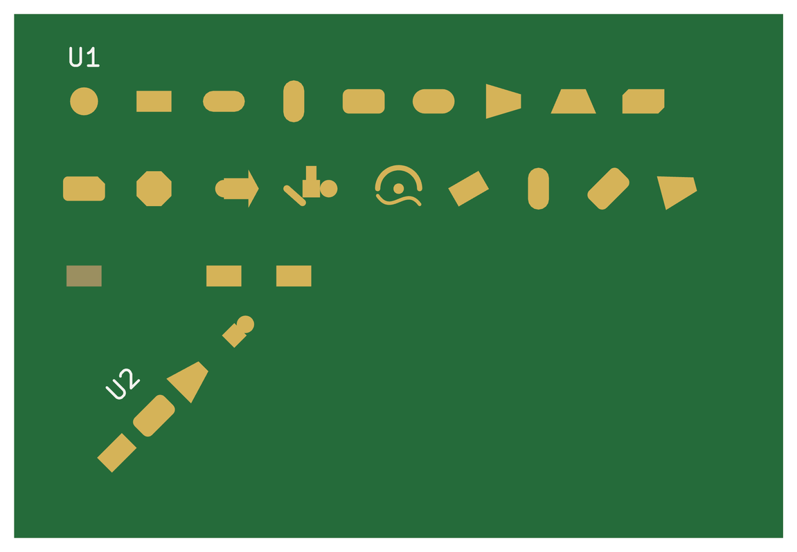
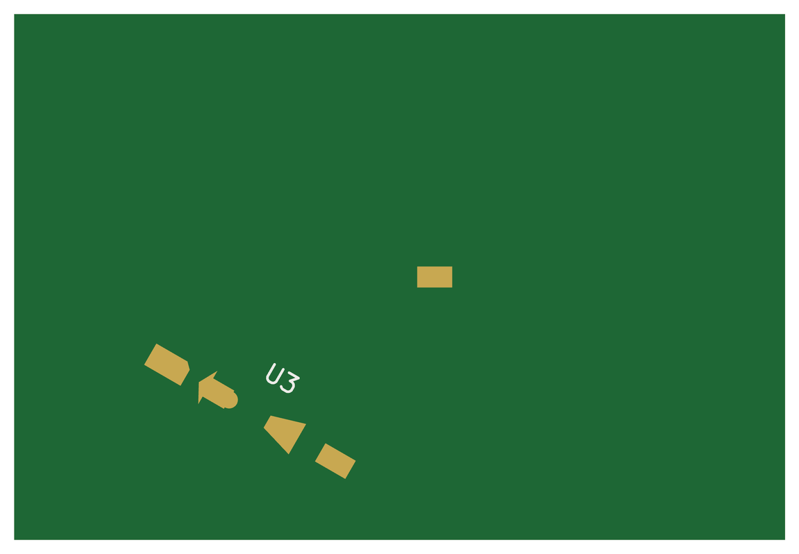
</p>

![07 Pad shapes: stacked bars of seconds per stage, one format a run; stages 4 and 6 take 40% to 66% of a run. Simulation with GLB takes 0.7 s: read 74 ms, resolve 40 ms, geometry 0.1, materials 0.1 ms, assemble 0.3, write 9 ms, verify 25 ms, start-up and exit 0.2. Simulation with STEP takes 1.0 s: read 77 ms, resolve 44 ms, geometry 0.1, materials 0.1 ms, assemble 0.3, write 0.3, verify 25 ms, start-up and exit 0.2. Simulation with STL takes 0.7 s: read 72 ms, resolve 41 ms, geometry 0.1, materials 0.1 ms, assemble 0.3, write 12 ms, verify 23 ms, start-up and exit 0.2. Simulation with OBJ takes 0.9 s: read 90 ms, resolve 37 ms, geometry 0.1, materials 0.1 ms, assemble 0.3, write 0.1, verify 22 ms, start-up and exit 0.2. Visual with GLB takes 1.0 s: read 73 ms, resolve 43 ms, geometry 0.1, materials 0.2 ms, assemble 0.5, write 5 ms, verify 41 ms, start-up and exit 0.2. Visual with OBJ takes 1.1 s: read 76 ms, resolve 37 ms, geometry 0.1, materials 0.1 ms, assemble 0.5, write 0.1, verify 50 ms, start-up and exit 0.2](https://raw.githubusercontent.com/RolandThsive/KiCad-EM-Stackup-Exporter-KESE/main/docs/images/Feature-Test-Collection/feature_07_pad_shapes.webp)

| Mode and format | 1–2 read | 3 resolve | 4 geometry | 5 materials | 6 assemble | 7 write | 8 verify | start-up and exit | Total |
|---|---:|---:|---:|---:|---:|---:|---:|---:|---:|
| Simulation, GLB | 74&nbsp;ms | 40&nbsp;ms | 0.1 | 0.1&nbsp;ms | 0.3 | 9&nbsp;ms | 25&nbsp;ms | 0.2 | 0.7 |
| Simulation, STEP | 77&nbsp;ms | 44&nbsp;ms | 0.1 | 0.1&nbsp;ms | 0.3 | 0.3 | 25&nbsp;ms | 0.2 | 1.0 |
| Simulation, STL | 72&nbsp;ms | 41&nbsp;ms | 0.1 | 0.1&nbsp;ms | 0.3 | 12&nbsp;ms | 23&nbsp;ms | 0.2 | 0.7 |
| Simulation, OBJ | 90&nbsp;ms | 37&nbsp;ms | 0.1 | 0.1&nbsp;ms | 0.3 | 0.1 | 22&nbsp;ms | 0.2 | 0.9 |
| Visual, GLB | 73&nbsp;ms | 43&nbsp;ms | 0.1 | 0.2&nbsp;ms | 0.5 | 5&nbsp;ms | 41&nbsp;ms | 0.2 | 1.0 |
| Visual, OBJ | 76&nbsp;ms | 37&nbsp;ms | 0.1 | 0.1&nbsp;ms | 0.5 | 0.1 | 50&nbsp;ms | 0.2 | 1.1 |

<table align="center">
<tr>
<td valign="top">

| Board | `featureTest/`<br>`07_pad_shapes.kicad_pcb` |
|---|---|
| Outline | 44 × 30 mm |
| Thickness | 1.6 mm |
| Copper&nbsp;layers | 2 |
| Vias | none |
| Board&nbsp;edge | Plain |
| Mask,&nbsp;silkscreen,&nbsp;finish | Not set (drawn green and white),<br>ENIG |

</td>
<td valign="top">

<table>
<tr><th>File<br>type</th><th>File<br>size</th><th>Peak memory<br>used</th></tr>
<tr><th colspan="3" align="left">Simulation</th></tr>
<tr><td>GLB</td><td align="right">842 kB</td><td align="right">68 MB</td></tr>
<tr><td>STEP</td><td align="right">3.7 MB</td><td align="right">72 MB</td></tr>
<tr><td>STL</td><td align="right">1.1 MB</td><td align="right">69 MB</td></tr>
<tr><td>OBJ</td><td align="right">2.2 MB</td><td align="right">74 MB</td></tr>
<tr><th colspan="3" align="left">Visual</th></tr>
<tr><td>GLB</td><td align="right">729 kB</td><td align="right">102 MB</td></tr>
<tr><td>OBJ</td><td align="right">1.9 MB</td><td align="right">102 MB</td></tr>
</table>

</td>
</tr>
</table>

## 23.4 Copper Drawings, Text And Tracks

### 23.4.1 08 Copper Graphics

<p align="center">

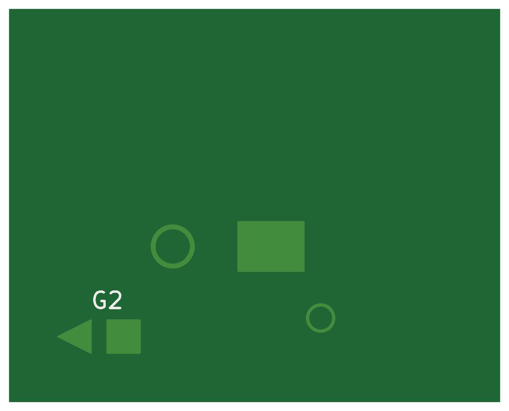
</p>

![08 Copper graphics: stacked bars of seconds per stage, one format a run; reading, start-up and exit take 33% to 49% of a run. Simulation with GLB takes 0.6 s: read 85 ms, resolve 27 ms, geometry 43 ms, materials 0.1 ms, assemble 0.2, write 4 ms, verify 14 ms, start-up and exit 0.2. Simulation with STEP takes 0.8 s: read 71 ms, resolve 23 ms, geometry 38 ms, materials 0.1 ms, assemble 0.2, write 0.2, verify 13 ms, start-up and exit 0.2. Simulation with STL takes 0.6 s: read 73 ms, resolve 24 ms, geometry 38 ms, materials 0.1 ms, assemble 0.2, write 6 ms, verify 13 ms, start-up and exit 0.2. Simulation with OBJ takes 0.8 s: read 89 ms, resolve 25 ms, geometry 39 ms, materials 0.1 ms, assemble 0.3, write 0.1, verify 19 ms, start-up and exit 0.2. Visual with GLB takes 0.7 s: read 70 ms, resolve 23 ms, geometry 39 ms, materials 0.1 ms, assemble 0.3, write 4 ms, verify 40 ms, start-up and exit 0.2. Visual with OBJ takes 0.7 s: read 69 ms, resolve 25 ms, geometry 41 ms, materials 0.1 ms, assemble 0.3, write 96 ms, verify 51 ms, start-up and exit 0.2](https://raw.githubusercontent.com/RolandThsive/KiCad-EM-Stackup-Exporter-KESE/main/docs/images/Feature-Test-Collection/feature_08_copper_graphics.webp)

| Mode and format | 1–2 read | 3 resolve | 4 geometry | 5 materials | 6 assemble | 7 write | 8 verify | start-up and exit | Total |
|---|---:|---:|---:|---:|---:|---:|---:|---:|---:|
| Simulation, GLB | 85&nbsp;ms | 27&nbsp;ms | 43&nbsp;ms | 0.1&nbsp;ms | 0.2 | 4&nbsp;ms | 14&nbsp;ms | 0.2 | 0.6 |
| Simulation, STEP | 71&nbsp;ms | 23&nbsp;ms | 38&nbsp;ms | 0.1&nbsp;ms | 0.2 | 0.2 | 13&nbsp;ms | 0.2 | 0.8 |
| Simulation, STL | 73&nbsp;ms | 24&nbsp;ms | 38&nbsp;ms | 0.1&nbsp;ms | 0.2 | 6&nbsp;ms | 13&nbsp;ms | 0.2 | 0.6 |
| Simulation, OBJ | 89&nbsp;ms | 25&nbsp;ms | 39&nbsp;ms | 0.1&nbsp;ms | 0.3 | 0.1 | 19&nbsp;ms | 0.2 | 0.8 |
| Visual, GLB | 70&nbsp;ms | 23&nbsp;ms | 39&nbsp;ms | 0.1&nbsp;ms | 0.3 | 4&nbsp;ms | 40&nbsp;ms | 0.2 | 0.7 |
| Visual, OBJ | 69&nbsp;ms | 25&nbsp;ms | 41&nbsp;ms | 0.1&nbsp;ms | 0.3 | 96&nbsp;ms | 51&nbsp;ms | 0.2 | 0.7 |

<table align="center">
<tr>
<td valign="top">

| Board | `featureTest/`<br>`08_copper_graphics.kicad_pcb` |
|---|---|
| Outline | 30 × 24 mm |
| Thickness | 1.6 mm |
| Copper&nbsp;layers | 2 |
| Vias | none |
| Board&nbsp;edge | Plain |
| Mask,&nbsp;silkscreen,&nbsp;finish | Not set (drawn green and white),<br>ENIG |

</td>
<td valign="top">

<table>
<tr><th>File<br>type</th><th>File<br>size</th><th>Peak memory<br>used</th></tr>
<tr><th colspan="3" align="left">Simulation</th></tr>
<tr><td>GLB</td><td align="right">776 kB</td><td align="right">72 MB</td></tr>
<tr><td>STEP</td><td align="right">4.4 MB</td><td align="right">74 MB</td></tr>
<tr><td>STL</td><td align="right">1.2 MB</td><td align="right">71 MB</td></tr>
<tr><td>OBJ</td><td align="right">2.1 MB</td><td align="right">75 MB</td></tr>
<tr><th colspan="3" align="left">Visual</th></tr>
<tr><td>GLB</td><td align="right">579 kB</td><td align="right">100 MB</td></tr>
<tr><td>OBJ</td><td align="right">1.5 MB</td><td align="right">102 MB</td></tr>
</table>

</td>
</tr>
</table>

### 23.4.2 08b Copper Graphics On Nets

<p align="center">


</p>

![08b Copper graphics on nets: stacked bars of seconds per stage, one format a run; stages 4 and 6 take 41% to 60% of a run. Simulation with GLB takes 0.5 s: read 8 ms, resolve 23 ms, geometry 53 ms, materials 0.1 ms, assemble 0.2, write 6 ms, verify 18 ms, start-up and exit 0.2. Simulation with STEP takes 0.7 s: read 7 ms, resolve 31 ms, geometry 54 ms, materials 0.1 ms, assemble 0.2, write 0.2, verify 17 ms, start-up and exit 0.2. Simulation with STL takes 0.6 s: read 7 ms, resolve 28 ms, geometry 55 ms, materials 0.2 ms, assemble 0.3, write 11 ms, verify 21 ms, start-up and exit 0.2. Simulation with OBJ takes 0.6 s: read 7 ms, resolve 29 ms, geometry 60 ms, materials 0.1 ms, assemble 0.2, write 94 ms, verify 19 ms, start-up and exit 0.2. Visual with GLB takes 0.7 s: read 11 ms, resolve 32 ms, geometry 59 ms, materials 0.1 ms, assemble 0.4, write 4 ms, verify 42 ms, start-up and exit 0.2. Visual with OBJ takes 0.7 s: read 8 ms, resolve 24 ms, geometry 56 ms, materials 0.1 ms, assemble 0.3, write 69 ms, verify 38 ms, start-up and exit 0.2](https://raw.githubusercontent.com/RolandThsive/KiCad-EM-Stackup-Exporter-KESE/main/docs/images/Feature-Test-Collection/feature_08b_copper_graphics_nets.webp)

| Mode and format | 1–2 read | 3 resolve | 4 geometry | 5 materials | 6 assemble | 7 write | 8 verify | start-up and exit | Total |
|---|---:|---:|---:|---:|---:|---:|---:|---:|---:|
| Simulation, GLB | 8&nbsp;ms | 23&nbsp;ms | 53&nbsp;ms | 0.1&nbsp;ms | 0.2 | 6&nbsp;ms | 18&nbsp;ms | 0.2 | 0.5 |
| Simulation, STEP | 7&nbsp;ms | 31&nbsp;ms | 54&nbsp;ms | 0.1&nbsp;ms | 0.2 | 0.2 | 17&nbsp;ms | 0.2 | 0.7 |
| Simulation, STL | 7&nbsp;ms | 28&nbsp;ms | 55&nbsp;ms | 0.2&nbsp;ms | 0.3 | 11&nbsp;ms | 21&nbsp;ms | 0.2 | 0.6 |
| Simulation, OBJ | 7&nbsp;ms | 29&nbsp;ms | 60&nbsp;ms | 0.1&nbsp;ms | 0.2 | 94&nbsp;ms | 19&nbsp;ms | 0.2 | 0.6 |
| Visual, GLB | 11&nbsp;ms | 32&nbsp;ms | 59&nbsp;ms | 0.1&nbsp;ms | 0.4 | 4&nbsp;ms | 42&nbsp;ms | 0.2 | 0.7 |
| Visual, OBJ | 8&nbsp;ms | 24&nbsp;ms | 56&nbsp;ms | 0.1&nbsp;ms | 0.3 | 69&nbsp;ms | 38&nbsp;ms | 0.2 | 0.7 |

<table align="center">
<tr>
<td valign="top">

| Board | `featureTest/`<br>`08b_copper_graphics_nets.kicad_pcb` |
|---|---|
| Outline | 36 × 24 mm, rounded corners |
| Thickness | 1.6 mm |
| Copper&nbsp;layers | 2 |
| Vias | none |
| Board&nbsp;edge | Plain |
| Mask,&nbsp;silkscreen,&nbsp;finish | Not set (drawn green and white),<br>ENIG |

</td>
<td valign="top">

<table>
<tr><th>File<br>type</th><th>File<br>size</th><th>Peak memory<br>used</th></tr>
<tr><th colspan="3" align="left">Simulation</th></tr>
<tr><td>GLB</td><td align="right">615 kB</td><td align="right">46 MB</td></tr>
<tr><td>STEP</td><td align="right">3.3 MB</td><td align="right">49 MB</td></tr>
<tr><td>STL</td><td align="right">868 kB</td><td align="right">47 MB</td></tr>
<tr><td>OBJ</td><td align="right">1.6 MB</td><td align="right">50 MB</td></tr>
<tr><th colspan="3" align="left">Visual</th></tr>
<tr><td>GLB</td><td align="right">474 kB</td><td align="right">75 MB</td></tr>
<tr><td>OBJ</td><td align="right">1.2 MB</td><td align="right">77 MB</td></tr>
</table>

</td>
</tr>
</table>

### 23.4.3 09 Copper Text

<p align="center">
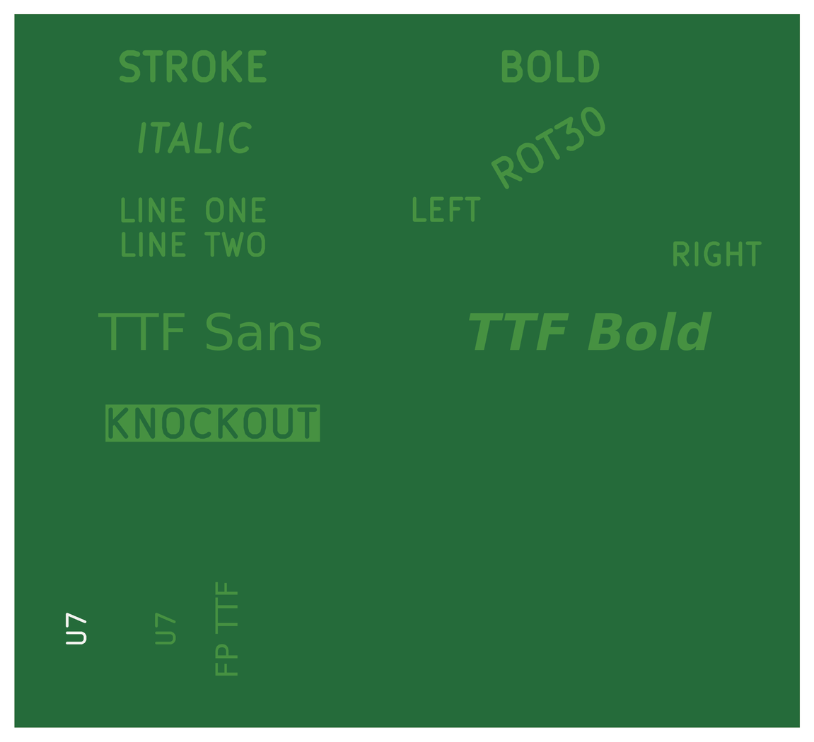

</p>

![09 Copper text: stacked bars of seconds per stage, one format a run; stages 4 and 6 take 44% to 76% of a run. Simulation with GLB takes 1.5 s: read 87 ms, resolve 41 ms, geometry 0.1, materials 0.1 ms, assemble 1.0, write 17 ms, verify 50 ms, start-up and exit 0.2. Simulation with STEP takes 2.5 s: read 85 ms, resolve 38 ms, geometry 0.1, materials 0.1 ms, assemble 1.0, write 1.0, verify 42 ms, start-up and exit 0.2. Simulation with STL takes 1.6 s: read 87 ms, resolve 38 ms, geometry 0.1, materials 0.1 ms, assemble 1.1, write 34 ms, verify 47 ms, start-up and exit 0.2. Simulation with OBJ takes 2.0 s: read 0.1, resolve 38 ms, geometry 0.1, materials 0.1 ms, assemble 1.0, write 0.5, verify 61 ms, start-up and exit 0.2. Visual with GLB takes 1.4 s: read 88 ms, resolve 38 ms, geometry 0.1, materials 0.1 ms, assemble 0.9, write 12 ms, verify 86 ms, start-up and exit 0.2. Visual with OBJ takes 1.9 s: read 87 ms, resolve 40 ms, geometry 0.1, materials 0.1 ms, assemble 0.9, write 0.4, verify 98 ms, start-up and exit 0.2](https://raw.githubusercontent.com/RolandThsive/KiCad-EM-Stackup-Exporter-KESE/main/docs/images/Feature-Test-Collection/feature_09_copper_text.webp)

| Mode and format | 1–2 read | 3 resolve | 4 geometry | 5 materials | 6 assemble | 7 write | 8 verify | start-up and exit | Total |
|---|---:|---:|---:|---:|---:|---:|---:|---:|---:|
| Simulation, GLB | 87&nbsp;ms | 41&nbsp;ms | 0.1 | 0.1&nbsp;ms | 1.0 | 17&nbsp;ms | 50&nbsp;ms | 0.2 | 1.5 |
| Simulation, STEP | 85&nbsp;ms | 38&nbsp;ms | 0.1 | 0.1&nbsp;ms | 1.0 | 1.0 | 42&nbsp;ms | 0.2 | 2.5 |
| Simulation, STL | 87&nbsp;ms | 38&nbsp;ms | 0.1 | 0.1&nbsp;ms | 1.1 | 34&nbsp;ms | 47&nbsp;ms | 0.2 | 1.6 |
| Simulation, OBJ | 0.1 | 38&nbsp;ms | 0.1 | 0.1&nbsp;ms | 1.0 | 0.5 | 61&nbsp;ms | 0.2 | 2.0 |
| Visual, GLB | 88&nbsp;ms | 38&nbsp;ms | 0.1 | 0.1&nbsp;ms | 0.9 | 12&nbsp;ms | 86&nbsp;ms | 0.2 | 1.4 |
| Visual, OBJ | 87&nbsp;ms | 40&nbsp;ms | 0.1 | 0.1&nbsp;ms | 0.9 | 0.4 | 98&nbsp;ms | 0.2 | 1.9 |

<table align="center">
<tr>
<td valign="top">

| Board | `featureTest/`<br>`09_copper_text.kicad_pcb` |
|---|---|
| Outline | 44 × 40 mm |
| Thickness | 1.6 mm |
| Copper&nbsp;layers | 2 |
| Vias | none |
| Board&nbsp;edge | Plain |
| Mask,&nbsp;silkscreen,&nbsp;finish | Not set (drawn green and white),<br>ENIG |

</td>
<td valign="top">

<table>
<tr><th>File<br>type</th><th>File<br>size</th><th>Peak memory<br>used</th></tr>
<tr><th colspan="3" align="left">Simulation</th></tr>
<tr><td>GLB</td><td align="right">3.2 MB</td><td align="right">203 MB</td></tr>
<tr><td>STEP</td><td align="right">18.9 MB</td><td align="right">208 MB</td></tr>
<tr><td>STL</td><td align="right">4.7 MB</td><td align="right">203 MB</td></tr>
<tr><td>OBJ</td><td align="right">8.7 MB</td><td align="right">198 MB</td></tr>
<tr><th colspan="3" align="left">Visual</th></tr>
<tr><td>GLB</td><td align="right">2.2 MB</td><td align="right">159 MB</td></tr>
<tr><td>OBJ</td><td align="right">6.1 MB</td><td align="right">158 MB</td></tr>
</table>

</td>
</tr>
</table>

### 23.4.4 10 Tracks And Arcs

<p align="center">


</p>

![10 Tracks and arcs: stacked bars of seconds per stage, one format a run; reading, start-up and exit take 35% to 46% of a run. Simulation with GLB takes 0.6 s: read 71 ms, resolve 24 ms, geometry 37 ms, materials 0.1 ms, assemble 0.2, write 7 ms, verify 19 ms, start-up and exit 0.2. Simulation with STEP takes 0.8 s: read 74 ms, resolve 27 ms, geometry 36 ms, materials 0.1 ms, assemble 0.2, write 0.2, verify 16 ms, start-up and exit 0.2. Simulation with STL takes 0.6 s: read 69 ms, resolve 23 ms, geometry 38 ms, materials 0.1 ms, assemble 0.2, write 8 ms, verify 17 ms, start-up and exit 0.2. Simulation with OBJ takes 0.6 s: read 68 ms, resolve 24 ms, geometry 46 ms, materials 0.1 ms, assemble 0.2, write 83 ms, verify 16 ms, start-up and exit 0.2. Visual with GLB takes 0.7 s: read 86 ms, resolve 27 ms, geometry 37 ms, materials 0.1 ms, assemble 0.4, write 4 ms, verify 40 ms, start-up and exit 0.2. Visual with OBJ takes 0.8 s: read 71 ms, resolve 25 ms, geometry 38 ms, materials 0.1 ms, assemble 0.3, write 78 ms, verify 40 ms, start-up and exit 0.2](https://raw.githubusercontent.com/RolandThsive/KiCad-EM-Stackup-Exporter-KESE/main/docs/images/Feature-Test-Collection/feature_10_tracks_arcs.webp)

| Mode and format | 1–2 read | 3 resolve | 4 geometry | 5 materials | 6 assemble | 7 write | 8 verify | start-up and exit | Total |
|---|---:|---:|---:|---:|---:|---:|---:|---:|---:|
| Simulation, GLB | 71&nbsp;ms | 24&nbsp;ms | 37&nbsp;ms | 0.1&nbsp;ms | 0.2 | 7&nbsp;ms | 19&nbsp;ms | 0.2 | 0.6 |
| Simulation, STEP | 74&nbsp;ms | 27&nbsp;ms | 36&nbsp;ms | 0.1&nbsp;ms | 0.2 | 0.2 | 16&nbsp;ms | 0.2 | 0.8 |
| Simulation, STL | 69&nbsp;ms | 23&nbsp;ms | 38&nbsp;ms | 0.1&nbsp;ms | 0.2 | 8&nbsp;ms | 17&nbsp;ms | 0.2 | 0.6 |
| Simulation, OBJ | 68&nbsp;ms | 24&nbsp;ms | 46&nbsp;ms | 0.1&nbsp;ms | 0.2 | 83&nbsp;ms | 16&nbsp;ms | 0.2 | 0.6 |
| Visual, GLB | 86&nbsp;ms | 27&nbsp;ms | 37&nbsp;ms | 0.1&nbsp;ms | 0.4 | 4&nbsp;ms | 40&nbsp;ms | 0.2 | 0.7 |
| Visual, OBJ | 71&nbsp;ms | 25&nbsp;ms | 38&nbsp;ms | 0.1&nbsp;ms | 0.3 | 78&nbsp;ms | 40&nbsp;ms | 0.2 | 0.8 |

<table align="center">
<tr>
<td valign="top">

| Board | `featureTest/`<br>`10_tracks_arcs.kicad_pcb` |
|---|---|
| Outline | 44 × 24 mm |
| Thickness | 1.6 mm |
| Copper&nbsp;layers | 2 |
| Vias | none |
| Board&nbsp;edge | Plain |
| Mask,&nbsp;silkscreen,&nbsp;finish | Not set (drawn green and white),<br>ENIG |

</td>
<td valign="top">

<table>
<tr><th>File<br>type</th><th>File<br>size</th><th>Peak memory<br>used</th></tr>
<tr><th colspan="3" align="left">Simulation</th></tr>
<tr><td>GLB</td><td align="right">560 kB</td><td align="right">68 MB</td></tr>
<tr><td>STEP</td><td align="right">2.5 MB</td><td align="right">71 MB</td></tr>
<tr><td>STL</td><td align="right">817 kB</td><td align="right">68 MB</td></tr>
<tr><td>OBJ</td><td align="right">1.4 MB</td><td align="right">72 MB</td></tr>
<tr><th colspan="3" align="left">Visual</th></tr>
<tr><td>GLB</td><td align="right">521 kB</td><td align="right">98 MB</td></tr>
<tr><td>OBJ</td><td align="right">1.4 MB</td><td align="right">99 MB</td></tr>
</table>

</td>
</tr>
</table>

### 23.4.5 27 Hatched Fills

<p align="center">
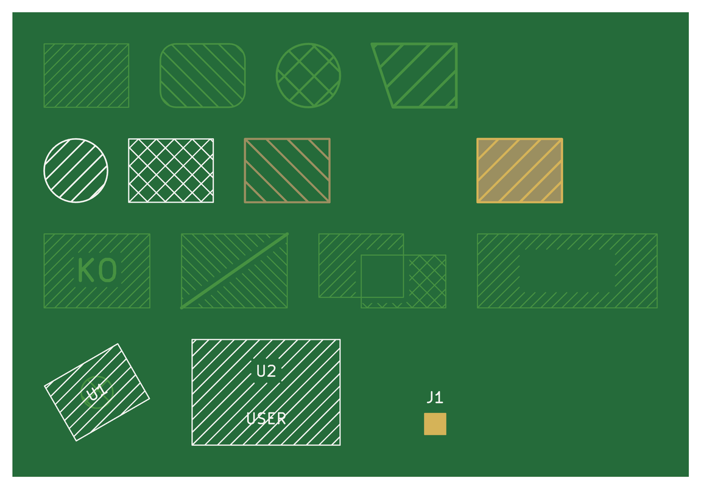

</p>

![27 Hatched fills: stacked bars of seconds per stage, one format a run; stages 4 and 6 take 49% to 71% of a run. Simulation with GLB takes 1.7 s: read 0.1, resolve 86 ms, geometry 0.2, materials 0.1 ms, assemble 1.0, write 11 ms, verify 54 ms, start-up and exit 0.2. Simulation with STEP takes 2.4 s: read 0.1, resolve 78 ms, geometry 0.2, materials 0.1 ms, assemble 1.0, write 0.8, verify 56 ms, start-up and exit 0.2. Simulation with STL takes 1.7 s: read 0.1, resolve 92 ms, geometry 0.2, materials 0.1 ms, assemble 1.0, write 19 ms, verify 51 ms, start-up and exit 0.2. Simulation with OBJ takes 1.9 s: read 0.1, resolve 85 ms, geometry 0.2, materials 0.1 ms, assemble 1.0, write 0.3, verify 61 ms, start-up and exit 0.2. Visual with GLB takes 1.5 s: read 0.1, resolve 84 ms, geometry 0.2, materials 0.1 ms, assemble 0.9, write 10 ms, verify 67 ms, start-up and exit 0.2. Visual with OBJ takes 1.8 s: read 0.1, resolve 92 ms, geometry 0.2, materials 0.1 ms, assemble 0.9, write 0.3, verify 66 ms, start-up and exit 0.2](https://raw.githubusercontent.com/RolandThsive/KiCad-EM-Stackup-Exporter-KESE/main/docs/images/Feature-Test-Collection/feature_27_hatched_fills.webp)

| Mode and format | 1–2 read | 3 resolve | 4 geometry | 5 materials | 6 assemble | 7 write | 8 verify | start-up and exit | Total |
|---|---:|---:|---:|---:|---:|---:|---:|---:|---:|
| Simulation, GLB | 0.1 | 86&nbsp;ms | 0.2 | 0.1&nbsp;ms | 1.0 | 11&nbsp;ms | 54&nbsp;ms | 0.2 | 1.7 |
| Simulation, STEP | 0.1 | 78&nbsp;ms | 0.2 | 0.1&nbsp;ms | 1.0 | 0.8 | 56&nbsp;ms | 0.2 | 2.4 |
| Simulation, STL | 0.1 | 92&nbsp;ms | 0.2 | 0.1&nbsp;ms | 1.0 | 19&nbsp;ms | 51&nbsp;ms | 0.2 | 1.7 |
| Simulation, OBJ | 0.1 | 85&nbsp;ms | 0.2 | 0.1&nbsp;ms | 1.0 | 0.3 | 61&nbsp;ms | 0.2 | 1.9 |
| Visual, GLB | 0.1 | 84&nbsp;ms | 0.2 | 0.1&nbsp;ms | 0.9 | 10&nbsp;ms | 67&nbsp;ms | 0.2 | 1.5 |
| Visual, OBJ | 0.1 | 92&nbsp;ms | 0.2 | 0.1&nbsp;ms | 0.9 | 0.3 | 66&nbsp;ms | 0.2 | 1.8 |

<table align="center">
<tr>
<td valign="top">

| Board | `featureTest/`<br>`27_hatched_fills.kicad_pcb` |
|---|---|
| Outline | 64 × 44 mm |
| Thickness | 1.6 mm |
| Copper&nbsp;layers | 2 |
| Vias | none |
| Board&nbsp;edge | Plain |
| Mask,&nbsp;silkscreen,&nbsp;finish | Not set (drawn green and white),<br>ENIG |

</td>
<td valign="top">

<table>
<tr><th>File<br>type</th><th>File<br>size</th><th>Peak memory<br>used</th></tr>
<tr><th colspan="3" align="left">Simulation</th></tr>
<tr><td>GLB</td><td align="right">2.0 MB</td><td align="right">83 MB</td></tr>
<tr><td>STEP</td><td align="right">13.6 MB</td><td align="right">195 MB</td></tr>
<tr><td>STL</td><td align="right">2.6 MB</td><td align="right">82 MB</td></tr>
<tr><td>OBJ</td><td align="right">5.4 MB</td><td align="right">102 MB</td></tr>
<tr><th colspan="3" align="left">Visual</th></tr>
<tr><td>GLB</td><td align="right">1.7 MB</td><td align="right">126 MB</td></tr>
<tr><td>OBJ</td><td align="right">4.8 MB</td><td align="right">126 MB</td></tr>
</table>

</td>
</tr>
</table>

## 23.5 Zones

### 23.5.1 11 Zones

<p align="center">
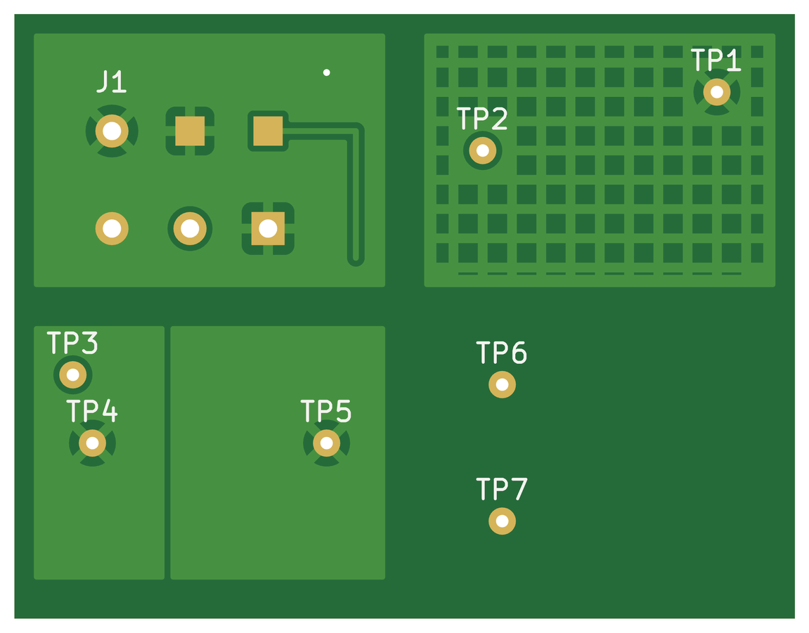
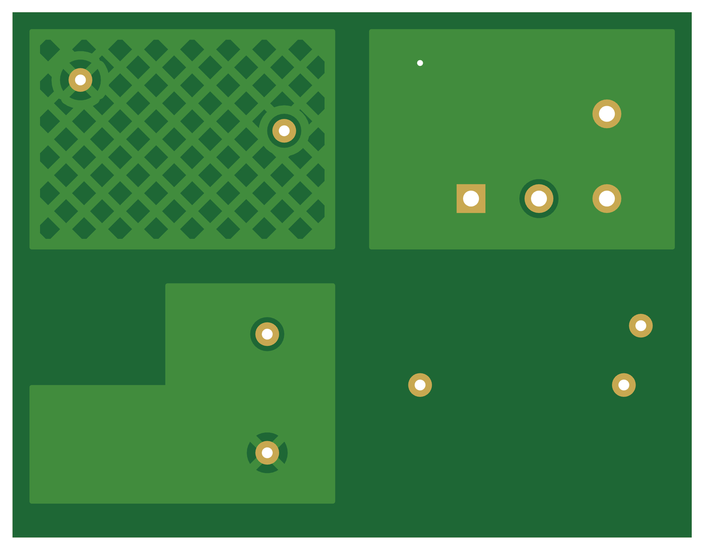
</p>

![11 Zones: stacked bars of seconds per stage, one format a run; stages 4 and 6 take 42% to 75% of a run. Simulation with GLB takes 1.5 s: read 0.1, resolve 0.1, geometry 0.4, materials 0.1 ms, assemble 0.6, write 19 ms, verify 80 ms, start-up and exit 0.2. Simulation with STEP takes 2.3 s: read 89 ms, resolve 0.1, geometry 0.4, materials 0.1 ms, assemble 0.6, write 0.8, verify 77 ms, start-up and exit 0.2. Simulation with STL takes 1.5 s: read 0.1, resolve 0.1, geometry 0.4, materials 0.1 ms, assemble 0.6, write 26 ms, verify 88 ms, start-up and exit 0.2. Simulation with OBJ takes 2.0 s: read 87 ms, resolve 0.1, geometry 0.4, materials 0.1 ms, assemble 0.6, write 0.6, verify 80 ms, start-up and exit 0.2. Visual with GLB takes 1.9 s: read 99 ms, resolve 0.1, geometry 0.3, materials 0.1 ms, assemble 1.1, write 13 ms, verify 72 ms, start-up and exit 0.2. Visual with OBJ takes 2.2 s: read 92 ms, resolve 0.1, geometry 0.3, materials 0.1 ms, assemble 1.1, write 0.3, verify 71 ms, start-up and exit 0.2](https://raw.githubusercontent.com/RolandThsive/KiCad-EM-Stackup-Exporter-KESE/main/docs/images/Feature-Test-Collection/feature_11_zones.webp)

| Mode and format | 1–2 read | 3 resolve | 4 geometry | 5 materials | 6 assemble | 7 write | 8 verify | start-up and exit | Total |
|---|---:|---:|---:|---:|---:|---:|---:|---:|---:|
| Simulation, GLB | 0.1 | 0.1 | 0.4 | 0.1&nbsp;ms | 0.6 | 19&nbsp;ms | 80&nbsp;ms | 0.2 | 1.5 |
| Simulation, STEP | 89&nbsp;ms | 0.1 | 0.4 | 0.1&nbsp;ms | 0.6 | 0.8 | 77&nbsp;ms | 0.2 | 2.3 |
| Simulation, STL | 0.1 | 0.1 | 0.4 | 0.1&nbsp;ms | 0.6 | 26&nbsp;ms | 88&nbsp;ms | 0.2 | 1.5 |
| Simulation, OBJ | 87&nbsp;ms | 0.1 | 0.4 | 0.1&nbsp;ms | 0.6 | 0.6 | 80&nbsp;ms | 0.2 | 2.0 |
| Visual, GLB | 99&nbsp;ms | 0.1 | 0.3 | 0.1&nbsp;ms | 1.1 | 13&nbsp;ms | 72&nbsp;ms | 0.2 | 1.9 |
| Visual, OBJ | 92&nbsp;ms | 0.1 | 0.3 | 0.1&nbsp;ms | 1.1 | 0.3 | 71&nbsp;ms | 0.2 | 2.2 |

<table align="center">
<tr>
<td valign="top">

| Board | `featureTest/`<br>`11_zones.kicad_pcb` |
|---|---|
| Outline | 40 × 31 mm |
| Thickness | 1.6 mm |
| Copper&nbsp;layers | 4 |
| Vias | 1 through |
| Board&nbsp;edge | Plain |
| Mask,&nbsp;silkscreen,&nbsp;finish | Not set (drawn green and white),<br>ENIG |

</td>
<td valign="top">

<table>
<tr><th>File<br>type</th><th>File<br>size</th><th>Peak memory<br>used</th></tr>
<tr><th colspan="3" align="left">Simulation</th></tr>
<tr><td>GLB</td><td align="right">3.4 MB</td><td align="right">182 MB</td></tr>
<tr><td>STEP</td><td align="right">13.6 MB</td><td align="right">187 MB</td></tr>
<tr><td>STL</td><td align="right">4.9 MB</td><td align="right">181 MB</td></tr>
<tr><td>OBJ</td><td align="right">9.5 MB</td><td align="right">185 MB</td></tr>
<tr><th colspan="3" align="left">Visual</th></tr>
<tr><td>GLB</td><td align="right">1.8 MB</td><td align="right">156 MB</td></tr>
<tr><td>OBJ</td><td align="right">5.0 MB</td><td align="right">155 MB</td></tr>
</table>

</td>
</tr>
</table>

## 23.6 Board Outline

### 23.6.1 12 Board Outline Shapes

<p align="center">

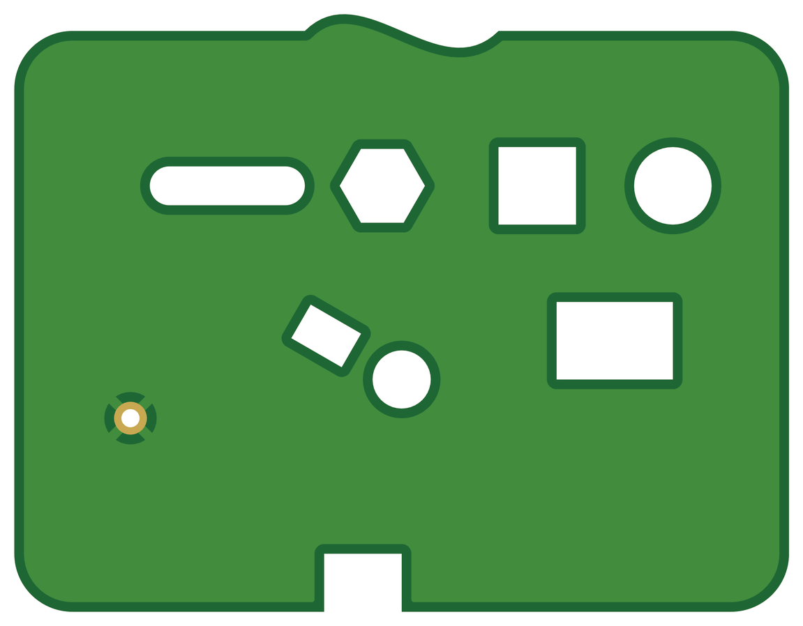
</p>

![12 Board outline shapes: stacked bars of seconds per stage, one format a run; stages 4 and 6 take 39% to 59% of a run. Simulation with GLB takes 0.8 s: read 80 ms, resolve 36 ms, geometry 70 ms, materials 0.1 ms, assemble 0.4, write 9 ms, verify 33 ms, start-up and exit 0.2. Simulation with STEP takes 1.2 s: read 79 ms, resolve 39 ms, geometry 77 ms, materials 0.1 ms, assemble 0.4, write 0.4, verify 32 ms, start-up and exit 0.2. Simulation with STL takes 0.8 s: read 83 ms, resolve 38 ms, geometry 77 ms, materials 0.1 ms, assemble 0.4, write 13 ms, verify 26 ms, start-up and exit 0.2. Simulation with OBJ takes 1.1 s: read 80 ms, resolve 40 ms, geometry 79 ms, materials 0.1 ms, assemble 0.4, write 0.2, verify 26 ms, start-up and exit 0.2. Visual with GLB takes 0.9 s: read 81 ms, resolve 37 ms, geometry 76 ms, materials 0.1 ms, assemble 0.5, write 9 ms, verify 58 ms, start-up and exit 0.2. Visual with OBJ takes 1.2 s: read 80 ms, resolve 37 ms, geometry 71 ms, materials 0.1 ms, assemble 0.5, write 0.3, verify 54 ms, start-up and exit 0.2](https://raw.githubusercontent.com/RolandThsive/KiCad-EM-Stackup-Exporter-KESE/main/docs/images/Feature-Test-Collection/feature_12_outline_shapes.webp)

| Mode and format | 1–2 read | 3 resolve | 4 geometry | 5 materials | 6 assemble | 7 write | 8 verify | start-up and exit | Total |
|---|---:|---:|---:|---:|---:|---:|---:|---:|---:|
| Simulation, GLB | 80&nbsp;ms | 36&nbsp;ms | 70&nbsp;ms | 0.1&nbsp;ms | 0.4 | 9&nbsp;ms | 33&nbsp;ms | 0.2 | 0.8 |
| Simulation, STEP | 79&nbsp;ms | 39&nbsp;ms | 77&nbsp;ms | 0.1&nbsp;ms | 0.4 | 0.4 | 32&nbsp;ms | 0.2 | 1.2 |
| Simulation, STL | 83&nbsp;ms | 38&nbsp;ms | 77&nbsp;ms | 0.1&nbsp;ms | 0.4 | 13&nbsp;ms | 26&nbsp;ms | 0.2 | 0.8 |
| Simulation, OBJ | 80&nbsp;ms | 40&nbsp;ms | 79&nbsp;ms | 0.1&nbsp;ms | 0.4 | 0.2 | 26&nbsp;ms | 0.2 | 1.1 |
| Visual, GLB | 81&nbsp;ms | 37&nbsp;ms | 76&nbsp;ms | 0.1&nbsp;ms | 0.5 | 9&nbsp;ms | 58&nbsp;ms | 0.2 | 0.9 |
| Visual, OBJ | 80&nbsp;ms | 37&nbsp;ms | 71&nbsp;ms | 0.1&nbsp;ms | 0.5 | 0.3 | 54&nbsp;ms | 0.2 | 1.2 |

<table align="center">
<tr>
<td valign="top">

| Board | `featureTest/`<br>`12_outline_shapes.kicad_pcb` |
|---|---|
| Outline | 40 × 30.9 mm, arcs, a Bezier edge,<br>a notch and cut-outs |
| Thickness | 1.6 mm |
| Copper&nbsp;layers | 2 |
| Vias | none |
| Board&nbsp;edge | Plain |
| Mask,&nbsp;silkscreen,&nbsp;finish | Not set (drawn green and white),<br>ENIG |

</td>
<td valign="top">

<table>
<tr><th>File<br>type</th><th>File<br>size</th><th>Peak memory<br>used</th></tr>
<tr><th colspan="3" align="left">Simulation</th></tr>
<tr><td>GLB</td><td align="right">1.6 MB</td><td align="right">77 MB</td></tr>
<tr><td>STEP</td><td align="right">10.8 MB</td><td align="right">83 MB</td></tr>
<tr><td>STL</td><td align="right">2.4 MB</td><td align="right">78 MB</td></tr>
<tr><td>OBJ</td><td align="right">4.5 MB</td><td align="right">95 MB</td></tr>
<tr><th colspan="3" align="left">Visual</th></tr>
<tr><td>GLB</td><td align="right">1.5 MB</td><td align="right">112 MB</td></tr>
<tr><td>OBJ</td><td align="right">4.1 MB</td><td align="right">114 MB</td></tr>
</table>

</td>
</tr>
</table>

### 23.6.2 13a No Board Outline

<p align="center">


</p>

![13a No board outline: stacked bars of seconds per stage, one format a run; reading, start-up and exit take 42% to 53% of a run. Simulation with GLB takes 0.5 s: read 67 ms, resolve 27 ms, geometry 53 ms, materials 0.1 ms, assemble 0.1, write 4 ms, verify 15 ms, start-up and exit 0.2. Simulation with STEP takes 0.6 s: read 70 ms, resolve 26 ms, geometry 55 ms, materials 0.1 ms, assemble 0.1, write 0.1, verify 18 ms, start-up and exit 0.2. Simulation with STL takes 0.5 s: read 67 ms, resolve 25 ms, geometry 55 ms, materials 0.1 ms, assemble 0.1, write 6 ms, verify 17 ms, start-up and exit 0.2. Simulation with OBJ takes 0.6 s: read 65 ms, resolve 23 ms, geometry 53 ms, materials 0.1 ms, assemble 0.1, write 62 ms, verify 16 ms, start-up and exit 0.2. Visual with GLB takes 0.6 s: read 71 ms, resolve 24 ms, geometry 54 ms, materials 0.1 ms, assemble 0.2, write 4 ms, verify 64 ms, start-up and exit 0.2. Visual with OBJ takes 0.6 s: read 65 ms, resolve 24 ms, geometry 51 ms, materials 0.1 ms, assemble 0.2, write 38 ms, verify 45 ms, start-up and exit 0.2](https://raw.githubusercontent.com/RolandThsive/KiCad-EM-Stackup-Exporter-KESE/main/docs/images/Feature-Test-Collection/feature_13a_outline_none.webp)

| Mode and format | 1–2 read | 3 resolve | 4 geometry | 5 materials | 6 assemble | 7 write | 8 verify | start-up and exit | Total |
|---|---:|---:|---:|---:|---:|---:|---:|---:|---:|
| Simulation, GLB | 67&nbsp;ms | 27&nbsp;ms | 53&nbsp;ms | 0.1&nbsp;ms | 0.1 | 4&nbsp;ms | 15&nbsp;ms | 0.2 | 0.5 |
| Simulation, STEP | 70&nbsp;ms | 26&nbsp;ms | 55&nbsp;ms | 0.1&nbsp;ms | 0.1 | 0.1 | 18&nbsp;ms | 0.2 | 0.6 |
| Simulation, STL | 67&nbsp;ms | 25&nbsp;ms | 55&nbsp;ms | 0.1&nbsp;ms | 0.1 | 6&nbsp;ms | 17&nbsp;ms | 0.2 | 0.5 |
| Simulation, OBJ | 65&nbsp;ms | 23&nbsp;ms | 53&nbsp;ms | 0.1&nbsp;ms | 0.1 | 62&nbsp;ms | 16&nbsp;ms | 0.2 | 0.6 |
| Visual, GLB | 71&nbsp;ms | 24&nbsp;ms | 54&nbsp;ms | 0.1&nbsp;ms | 0.2 | 4&nbsp;ms | 64&nbsp;ms | 0.2 | 0.6 |
| Visual, OBJ | 65&nbsp;ms | 24&nbsp;ms | 51&nbsp;ms | 0.1&nbsp;ms | 0.2 | 38&nbsp;ms | 45&nbsp;ms | 0.2 | 0.6 |

<table align="center">
<tr>
<td valign="top">

| Board | `featureTest/`<br>`13a_outline_none.kicad_pcb` |
|---|---|
| Outline | 13.7 × 7.2 mm,<br>from the copper (no Edge.Cuts) |
| Thickness | 1.6 mm |
| Copper&nbsp;layers | 2 |
| Vias | 1 through |
| Board&nbsp;edge | Plain |
| Mask,&nbsp;silkscreen,&nbsp;finish | Mask colour not set (drawn green),<br>no silkscreen, ENIG |

</td>
<td valign="top">

<table>
<tr><th>File<br>type</th><th>File<br>size</th><th>Peak memory<br>used</th></tr>
<tr><th colspan="3" align="left">Simulation</th></tr>
<tr><td>GLB</td><td align="right">411 kB</td><td align="right">68 MB</td></tr>
<tr><td>STEP</td><td align="right">1.6 MB</td><td align="right">66 MB</td></tr>
<tr><td>STL</td><td align="right">621 kB</td><td align="right">67 MB</td></tr>
<tr><td>OBJ</td><td align="right">1.1 MB</td><td align="right">68 MB</td></tr>
<tr><th colspan="3" align="left">Visual</th></tr>
<tr><td>GLB</td><td align="right">249 kB</td><td align="right">105 MB</td></tr>
<tr><td>OBJ</td><td align="right">630 kB</td><td align="right">107 MB</td></tr>
</table>

</td>
</tr>
</table>

### 23.6.3 13b Two Board Outlines

<p align="center">


</p>

![13b Two board outlines: stacked bars of seconds per stage, one format a run; reading, start-up and exit take 44% to 60% of a run. Simulation with GLB takes 0.5 s: read 68 ms, resolve 21 ms, geometry 39 ms, materials 0.1 ms, assemble 0.1, write 5 ms, verify 15 ms, start-up and exit 0.2. Simulation with STEP takes 0.6 s: read 73 ms, resolve 23 ms, geometry 47 ms, materials 0.1 ms, assemble 0.1, write 0.1, verify 15 ms, start-up and exit 0.2. Simulation with STL takes 0.5 s: read 68 ms, resolve 23 ms, geometry 41 ms, materials 0.1 ms, assemble 0.1, write 5 ms, verify 16 ms, start-up and exit 0.2. Simulation with OBJ takes 0.5 s: read 82 ms, resolve 29 ms, geometry 47 ms, materials 0.1 ms, assemble 0.1, write 39 ms, verify 18 ms, start-up and exit 0.2. Visual with GLB takes 0.6 s: read 72 ms, resolve 22 ms, geometry 51 ms, materials 0.1 ms, assemble 0.2, write 3 ms, verify 22 ms, start-up and exit 0.2. Visual with OBJ takes 0.6 s: read 68 ms, resolve 21 ms, geometry 48 ms, materials 0.1 ms, assemble 0.2, write 30 ms, verify 22 ms, start-up and exit 0.2](https://raw.githubusercontent.com/RolandThsive/KiCad-EM-Stackup-Exporter-KESE/main/docs/images/Feature-Test-Collection/feature_13b_outline_two.webp)

| Mode and format | 1–2 read | 3 resolve | 4 geometry | 5 materials | 6 assemble | 7 write | 8 verify | start-up and exit | Total |
|---|---:|---:|---:|---:|---:|---:|---:|---:|---:|
| Simulation, GLB | 68&nbsp;ms | 21&nbsp;ms | 39&nbsp;ms | 0.1&nbsp;ms | 0.1 | 5&nbsp;ms | 15&nbsp;ms | 0.2 | 0.5 |
| Simulation, STEP | 73&nbsp;ms | 23&nbsp;ms | 47&nbsp;ms | 0.1&nbsp;ms | 0.1 | 0.1 | 15&nbsp;ms | 0.2 | 0.6 |
| Simulation, STL | 68&nbsp;ms | 23&nbsp;ms | 41&nbsp;ms | 0.1&nbsp;ms | 0.1 | 5&nbsp;ms | 16&nbsp;ms | 0.2 | 0.5 |
| Simulation, OBJ | 82&nbsp;ms | 29&nbsp;ms | 47&nbsp;ms | 0.1&nbsp;ms | 0.1 | 39&nbsp;ms | 18&nbsp;ms | 0.2 | 0.5 |
| Visual, GLB | 72&nbsp;ms | 22&nbsp;ms | 51&nbsp;ms | 0.1&nbsp;ms | 0.2 | 3&nbsp;ms | 22&nbsp;ms | 0.2 | 0.6 |
| Visual, OBJ | 68&nbsp;ms | 21&nbsp;ms | 48&nbsp;ms | 0.1&nbsp;ms | 0.2 | 30&nbsp;ms | 22&nbsp;ms | 0.2 | 0.6 |

<table align="center">
<tr>
<td valign="top">

| Board | `featureTest/`<br>`13b_outline_two.kicad_pcb` |
|---|---|
| Outline | 40 × 20 mm,<br>two boards and a third in a hole |
| Thickness | 1.6 mm |
| Copper&nbsp;layers | 2 |
| Vias | none |
| Board&nbsp;edge | Plain |
| Mask,&nbsp;silkscreen,&nbsp;finish | Not set (drawn green and white),<br>ENIG |

</td>
<td valign="top">

<table>
<tr><th>File<br>type</th><th>File<br>size</th><th>Peak memory<br>used</th></tr>
<tr><th colspan="3" align="left">Simulation</th></tr>
<tr><td>GLB</td><td align="right">247 kB</td><td align="right">70 MB</td></tr>
<tr><td>STEP</td><td align="right">1.0 MB</td><td align="right">66 MB</td></tr>
<tr><td>STL</td><td align="right">354 kB</td><td align="right">68 MB</td></tr>
<tr><td>OBJ</td><td align="right">627 kB</td><td align="right">69 MB</td></tr>
<tr><th colspan="3" align="left">Visual</th></tr>
<tr><td>GLB</td><td align="right">165 kB</td><td align="right">79 MB</td></tr>
<tr><td>OBJ</td><td align="right">402 kB</td><td align="right">80 MB</td></tr>
</table>

</td>
</tr>
</table>

## 23.7 Stack-Up

### 23.7.1 14 Full Stack-Up

<p align="center">
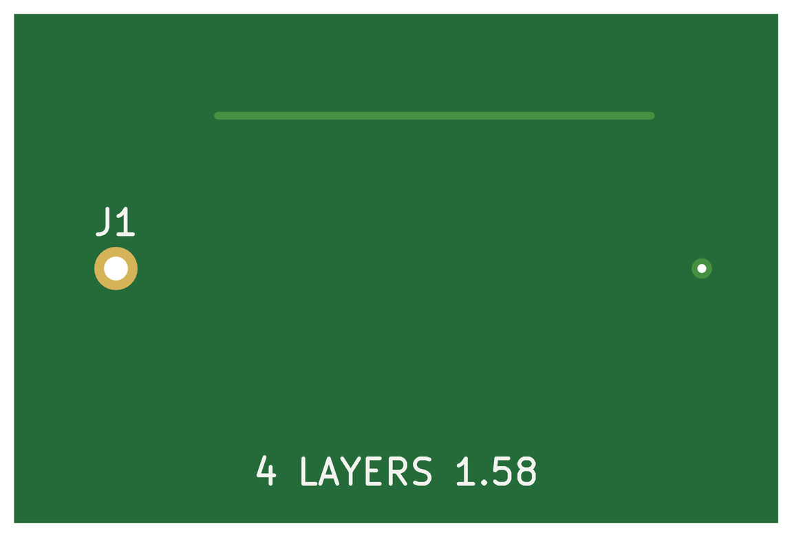

</p>

![14 Full stack-up: stacked bars of seconds per stage, one format a run; reading, start-up and exit take 36% to 47% of a run. Simulation with GLB takes 0.5 s: read 68 ms, resolve 35 ms, geometry 72 ms, materials 0.1 ms, assemble 0.2, write 5 ms, verify 18 ms, start-up and exit 0.2. Simulation with STEP takes 0.7 s: read 72 ms, resolve 36 ms, geometry 68 ms, materials 0.1 ms, assemble 0.2, write 0.1, verify 18 ms, start-up and exit 0.2. Simulation with STL takes 0.5 s: read 67 ms, resolve 35 ms, geometry 66 ms, materials 0.1 ms, assemble 0.2, write 6 ms, verify 20 ms, start-up and exit 0.2. Simulation with OBJ takes 0.6 s: read 74 ms, resolve 38 ms, geometry 60 ms, materials 0.1 ms, assemble 0.2, write 68 ms, verify 21 ms, start-up and exit 0.2. Visual with GLB takes 0.8 s: read 69 ms, resolve 36 ms, geometry 72 ms, materials 0.1 ms, assemble 0.4, write 4 ms, verify 35 ms, start-up and exit 0.2. Visual with OBJ takes 0.7 s: read 86 ms, resolve 37 ms, geometry 62 ms, materials 0.1 ms, assemble 0.3, write 46 ms, verify 31 ms, start-up and exit 0.2](https://raw.githubusercontent.com/RolandThsive/KiCad-EM-Stackup-Exporter-KESE/main/docs/images/Feature-Test-Collection/feature_14_stackup_full.webp)

| Mode and format | 1–2 read | 3 resolve | 4 geometry | 5 materials | 6 assemble | 7 write | 8 verify | start-up and exit | Total |
|---|---:|---:|---:|---:|---:|---:|---:|---:|---:|
| Simulation, GLB | 68&nbsp;ms | 35&nbsp;ms | 72&nbsp;ms | 0.1&nbsp;ms | 0.2 | 5&nbsp;ms | 18&nbsp;ms | 0.2 | 0.5 |
| Simulation, STEP | 72&nbsp;ms | 36&nbsp;ms | 68&nbsp;ms | 0.1&nbsp;ms | 0.2 | 0.1 | 18&nbsp;ms | 0.2 | 0.7 |
| Simulation, STL | 67&nbsp;ms | 35&nbsp;ms | 66&nbsp;ms | 0.1&nbsp;ms | 0.2 | 6&nbsp;ms | 20&nbsp;ms | 0.2 | 0.5 |
| Simulation, OBJ | 74&nbsp;ms | 38&nbsp;ms | 60&nbsp;ms | 0.1&nbsp;ms | 0.2 | 68&nbsp;ms | 21&nbsp;ms | 0.2 | 0.6 |
| Visual, GLB | 69&nbsp;ms | 36&nbsp;ms | 72&nbsp;ms | 0.1&nbsp;ms | 0.4 | 4&nbsp;ms | 35&nbsp;ms | 0.2 | 0.8 |
| Visual, OBJ | 86&nbsp;ms | 37&nbsp;ms | 62&nbsp;ms | 0.1&nbsp;ms | 0.3 | 46&nbsp;ms | 31&nbsp;ms | 0.2 | 0.7 |

<table align="center">
<tr>
<td valign="top">

| Board | `featureTest/`<br>`14_stackup_full.kicad_pcb` |
|---|---|
| Outline | 30 × 20 mm |
| Thickness | 1.58 mm |
| Copper&nbsp;layers | 4 |
| Vias | 1 through |
| Board&nbsp;edge | Plain |
| Mask,&nbsp;silkscreen,&nbsp;finish | Green, white, ENIG |

</td>
<td valign="top">

<table>
<tr><th>File<br>type</th><th>File<br>size</th><th>Peak memory<br>used</th></tr>
<tr><th colspan="3" align="left">Simulation</th></tr>
<tr><td>GLB</td><td align="right">433 kB</td><td align="right">66 MB</td></tr>
<tr><td>STEP</td><td align="right">1.4 MB</td><td align="right">67 MB</td></tr>
<tr><td>STL</td><td align="right">639 kB</td><td align="right">69 MB</td></tr>
<tr><td>OBJ</td><td align="right">1.2 MB</td><td align="right">69 MB</td></tr>
<tr><th colspan="3" align="left">Visual</th></tr>
<tr><td>GLB</td><td align="right">281 kB</td><td align="right">89 MB</td></tr>
<tr><td>OBJ</td><td align="right">711 kB</td><td align="right">90 MB</td></tr>
</table>

</td>
</tr>
</table>

### 23.7.2 15 No Stack-Up

<p align="center">


</p>

![15 No stack-up: stacked bars of seconds per stage, one format a run; reading, start-up and exit take 38% to 53% of a run. Simulation with GLB takes 0.5 s: read 75 ms, resolve 34 ms, geometry 61 ms, materials 0.1 ms, assemble 0.1, write 4 ms, verify 18 ms, start-up and exit 0.2. Simulation with STEP takes 0.7 s: read 65 ms, resolve 31 ms, geometry 56 ms, materials 0.1 ms, assemble 0.2, write 0.1, verify 18 ms, start-up and exit 0.2. Simulation with STL takes 0.5 s: read 73 ms, resolve 31 ms, geometry 62 ms, materials 0.1 ms, assemble 0.1, write 5 ms, verify 17 ms, start-up and exit 0.2. Simulation with OBJ takes 0.6 s: read 69 ms, resolve 29 ms, geometry 55 ms, materials 0.1 ms, assemble 0.1, write 59 ms, verify 20 ms, start-up and exit 0.2. Visual with GLB takes 0.7 s: read 64 ms, resolve 30 ms, geometry 52 ms, materials 0.1 ms, assemble 0.3, write 4 ms, verify 32 ms, start-up and exit 0.2. Visual with OBJ takes 0.7 s: read 64 ms, resolve 27 ms, geometry 53 ms, materials 0.1 ms, assemble 0.3, write 32 ms, verify 27 ms, start-up and exit 0.2](https://raw.githubusercontent.com/RolandThsive/KiCad-EM-Stackup-Exporter-KESE/main/docs/images/Feature-Test-Collection/feature_15_stackup_none.webp)

| Mode and format | 1–2 read | 3 resolve | 4 geometry | 5 materials | 6 assemble | 7 write | 8 verify | start-up and exit | Total |
|---|---:|---:|---:|---:|---:|---:|---:|---:|---:|
| Simulation, GLB | 75&nbsp;ms | 34&nbsp;ms | 61&nbsp;ms | 0.1&nbsp;ms | 0.1 | 4&nbsp;ms | 18&nbsp;ms | 0.2 | 0.5 |
| Simulation, STEP | 65&nbsp;ms | 31&nbsp;ms | 56&nbsp;ms | 0.1&nbsp;ms | 0.2 | 0.1 | 18&nbsp;ms | 0.2 | 0.7 |
| Simulation, STL | 73&nbsp;ms | 31&nbsp;ms | 62&nbsp;ms | 0.1&nbsp;ms | 0.1 | 5&nbsp;ms | 17&nbsp;ms | 0.2 | 0.5 |
| Simulation, OBJ | 69&nbsp;ms | 29&nbsp;ms | 55&nbsp;ms | 0.1&nbsp;ms | 0.1 | 59&nbsp;ms | 20&nbsp;ms | 0.2 | 0.6 |
| Visual, GLB | 64&nbsp;ms | 30&nbsp;ms | 52&nbsp;ms | 0.1&nbsp;ms | 0.3 | 4&nbsp;ms | 32&nbsp;ms | 0.2 | 0.7 |
| Visual, OBJ | 64&nbsp;ms | 27&nbsp;ms | 53&nbsp;ms | 0.1&nbsp;ms | 0.3 | 32&nbsp;ms | 27&nbsp;ms | 0.2 | 0.7 |

<table align="center">
<tr>
<td valign="top">

| Board | `featureTest/`<br>`15_stackup_none.kicad_pcb` |
|---|---|
| Outline | 30 × 20 mm |
| Thickness | 1.2 mm |
| Copper&nbsp;layers | 4 |
| Vias | 1 through |
| Board&nbsp;edge | Plain |
| Mask,&nbsp;silkscreen,&nbsp;finish | Not set (drawn green and white),<br>ENIG |

</td>
<td valign="top">

<table>
<tr><th>File<br>type</th><th>File<br>size</th><th>Peak memory<br>used</th></tr>
<tr><th colspan="3" align="left">Simulation</th></tr>
<tr><td>GLB</td><td align="right">353 kB</td><td align="right">67 MB</td></tr>
<tr><td>STEP</td><td align="right">1.0 MB</td><td align="right">68 MB</td></tr>
<tr><td>STL</td><td align="right">537 kB</td><td align="right">70 MB</td></tr>
<tr><td>OBJ</td><td align="right">949 kB</td><td align="right">68 MB</td></tr>
<tr><th colspan="3" align="left">Visual</th></tr>
<tr><td>GLB</td><td align="right">203 kB</td><td align="right">84 MB</td></tr>
<tr><td>OBJ</td><td align="right">501 kB</td><td align="right">85 MB</td></tr>
</table>

</td>
</tr>
</table>

## 23.8 Edge Plating

### 23.8.1 16 Castellated Pads And A Plated Edge

<p align="center">
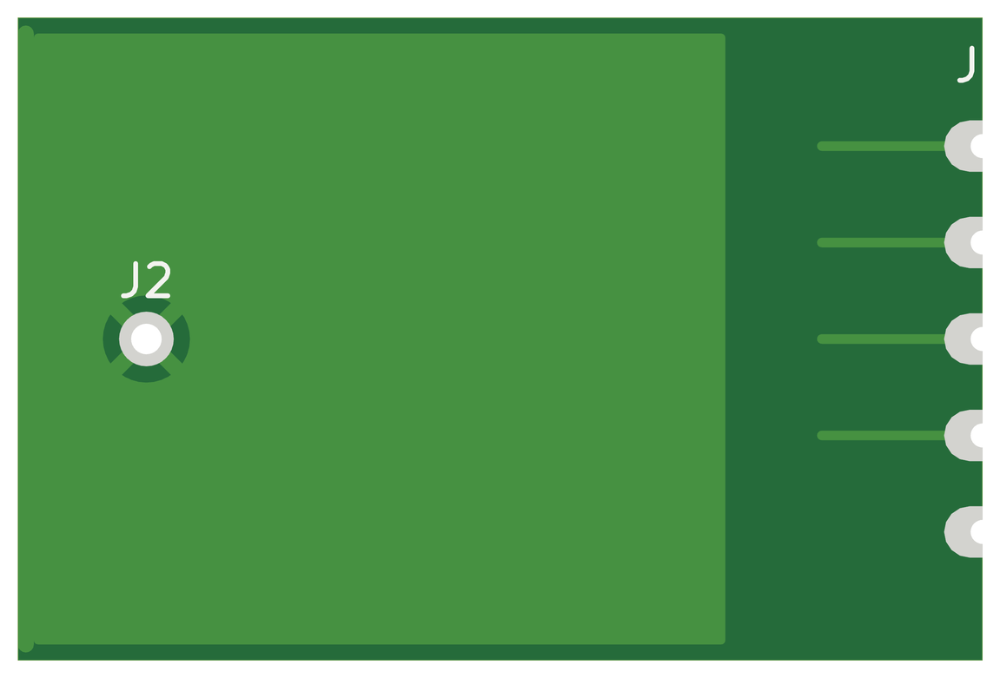
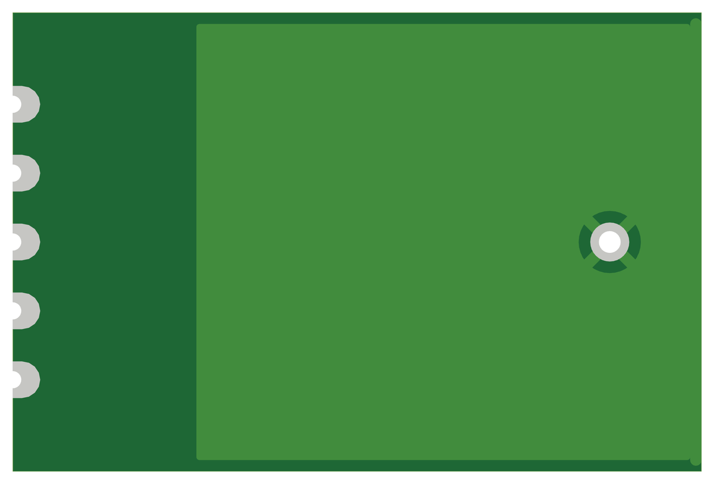
</p>

![16 Castellated pads and a plated edge: stacked bars of seconds per stage, one format a run; stages 4 and 6 take 36% to 50% of a run. Simulation with GLB takes 0.6 s: read 71 ms, resolve 70 ms, geometry 95 ms, materials 0.1 ms, assemble 0.2, write 4 ms, verify 20 ms, start-up and exit 0.2. Simulation with STEP takes 0.8 s: read 72 ms, resolve 70 ms, geometry 0.1, materials 0.1 ms, assemble 0.2, write 0.1, verify 19 ms, start-up and exit 0.2. Simulation with STL takes 0.7 s: read 70 ms, resolve 73 ms, geometry 0.1, materials 0.1 ms, assemble 0.2, write 6 ms, verify 19 ms, start-up and exit 0.2. Simulation with OBJ takes 0.7 s: read 73 ms, resolve 72 ms, geometry 92 ms, materials 0.1 ms, assemble 0.2, write 81 ms, verify 20 ms, start-up and exit 0.2. Visual with GLB takes 0.7 s: read 68 ms, resolve 71 ms, geometry 89 ms, materials 0.1 ms, assemble 0.3, write 4 ms, verify 34 ms, start-up and exit 0.2. Visual with OBJ takes 0.8 s: read 69 ms, resolve 70 ms, geometry 96 ms, materials 0.1 ms, assemble 0.3, write 51 ms, verify 31 ms, start-up and exit 0.2](https://raw.githubusercontent.com/RolandThsive/KiCad-EM-Stackup-Exporter-KESE/main/docs/images/Feature-Test-Collection/feature_16_edge_plating_castellation.webp)

| Mode and format | 1–2 read | 3 resolve | 4 geometry | 5 materials | 6 assemble | 7 write | 8 verify | start-up and exit | Total |
|---|---:|---:|---:|---:|---:|---:|---:|---:|---:|
| Simulation, GLB | 71&nbsp;ms | 70&nbsp;ms | 95&nbsp;ms | 0.1&nbsp;ms | 0.2 | 4&nbsp;ms | 20&nbsp;ms | 0.2 | 0.6 |
| Simulation, STEP | 72&nbsp;ms | 70&nbsp;ms | 0.1 | 0.1&nbsp;ms | 0.2 | 0.1 | 19&nbsp;ms | 0.2 | 0.8 |
| Simulation, STL | 70&nbsp;ms | 73&nbsp;ms | 0.1 | 0.1&nbsp;ms | 0.2 | 6&nbsp;ms | 19&nbsp;ms | 0.2 | 0.7 |
| Simulation, OBJ | 73&nbsp;ms | 72&nbsp;ms | 92&nbsp;ms | 0.1&nbsp;ms | 0.2 | 81&nbsp;ms | 20&nbsp;ms | 0.2 | 0.7 |
| Visual, GLB | 68&nbsp;ms | 71&nbsp;ms | 89&nbsp;ms | 0.1&nbsp;ms | 0.3 | 4&nbsp;ms | 34&nbsp;ms | 0.2 | 0.7 |
| Visual, OBJ | 69&nbsp;ms | 70&nbsp;ms | 96&nbsp;ms | 0.1&nbsp;ms | 0.3 | 51&nbsp;ms | 31&nbsp;ms | 0.2 | 0.8 |

<table align="center">
<tr>
<td valign="top">

| Board | `featureTest/`<br>`16_edge_plating_castellation.kicad_pcb` |
|---|---|
| Outline | 30 × 20 mm |
| Thickness | 1.6 mm |
| Copper&nbsp;layers | 2 |
| Vias | none |
| Board&nbsp;edge | Castellated pads on the right edge,<br>plated edge |
| Mask,&nbsp;silkscreen,&nbsp;finish | Not set (drawn green and white),<br>immersion silver |

</td>
<td valign="top">

<table>
<tr><th>File<br>type</th><th>File<br>size</th><th>Peak memory<br>used</th></tr>
<tr><th colspan="3" align="left">Simulation</th></tr>
<tr><td>GLB</td><td align="right">500 kB</td><td align="right">65 MB</td></tr>
<tr><td>STEP</td><td align="right">2.6 MB</td><td align="right">70 MB</td></tr>
<tr><td>STL</td><td align="right">718 kB</td><td align="right">68 MB</td></tr>
<tr><td>OBJ</td><td align="right">1.3 MB</td><td align="right">69 MB</td></tr>
<tr><th colspan="3" align="left">Visual</th></tr>
<tr><td>GLB</td><td align="right">337 kB</td><td align="right">91 MB</td></tr>
<tr><td>OBJ</td><td align="right">848 kB</td><td align="right">92 MB</td></tr>
</table>

</td>
</tr>
</table>

### 23.8.2 16b Plated Board Edge With A GND Border

<p align="center">


</p>

![16b Plated board edge with a GND border: stacked bars of seconds per stage, one format a run; stages 4 and 6 take 55% to 88% of a run. Simulation with GLB takes 5.6 s: read 0.1, resolve 0.5, geometry 2.2, materials 0.2 ms, assemble 2.2, write 67 ms, verify 0.3, start-up and exit 0.2. Simulation with STEP takes 6.6 s: read 0.1, resolve 0.4, geometry 2.2, materials 0.1 ms, assemble 2.2, write 1.3, verify 0.2, start-up and exit 0.2. Simulation with STL takes 5.5 s: read 0.1, resolve 0.5, geometry 2.2, materials 0.2 ms, assemble 2.2, write 0.1, verify 0.3, start-up and exit 0.2. Simulation with OBJ takes 8.1 s: read 0.1, resolve 0.5, geometry 2.1, materials 0.2 ms, assemble 2.3, write 2.6, verify 0.3, start-up and exit 0.2. Visual with GLB takes 7.6 s: read 99 ms, resolve 0.5, geometry 2.2, materials 0.2 ms, assemble 4.5, write 23 ms, verify 0.2, start-up and exit 0.2. Visual with OBJ takes 8.6 s: read 0.1, resolve 0.5, geometry 2.3, materials 0.2 ms, assemble 4.5, write 0.9, verify 0.1, start-up and exit 0.2](https://raw.githubusercontent.com/RolandThsive/KiCad-EM-Stackup-Exporter-KESE/main/docs/images/Feature-Test-Collection/feature_16b_edge_plating_border.webp)

| Mode and format | 1–2 read | 3 resolve | 4 geometry | 5 materials | 6 assemble | 7 write | 8 verify | start-up and exit | Total |
|---|---:|---:|---:|---:|---:|---:|---:|---:|---:|
| Simulation, GLB | 0.1 | 0.5 | 2.2 | 0.2&nbsp;ms | 2.2 | 67&nbsp;ms | 0.3 | 0.2 | 5.6 |
| Simulation, STEP | 0.1 | 0.4 | 2.2 | 0.1&nbsp;ms | 2.2 | 1.3 | 0.2 | 0.2 | 6.6 |
| Simulation, STL | 0.1 | 0.5 | 2.2 | 0.2&nbsp;ms | 2.2 | 0.1 | 0.3 | 0.2 | 5.5 |
| Simulation, OBJ | 0.1 | 0.5 | 2.1 | 0.2&nbsp;ms | 2.3 | 2.6 | 0.3 | 0.2 | 8.1 |
| Visual, GLB | 99&nbsp;ms | 0.5 | 2.2 | 0.2&nbsp;ms | 4.5 | 23&nbsp;ms | 0.2 | 0.2 | 7.6 |
| Visual, OBJ | 0.1 | 0.5 | 2.3 | 0.2&nbsp;ms | 4.5 | 0.9 | 0.1 | 0.2 | 8.6 |

<table align="center">
<tr>
<td valign="top">

| Board | `featureTest/`<br>`16b_edge_plating_border.kicad_pcb` |
|---|---|
| Outline | 40 × 28 mm, a cut-out |
| Thickness | 1.6 mm |
| Copper&nbsp;layers | 4 |
| Vias | 91 through |
| Board&nbsp;edge | Plated all round<br>and in the cut-out |
| Mask,&nbsp;silkscreen,&nbsp;finish | Green, white, ENIG |

</td>
<td valign="top">

<table>
<tr><th>File<br>type</th><th>File<br>size</th><th>Peak memory<br>used</th></tr>
<tr><th colspan="3" align="left">Simulation</th></tr>
<tr><td>GLB</td><td align="right">14.8 MB</td><td align="right">287 MB</td></tr>
<tr><td>STEP</td><td align="right">54.3 MB</td><td align="right">328 MB</td></tr>
<tr><td>STL</td><td align="right">22.1 MB</td><td align="right">286 MB</td></tr>
<tr><td>OBJ</td><td align="right">43.6 MB</td><td align="right">347 MB</td></tr>
<tr><th colspan="3" align="left">Visual</th></tr>
<tr><td>GLB</td><td align="right">4.5 MB</td><td align="right">247 MB</td></tr>
<tr><td>OBJ</td><td align="right">13.1 MB</td><td align="right">247 MB</td></tr>
</table>

</td>
</tr>
</table>

### 23.8.3 28 Machining At A Plated Edge

<p align="center">
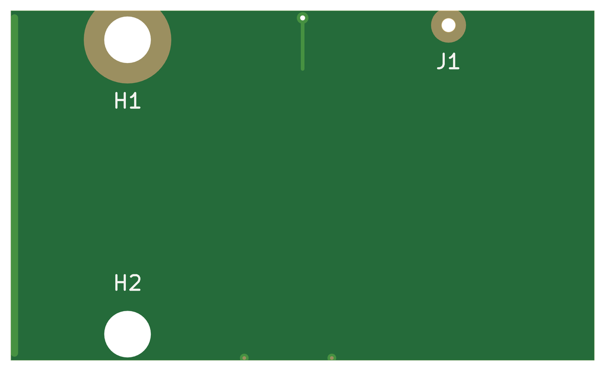
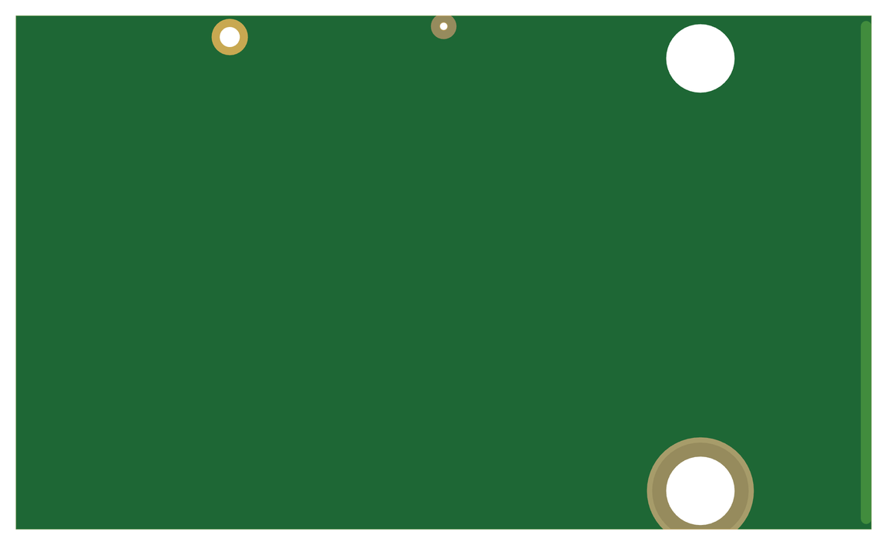
</p>

![28 Machining at a plated edge: stacked bars of seconds per stage, one format a run; stages 4 and 6 take 61% to 76% of a run. Simulation with GLB takes 1.3 s: read 70 ms, resolve 69 ms, geometry 0.3, materials 0.1 ms, assemble 0.6, write 6 ms, verify 42 ms, start-up and exit 0.2. Simulation with STEP takes 1.5 s: read 66 ms, resolve 70 ms, geometry 0.3, materials 0.1 ms, assemble 0.6, write 0.2, verify 40 ms, start-up and exit 0.2. Simulation with STL takes 1.3 s: read 72 ms, resolve 75 ms, geometry 0.3, materials 0.1 ms, assemble 0.6, write 9 ms, verify 39 ms, start-up and exit 0.2. Simulation with OBJ takes 1.4 s: read 68 ms, resolve 74 ms, geometry 0.3, materials 0.1 ms, assemble 0.6, write 0.1, verify 47 ms, start-up and exit 0.2. Visual with GLB takes 1.5 s: read 67 ms, resolve 69 ms, geometry 0.3, materials 0.1 ms, assemble 0.9, write 7 ms, verify 38 ms, start-up and exit 0.2. Visual with OBJ takes 1.6 s: read 78 ms, resolve 75 ms, geometry 0.3, materials 0.2 ms, assemble 0.9, write 76 ms, verify 35 ms, start-up and exit 0.2](https://raw.githubusercontent.com/RolandThsive/KiCad-EM-Stackup-Exporter-KESE/main/docs/images/Feature-Test-Collection/feature_28_plated_edge_machining.webp)

| Mode and format | 1–2 read | 3 resolve | 4 geometry | 5 materials | 6 assemble | 7 write | 8 verify | start-up and exit | Total |
|---|---:|---:|---:|---:|---:|---:|---:|---:|---:|
| Simulation, GLB | 70&nbsp;ms | 69&nbsp;ms | 0.3 | 0.1&nbsp;ms | 0.6 | 6&nbsp;ms | 42&nbsp;ms | 0.2 | 1.3 |
| Simulation, STEP | 66&nbsp;ms | 70&nbsp;ms | 0.3 | 0.1&nbsp;ms | 0.6 | 0.2 | 40&nbsp;ms | 0.2 | 1.5 |
| Simulation, STL | 72&nbsp;ms | 75&nbsp;ms | 0.3 | 0.1&nbsp;ms | 0.6 | 9&nbsp;ms | 39&nbsp;ms | 0.2 | 1.3 |
| Simulation, OBJ | 68&nbsp;ms | 74&nbsp;ms | 0.3 | 0.1&nbsp;ms | 0.6 | 0.1 | 47&nbsp;ms | 0.2 | 1.4 |
| Visual, GLB | 67&nbsp;ms | 69&nbsp;ms | 0.3 | 0.1&nbsp;ms | 0.9 | 7&nbsp;ms | 38&nbsp;ms | 0.2 | 1.5 |
| Visual, OBJ | 78&nbsp;ms | 75&nbsp;ms | 0.3 | 0.2&nbsp;ms | 0.9 | 76&nbsp;ms | 35&nbsp;ms | 0.2 | 1.6 |

<table align="center">
<tr>
<td valign="top">

| Board | `featureTest/`<br>`28_plated_edge_machining.kicad_pcb` |
|---|---|
| Outline | 40 × 24 mm |
| Thickness | 1.6 mm |
| Copper&nbsp;layers | 4 |
| Vias | 3: 2 blind and buried, 1 through |
| Board&nbsp;edge | Plated all round,<br>cut by machining between two heights |
| Mask,&nbsp;silkscreen,&nbsp;finish | Not set (drawn green and white),<br>ENIG |

</td>
<td valign="top">

<table>
<tr><th>File<br>type</th><th>File<br>size</th><th>Peak memory<br>used</th></tr>
<tr><th colspan="3" align="left">Simulation</th></tr>
<tr><td>GLB</td><td align="right">926 kB</td><td align="right">69 MB</td></tr>
<tr><td>STEP</td><td align="right">5.1 MB</td><td align="right">71 MB</td></tr>
<tr><td>STL</td><td align="right">1.4 MB</td><td align="right">69 MB</td></tr>
<tr><td>OBJ</td><td align="right">2.5 MB</td><td align="right">74 MB</td></tr>
<tr><th colspan="3" align="left">Visual</th></tr>
<tr><td>GLB</td><td align="right">504 kB</td><td align="right">96 MB</td></tr>
<tr><td>OBJ</td><td align="right">1.3 MB</td><td align="right">97 MB</td></tr>
</table>

</td>
</tr>
</table>

## 23.9 Solder Mask And Silkscreen

### 23.9.1 17 Solder Mask And Silkscreen

<p align="center">


</p>

![17 Solder mask and silkscreen: stacked bars of seconds per stage, one format a run; stages 4 and 6 take 37% to 52% of a run. Simulation with GLB takes 0.6 s: read 74 ms, resolve 72 ms, geometry 0.1, materials 0.1 ms, assemble 0.2, write 5 ms, verify 16 ms, start-up and exit 0.2. Simulation with STEP takes 0.8 s: read 73 ms, resolve 62 ms, geometry 98 ms, materials 0.1 ms, assemble 0.2, write 0.2, verify 20 ms, start-up and exit 0.2. Simulation with STL takes 0.7 s: read 77 ms, resolve 71 ms, geometry 0.1, materials 0.1 ms, assemble 0.2, write 7 ms, verify 17 ms, start-up and exit 0.2. Simulation with OBJ takes 0.8 s: read 82 ms, resolve 67 ms, geometry 0.1, materials 0.1 ms, assemble 0.2, write 0.1, verify 17 ms, start-up and exit 0.2. Visual with GLB takes 0.8 s: read 98 ms, resolve 78 ms, geometry 0.1, materials 0.1 ms, assemble 0.3, write 5 ms, verify 38 ms, start-up and exit 0.2. Visual with OBJ takes 1.0 s: read 80 ms, resolve 65 ms, geometry 0.1, materials 0.1 ms, assemble 0.3, write 0.1, verify 47 ms, start-up and exit 0.2](https://raw.githubusercontent.com/RolandThsive/KiCad-EM-Stackup-Exporter-KESE/main/docs/images/Feature-Test-Collection/feature_17_mask_silk.webp)

| Mode and format | 1–2 read | 3 resolve | 4 geometry | 5 materials | 6 assemble | 7 write | 8 verify | start-up and exit | Total |
|---|---:|---:|---:|---:|---:|---:|---:|---:|---:|
| Simulation, GLB | 74&nbsp;ms | 72&nbsp;ms | 0.1 | 0.1&nbsp;ms | 0.2 | 5&nbsp;ms | 16&nbsp;ms | 0.2 | 0.6 |
| Simulation, STEP | 73&nbsp;ms | 62&nbsp;ms | 98&nbsp;ms | 0.1&nbsp;ms | 0.2 | 0.2 | 20&nbsp;ms | 0.2 | 0.8 |
| Simulation, STL | 77&nbsp;ms | 71&nbsp;ms | 0.1 | 0.1&nbsp;ms | 0.2 | 7&nbsp;ms | 17&nbsp;ms | 0.2 | 0.7 |
| Simulation, OBJ | 82&nbsp;ms | 67&nbsp;ms | 0.1 | 0.1&nbsp;ms | 0.2 | 0.1 | 17&nbsp;ms | 0.2 | 0.8 |
| Visual, GLB | 98&nbsp;ms | 78&nbsp;ms | 0.1 | 0.1&nbsp;ms | 0.3 | 5&nbsp;ms | 38&nbsp;ms | 0.2 | 0.8 |
| Visual, OBJ | 80&nbsp;ms | 65&nbsp;ms | 0.1 | 0.1&nbsp;ms | 0.3 | 0.1 | 47&nbsp;ms | 0.2 | 1.0 |

<table align="center">
<tr>
<td valign="top">

| Board | `featureTest/`<br>`17_mask_silk.kicad_pcb` |
|---|---|
| Outline | 40 × 30 mm |
| Thickness | 1.6 mm |
| Copper&nbsp;layers | 2 |
| Vias | 1 through |
| Board&nbsp;edge | Plain |
| Mask,&nbsp;silkscreen,&nbsp;finish | Red, black, lead-free HASL |

</td>
<td valign="top">

<table>
<tr><th>File<br>type</th><th>File<br>size</th><th>Peak memory<br>used</th></tr>
<tr><th colspan="3" align="left">Simulation</th></tr>
<tr><td>GLB</td><td align="right">645 kB</td><td align="right">67 MB</td></tr>
<tr><td>STEP</td><td align="right">2.0 MB</td><td align="right">68 MB</td></tr>
<tr><td>STL</td><td align="right">880 kB</td><td align="right">69 MB</td></tr>
<tr><td>OBJ</td><td align="right">1.7 MB</td><td align="right">71 MB</td></tr>
<tr><th colspan="3" align="left">Visual</th></tr>
<tr><td>GLB</td><td align="right">561 kB</td><td align="right">95 MB</td></tr>
<tr><td>OBJ</td><td align="right">1.5 MB</td><td align="right">95 MB</td></tr>
</table>

</td>
</tr>
</table>

### 23.9.2 17b Silkscreen Over Copper

<p align="center">
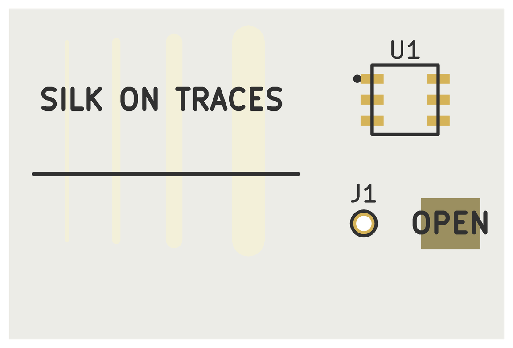
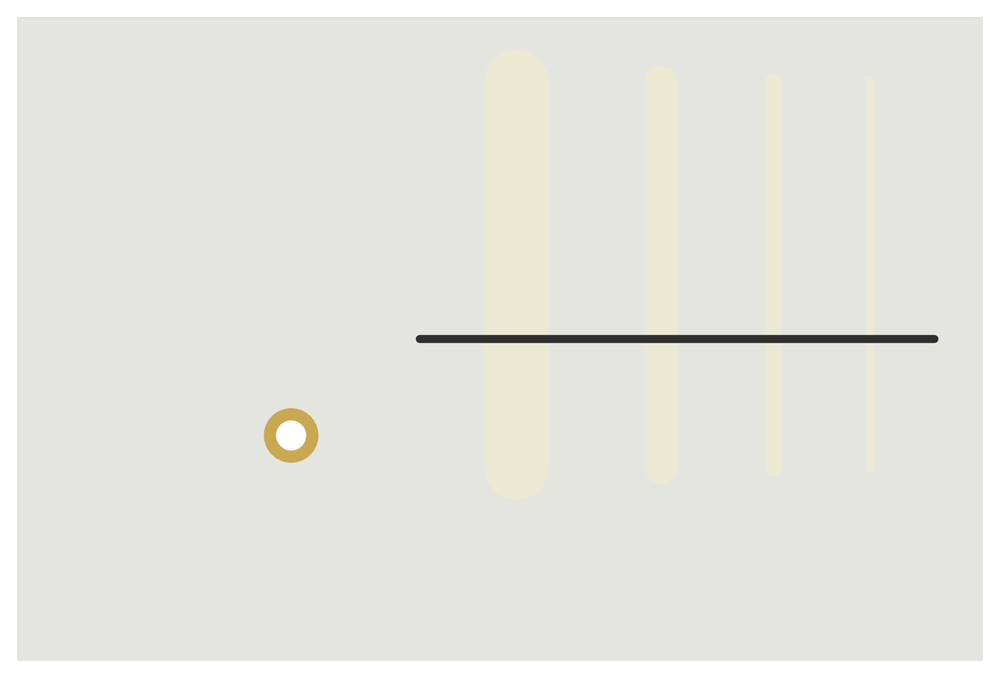
</p>

![17b Silkscreen over copper: stacked bars of seconds per stage, one format a run; stages 4 and 6 take 43% to 65% of a run. Simulation with GLB takes 0.7 s: read 82 ms, resolve 36 ms, geometry 0.1, materials 0.1 ms, assemble 0.2, write 5 ms, verify 24 ms, start-up and exit 0.2. Simulation with STEP takes 0.9 s: read 69 ms, resolve 33 ms, geometry 0.2, materials 0.1 ms, assemble 0.2, write 0.2, verify 26 ms, start-up and exit 0.2. Simulation with STL takes 0.8 s: read 76 ms, resolve 35 ms, geometry 0.1, materials 0.1 ms, assemble 0.3, write 8 ms, verify 26 ms, start-up and exit 0.2. Simulation with OBJ takes 0.8 s: read 70 ms, resolve 32 ms, geometry 0.2, materials 0.1 ms, assemble 0.3, write 0.1, verify 23 ms, start-up and exit 0.2. Visual with GLB takes 0.9 s: read 70 ms, resolve 31 ms, geometry 0.2, materials 0.1 ms, assemble 0.4, write 4 ms, verify 39 ms, start-up and exit 0.2. Visual with OBJ takes 1.0 s: read 71 ms, resolve 32 ms, geometry 0.2, materials 0.1 ms, assemble 0.4, write 80 ms, verify 32 ms, start-up and exit 0.2](https://raw.githubusercontent.com/RolandThsive/KiCad-EM-Stackup-Exporter-KESE/main/docs/images/Feature-Test-Collection/feature_17b_silk_over_copper.webp)

| Mode and format | 1–2 read | 3 resolve | 4 geometry | 5 materials | 6 assemble | 7 write | 8 verify | start-up and exit | Total |
|---|---:|---:|---:|---:|---:|---:|---:|---:|---:|
| Simulation, GLB | 82&nbsp;ms | 36&nbsp;ms | 0.1 | 0.1&nbsp;ms | 0.2 | 5&nbsp;ms | 24&nbsp;ms | 0.2 | 0.7 |
| Simulation, STEP | 69&nbsp;ms | 33&nbsp;ms | 0.2 | 0.1&nbsp;ms | 0.2 | 0.2 | 26&nbsp;ms | 0.2 | 0.9 |
| Simulation, STL | 76&nbsp;ms | 35&nbsp;ms | 0.1 | 0.1&nbsp;ms | 0.3 | 8&nbsp;ms | 26&nbsp;ms | 0.2 | 0.8 |
| Simulation, OBJ | 70&nbsp;ms | 32&nbsp;ms | 0.2 | 0.1&nbsp;ms | 0.3 | 0.1 | 23&nbsp;ms | 0.2 | 0.8 |
| Visual, GLB | 70&nbsp;ms | 31&nbsp;ms | 0.2 | 0.1&nbsp;ms | 0.4 | 4&nbsp;ms | 39&nbsp;ms | 0.2 | 0.9 |
| Visual, OBJ | 71&nbsp;ms | 32&nbsp;ms | 0.2 | 0.1&nbsp;ms | 0.4 | 80&nbsp;ms | 32&nbsp;ms | 0.2 | 1.0 |

<table align="center">
<tr>
<td valign="top">

| Board | `featureTest/`<br>`17b_silk_over_copper.kicad_pcb` |
|---|---|
| Outline | 30 × 20 mm |
| Thickness | 1.6 mm |
| Copper&nbsp;layers | 2 |
| Vias | none |
| Board&nbsp;edge | Plain |
| Mask,&nbsp;silkscreen,&nbsp;finish | White, black, ENIG |

</td>
<td valign="top">

<table>
<tr><th>File<br>type</th><th>File<br>size</th><th>Peak memory<br>used</th></tr>
<tr><th colspan="3" align="left">Simulation</th></tr>
<tr><td>GLB</td><td align="right">589 kB</td><td align="right">68 MB</td></tr>
<tr><td>STEP</td><td align="right">3.0 MB</td><td align="right">69 MB</td></tr>
<tr><td>STL</td><td align="right">804 kB</td><td align="right">69 MB</td></tr>
<tr><td>OBJ</td><td align="right">1.6 MB</td><td align="right">70 MB</td></tr>
<tr><th colspan="3" align="left">Visual</th></tr>
<tr><td>GLB</td><td align="right">513 kB</td><td align="right">90 MB</td></tr>
<tr><td>OBJ</td><td align="right">1.3 MB</td><td align="right">91 MB</td></tr>
</table>

</td>
</tr>
</table>

## 23.10 Surface Finish

### 23.10.1 18 Gold Edge Fingers

<p align="center">


</p>

![18 Gold edge fingers: stacked bars of seconds per stage, one format a run; reading, start-up and exit take 35% to 46% of a run. Simulation with GLB takes 0.6 s: read 79 ms, resolve 35 ms, geometry 55 ms, materials 0.1 ms, assemble 0.2, write 5 ms, verify 19 ms, start-up and exit 0.2. Simulation with STEP takes 0.7 s: read 67 ms, resolve 38 ms, geometry 49 ms, materials 0.1 ms, assemble 0.2, write 0.1, verify 17 ms, start-up and exit 0.2. Simulation with STL takes 0.6 s: read 69 ms, resolve 36 ms, geometry 49 ms, materials 0.1 ms, assemble 0.2, write 6 ms, verify 18 ms, start-up and exit 0.2. Simulation with OBJ takes 0.6 s: read 68 ms, resolve 34 ms, geometry 55 ms, materials 0.1 ms, assemble 0.2, write 88 ms, verify 17 ms, start-up and exit 0.2. Visual with GLB takes 0.7 s: read 70 ms, resolve 35 ms, geometry 48 ms, materials 0.1 ms, assemble 0.3, write 5 ms, verify 51 ms, start-up and exit 0.2. Visual with OBJ takes 0.8 s: read 86 ms, resolve 35 ms, geometry 46 ms, materials 0.1 ms, assemble 0.3, write 77 ms, verify 49 ms, start-up and exit 0.2](https://raw.githubusercontent.com/RolandThsive/KiCad-EM-Stackup-Exporter-KESE/main/docs/images/Feature-Test-Collection/feature_18_finishes.webp)

| Mode and format | 1–2 read | 3 resolve | 4 geometry | 5 materials | 6 assemble | 7 write | 8 verify | start-up and exit | Total |
|---|---:|---:|---:|---:|---:|---:|---:|---:|---:|
| Simulation, GLB | 79&nbsp;ms | 35&nbsp;ms | 55&nbsp;ms | 0.1&nbsp;ms | 0.2 | 5&nbsp;ms | 19&nbsp;ms | 0.2 | 0.6 |
| Simulation, STEP | 67&nbsp;ms | 38&nbsp;ms | 49&nbsp;ms | 0.1&nbsp;ms | 0.2 | 0.1 | 17&nbsp;ms | 0.2 | 0.7 |
| Simulation, STL | 69&nbsp;ms | 36&nbsp;ms | 49&nbsp;ms | 0.1&nbsp;ms | 0.2 | 6&nbsp;ms | 18&nbsp;ms | 0.2 | 0.6 |
| Simulation, OBJ | 68&nbsp;ms | 34&nbsp;ms | 55&nbsp;ms | 0.1&nbsp;ms | 0.2 | 88&nbsp;ms | 17&nbsp;ms | 0.2 | 0.6 |
| Visual, GLB | 70&nbsp;ms | 35&nbsp;ms | 48&nbsp;ms | 0.1&nbsp;ms | 0.3 | 5&nbsp;ms | 51&nbsp;ms | 0.2 | 0.7 |
| Visual, OBJ | 86&nbsp;ms | 35&nbsp;ms | 46&nbsp;ms | 0.1&nbsp;ms | 0.3 | 77&nbsp;ms | 49&nbsp;ms | 0.2 | 0.8 |

<table align="center">
<tr>
<td valign="top">

| Board | `featureTest/`<br>`18_finishes.kicad_pcb` |
|---|---|
| Outline | 30 × 16 mm |
| Thickness | 1.6 mm |
| Copper&nbsp;layers | 2 |
| Vias | 6 through |
| Board&nbsp;edge | Gold edge fingers<br>on a bevelled edge |
| Mask,&nbsp;silkscreen,&nbsp;finish | Not set (drawn green and white),<br>hard gold |

</td>
<td valign="top">

<table>
<tr><th>File<br>type</th><th>File<br>size</th><th>Peak memory<br>used</th></tr>
<tr><th colspan="3" align="left">Simulation</th></tr>
<tr><td>GLB</td><td align="right">500 kB</td><td align="right">69 MB</td></tr>
<tr><td>STEP</td><td align="right">2.0 MB</td><td align="right">67 MB</td></tr>
<tr><td>STL</td><td align="right">776 kB</td><td align="right">65 MB</td></tr>
<tr><td>OBJ</td><td align="right">1.4 MB</td><td align="right">70 MB</td></tr>
<tr><th colspan="3" align="left">Visual</th></tr>
<tr><td>GLB</td><td align="right">482 kB</td><td align="right">104 MB</td></tr>
<tr><td>OBJ</td><td align="right">1.3 MB</td><td align="right">105 MB</td></tr>
</table>

</td>
</tr>
</table>

### 23.10.2 18b Finish On Every Kind Of Bare Copper

<p align="center">


</p>

![18b Finish on every kind of bare copper: stacked bars of seconds per stage, one format a run; stages 4 and 6 take 42% to 61% of a run. Simulation with GLB takes 0.7 s: read 68 ms, resolve 36 ms, geometry 0.1, materials 0.1 ms, assemble 0.3, write 8 ms, verify 24 ms, start-up and exit 0.2. Simulation with STEP takes 0.9 s: read 73 ms, resolve 43 ms, geometry 0.1, materials 0.2 ms, assemble 0.3, write 0.2, verify 22 ms, start-up and exit 0.2. Simulation with STL takes 0.7 s: read 75 ms, resolve 43 ms, geometry 0.1, materials 0.1 ms, assemble 0.2, write 8 ms, verify 26 ms, start-up and exit 0.2. Simulation with OBJ takes 0.8 s: read 70 ms, resolve 35 ms, geometry 0.1, materials 0.1 ms, assemble 0.2, write 0.1, verify 23 ms, start-up and exit 0.2. Visual with GLB takes 0.8 s: read 69 ms, resolve 36 ms, geometry 0.1, materials 0.2 ms, assemble 0.4, write 4 ms, verify 40 ms, start-up and exit 0.2. Visual with OBJ takes 0.8 s: read 69 ms, resolve 33 ms, geometry 94 ms, materials 0.2 ms, assemble 0.4, write 65 ms, verify 33 ms, start-up and exit 0.2](https://raw.githubusercontent.com/RolandThsive/KiCad-EM-Stackup-Exporter-KESE/main/docs/images/Feature-Test-Collection/feature_18b_finish_pads.webp)

| Mode and format | 1–2 read | 3 resolve | 4 geometry | 5 materials | 6 assemble | 7 write | 8 verify | start-up and exit | Total |
|---|---:|---:|---:|---:|---:|---:|---:|---:|---:|
| Simulation, GLB | 68&nbsp;ms | 36&nbsp;ms | 0.1 | 0.1&nbsp;ms | 0.3 | 8&nbsp;ms | 24&nbsp;ms | 0.2 | 0.7 |
| Simulation, STEP | 73&nbsp;ms | 43&nbsp;ms | 0.1 | 0.2&nbsp;ms | 0.3 | 0.2 | 22&nbsp;ms | 0.2 | 0.9 |
| Simulation, STL | 75&nbsp;ms | 43&nbsp;ms | 0.1 | 0.1&nbsp;ms | 0.2 | 8&nbsp;ms | 26&nbsp;ms | 0.2 | 0.7 |
| Simulation, OBJ | 70&nbsp;ms | 35&nbsp;ms | 0.1 | 0.1&nbsp;ms | 0.2 | 0.1 | 23&nbsp;ms | 0.2 | 0.8 |
| Visual, GLB | 69&nbsp;ms | 36&nbsp;ms | 0.1 | 0.2&nbsp;ms | 0.4 | 4&nbsp;ms | 40&nbsp;ms | 0.2 | 0.8 |
| Visual, OBJ | 69&nbsp;ms | 33&nbsp;ms | 94&nbsp;ms | 0.2&nbsp;ms | 0.4 | 65&nbsp;ms | 33&nbsp;ms | 0.2 | 0.8 |

<table align="center">
<tr>
<td valign="top">

| Board | `featureTest/`<br>`18b_finish_pads.kicad_pcb` |
|---|---|
| Outline | 30 × 20 mm |
| Thickness | 1.6 mm |
| Copper&nbsp;layers | 2 |
| Vias | 1 through |
| Board&nbsp;edge | Plain |
| Mask,&nbsp;silkscreen,&nbsp;finish | Green, white, ENIG |

</td>
<td valign="top">

<table>
<tr><th>File<br>type</th><th>File<br>size</th><th>Peak memory<br>used</th></tr>
<tr><th colspan="3" align="left">Simulation</th></tr>
<tr><td>GLB</td><td align="right">635 kB</td><td align="right">67 MB</td></tr>
<tr><td>STEP</td><td align="right">2.4 MB</td><td align="right">69 MB</td></tr>
<tr><td>STL</td><td align="right">872 kB</td><td align="right">67 MB</td></tr>
<tr><td>OBJ</td><td align="right">1.7 MB</td><td align="right">70 MB</td></tr>
<tr><th colspan="3" align="left">Visual</th></tr>
<tr><td>GLB</td><td align="right">415 kB</td><td align="right">93 MB</td></tr>
<tr><td>OBJ</td><td align="right">1.1 MB</td><td align="right">95 MB</td></tr>
</table>

</td>
</tr>
</table>

### 23.10.3 18c Finish Before The Solder Mask

<p align="center">


</p>

![18c Finish before the solder mask: stacked bars of seconds per stage, one format a run; stages 4 and 6 take 46% to 69% of a run. Simulation with GLB takes 0.9 s: read 70 ms, resolve 32 ms, geometry 0.2, materials 0.2 ms, assemble 0.5, write 9 ms, verify 36 ms, start-up and exit 0.2. Simulation with STEP takes 1.3 s: read 74 ms, resolve 33 ms, geometry 0.2, materials 0.1 ms, assemble 0.5, write 0.4, verify 43 ms, start-up and exit 0.2. Simulation with STL takes 1.0 s: read 71 ms, resolve 37 ms, geometry 0.2, materials 0.1 ms, assemble 0.5, write 12 ms, verify 34 ms, start-up and exit 0.2. Simulation with OBJ takes 1.2 s: read 74 ms, resolve 35 ms, geometry 0.2, materials 0.1 ms, assemble 0.5, write 0.2, verify 38 ms, start-up and exit 0.2. Visual with GLB takes 1.1 s: read 70 ms, resolve 34 ms, geometry 0.2, materials 0.1 ms, assemble 0.6, write 6 ms, verify 36 ms, start-up and exit 0.2. Visual with OBJ takes 1.2 s: read 68 ms, resolve 35 ms, geometry 0.2, materials 0.2 ms, assemble 0.6, write 80 ms, verify 37 ms, start-up and exit 0.2](https://raw.githubusercontent.com/RolandThsive/KiCad-EM-Stackup-Exporter-KESE/main/docs/images/Feature-Test-Collection/feature_18c_finish_before_mask.webp)

| Mode and format | 1–2 read | 3 resolve | 4 geometry | 5 materials | 6 assemble | 7 write | 8 verify | start-up and exit | Total |
|---|---:|---:|---:|---:|---:|---:|---:|---:|---:|
| Simulation, GLB | 70&nbsp;ms | 32&nbsp;ms | 0.2 | 0.2&nbsp;ms | 0.5 | 9&nbsp;ms | 36&nbsp;ms | 0.2 | 0.9 |
| Simulation, STEP | 74&nbsp;ms | 33&nbsp;ms | 0.2 | 0.1&nbsp;ms | 0.5 | 0.4 | 43&nbsp;ms | 0.2 | 1.3 |
| Simulation, STL | 71&nbsp;ms | 37&nbsp;ms | 0.2 | 0.1&nbsp;ms | 0.5 | 12&nbsp;ms | 34&nbsp;ms | 0.2 | 1.0 |
| Simulation, OBJ | 74&nbsp;ms | 35&nbsp;ms | 0.2 | 0.1&nbsp;ms | 0.5 | 0.2 | 38&nbsp;ms | 0.2 | 1.2 |
| Visual, GLB | 70&nbsp;ms | 34&nbsp;ms | 0.2 | 0.1&nbsp;ms | 0.6 | 6&nbsp;ms | 36&nbsp;ms | 0.2 | 1.1 |
| Visual, OBJ | 68&nbsp;ms | 35&nbsp;ms | 0.2 | 0.2&nbsp;ms | 0.6 | 80&nbsp;ms | 37&nbsp;ms | 0.2 | 1.2 |

<table align="center">
<tr>
<td valign="top">

| Board | `featureTest/`<br>`18c_finish_before_mask.kicad_pcb` |
|---|---|
| Outline | 30 × 20 mm |
| Thickness | 1.6 mm |
| Copper&nbsp;layers | 2 |
| Vias | 1 through |
| Board&nbsp;edge | Plain |
| Mask,&nbsp;silkscreen,&nbsp;finish | Blue, white, ENEPIG |

</td>
<td valign="top">

<table>
<tr><th>File<br>type</th><th>File<br>size</th><th>Peak memory<br>used</th></tr>
<tr><th colspan="3" align="left">Simulation</th></tr>
<tr><td>GLB</td><td align="right">1.2 MB</td><td align="right">69 MB</td></tr>
<tr><td>STEP</td><td align="right">6.5 MB</td><td align="right">71 MB</td></tr>
<tr><td>STL</td><td align="right">1.7 MB</td><td align="right">70 MB</td></tr>
<tr><td>OBJ</td><td align="right">3.3 MB</td><td align="right">80 MB</td></tr>
<tr><th colspan="3" align="left">Visual</th></tr>
<tr><td>GLB</td><td align="right">546 kB</td><td align="right">93 MB</td></tr>
<tr><td>OBJ</td><td align="right">1.4 MB</td><td align="right">95 MB</td></tr>
</table>

</td>
</tr>
</table>

## 23.11 Items KESE Skips

### 23.11.1 19 Items KESE Skips

<p align="center">


</p>

![19 Items KESE skips: stacked bars of seconds per stage, one format a run; reading, start-up and exit take 55% to 74% of a run. Simulation with GLB takes 0.4 s: read 72 ms, resolve 17 ms, geometry 20 ms, materials 0.1 ms, assemble 67 ms, write 4 ms, verify 8 ms, start-up and exit 0.2. Simulation with STEP takes 0.4 s: read 67 ms, resolve 17 ms, geometry 22 ms, materials 0.1 ms, assemble 43 ms, write 42 ms, verify 7 ms, start-up and exit 0.2. Simulation with STL takes 0.3 s: read 65 ms, resolve 17 ms, geometry 19 ms, materials 0.1 ms, assemble 43 ms, write 3 ms, verify 6 ms, start-up and exit 0.2. Simulation with OBJ takes 0.4 s: read 74 ms, resolve 18 ms, geometry 21 ms, materials 0.1 ms, assemble 46 ms, write 16 ms, verify 7 ms, start-up and exit 0.2. Visual with GLB takes 0.4 s: read 66 ms, resolve 16 ms, geometry 21 ms, materials 0.1 ms, assemble 0.1, write 2 ms, verify 18 ms, start-up and exit 0.2. Visual with OBJ takes 0.4 s: read 65 ms, resolve 17 ms, geometry 21 ms, materials 0.1 ms, assemble 0.1, write 26 ms, verify 19 ms, start-up and exit 0.2](https://raw.githubusercontent.com/RolandThsive/KiCad-EM-Stackup-Exporter-KESE/main/docs/images/Feature-Test-Collection/feature_19_skipped_items.webp)

| Mode and format | 1–2 read | 3 resolve | 4 geometry | 5 materials | 6 assemble | 7 write | 8 verify | start-up and exit | Total |
|---|---:|---:|---:|---:|---:|---:|---:|---:|---:|
| Simulation, GLB | 72&nbsp;ms | 17&nbsp;ms | 20&nbsp;ms | 0.1&nbsp;ms | 67&nbsp;ms | 4&nbsp;ms | 8&nbsp;ms | 0.2 | 0.4 |
| Simulation, STEP | 67&nbsp;ms | 17&nbsp;ms | 22&nbsp;ms | 0.1&nbsp;ms | 43&nbsp;ms | 42&nbsp;ms | 7&nbsp;ms | 0.2 | 0.4 |
| Simulation, STL | 65&nbsp;ms | 17&nbsp;ms | 19&nbsp;ms | 0.1&nbsp;ms | 43&nbsp;ms | 3&nbsp;ms | 6&nbsp;ms | 0.2 | 0.3 |
| Simulation, OBJ | 74&nbsp;ms | 18&nbsp;ms | 21&nbsp;ms | 0.1&nbsp;ms | 46&nbsp;ms | 16&nbsp;ms | 7&nbsp;ms | 0.2 | 0.4 |
| Visual, GLB | 66&nbsp;ms | 16&nbsp;ms | 21&nbsp;ms | 0.1&nbsp;ms | 0.1 | 2&nbsp;ms | 18&nbsp;ms | 0.2 | 0.4 |
| Visual, OBJ | 65&nbsp;ms | 17&nbsp;ms | 21&nbsp;ms | 0.1&nbsp;ms | 0.1 | 26&nbsp;ms | 19&nbsp;ms | 0.2 | 0.4 |

<table align="center">
<tr>
<td valign="top">

| Board | `featureTest/`<br>`19_skipped_items.kicad_pcb` |
|---|---|
| Outline | 40 × 30 mm |
| Thickness | 1.6 mm |
| Copper&nbsp;layers | 2 |
| Vias | none |
| Board&nbsp;edge | Plain |
| Mask,&nbsp;silkscreen,&nbsp;finish | Not set (drawn green and white),<br>ENIG |

</td>
<td valign="top">

<table>
<tr><th>File<br>type</th><th>File<br>size</th><th>Peak memory<br>used</th></tr>
<tr><th colspan="3" align="left">Simulation</th></tr>
<tr><td>GLB</td><td align="right">104 kB</td><td align="right">67 MB</td></tr>
<tr><td>STEP</td><td align="right">510 kB</td><td align="right">64 MB</td></tr>
<tr><td>STL</td><td align="right">132 kB</td><td align="right">67 MB</td></tr>
<tr><td>OBJ</td><td align="right">244 kB</td><td align="right">67 MB</td></tr>
<tr><th colspan="3" align="left">Visual</th></tr>
<tr><td>GLB</td><td align="right">105 kB</td><td align="right">76 MB</td></tr>
<tr><td>OBJ</td><td align="right">249 kB</td><td align="right">77 MB</td></tr>
</table>

</td>
</tr>
</table>

### 23.11.2 19b Items KESE Skips, KiCad 10

<p align="center">


</p>

![19b Items KESE skips, KiCad 10: stacked bars of seconds per stage, one format a run; reading, start-up and exit take 76% to 84% of a run. Simulation with GLB takes 0.2 s: read 0.7 ms, resolve 6 ms, geometry 10 ms, materials 0.0 ms, assemble 15 ms, write 1 ms, verify 1 ms, start-up and exit 0.2. Simulation with STEP takes 0.2 s: read 0.8 ms, resolve 4 ms, geometry 11 ms, materials 0.1 ms, assemble 19 ms, write 6 ms, verify 2 ms, start-up and exit 0.2. Simulation with STL takes 0.2 s: read 0.8 ms, resolve 6 ms, geometry 7 ms, materials 0.0 ms, assemble 15 ms, write 1 ms, verify 5 ms, start-up and exit 0.2. Simulation with OBJ takes 0.2 s: read 0.8 ms, resolve 7 ms, geometry 8 ms, materials 0.0 ms, assemble 15 ms, write 1 ms, verify 1 ms, start-up and exit 0.2. Visual with GLB takes 0.2 s: read 0.9 ms, resolve 4 ms, geometry 15 ms, materials 0.0 ms, assemble 26 ms, write 1 ms, verify 11 ms, start-up and exit 0.2. Visual with OBJ takes 0.2 s: read 0.9 ms, resolve 4 ms, geometry 8 ms, materials 0.0 ms, assemble 34 ms, write 1 ms, verify 11 ms, start-up and exit 0.2](https://raw.githubusercontent.com/RolandThsive/KiCad-EM-Stackup-Exporter-KESE/main/docs/images/Feature-Test-Collection/feature_19b_skipped_items_k10.webp)

| Mode and format | 1–2 read | 3 resolve | 4 geometry | 5 materials | 6 assemble | 7 write | 8 verify | start-up and exit | Total |
|---|---:|---:|---:|---:|---:|---:|---:|---:|---:|
| Simulation, GLB | 0.7&nbsp;ms | 6&nbsp;ms | 10&nbsp;ms | 0.0&nbsp;ms | 15&nbsp;ms | 1&nbsp;ms | 1&nbsp;ms | 0.2 | 0.2 |
| Simulation, STEP | 0.8&nbsp;ms | 4&nbsp;ms | 11&nbsp;ms | 0.1&nbsp;ms | 19&nbsp;ms | 6&nbsp;ms | 2&nbsp;ms | 0.2 | 0.2 |
| Simulation, STL | 0.8&nbsp;ms | 6&nbsp;ms | 7&nbsp;ms | 0.0&nbsp;ms | 15&nbsp;ms | 1&nbsp;ms | 5&nbsp;ms | 0.2 | 0.2 |
| Simulation, OBJ | 0.8&nbsp;ms | 7&nbsp;ms | 8&nbsp;ms | 0.0&nbsp;ms | 15&nbsp;ms | 1&nbsp;ms | 1&nbsp;ms | 0.2 | 0.2 |
| Visual, GLB | 0.9&nbsp;ms | 4&nbsp;ms | 15&nbsp;ms | 0.0&nbsp;ms | 26&nbsp;ms | 1&nbsp;ms | 11&nbsp;ms | 0.2 | 0.2 |
| Visual, OBJ | 0.9&nbsp;ms | 4&nbsp;ms | 8&nbsp;ms | 0.0&nbsp;ms | 34&nbsp;ms | 1&nbsp;ms | 11&nbsp;ms | 0.2 | 0.2 |

<table align="center">
<tr>
<td valign="top">

| Board | `featureTest/`<br>`19b_skipped_items_k10.kicad_pcb` |
|---|---|
| Outline | 40 × 24 mm |
| Thickness | 1.6 mm |
| Copper&nbsp;layers | 2 |
| Vias | none |
| Board&nbsp;edge | Plain |
| Mask,&nbsp;silkscreen,&nbsp;finish | Mask colour not set (drawn green),<br>no silkscreen, ENIG |

</td>
<td valign="top">

<table>
<tr><th>File<br>type</th><th>File<br>size</th><th>Peak memory<br>used</th></tr>
<tr><th colspan="3" align="left">Simulation</th></tr>
<tr><td>GLB</td><td align="right">4 kB</td><td align="right">40 MB</td></tr>
<tr><td>STEP</td><td align="right">19 kB</td><td align="right">40 MB</td></tr>
<tr><td>STL</td><td align="right">2 kB</td><td align="right">40 MB</td></tr>
<tr><td>OBJ</td><td align="right">5 kB</td><td align="right">40 MB</td></tr>
<tr><th colspan="3" align="left">Visual</th></tr>
<tr><td>GLB</td><td align="right">5 kB</td><td align="right">46 MB</td></tr>
<tr><td>OBJ</td><td align="right">5 kB</td><td align="right">45 MB</td></tr>
</table>

</td>
</tr>
</table>

## 23.12 KiCad File Formats

### 23.12.1 20a KiCad 6 Format

<p align="center">
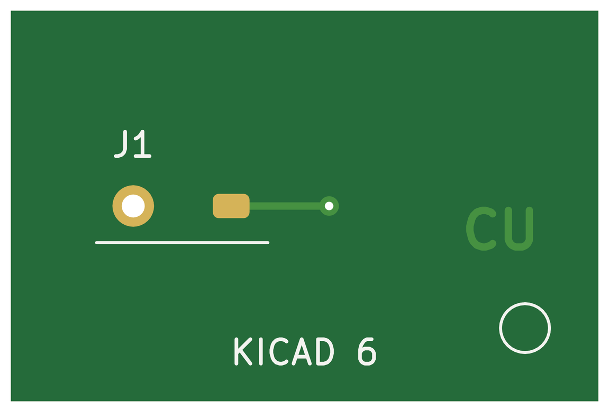

</p>

![20a KiCad 6 format: stacked bars of seconds per stage, one format a run; reading, start-up and exit take 36% to 48% of a run. Simulation with GLB takes 0.5 s: read 65 ms, resolve 29 ms, geometry 61 ms, materials 0.1 ms, assemble 0.1, write 4 ms, verify 17 ms, start-up and exit 0.2. Simulation with STEP takes 0.6 s: read 66 ms, resolve 25 ms, geometry 60 ms, materials 0.1 ms, assemble 0.2, write 0.2, verify 18 ms, start-up and exit 0.2. Simulation with STL takes 0.5 s: read 66 ms, resolve 27 ms, geometry 62 ms, materials 0.1 ms, assemble 0.2, write 7 ms, verify 19 ms, start-up and exit 0.2. Simulation with OBJ takes 0.6 s: read 67 ms, resolve 26 ms, geometry 66 ms, materials 0.1 ms, assemble 0.2, write 79 ms, verify 18 ms, start-up and exit 0.2. Visual with GLB takes 0.7 s: read 71 ms, resolve 27 ms, geometry 65 ms, materials 0.1 ms, assemble 0.3, write 4 ms, verify 35 ms, start-up and exit 0.2. Visual with OBJ takes 0.7 s: read 80 ms, resolve 29 ms, geometry 62 ms, materials 0.1 ms, assemble 0.3, write 62 ms, verify 29 ms, start-up and exit 0.2](https://raw.githubusercontent.com/RolandThsive/KiCad-EM-Stackup-Exporter-KESE/main/docs/images/Feature-Test-Collection/feature_20a_format_kicad6.webp)

| Mode and format | 1–2 read | 3 resolve | 4 geometry | 5 materials | 6 assemble | 7 write | 8 verify | start-up and exit | Total |
|---|---:|---:|---:|---:|---:|---:|---:|---:|---:|
| Simulation, GLB | 65&nbsp;ms | 29&nbsp;ms | 61&nbsp;ms | 0.1&nbsp;ms | 0.1 | 4&nbsp;ms | 17&nbsp;ms | 0.2 | 0.5 |
| Simulation, STEP | 66&nbsp;ms | 25&nbsp;ms | 60&nbsp;ms | 0.1&nbsp;ms | 0.2 | 0.2 | 18&nbsp;ms | 0.2 | 0.6 |
| Simulation, STL | 66&nbsp;ms | 27&nbsp;ms | 62&nbsp;ms | 0.1&nbsp;ms | 0.2 | 7&nbsp;ms | 19&nbsp;ms | 0.2 | 0.5 |
| Simulation, OBJ | 67&nbsp;ms | 26&nbsp;ms | 66&nbsp;ms | 0.1&nbsp;ms | 0.2 | 79&nbsp;ms | 18&nbsp;ms | 0.2 | 0.6 |
| Visual, GLB | 71&nbsp;ms | 27&nbsp;ms | 65&nbsp;ms | 0.1&nbsp;ms | 0.3 | 4&nbsp;ms | 35&nbsp;ms | 0.2 | 0.7 |
| Visual, OBJ | 80&nbsp;ms | 29&nbsp;ms | 62&nbsp;ms | 0.1&nbsp;ms | 0.3 | 62&nbsp;ms | 29&nbsp;ms | 0.2 | 0.7 |

<table align="center">
<tr>
<td valign="top">

| Board | `featureTest/`<br>`20a_format_kicad6.kicad_pcb` |
|---|---|
| Outline | 24 × 16 mm |
| Thickness | 1.6 mm |
| Copper&nbsp;layers | 2 |
| Vias | 1 through |
| Board&nbsp;edge | Plain |
| Mask,&nbsp;silkscreen,&nbsp;finish | Not set (drawn green and white),<br>ENIG |

</td>
<td valign="top">

<table>
<tr><th>File<br>type</th><th>File<br>size</th><th>Peak memory<br>used</th></tr>
<tr><th colspan="3" align="left">Simulation</th></tr>
<tr><td>GLB</td><td align="right">512 kB</td><td align="right">67 MB</td></tr>
<tr><td>STEP</td><td align="right">2.3 MB</td><td align="right">68 MB</td></tr>
<tr><td>STL</td><td align="right">746 kB</td><td align="right">65 MB</td></tr>
<tr><td>OBJ</td><td align="right">1.3 MB</td><td align="right">70 MB</td></tr>
<tr><th colspan="3" align="left">Visual</th></tr>
<tr><td>GLB</td><td align="right">413 kB</td><td align="right">88 MB</td></tr>
<tr><td>OBJ</td><td align="right">1.1 MB</td><td align="right">89 MB</td></tr>
</table>

</td>
</tr>
</table>

### 23.12.2 20b KiCad 7 Format

<p align="center">
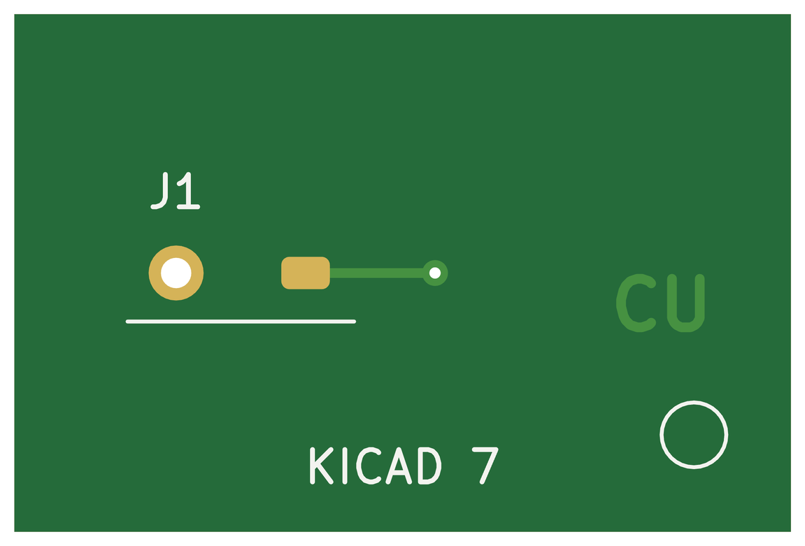

</p>

![20b KiCad 7 format: stacked bars of seconds per stage, one format a run; reading, start-up and exit take 35% to 49% of a run. Simulation with GLB takes 0.6 s: read 74 ms, resolve 28 ms, geometry 71 ms, materials 0.1 ms, assemble 0.2, write 5 ms, verify 18 ms, start-up and exit 0.2. Simulation with STEP takes 0.7 s: read 78 ms, resolve 31 ms, geometry 65 ms, materials 0.1 ms, assemble 0.2, write 0.2, verify 19 ms, start-up and exit 0.2. Simulation with STL takes 0.5 s: read 69 ms, resolve 28 ms, geometry 61 ms, materials 0.1 ms, assemble 0.2, write 6 ms, verify 16 ms, start-up and exit 0.2. Simulation with OBJ takes 0.6 s: read 69 ms, resolve 31 ms, geometry 72 ms, materials 0.1 ms, assemble 0.2, write 77 ms, verify 17 ms, start-up and exit 0.2. Visual with GLB takes 0.7 s: read 77 ms, resolve 31 ms, geometry 70 ms, materials 0.1 ms, assemble 0.3, write 5 ms, verify 33 ms, start-up and exit 0.2. Visual with OBJ takes 0.7 s: read 70 ms, resolve 28 ms, geometry 73 ms, materials 0.1 ms, assemble 0.3, write 60 ms, verify 29 ms, start-up and exit 0.2](https://raw.githubusercontent.com/RolandThsive/KiCad-EM-Stackup-Exporter-KESE/main/docs/images/Feature-Test-Collection/feature_20b_format_kicad7.webp)

| Mode and format | 1–2 read | 3 resolve | 4 geometry | 5 materials | 6 assemble | 7 write | 8 verify | start-up and exit | Total |
|---|---:|---:|---:|---:|---:|---:|---:|---:|---:|
| Simulation, GLB | 74&nbsp;ms | 28&nbsp;ms | 71&nbsp;ms | 0.1&nbsp;ms | 0.2 | 5&nbsp;ms | 18&nbsp;ms | 0.2 | 0.6 |
| Simulation, STEP | 78&nbsp;ms | 31&nbsp;ms | 65&nbsp;ms | 0.1&nbsp;ms | 0.2 | 0.2 | 19&nbsp;ms | 0.2 | 0.7 |
| Simulation, STL | 69&nbsp;ms | 28&nbsp;ms | 61&nbsp;ms | 0.1&nbsp;ms | 0.2 | 6&nbsp;ms | 16&nbsp;ms | 0.2 | 0.5 |
| Simulation, OBJ | 69&nbsp;ms | 31&nbsp;ms | 72&nbsp;ms | 0.1&nbsp;ms | 0.2 | 77&nbsp;ms | 17&nbsp;ms | 0.2 | 0.6 |
| Visual, GLB | 77&nbsp;ms | 31&nbsp;ms | 70&nbsp;ms | 0.1&nbsp;ms | 0.3 | 5&nbsp;ms | 33&nbsp;ms | 0.2 | 0.7 |
| Visual, OBJ | 70&nbsp;ms | 28&nbsp;ms | 73&nbsp;ms | 0.1&nbsp;ms | 0.3 | 60&nbsp;ms | 29&nbsp;ms | 0.2 | 0.7 |

<table align="center">
<tr>
<td valign="top">

| Board | `featureTest/`<br>`20b_format_kicad7.kicad_pcb` |
|---|---|
| Outline | 24 × 16 mm |
| Thickness | 1.6 mm |
| Copper&nbsp;layers | 2 |
| Vias | 1 through |
| Board&nbsp;edge | Plain |
| Mask,&nbsp;silkscreen,&nbsp;finish | Not set (drawn green and white),<br>ENIG |

</td>
<td valign="top">

<table>
<tr><th>File<br>type</th><th>File<br>size</th><th>Peak memory<br>used</th></tr>
<tr><th colspan="3" align="left">Simulation</th></tr>
<tr><td>GLB</td><td align="right">506 kB</td><td align="right">68 MB</td></tr>
<tr><td>STEP</td><td align="right">2.2 MB</td><td align="right">68 MB</td></tr>
<tr><td>STL</td><td align="right">738 kB</td><td align="right">70 MB</td></tr>
<tr><td>OBJ</td><td align="right">1.3 MB</td><td align="right">70 MB</td></tr>
<tr><th colspan="3" align="left">Visual</th></tr>
<tr><td>GLB</td><td align="right">406 kB</td><td align="right">87 MB</td></tr>
<tr><td>OBJ</td><td align="right">1.0 MB</td><td align="right">89 MB</td></tr>
</table>

</td>
</tr>
</table>

### 23.12.3 20c KiCad 8 Format

<p align="center">


</p>

![20c KiCad 8 format: stacked bars of seconds per stage, one format a run; reading, start-up and exit take 35% to 50% of a run. Simulation with GLB takes 0.5 s: read 72 ms, resolve 30 ms, geometry 66 ms, materials 0.1 ms, assemble 0.2, write 5 ms, verify 19 ms, start-up and exit 0.2. Simulation with STEP takes 0.7 s: read 73 ms, resolve 27 ms, geometry 59 ms, materials 0.1 ms, assemble 0.2, write 0.2, verify 20 ms, start-up and exit 0.2. Simulation with STL takes 0.6 s: read 82 ms, resolve 28 ms, geometry 68 ms, materials 0.1 ms, assemble 0.2, write 6 ms, verify 17 ms, start-up and exit 0.2. Simulation with OBJ takes 0.6 s: read 70 ms, resolve 28 ms, geometry 72 ms, materials 0.1 ms, assemble 0.2, write 77 ms, verify 17 ms, start-up and exit 0.2. Visual with GLB takes 0.7 s: read 69 ms, resolve 28 ms, geometry 72 ms, materials 0.1 ms, assemble 0.3, write 4 ms, verify 35 ms, start-up and exit 0.2. Visual with OBJ takes 0.7 s: read 71 ms, resolve 30 ms, geometry 65 ms, materials 0.1 ms, assemble 0.3, write 63 ms, verify 32 ms, start-up and exit 0.2](https://raw.githubusercontent.com/RolandThsive/KiCad-EM-Stackup-Exporter-KESE/main/docs/images/Feature-Test-Collection/feature_20c_format_kicad8.webp)

| Mode and format | 1–2 read | 3 resolve | 4 geometry | 5 materials | 6 assemble | 7 write | 8 verify | start-up and exit | Total |
|---|---:|---:|---:|---:|---:|---:|---:|---:|---:|
| Simulation, GLB | 72&nbsp;ms | 30&nbsp;ms | 66&nbsp;ms | 0.1&nbsp;ms | 0.2 | 5&nbsp;ms | 19&nbsp;ms | 0.2 | 0.5 |
| Simulation, STEP | 73&nbsp;ms | 27&nbsp;ms | 59&nbsp;ms | 0.1&nbsp;ms | 0.2 | 0.2 | 20&nbsp;ms | 0.2 | 0.7 |
| Simulation, STL | 82&nbsp;ms | 28&nbsp;ms | 68&nbsp;ms | 0.1&nbsp;ms | 0.2 | 6&nbsp;ms | 17&nbsp;ms | 0.2 | 0.6 |
| Simulation, OBJ | 70&nbsp;ms | 28&nbsp;ms | 72&nbsp;ms | 0.1&nbsp;ms | 0.2 | 77&nbsp;ms | 17&nbsp;ms | 0.2 | 0.6 |
| Visual, GLB | 69&nbsp;ms | 28&nbsp;ms | 72&nbsp;ms | 0.1&nbsp;ms | 0.3 | 4&nbsp;ms | 35&nbsp;ms | 0.2 | 0.7 |
| Visual, OBJ | 71&nbsp;ms | 30&nbsp;ms | 65&nbsp;ms | 0.1&nbsp;ms | 0.3 | 63&nbsp;ms | 32&nbsp;ms | 0.2 | 0.7 |

<table align="center">
<tr>
<td valign="top">

| Board | `featureTest/`<br>`20c_format_kicad8.kicad_pcb` |
|---|---|
| Outline | 24 × 16 mm |
| Thickness | 1.6 mm |
| Copper&nbsp;layers | 2 |
| Vias | 1 through |
| Board&nbsp;edge | Plain |
| Mask,&nbsp;silkscreen,&nbsp;finish | Not set (drawn green and white),<br>ENIG |

</td>
<td valign="top">

<table>
<tr><th>File<br>type</th><th>File<br>size</th><th>Peak memory<br>used</th></tr>
<tr><th colspan="3" align="left">Simulation</th></tr>
<tr><td>GLB</td><td align="right">515 kB</td><td align="right">67 MB</td></tr>
<tr><td>STEP</td><td align="right">2.3 MB</td><td align="right">67 MB</td></tr>
<tr><td>STL</td><td align="right">749 kB</td><td align="right">67 MB</td></tr>
<tr><td>OBJ</td><td align="right">1.4 MB</td><td align="right">69 MB</td></tr>
<tr><th colspan="3" align="left">Visual</th></tr>
<tr><td>GLB</td><td align="right">415 kB</td><td align="right">87 MB</td></tr>
<tr><td>OBJ</td><td align="right">1.1 MB</td><td align="right">89 MB</td></tr>
</table>

</td>
</tr>
</table>

### 23.12.4 20d KiCad 9 Format

<p align="center">


</p>

![20d KiCad 9 format: stacked bars of seconds per stage, one format a run; reading, start-up and exit take 35% to 51% of a run. Simulation with GLB takes 0.6 s: read 75 ms, resolve 29 ms, geometry 68 ms, materials 0.1 ms, assemble 0.2, write 5 ms, verify 17 ms, start-up and exit 0.2. Simulation with STEP takes 0.7 s: read 67 ms, resolve 33 ms, geometry 66 ms, materials 0.1 ms, assemble 0.2, write 0.2, verify 17 ms, start-up and exit 0.2. Simulation with STL takes 0.5 s: read 69 ms, resolve 34 ms, geometry 64 ms, materials 0.1 ms, assemble 0.2, write 7 ms, verify 16 ms, start-up and exit 0.2. Simulation with OBJ takes 0.6 s: read 70 ms, resolve 29 ms, geometry 67 ms, materials 0.1 ms, assemble 0.2, write 74 ms, verify 19 ms, start-up and exit 0.2. Visual with GLB takes 0.7 s: read 68 ms, resolve 28 ms, geometry 71 ms, materials 0.1 ms, assemble 0.3, write 4 ms, verify 30 ms, start-up and exit 0.2. Visual with OBJ takes 0.7 s: read 67 ms, resolve 27 ms, geometry 69 ms, materials 0.1 ms, assemble 0.3, write 59 ms, verify 31 ms, start-up and exit 0.2](https://raw.githubusercontent.com/RolandThsive/KiCad-EM-Stackup-Exporter-KESE/main/docs/images/Feature-Test-Collection/feature_20d_format_kicad9.webp)

| Mode and format | 1–2 read | 3 resolve | 4 geometry | 5 materials | 6 assemble | 7 write | 8 verify | start-up and exit | Total |
|---|---:|---:|---:|---:|---:|---:|---:|---:|---:|
| Simulation, GLB | 75&nbsp;ms | 29&nbsp;ms | 68&nbsp;ms | 0.1&nbsp;ms | 0.2 | 5&nbsp;ms | 17&nbsp;ms | 0.2 | 0.6 |
| Simulation, STEP | 67&nbsp;ms | 33&nbsp;ms | 66&nbsp;ms | 0.1&nbsp;ms | 0.2 | 0.2 | 17&nbsp;ms | 0.2 | 0.7 |
| Simulation, STL | 69&nbsp;ms | 34&nbsp;ms | 64&nbsp;ms | 0.1&nbsp;ms | 0.2 | 7&nbsp;ms | 16&nbsp;ms | 0.2 | 0.5 |
| Simulation, OBJ | 70&nbsp;ms | 29&nbsp;ms | 67&nbsp;ms | 0.1&nbsp;ms | 0.2 | 74&nbsp;ms | 19&nbsp;ms | 0.2 | 0.6 |
| Visual, GLB | 68&nbsp;ms | 28&nbsp;ms | 71&nbsp;ms | 0.1&nbsp;ms | 0.3 | 4&nbsp;ms | 30&nbsp;ms | 0.2 | 0.7 |
| Visual, OBJ | 67&nbsp;ms | 27&nbsp;ms | 69&nbsp;ms | 0.1&nbsp;ms | 0.3 | 59&nbsp;ms | 31&nbsp;ms | 0.2 | 0.7 |

<table align="center">
<tr>
<td valign="top">

| Board | `featureTest/`<br>`20d_format_kicad9.kicad_pcb` |
|---|---|
| Outline | 24 × 16 mm |
| Thickness | 1.6 mm |
| Copper&nbsp;layers | 2 |
| Vias | 1 through |
| Board&nbsp;edge | Plain |
| Mask,&nbsp;silkscreen,&nbsp;finish | Not set (drawn green and white),<br>ENIG |

</td>
<td valign="top">

<table>
<tr><th>File<br>type</th><th>File<br>size</th><th>Peak memory<br>used</th></tr>
<tr><th colspan="3" align="left">Simulation</th></tr>
<tr><td>GLB</td><td align="right">512 kB</td><td align="right">65 MB</td></tr>
<tr><td>STEP</td><td align="right">2.3 MB</td><td align="right">67 MB</td></tr>
<tr><td>STL</td><td align="right">746 kB</td><td align="right">69 MB</td></tr>
<tr><td>OBJ</td><td align="right">1.3 MB</td><td align="right">70 MB</td></tr>
<tr><th colspan="3" align="left">Visual</th></tr>
<tr><td>GLB</td><td align="right">413 kB</td><td align="right">88 MB</td></tr>
<tr><td>OBJ</td><td align="right">1.1 MB</td><td align="right">89 MB</td></tr>
</table>

</td>
</tr>
</table>

### 23.12.5 20e KiCad 10 Format

<p align="center">


</p>

![20e KiCad 10 format: stacked bars of seconds per stage, one format a run; reading, start-up and exit take 36% to 49% of a run. Simulation with GLB takes 0.5 s: read 76 ms, resolve 28 ms, geometry 62 ms, materials 0.1 ms, assemble 0.2, write 5 ms, verify 17 ms, start-up and exit 0.2. Simulation with STEP takes 0.7 s: read 70 ms, resolve 36 ms, geometry 73 ms, materials 0.1 ms, assemble 0.2, write 0.1, verify 17 ms, start-up and exit 0.2. Simulation with STL takes 0.5 s: read 73 ms, resolve 32 ms, geometry 63 ms, materials 0.1 ms, assemble 0.2, write 7 ms, verify 17 ms, start-up and exit 0.2. Simulation with OBJ takes 0.6 s: read 68 ms, resolve 27 ms, geometry 64 ms, materials 0.1 ms, assemble 0.2, write 93 ms, verify 21 ms, start-up and exit 0.2. Visual with GLB takes 0.7 s: read 70 ms, resolve 27 ms, geometry 64 ms, materials 0.1 ms, assemble 0.3, write 4 ms, verify 32 ms, start-up and exit 0.2. Visual with OBJ takes 0.8 s: read 69 ms, resolve 29 ms, geometry 68 ms, materials 0.1 ms, assemble 0.3, write 60 ms, verify 31 ms, start-up and exit 0.2](https://raw.githubusercontent.com/RolandThsive/KiCad-EM-Stackup-Exporter-KESE/main/docs/images/Feature-Test-Collection/feature_20e_format_kicad10.webp)

| Mode and format | 1–2 read | 3 resolve | 4 geometry | 5 materials | 6 assemble | 7 write | 8 verify | start-up and exit | Total |
|---|---:|---:|---:|---:|---:|---:|---:|---:|---:|
| Simulation, GLB | 76&nbsp;ms | 28&nbsp;ms | 62&nbsp;ms | 0.1&nbsp;ms | 0.2 | 5&nbsp;ms | 17&nbsp;ms | 0.2 | 0.5 |
| Simulation, STEP | 70&nbsp;ms | 36&nbsp;ms | 73&nbsp;ms | 0.1&nbsp;ms | 0.2 | 0.1 | 17&nbsp;ms | 0.2 | 0.7 |
| Simulation, STL | 73&nbsp;ms | 32&nbsp;ms | 63&nbsp;ms | 0.1&nbsp;ms | 0.2 | 7&nbsp;ms | 17&nbsp;ms | 0.2 | 0.5 |
| Simulation, OBJ | 68&nbsp;ms | 27&nbsp;ms | 64&nbsp;ms | 0.1&nbsp;ms | 0.2 | 93&nbsp;ms | 21&nbsp;ms | 0.2 | 0.6 |
| Visual, GLB | 70&nbsp;ms | 27&nbsp;ms | 64&nbsp;ms | 0.1&nbsp;ms | 0.3 | 4&nbsp;ms | 32&nbsp;ms | 0.2 | 0.7 |
| Visual, OBJ | 69&nbsp;ms | 29&nbsp;ms | 68&nbsp;ms | 0.1&nbsp;ms | 0.3 | 60&nbsp;ms | 31&nbsp;ms | 0.2 | 0.8 |

<table align="center">
<tr>
<td valign="top">

| Board | `featureTest/`<br>`20e_format_kicad10.kicad_pcb` |
|---|---|
| Outline | 24 × 16 mm |
| Thickness | 1.6 mm |
| Copper&nbsp;layers | 2 |
| Vias | 1 through |
| Board&nbsp;edge | Plain |
| Mask,&nbsp;silkscreen,&nbsp;finish | Not set (drawn green and white),<br>ENIG |

</td>
<td valign="top">

<table>
<tr><th>File<br>type</th><th>File<br>size</th><th>Peak memory<br>used</th></tr>
<tr><th colspan="3" align="left">Simulation</th></tr>
<tr><td>GLB</td><td align="right">517 kB</td><td align="right">69 MB</td></tr>
<tr><td>STEP</td><td align="right">2.3 MB</td><td align="right">68 MB</td></tr>
<tr><td>STL</td><td align="right">753 kB</td><td align="right">65 MB</td></tr>
<tr><td>OBJ</td><td align="right">1.4 MB</td><td align="right">70 MB</td></tr>
<tr><th colspan="3" align="left">Visual</th></tr>
<tr><td>GLB</td><td align="right">418 kB</td><td align="right">87 MB</td></tr>
<tr><td>OBJ</td><td align="right">1.1 MB</td><td align="right">89 MB</td></tr>
</table>

</td>
</tr>
</table>

## 23.13 Example Boards

### 23.13.1 21 RF Sensor Module

<p align="center">

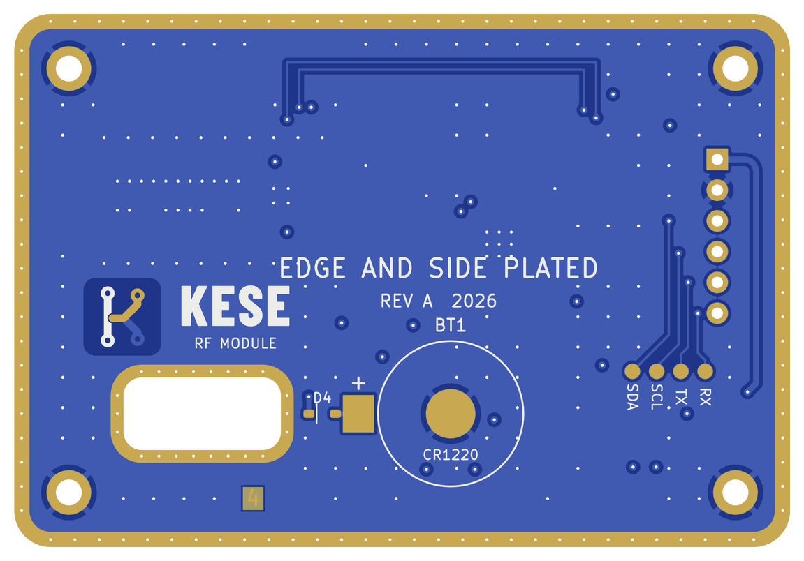
</p>

![21 RF sensor module: stacked bars of seconds per stage, one format a run; stages 4 and 6 take 53% to 85% of a run. Simulation with GLB takes 15.7 s: read 0.2, resolve 1.6, geometry 7.2, materials 0.4 ms, assemble 5.5, write 0.3, verify 0.6, start-up and exit 0.2. Simulation with STEP takes 18.9 s: read 0.3, resolve 1.9, geometry 7.2, materials 0.4 ms, assemble 5.6, write 3.1, verify 0.6, start-up and exit 0.3. Simulation with STL takes 15.2 s: read 0.3, resolve 1.7, geometry 6.8, materials 0.4 ms, assemble 5.3, write 0.4, verify 0.5, start-up and exit 0.2. Simulation with OBJ takes 23.4 s: read 0.3, resolve 1.8, geometry 6.8, materials 0.5 ms, assemble 5.5, write 8.3, verify 0.6, start-up and exit 0.2. Visual with GLB takes 19.1 s: read 0.3, resolve 1.7, geometry 6.8, materials 0.4 ms, assemble 9.5, write 94 ms, verify 0.6, start-up and exit 0.2. Visual with OBJ takes 23.1 s: read 0.2, resolve 1.6, geometry 6.7, materials 0.5 ms, assemble 9.8, write 3.8, verify 0.8, start-up and exit 0.2](https://raw.githubusercontent.com/RolandThsive/KiCad-EM-Stackup-Exporter-KESE/main/docs/images/Feature-Test-Collection/feature_21_rf_module.webp)

| Mode and format | 1–2 read | 3 resolve | 4 geometry | 5 materials | 6 assemble | 7 write | 8 verify | start-up and exit | Total |
|---|---:|---:|---:|---:|---:|---:|---:|---:|---:|
| Simulation, GLB | 0.2 | 1.6 | 7.2 | 0.4&nbsp;ms | 5.5 | 0.3 | 0.6 | 0.2 | 15.7 |
| Simulation, STEP | 0.3 | 1.9 | 7.2 | 0.4&nbsp;ms | 5.6 | 3.1 | 0.6 | 0.3 | 18.9 |
| Simulation, STL | 0.3 | 1.7 | 6.8 | 0.4&nbsp;ms | 5.3 | 0.4 | 0.5 | 0.2 | 15.2 |
| Simulation, OBJ | 0.3 | 1.8 | 6.8 | 0.5&nbsp;ms | 5.5 | 8.3 | 0.6 | 0.2 | 23.4 |
| Visual, GLB | 0.3 | 1.7 | 6.8 | 0.4&nbsp;ms | 9.5 | 94&nbsp;ms | 0.6 | 0.2 | 19.1 |
| Visual, OBJ | 0.2 | 1.6 | 6.7 | 0.5&nbsp;ms | 9.8 | 3.8 | 0.8 | 0.2 | 23.1 |

<table align="center">
<tr>
<td valign="top">

| Board | `featureTest/`<br>`21_rf_module.kicad_pcb`<br>([5.1](Examples.md#51-rf-sensor-module)) |
|---|---|
| Outline | 64 × 44 mm, a cut-out |
| Thickness | 1.6 mm |
| Copper&nbsp;layers | 4 |
| Vias | 307 through |
| Board&nbsp;edge | Plated all round<br>and in the cut-out |
| Mask,&nbsp;silkscreen,&nbsp;finish | Blue, white, ENIG |

</td>
<td valign="top">

<table>
<tr><th>File<br>type</th><th>File<br>size</th><th>Peak memory<br>used</th></tr>
<tr><th colspan="3" align="left">Simulation</th></tr>
<tr><td>GLB</td><td align="right">47.2 MB</td><td align="right">548 MB</td></tr>
<tr><td>STEP</td><td align="right">171.2 MB</td><td align="right">643 MB</td></tr>
<tr><td>STL</td><td align="right">69.4 MB</td><td align="right">539 MB</td></tr>
<tr><td>OBJ</td><td align="right">142.2 MB</td><td align="right">971 MB</td></tr>
<tr><th colspan="3" align="left">Visual</th></tr>
<tr><td>GLB</td><td align="right">21.6 MB</td><td align="right">592 MB</td></tr>
<tr><td>OBJ</td><td align="right">65.1 MB</td><td align="right">579 MB</td></tr>
</table>

</td>
</tr>
</table>

### 23.13.2 22 HDI Radio Module

<p align="center">
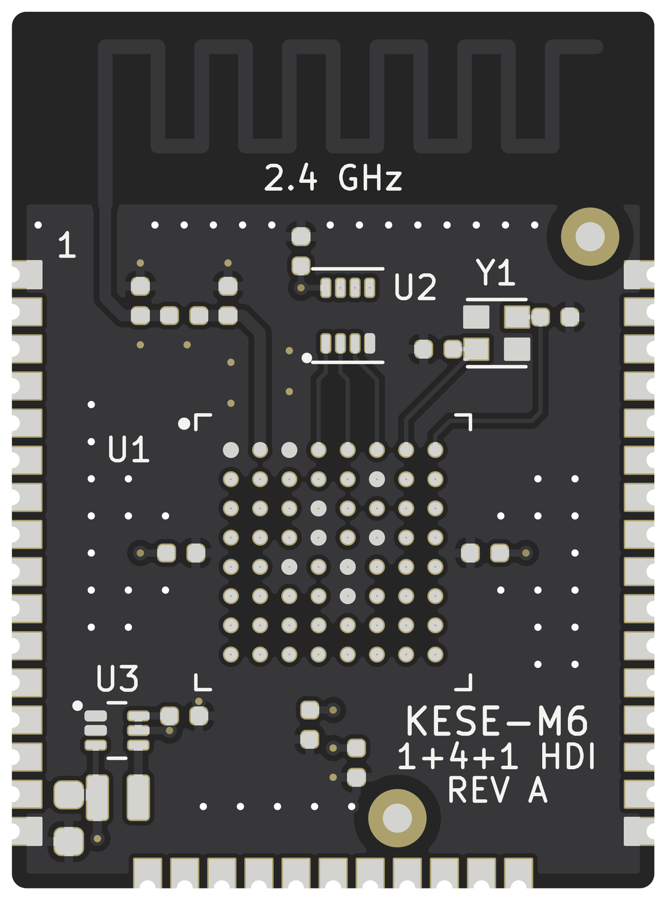

</p>

![22 HDI radio module: stacked bars of seconds per stage, one format a run; stages 4 and 6 take 45% to 77% of a run. Simulation with GLB takes 6.7 s: read 0.2, resolve 1.1, geometry 2.5, materials 0.4 ms, assemble 2.0, write 0.1, verify 0.5, start-up and exit 0.3. Simulation with STEP takes 8.1 s: read 0.2, resolve 1.1, geometry 2.4, materials 0.4 ms, assemble 2.0, write 1.7, verify 0.5, start-up and exit 0.2. Simulation with STL takes 6.6 s: read 0.2, resolve 1.0, geometry 2.6, materials 0.4 ms, assemble 2.0, write 0.2, verify 0.4, start-up and exit 0.2. Simulation with OBJ takes 9.9 s: read 0.2, resolve 1.0, geometry 2.5, materials 0.3 ms, assemble 2.0, write 3.5, verify 0.5, start-up and exit 0.2. Visual with GLB takes 8.5 s: read 0.2, resolve 1.0, geometry 2.6, materials 0.4 ms, assemble 4.0, write 66 ms, verify 0.4, start-up and exit 0.2. Visual with OBJ takes 10.3 s: read 0.2, resolve 1.0, geometry 2.7, materials 0.4 ms, assemble 4.1, write 1.7, verify 0.4, start-up and exit 0.2](https://raw.githubusercontent.com/RolandThsive/KiCad-EM-Stackup-Exporter-KESE/main/docs/images/Feature-Test-Collection/feature_22_hdi_module.webp)

| Mode and format | 1–2 read | 3 resolve | 4 geometry | 5 materials | 6 assemble | 7 write | 8 verify | start-up and exit | Total |
|---|---:|---:|---:|---:|---:|---:|---:|---:|---:|
| Simulation, GLB | 0.2 | 1.1 | 2.5 | 0.4&nbsp;ms | 2.0 | 0.1 | 0.5 | 0.3 | 6.7 |
| Simulation, STEP | 0.2 | 1.1 | 2.4 | 0.4&nbsp;ms | 2.0 | 1.7 | 0.5 | 0.2 | 8.1 |
| Simulation, STL | 0.2 | 1.0 | 2.6 | 0.4&nbsp;ms | 2.0 | 0.2 | 0.4 | 0.2 | 6.6 |
| Simulation, OBJ | 0.2 | 1.0 | 2.5 | 0.3&nbsp;ms | 2.0 | 3.5 | 0.5 | 0.2 | 9.9 |
| Visual, GLB | 0.2 | 1.0 | 2.6 | 0.4&nbsp;ms | 4.0 | 66&nbsp;ms | 0.4 | 0.2 | 8.5 |
| Visual, OBJ | 0.2 | 1.0 | 2.7 | 0.4&nbsp;ms | 4.1 | 1.7 | 0.4 | 0.2 | 10.3 |

<table align="center">
<tr>
<td valign="top">

| Board | `featureTest/`<br>`22_hdi_module.kicad_pcb`<br>([5.2](Examples.md#52-hdi-radio-module)) |
|---|---|
| Outline | 22 × 30 mm |
| Thickness | 0.925 mm |
| Copper&nbsp;layers | 6 |
| Vias | 150: 71 micro,<br>34 blind and buried, 45 through |
| Board&nbsp;edge | 43 castellated pads |
| Mask,&nbsp;silkscreen,&nbsp;finish | Black, white, immersion silver |

</td>
<td valign="top">

<table>
<tr><th>File<br>type</th><th>File<br>size</th><th>Peak memory<br>used</th></tr>
<tr><th colspan="3" align="left">Simulation</th></tr>
<tr><td>GLB</td><td align="right">21.0 MB</td><td align="right">350 MB</td></tr>
<tr><td>STEP</td><td align="right">70.9 MB</td><td align="right">357 MB</td></tr>
<tr><td>STL</td><td align="right">30.5 MB</td><td align="right">340 MB</td></tr>
<tr><td>OBJ</td><td align="right">62.8 MB</td><td align="right">459 MB</td></tr>
<tr><th colspan="3" align="left">Visual</th></tr>
<tr><td>GLB</td><td align="right">10.6 MB</td><td align="right">303 MB</td></tr>
<tr><td>OBJ</td><td align="right">32.1 MB</td><td align="right">319 MB</td></tr>
</table>

</td>
</tr>
</table>

### 23.13.3 23 PCIe x1 Card

<p align="center">


</p>

![23 PCIe x1 card: stacked bars of seconds per stage, one format a run; stages 4 and 6 take 44% to 82% of a run. Simulation with GLB takes 10.0 s: read 0.3, resolve 1.2, geometry 3.8, materials 0.5 ms, assemble 3.7, write 0.2, verify 0.6, start-up and exit 0.2. Simulation with STEP takes 12.9 s: read 0.3, resolve 1.2, geometry 3.9, materials 0.4 ms, assemble 3.8, write 3.0, verify 0.6, start-up and exit 0.2. Simulation with STL takes 9.7 s: read 0.3, resolve 1.1, geometry 3.9, materials 0.4 ms, assemble 3.4, write 0.3, verify 0.5, start-up and exit 0.2. Simulation with OBJ takes 16.5 s: read 0.3, resolve 1.2, geometry 3.7, materials 0.4 ms, assemble 3.5, write 7.1, verify 0.5, start-up and exit 0.2. Visual with GLB takes 13.9 s: read 0.3, resolve 1.1, geometry 3.8, materials 0.5 ms, assemble 7.6, write 0.1, verify 0.8, start-up and exit 0.2. Visual with OBJ takes 17.7 s: read 0.3, resolve 1.3, geometry 3.8, materials 0.6 ms, assemble 7.4, write 3.9, verify 0.8, start-up and exit 0.2](https://raw.githubusercontent.com/RolandThsive/KiCad-EM-Stackup-Exporter-KESE/main/docs/images/Feature-Test-Collection/feature_23_pcie_card.webp)

| Mode and format | 1–2 read | 3 resolve | 4 geometry | 5 materials | 6 assemble | 7 write | 8 verify | start-up and exit | Total |
|---|---:|---:|---:|---:|---:|---:|---:|---:|---:|
| Simulation, GLB | 0.3 | 1.2 | 3.8 | 0.5&nbsp;ms | 3.7 | 0.2 | 0.6 | 0.2 | 10.0 |
| Simulation, STEP | 0.3 | 1.2 | 3.9 | 0.4&nbsp;ms | 3.8 | 3.0 | 0.6 | 0.2 | 12.9 |
| Simulation, STL | 0.3 | 1.1 | 3.9 | 0.4&nbsp;ms | 3.4 | 0.3 | 0.5 | 0.2 | 9.7 |
| Simulation, OBJ | 0.3 | 1.2 | 3.7 | 0.4&nbsp;ms | 3.5 | 7.1 | 0.5 | 0.2 | 16.5 |
| Visual, GLB | 0.3 | 1.1 | 3.8 | 0.5&nbsp;ms | 7.6 | 0.1 | 0.8 | 0.2 | 13.9 |
| Visual, OBJ | 0.3 | 1.3 | 3.8 | 0.6&nbsp;ms | 7.4 | 3.9 | 0.8 | 0.2 | 17.7 |

<table align="center">
<tr>
<td valign="top">

| Board | `featureTest/`<br>`23_pcie_card.kicad_pcb`<br>([5.3](Examples.md#53-pcie-x1-card)) |
|---|---|
| Outline | 80 × 64.4 mm with the fingers' tongue,<br>a slot |
| Thickness | 1.57 mm |
| Copper&nbsp;layers | 4 |
| Vias | 239 through |
| Board&nbsp;edge | 36 gold fingers on<br>a bevelled tongue |
| Mask,&nbsp;silkscreen,&nbsp;finish | Green, white, hard gold |

</td>
<td valign="top">

<table>
<tr><th>File<br>type</th><th>File<br>size</th><th>Peak memory<br>used</th></tr>
<tr><th colspan="3" align="left">Simulation</th></tr>
<tr><td>GLB</td><td align="right">41.1 MB</td><td align="right">530 MB</td></tr>
<tr><td>STEP</td><td align="right">130.5 MB</td><td align="right">559 MB</td></tr>
<tr><td>STL</td><td align="right">60.2 MB</td><td align="right">507 MB</td></tr>
<tr><td>OBJ</td><td align="right">122.2 MB</td><td align="right">833 MB</td></tr>
<tr><th colspan="3" align="left">Visual</th></tr>
<tr><td>GLB</td><td align="right">22.5 MB</td><td align="right">540 MB</td></tr>
<tr><td>OBJ</td><td align="right">67.7 MB</td><td align="right">578 MB</td></tr>
</table>

</td>
</tr>
</table>

## 23.14 The Numbers

Seconds, the median of three runs for each stage, unless marked ms; the total is the sum of the bars.

| Board | Mode and format | 1–2 read | 3 resolve | 4 geometry | 5 materials | 6 assemble | 7 write | 8 verify | start-up and exit | Total |
|---|---|---:|---:|---:|---:|---:|---:|---:|---:|---:|
| 01 Slotted holes | simulation, GLB | 70&nbsp;ms | 56&nbsp;ms | 0.2 | 0.2&nbsp;ms | 0.3 | 8&nbsp;ms | 41&nbsp;ms | 0.2 | 0.9 |
| 01 Slotted holes | simulation, STEP | 74&nbsp;ms | 55&nbsp;ms | 0.2 | 0.1&nbsp;ms | 0.4 | 0.4 | 36&nbsp;ms | 0.2 | 1.3 |
| 01 Slotted holes | simulation, STL | 69&nbsp;ms | 51&nbsp;ms | 0.2 | 0.1&nbsp;ms | 0.4 | 11&nbsp;ms | 40&nbsp;ms | 0.2 | 0.9 |
| 01 Slotted holes | simulation, OBJ | 74&nbsp;ms | 53&nbsp;ms | 0.2 | 0.1&nbsp;ms | 0.4 | 0.2 | 41&nbsp;ms | 0.2 | 1.2 |
| 01 Slotted holes | visual, GLB | 83&nbsp;ms | 56&nbsp;ms | 0.2 | 0.1&nbsp;ms | 0.5 | 7&nbsp;ms | 40&nbsp;ms | 0.2 | 1.1 |
| 01 Slotted holes | visual, OBJ | 68&nbsp;ms | 53&nbsp;ms | 0.2 | 0.2&nbsp;ms | 0.5 | 0.1 | 40&nbsp;ms | 0.2 | 1.2 |
| 02 Round holes | simulation, GLB | 76&nbsp;ms | 45&nbsp;ms | 0.2 | 0.1&nbsp;ms | 0.4 | 8&nbsp;ms | 34&nbsp;ms | 0.2 | 0.9 |
| 02 Round holes | simulation, STEP | 73&nbsp;ms | 46&nbsp;ms | 0.2 | 0.1&nbsp;ms | 0.4 | 0.3 | 31&nbsp;ms | 0.2 | 1.2 |
| 02 Round holes | simulation, STL | 67&nbsp;ms | 42&nbsp;ms | 0.2 | 0.1&nbsp;ms | 0.4 | 12&nbsp;ms | 31&nbsp;ms | 0.2 | 0.9 |
| 02 Round holes | simulation, OBJ | 72&nbsp;ms | 49&nbsp;ms | 0.2 | 0.1&nbsp;ms | 0.4 | 0.2 | 31&nbsp;ms | 0.2 | 1.1 |
| 02 Round holes | visual, GLB | 71&nbsp;ms | 46&nbsp;ms | 0.2 | 0.1&nbsp;ms | 0.4 | 6&nbsp;ms | 42&nbsp;ms | 0.2 | 1.0 |
| 02 Round holes | visual, OBJ | 66&nbsp;ms | 39&nbsp;ms | 0.2 | 0.1&nbsp;ms | 0.4 | 0.1 | 43&nbsp;ms | 0.2 | 1.1 |
| 03 Through vias | simulation, GLB | 67&nbsp;ms | 51&nbsp;ms | 0.2 | 0.1&nbsp;ms | 0.5 | 11&nbsp;ms | 44&nbsp;ms | 0.2 | 1.2 |
| 03 Through vias | simulation, STEP | 71&nbsp;ms | 58&nbsp;ms | 0.2 | 0.1&nbsp;ms | 0.6 | 0.3 | 49&nbsp;ms | 0.2 | 1.6 |
| 03 Through vias | simulation, STL | 67&nbsp;ms | 51&nbsp;ms | 0.2 | 0.1&nbsp;ms | 0.6 | 20&nbsp;ms | 48&nbsp;ms | 0.2 | 1.2 |
| 03 Through vias | simulation, OBJ | 66&nbsp;ms | 55&nbsp;ms | 0.2 | 0.1&nbsp;ms | 0.6 | 0.3 | 55&nbsp;ms | 0.2 | 1.5 |
| 03 Through vias | visual, GLB | 67&nbsp;ms | 55&nbsp;ms | 0.2 | 0.1&nbsp;ms | 0.6 | 6&nbsp;ms | 67&nbsp;ms | 0.2 | 1.2 |
| 03 Through vias | visual, OBJ | 82&nbsp;ms | 60&nbsp;ms | 0.2 | 0.1&nbsp;ms | 0.6 | 0.1 | 60&nbsp;ms | 0.2 | 1.3 |
| 03b KiCad 10 via options | simulation, GLB | 69&nbsp;ms | 0.1 | 0.3 | 0.1&nbsp;ms | 0.7 | 16&nbsp;ms | 0.1 | 0.2 | 1.5 |
| 03b KiCad 10 via options | simulation, STEP | 80&nbsp;ms | 0.2 | 0.3 | 0.1&nbsp;ms | 0.6 | 0.7 | 0.1 | 0.2 | 2.2 |
| 03b KiCad 10 via options | simulation, STL | 76&nbsp;ms | 0.1 | 0.3 | 0.2&nbsp;ms | 0.6 | 25&nbsp;ms | 97&nbsp;ms | 0.2 | 1.4 |
| 03b KiCad 10 via options | simulation, OBJ | 75&nbsp;ms | 0.1 | 0.3 | 0.2&nbsp;ms | 0.6 | 0.4 | 94&nbsp;ms | 0.2 | 1.8 |
| 03b KiCad 10 via options | visual, GLB | 92&nbsp;ms | 0.2 | 0.3 | 0.1&nbsp;ms | 2.4 | 14&nbsp;ms | 90&nbsp;ms | 0.2 | 3.2 |
| 03b KiCad 10 via options | visual, OBJ | 74&nbsp;ms | 0.2 | 0.3 | 0.1&nbsp;ms | 2.4 | 0.3 | 78&nbsp;ms | 0.2 | 3.5 |
| 04 Blind and buried vias | simulation, GLB | 73&nbsp;ms | 51&nbsp;ms | 62&nbsp;ms | 0.1&nbsp;ms | 0.2 | 5&nbsp;ms | 26&nbsp;ms | 0.2 | 0.7 |
| 04 Blind and buried vias | simulation, STEP | 68&nbsp;ms | 50&nbsp;ms | 59&nbsp;ms | 0.1&nbsp;ms | 0.2 | 0.2 | 22&nbsp;ms | 0.2 | 0.8 |
| 04 Blind and buried vias | simulation, STL | 68&nbsp;ms | 51&nbsp;ms | 59&nbsp;ms | 0.1&nbsp;ms | 0.2 | 8&nbsp;ms | 21&nbsp;ms | 0.2 | 0.6 |
| 04 Blind and buried vias | simulation, OBJ | 66&nbsp;ms | 55&nbsp;ms | 62&nbsp;ms | 0.1&nbsp;ms | 0.2 | 0.1 | 22&nbsp;ms | 0.2 | 0.7 |
| 04 Blind and buried vias | visual, GLB | 70&nbsp;ms | 54&nbsp;ms | 59&nbsp;ms | 0.1&nbsp;ms | 0.4 | 5&nbsp;ms | 37&nbsp;ms | 0.2 | 0.8 |
| 04 Blind and buried vias | visual, OBJ | 69&nbsp;ms | 53&nbsp;ms | 63&nbsp;ms | 0.1&nbsp;ms | 0.4 | 47&nbsp;ms | 32&nbsp;ms | 0.2 | 0.8 |
| 05 Microvias | simulation, GLB | 3&nbsp;ms | 54&nbsp;ms | 61&nbsp;ms | 0.1&nbsp;ms | 0.2 | 5&nbsp;ms | 21&nbsp;ms | 0.2 | 0.6 |
| 05 Microvias | simulation, STEP | 3&nbsp;ms | 55&nbsp;ms | 49&nbsp;ms | 0.1&nbsp;ms | 0.2 | 0.1 | 20&nbsp;ms | 0.2 | 0.6 |
| 05 Microvias | simulation, STL | 3&nbsp;ms | 50&nbsp;ms | 57&nbsp;ms | 0.1&nbsp;ms | 0.2 | 6&nbsp;ms | 25&nbsp;ms | 0.2 | 0.6 |
| 05 Microvias | simulation, OBJ | 3&nbsp;ms | 58&nbsp;ms | 49&nbsp;ms | 0.1&nbsp;ms | 0.2 | 97&nbsp;ms | 22&nbsp;ms | 0.2 | 0.6 |
| 05 Microvias | visual, GLB | 4&nbsp;ms | 60&nbsp;ms | 52&nbsp;ms | 0.1&nbsp;ms | 0.3 | 3&nbsp;ms | 49&nbsp;ms | 0.2 | 0.7 |
| 05 Microvias | visual, OBJ | 3&nbsp;ms | 59&nbsp;ms | 55&nbsp;ms | 0.1&nbsp;ms | 0.3 | 30&nbsp;ms | 49&nbsp;ms | 0.2 | 0.7 |
| 06 Padstacks | simulation, GLB | 68&nbsp;ms | 48&nbsp;ms | 92&nbsp;ms | 0.1&nbsp;ms | 0.3 | 7&nbsp;ms | 29&nbsp;ms | 0.2 | 0.7 |
| 06 Padstacks | simulation, STEP | 69&nbsp;ms | 47&nbsp;ms | 99&nbsp;ms | 0.1&nbsp;ms | 0.3 | 0.2 | 30&nbsp;ms | 0.2 | 1.0 |
| 06 Padstacks | simulation, STL | 71&nbsp;ms | 51&nbsp;ms | 93&nbsp;ms | 0.1&nbsp;ms | 0.3 | 9&nbsp;ms | 32&nbsp;ms | 0.2 | 0.8 |
| 06 Padstacks | simulation, OBJ | 80&nbsp;ms | 46&nbsp;ms | 89&nbsp;ms | 0.1&nbsp;ms | 0.3 | 0.2 | 35&nbsp;ms | 0.2 | 0.9 |
| 06 Padstacks | visual, GLB | 65&nbsp;ms | 47&nbsp;ms | 0.1 | 0.1&nbsp;ms | 0.5 | 4&nbsp;ms | 33&nbsp;ms | 0.2 | 0.9 |
| 06 Padstacks | visual, OBJ | 68&nbsp;ms | 48&nbsp;ms | 93&nbsp;ms | 0.1&nbsp;ms | 0.4 | 73&nbsp;ms | 32&nbsp;ms | 0.2 | 0.9 |
| 07 Pad shapes | simulation, GLB | 74&nbsp;ms | 40&nbsp;ms | 0.1 | 0.1&nbsp;ms | 0.3 | 9&nbsp;ms | 25&nbsp;ms | 0.2 | 0.7 |
| 07 Pad shapes | simulation, STEP | 77&nbsp;ms | 44&nbsp;ms | 0.1 | 0.1&nbsp;ms | 0.3 | 0.3 | 25&nbsp;ms | 0.2 | 1.0 |
| 07 Pad shapes | simulation, STL | 72&nbsp;ms | 41&nbsp;ms | 0.1 | 0.1&nbsp;ms | 0.3 | 12&nbsp;ms | 23&nbsp;ms | 0.2 | 0.7 |
| 07 Pad shapes | simulation, OBJ | 90&nbsp;ms | 37&nbsp;ms | 0.1 | 0.1&nbsp;ms | 0.3 | 0.1 | 22&nbsp;ms | 0.2 | 0.9 |
| 07 Pad shapes | visual, GLB | 73&nbsp;ms | 43&nbsp;ms | 0.1 | 0.2&nbsp;ms | 0.5 | 5&nbsp;ms | 41&nbsp;ms | 0.2 | 1.0 |
| 07 Pad shapes | visual, OBJ | 76&nbsp;ms | 37&nbsp;ms | 0.1 | 0.1&nbsp;ms | 0.5 | 0.1 | 50&nbsp;ms | 0.2 | 1.1 |
| 08 Copper graphics | simulation, GLB | 85&nbsp;ms | 27&nbsp;ms | 43&nbsp;ms | 0.1&nbsp;ms | 0.2 | 4&nbsp;ms | 14&nbsp;ms | 0.2 | 0.6 |
| 08 Copper graphics | simulation, STEP | 71&nbsp;ms | 23&nbsp;ms | 38&nbsp;ms | 0.1&nbsp;ms | 0.2 | 0.2 | 13&nbsp;ms | 0.2 | 0.8 |
| 08 Copper graphics | simulation, STL | 73&nbsp;ms | 24&nbsp;ms | 38&nbsp;ms | 0.1&nbsp;ms | 0.2 | 6&nbsp;ms | 13&nbsp;ms | 0.2 | 0.6 |
| 08 Copper graphics | simulation, OBJ | 89&nbsp;ms | 25&nbsp;ms | 39&nbsp;ms | 0.1&nbsp;ms | 0.3 | 0.1 | 19&nbsp;ms | 0.2 | 0.8 |
| 08 Copper graphics | visual, GLB | 70&nbsp;ms | 23&nbsp;ms | 39&nbsp;ms | 0.1&nbsp;ms | 0.3 | 4&nbsp;ms | 40&nbsp;ms | 0.2 | 0.7 |
| 08 Copper graphics | visual, OBJ | 69&nbsp;ms | 25&nbsp;ms | 41&nbsp;ms | 0.1&nbsp;ms | 0.3 | 96&nbsp;ms | 51&nbsp;ms | 0.2 | 0.7 |
| 08b Copper graphics on nets | simulation, GLB | 8&nbsp;ms | 23&nbsp;ms | 53&nbsp;ms | 0.1&nbsp;ms | 0.2 | 6&nbsp;ms | 18&nbsp;ms | 0.2 | 0.5 |
| 08b Copper graphics on nets | simulation, STEP | 7&nbsp;ms | 31&nbsp;ms | 54&nbsp;ms | 0.1&nbsp;ms | 0.2 | 0.2 | 17&nbsp;ms | 0.2 | 0.7 |
| 08b Copper graphics on nets | simulation, STL | 7&nbsp;ms | 28&nbsp;ms | 55&nbsp;ms | 0.2&nbsp;ms | 0.3 | 11&nbsp;ms | 21&nbsp;ms | 0.2 | 0.6 |
| 08b Copper graphics on nets | simulation, OBJ | 7&nbsp;ms | 29&nbsp;ms | 60&nbsp;ms | 0.1&nbsp;ms | 0.2 | 94&nbsp;ms | 19&nbsp;ms | 0.2 | 0.6 |
| 08b Copper graphics on nets | visual, GLB | 11&nbsp;ms | 32&nbsp;ms | 59&nbsp;ms | 0.1&nbsp;ms | 0.4 | 4&nbsp;ms | 42&nbsp;ms | 0.2 | 0.7 |
| 08b Copper graphics on nets | visual, OBJ | 8&nbsp;ms | 24&nbsp;ms | 56&nbsp;ms | 0.1&nbsp;ms | 0.3 | 69&nbsp;ms | 38&nbsp;ms | 0.2 | 0.7 |
| 09 Copper text | simulation, GLB | 87&nbsp;ms | 41&nbsp;ms | 0.1 | 0.1&nbsp;ms | 1.0 | 17&nbsp;ms | 50&nbsp;ms | 0.2 | 1.5 |
| 09 Copper text | simulation, STEP | 85&nbsp;ms | 38&nbsp;ms | 0.1 | 0.1&nbsp;ms | 1.0 | 1.0 | 42&nbsp;ms | 0.2 | 2.5 |
| 09 Copper text | simulation, STL | 87&nbsp;ms | 38&nbsp;ms | 0.1 | 0.1&nbsp;ms | 1.1 | 34&nbsp;ms | 47&nbsp;ms | 0.2 | 1.6 |
| 09 Copper text | simulation, OBJ | 0.1 | 38&nbsp;ms | 0.1 | 0.1&nbsp;ms | 1.0 | 0.5 | 61&nbsp;ms | 0.2 | 2.0 |
| 09 Copper text | visual, GLB | 88&nbsp;ms | 38&nbsp;ms | 0.1 | 0.1&nbsp;ms | 0.9 | 12&nbsp;ms | 86&nbsp;ms | 0.2 | 1.4 |
| 09 Copper text | visual, OBJ | 87&nbsp;ms | 40&nbsp;ms | 0.1 | 0.1&nbsp;ms | 0.9 | 0.4 | 98&nbsp;ms | 0.2 | 1.9 |
| 10 Tracks and arcs | simulation, GLB | 71&nbsp;ms | 24&nbsp;ms | 37&nbsp;ms | 0.1&nbsp;ms | 0.2 | 7&nbsp;ms | 19&nbsp;ms | 0.2 | 0.6 |
| 10 Tracks and arcs | simulation, STEP | 74&nbsp;ms | 27&nbsp;ms | 36&nbsp;ms | 0.1&nbsp;ms | 0.2 | 0.2 | 16&nbsp;ms | 0.2 | 0.8 |
| 10 Tracks and arcs | simulation, STL | 69&nbsp;ms | 23&nbsp;ms | 38&nbsp;ms | 0.1&nbsp;ms | 0.2 | 8&nbsp;ms | 17&nbsp;ms | 0.2 | 0.6 |
| 10 Tracks and arcs | simulation, OBJ | 68&nbsp;ms | 24&nbsp;ms | 46&nbsp;ms | 0.1&nbsp;ms | 0.2 | 83&nbsp;ms | 16&nbsp;ms | 0.2 | 0.6 |
| 10 Tracks and arcs | visual, GLB | 86&nbsp;ms | 27&nbsp;ms | 37&nbsp;ms | 0.1&nbsp;ms | 0.4 | 4&nbsp;ms | 40&nbsp;ms | 0.2 | 0.7 |
| 10 Tracks and arcs | visual, OBJ | 71&nbsp;ms | 25&nbsp;ms | 38&nbsp;ms | 0.1&nbsp;ms | 0.3 | 78&nbsp;ms | 40&nbsp;ms | 0.2 | 0.8 |
| 11 Zones | simulation, GLB | 0.1 | 0.1 | 0.4 | 0.1&nbsp;ms | 0.6 | 19&nbsp;ms | 80&nbsp;ms | 0.2 | 1.5 |
| 11 Zones | simulation, STEP | 89&nbsp;ms | 0.1 | 0.4 | 0.1&nbsp;ms | 0.6 | 0.8 | 77&nbsp;ms | 0.2 | 2.3 |
| 11 Zones | simulation, STL | 0.1 | 0.1 | 0.4 | 0.1&nbsp;ms | 0.6 | 26&nbsp;ms | 88&nbsp;ms | 0.2 | 1.5 |
| 11 Zones | simulation, OBJ | 87&nbsp;ms | 0.1 | 0.4 | 0.1&nbsp;ms | 0.6 | 0.6 | 80&nbsp;ms | 0.2 | 2.0 |
| 11 Zones | visual, GLB | 99&nbsp;ms | 0.1 | 0.3 | 0.1&nbsp;ms | 1.1 | 13&nbsp;ms | 72&nbsp;ms | 0.2 | 1.9 |
| 11 Zones | visual, OBJ | 92&nbsp;ms | 0.1 | 0.3 | 0.1&nbsp;ms | 1.1 | 0.3 | 71&nbsp;ms | 0.2 | 2.2 |
| 12 Board outline shapes | simulation, GLB | 80&nbsp;ms | 36&nbsp;ms | 70&nbsp;ms | 0.1&nbsp;ms | 0.4 | 9&nbsp;ms | 33&nbsp;ms | 0.2 | 0.8 |
| 12 Board outline shapes | simulation, STEP | 79&nbsp;ms | 39&nbsp;ms | 77&nbsp;ms | 0.1&nbsp;ms | 0.4 | 0.4 | 32&nbsp;ms | 0.2 | 1.2 |
| 12 Board outline shapes | simulation, STL | 83&nbsp;ms | 38&nbsp;ms | 77&nbsp;ms | 0.1&nbsp;ms | 0.4 | 13&nbsp;ms | 26&nbsp;ms | 0.2 | 0.8 |
| 12 Board outline shapes | simulation, OBJ | 80&nbsp;ms | 40&nbsp;ms | 79&nbsp;ms | 0.1&nbsp;ms | 0.4 | 0.2 | 26&nbsp;ms | 0.2 | 1.1 |
| 12 Board outline shapes | visual, GLB | 81&nbsp;ms | 37&nbsp;ms | 76&nbsp;ms | 0.1&nbsp;ms | 0.5 | 9&nbsp;ms | 58&nbsp;ms | 0.2 | 0.9 |
| 12 Board outline shapes | visual, OBJ | 80&nbsp;ms | 37&nbsp;ms | 71&nbsp;ms | 0.1&nbsp;ms | 0.5 | 0.3 | 54&nbsp;ms | 0.2 | 1.2 |
| 13a No board outline | simulation, GLB | 67&nbsp;ms | 27&nbsp;ms | 53&nbsp;ms | 0.1&nbsp;ms | 0.1 | 4&nbsp;ms | 15&nbsp;ms | 0.2 | 0.5 |
| 13a No board outline | simulation, STEP | 70&nbsp;ms | 26&nbsp;ms | 55&nbsp;ms | 0.1&nbsp;ms | 0.1 | 0.1 | 18&nbsp;ms | 0.2 | 0.6 |
| 13a No board outline | simulation, STL | 67&nbsp;ms | 25&nbsp;ms | 55&nbsp;ms | 0.1&nbsp;ms | 0.1 | 6&nbsp;ms | 17&nbsp;ms | 0.2 | 0.5 |
| 13a No board outline | simulation, OBJ | 65&nbsp;ms | 23&nbsp;ms | 53&nbsp;ms | 0.1&nbsp;ms | 0.1 | 62&nbsp;ms | 16&nbsp;ms | 0.2 | 0.6 |
| 13a No board outline | visual, GLB | 71&nbsp;ms | 24&nbsp;ms | 54&nbsp;ms | 0.1&nbsp;ms | 0.2 | 4&nbsp;ms | 64&nbsp;ms | 0.2 | 0.6 |
| 13a No board outline | visual, OBJ | 65&nbsp;ms | 24&nbsp;ms | 51&nbsp;ms | 0.1&nbsp;ms | 0.2 | 38&nbsp;ms | 45&nbsp;ms | 0.2 | 0.6 |
| 13b Two board outlines | simulation, GLB | 68&nbsp;ms | 21&nbsp;ms | 39&nbsp;ms | 0.1&nbsp;ms | 0.1 | 5&nbsp;ms | 15&nbsp;ms | 0.2 | 0.5 |
| 13b Two board outlines | simulation, STEP | 73&nbsp;ms | 23&nbsp;ms | 47&nbsp;ms | 0.1&nbsp;ms | 0.1 | 0.1 | 15&nbsp;ms | 0.2 | 0.6 |
| 13b Two board outlines | simulation, STL | 68&nbsp;ms | 23&nbsp;ms | 41&nbsp;ms | 0.1&nbsp;ms | 0.1 | 5&nbsp;ms | 16&nbsp;ms | 0.2 | 0.5 |
| 13b Two board outlines | simulation, OBJ | 82&nbsp;ms | 29&nbsp;ms | 47&nbsp;ms | 0.1&nbsp;ms | 0.1 | 39&nbsp;ms | 18&nbsp;ms | 0.2 | 0.5 |
| 13b Two board outlines | visual, GLB | 72&nbsp;ms | 22&nbsp;ms | 51&nbsp;ms | 0.1&nbsp;ms | 0.2 | 3&nbsp;ms | 22&nbsp;ms | 0.2 | 0.6 |
| 13b Two board outlines | visual, OBJ | 68&nbsp;ms | 21&nbsp;ms | 48&nbsp;ms | 0.1&nbsp;ms | 0.2 | 30&nbsp;ms | 22&nbsp;ms | 0.2 | 0.6 |
| 14 Full stack-up | simulation, GLB | 68&nbsp;ms | 35&nbsp;ms | 72&nbsp;ms | 0.1&nbsp;ms | 0.2 | 5&nbsp;ms | 18&nbsp;ms | 0.2 | 0.5 |
| 14 Full stack-up | simulation, STEP | 72&nbsp;ms | 36&nbsp;ms | 68&nbsp;ms | 0.1&nbsp;ms | 0.2 | 0.1 | 18&nbsp;ms | 0.2 | 0.7 |
| 14 Full stack-up | simulation, STL | 67&nbsp;ms | 35&nbsp;ms | 66&nbsp;ms | 0.1&nbsp;ms | 0.2 | 6&nbsp;ms | 20&nbsp;ms | 0.2 | 0.5 |
| 14 Full stack-up | simulation, OBJ | 74&nbsp;ms | 38&nbsp;ms | 60&nbsp;ms | 0.1&nbsp;ms | 0.2 | 68&nbsp;ms | 21&nbsp;ms | 0.2 | 0.6 |
| 14 Full stack-up | visual, GLB | 69&nbsp;ms | 36&nbsp;ms | 72&nbsp;ms | 0.1&nbsp;ms | 0.4 | 4&nbsp;ms | 35&nbsp;ms | 0.2 | 0.8 |
| 14 Full stack-up | visual, OBJ | 86&nbsp;ms | 37&nbsp;ms | 62&nbsp;ms | 0.1&nbsp;ms | 0.3 | 46&nbsp;ms | 31&nbsp;ms | 0.2 | 0.7 |
| 15 No stack-up | simulation, GLB | 75&nbsp;ms | 34&nbsp;ms | 61&nbsp;ms | 0.1&nbsp;ms | 0.1 | 4&nbsp;ms | 18&nbsp;ms | 0.2 | 0.5 |
| 15 No stack-up | simulation, STEP | 65&nbsp;ms | 31&nbsp;ms | 56&nbsp;ms | 0.1&nbsp;ms | 0.2 | 0.1 | 18&nbsp;ms | 0.2 | 0.7 |
| 15 No stack-up | simulation, STL | 73&nbsp;ms | 31&nbsp;ms | 62&nbsp;ms | 0.1&nbsp;ms | 0.1 | 5&nbsp;ms | 17&nbsp;ms | 0.2 | 0.5 |
| 15 No stack-up | simulation, OBJ | 69&nbsp;ms | 29&nbsp;ms | 55&nbsp;ms | 0.1&nbsp;ms | 0.1 | 59&nbsp;ms | 20&nbsp;ms | 0.2 | 0.6 |
| 15 No stack-up | visual, GLB | 64&nbsp;ms | 30&nbsp;ms | 52&nbsp;ms | 0.1&nbsp;ms | 0.3 | 4&nbsp;ms | 32&nbsp;ms | 0.2 | 0.7 |
| 15 No stack-up | visual, OBJ | 64&nbsp;ms | 27&nbsp;ms | 53&nbsp;ms | 0.1&nbsp;ms | 0.3 | 32&nbsp;ms | 27&nbsp;ms | 0.2 | 0.7 |
| 16 Castellated pads and a plated edge | simulation, GLB | 71&nbsp;ms | 70&nbsp;ms | 95&nbsp;ms | 0.1&nbsp;ms | 0.2 | 4&nbsp;ms | 20&nbsp;ms | 0.2 | 0.6 |
| 16 Castellated pads and a plated edge | simulation, STEP | 72&nbsp;ms | 70&nbsp;ms | 0.1 | 0.1&nbsp;ms | 0.2 | 0.1 | 19&nbsp;ms | 0.2 | 0.8 |
| 16 Castellated pads and a plated edge | simulation, STL | 70&nbsp;ms | 73&nbsp;ms | 0.1 | 0.1&nbsp;ms | 0.2 | 6&nbsp;ms | 19&nbsp;ms | 0.2 | 0.7 |
| 16 Castellated pads and a plated edge | simulation, OBJ | 73&nbsp;ms | 72&nbsp;ms | 92&nbsp;ms | 0.1&nbsp;ms | 0.2 | 81&nbsp;ms | 20&nbsp;ms | 0.2 | 0.7 |
| 16 Castellated pads and a plated edge | visual, GLB | 68&nbsp;ms | 71&nbsp;ms | 89&nbsp;ms | 0.1&nbsp;ms | 0.3 | 4&nbsp;ms | 34&nbsp;ms | 0.2 | 0.7 |
| 16 Castellated pads and a plated edge | visual, OBJ | 69&nbsp;ms | 70&nbsp;ms | 96&nbsp;ms | 0.1&nbsp;ms | 0.3 | 51&nbsp;ms | 31&nbsp;ms | 0.2 | 0.8 |
| 16b Plated board edge with a GND border | simulation, GLB | 0.1 | 0.5 | 2.2 | 0.2&nbsp;ms | 2.2 | 67&nbsp;ms | 0.3 | 0.2 | 5.6 |
| 16b Plated board edge with a GND border | simulation, STEP | 0.1 | 0.4 | 2.2 | 0.1&nbsp;ms | 2.2 | 1.3 | 0.2 | 0.2 | 6.6 |
| 16b Plated board edge with a GND border | simulation, STL | 0.1 | 0.5 | 2.2 | 0.2&nbsp;ms | 2.2 | 0.1 | 0.3 | 0.2 | 5.5 |
| 16b Plated board edge with a GND border | simulation, OBJ | 0.1 | 0.5 | 2.1 | 0.2&nbsp;ms | 2.3 | 2.6 | 0.3 | 0.2 | 8.1 |
| 16b Plated board edge with a GND border | visual, GLB | 99&nbsp;ms | 0.5 | 2.2 | 0.2&nbsp;ms | 4.5 | 23&nbsp;ms | 0.2 | 0.2 | 7.6 |
| 16b Plated board edge with a GND border | visual, OBJ | 0.1 | 0.5 | 2.3 | 0.2&nbsp;ms | 4.5 | 0.9 | 0.1 | 0.2 | 8.6 |
| 17 Solder mask and silkscreen | simulation, GLB | 74&nbsp;ms | 72&nbsp;ms | 0.1 | 0.1&nbsp;ms | 0.2 | 5&nbsp;ms | 16&nbsp;ms | 0.2 | 0.6 |
| 17 Solder mask and silkscreen | simulation, STEP | 73&nbsp;ms | 62&nbsp;ms | 98&nbsp;ms | 0.1&nbsp;ms | 0.2 | 0.2 | 20&nbsp;ms | 0.2 | 0.8 |
| 17 Solder mask and silkscreen | simulation, STL | 77&nbsp;ms | 71&nbsp;ms | 0.1 | 0.1&nbsp;ms | 0.2 | 7&nbsp;ms | 17&nbsp;ms | 0.2 | 0.7 |
| 17 Solder mask and silkscreen | simulation, OBJ | 82&nbsp;ms | 67&nbsp;ms | 0.1 | 0.1&nbsp;ms | 0.2 | 0.1 | 17&nbsp;ms | 0.2 | 0.8 |
| 17 Solder mask and silkscreen | visual, GLB | 98&nbsp;ms | 78&nbsp;ms | 0.1 | 0.1&nbsp;ms | 0.3 | 5&nbsp;ms | 38&nbsp;ms | 0.2 | 0.8 |
| 17 Solder mask and silkscreen | visual, OBJ | 80&nbsp;ms | 65&nbsp;ms | 0.1 | 0.1&nbsp;ms | 0.3 | 0.1 | 47&nbsp;ms | 0.2 | 1.0 |
| 17b Silkscreen over copper | simulation, GLB | 82&nbsp;ms | 36&nbsp;ms | 0.1 | 0.1&nbsp;ms | 0.2 | 5&nbsp;ms | 24&nbsp;ms | 0.2 | 0.7 |
| 17b Silkscreen over copper | simulation, STEP | 69&nbsp;ms | 33&nbsp;ms | 0.2 | 0.1&nbsp;ms | 0.2 | 0.2 | 26&nbsp;ms | 0.2 | 0.9 |
| 17b Silkscreen over copper | simulation, STL | 76&nbsp;ms | 35&nbsp;ms | 0.1 | 0.1&nbsp;ms | 0.3 | 8&nbsp;ms | 26&nbsp;ms | 0.2 | 0.8 |
| 17b Silkscreen over copper | simulation, OBJ | 70&nbsp;ms | 32&nbsp;ms | 0.2 | 0.1&nbsp;ms | 0.3 | 0.1 | 23&nbsp;ms | 0.2 | 0.8 |
| 17b Silkscreen over copper | visual, GLB | 70&nbsp;ms | 31&nbsp;ms | 0.2 | 0.1&nbsp;ms | 0.4 | 4&nbsp;ms | 39&nbsp;ms | 0.2 | 0.9 |
| 17b Silkscreen over copper | visual, OBJ | 71&nbsp;ms | 32&nbsp;ms | 0.2 | 0.1&nbsp;ms | 0.4 | 80&nbsp;ms | 32&nbsp;ms | 0.2 | 1.0 |
| 18 Gold edge fingers | simulation, GLB | 79&nbsp;ms | 35&nbsp;ms | 55&nbsp;ms | 0.1&nbsp;ms | 0.2 | 5&nbsp;ms | 19&nbsp;ms | 0.2 | 0.6 |
| 18 Gold edge fingers | simulation, STEP | 67&nbsp;ms | 38&nbsp;ms | 49&nbsp;ms | 0.1&nbsp;ms | 0.2 | 0.1 | 17&nbsp;ms | 0.2 | 0.7 |
| 18 Gold edge fingers | simulation, STL | 69&nbsp;ms | 36&nbsp;ms | 49&nbsp;ms | 0.1&nbsp;ms | 0.2 | 6&nbsp;ms | 18&nbsp;ms | 0.2 | 0.6 |
| 18 Gold edge fingers | simulation, OBJ | 68&nbsp;ms | 34&nbsp;ms | 55&nbsp;ms | 0.1&nbsp;ms | 0.2 | 88&nbsp;ms | 17&nbsp;ms | 0.2 | 0.6 |
| 18 Gold edge fingers | visual, GLB | 70&nbsp;ms | 35&nbsp;ms | 48&nbsp;ms | 0.1&nbsp;ms | 0.3 | 5&nbsp;ms | 51&nbsp;ms | 0.2 | 0.7 |
| 18 Gold edge fingers | visual, OBJ | 86&nbsp;ms | 35&nbsp;ms | 46&nbsp;ms | 0.1&nbsp;ms | 0.3 | 77&nbsp;ms | 49&nbsp;ms | 0.2 | 0.8 |
| 18b Finish on every kind of bare copper | simulation, GLB | 68&nbsp;ms | 36&nbsp;ms | 0.1 | 0.1&nbsp;ms | 0.3 | 8&nbsp;ms | 24&nbsp;ms | 0.2 | 0.7 |
| 18b Finish on every kind of bare copper | simulation, STEP | 73&nbsp;ms | 43&nbsp;ms | 0.1 | 0.2&nbsp;ms | 0.3 | 0.2 | 22&nbsp;ms | 0.2 | 0.9 |
| 18b Finish on every kind of bare copper | simulation, STL | 75&nbsp;ms | 43&nbsp;ms | 0.1 | 0.1&nbsp;ms | 0.2 | 8&nbsp;ms | 26&nbsp;ms | 0.2 | 0.7 |
| 18b Finish on every kind of bare copper | simulation, OBJ | 70&nbsp;ms | 35&nbsp;ms | 0.1 | 0.1&nbsp;ms | 0.2 | 0.1 | 23&nbsp;ms | 0.2 | 0.8 |
| 18b Finish on every kind of bare copper | visual, GLB | 69&nbsp;ms | 36&nbsp;ms | 0.1 | 0.2&nbsp;ms | 0.4 | 4&nbsp;ms | 40&nbsp;ms | 0.2 | 0.8 |
| 18b Finish on every kind of bare copper | visual, OBJ | 69&nbsp;ms | 33&nbsp;ms | 94&nbsp;ms | 0.2&nbsp;ms | 0.4 | 65&nbsp;ms | 33&nbsp;ms | 0.2 | 0.8 |
| 18c Finish before the solder mask | simulation, GLB | 70&nbsp;ms | 32&nbsp;ms | 0.2 | 0.2&nbsp;ms | 0.5 | 9&nbsp;ms | 36&nbsp;ms | 0.2 | 0.9 |
| 18c Finish before the solder mask | simulation, STEP | 74&nbsp;ms | 33&nbsp;ms | 0.2 | 0.1&nbsp;ms | 0.5 | 0.4 | 43&nbsp;ms | 0.2 | 1.3 |
| 18c Finish before the solder mask | simulation, STL | 71&nbsp;ms | 37&nbsp;ms | 0.2 | 0.1&nbsp;ms | 0.5 | 12&nbsp;ms | 34&nbsp;ms | 0.2 | 1.0 |
| 18c Finish before the solder mask | simulation, OBJ | 74&nbsp;ms | 35&nbsp;ms | 0.2 | 0.1&nbsp;ms | 0.5 | 0.2 | 38&nbsp;ms | 0.2 | 1.2 |
| 18c Finish before the solder mask | visual, GLB | 70&nbsp;ms | 34&nbsp;ms | 0.2 | 0.1&nbsp;ms | 0.6 | 6&nbsp;ms | 36&nbsp;ms | 0.2 | 1.1 |
| 18c Finish before the solder mask | visual, OBJ | 68&nbsp;ms | 35&nbsp;ms | 0.2 | 0.2&nbsp;ms | 0.6 | 80&nbsp;ms | 37&nbsp;ms | 0.2 | 1.2 |
| 19 Items KESE skips | simulation, GLB | 72&nbsp;ms | 17&nbsp;ms | 20&nbsp;ms | 0.1&nbsp;ms | 67&nbsp;ms | 4&nbsp;ms | 8&nbsp;ms | 0.2 | 0.4 |
| 19 Items KESE skips | simulation, STEP | 67&nbsp;ms | 17&nbsp;ms | 22&nbsp;ms | 0.1&nbsp;ms | 43&nbsp;ms | 42&nbsp;ms | 7&nbsp;ms | 0.2 | 0.4 |
| 19 Items KESE skips | simulation, STL | 65&nbsp;ms | 17&nbsp;ms | 19&nbsp;ms | 0.1&nbsp;ms | 43&nbsp;ms | 3&nbsp;ms | 6&nbsp;ms | 0.2 | 0.3 |
| 19 Items KESE skips | simulation, OBJ | 74&nbsp;ms | 18&nbsp;ms | 21&nbsp;ms | 0.1&nbsp;ms | 46&nbsp;ms | 16&nbsp;ms | 7&nbsp;ms | 0.2 | 0.4 |
| 19 Items KESE skips | visual, GLB | 66&nbsp;ms | 16&nbsp;ms | 21&nbsp;ms | 0.1&nbsp;ms | 0.1 | 2&nbsp;ms | 18&nbsp;ms | 0.2 | 0.4 |
| 19 Items KESE skips | visual, OBJ | 65&nbsp;ms | 17&nbsp;ms | 21&nbsp;ms | 0.1&nbsp;ms | 0.1 | 26&nbsp;ms | 19&nbsp;ms | 0.2 | 0.4 |
| 19b Items KESE skips, KiCad 10 | simulation, GLB | 0.7&nbsp;ms | 6&nbsp;ms | 10&nbsp;ms | 0.0&nbsp;ms | 15&nbsp;ms | 1&nbsp;ms | 1&nbsp;ms | 0.2 | 0.2 |
| 19b Items KESE skips, KiCad 10 | simulation, STEP | 0.8&nbsp;ms | 4&nbsp;ms | 11&nbsp;ms | 0.1&nbsp;ms | 19&nbsp;ms | 6&nbsp;ms | 2&nbsp;ms | 0.2 | 0.2 |
| 19b Items KESE skips, KiCad 10 | simulation, STL | 0.8&nbsp;ms | 6&nbsp;ms | 7&nbsp;ms | 0.0&nbsp;ms | 15&nbsp;ms | 1&nbsp;ms | 5&nbsp;ms | 0.2 | 0.2 |
| 19b Items KESE skips, KiCad 10 | simulation, OBJ | 0.8&nbsp;ms | 7&nbsp;ms | 8&nbsp;ms | 0.0&nbsp;ms | 15&nbsp;ms | 1&nbsp;ms | 1&nbsp;ms | 0.2 | 0.2 |
| 19b Items KESE skips, KiCad 10 | visual, GLB | 0.9&nbsp;ms | 4&nbsp;ms | 15&nbsp;ms | 0.0&nbsp;ms | 26&nbsp;ms | 1&nbsp;ms | 11&nbsp;ms | 0.2 | 0.2 |
| 19b Items KESE skips, KiCad 10 | visual, OBJ | 0.9&nbsp;ms | 4&nbsp;ms | 8&nbsp;ms | 0.0&nbsp;ms | 34&nbsp;ms | 1&nbsp;ms | 11&nbsp;ms | 0.2 | 0.2 |
| 20a KiCad 6 format | simulation, GLB | 65&nbsp;ms | 29&nbsp;ms | 61&nbsp;ms | 0.1&nbsp;ms | 0.1 | 4&nbsp;ms | 17&nbsp;ms | 0.2 | 0.5 |
| 20a KiCad 6 format | simulation, STEP | 66&nbsp;ms | 25&nbsp;ms | 60&nbsp;ms | 0.1&nbsp;ms | 0.2 | 0.2 | 18&nbsp;ms | 0.2 | 0.6 |
| 20a KiCad 6 format | simulation, STL | 66&nbsp;ms | 27&nbsp;ms | 62&nbsp;ms | 0.1&nbsp;ms | 0.2 | 7&nbsp;ms | 19&nbsp;ms | 0.2 | 0.5 |
| 20a KiCad 6 format | simulation, OBJ | 67&nbsp;ms | 26&nbsp;ms | 66&nbsp;ms | 0.1&nbsp;ms | 0.2 | 79&nbsp;ms | 18&nbsp;ms | 0.2 | 0.6 |
| 20a KiCad 6 format | visual, GLB | 71&nbsp;ms | 27&nbsp;ms | 65&nbsp;ms | 0.1&nbsp;ms | 0.3 | 4&nbsp;ms | 35&nbsp;ms | 0.2 | 0.7 |
| 20a KiCad 6 format | visual, OBJ | 80&nbsp;ms | 29&nbsp;ms | 62&nbsp;ms | 0.1&nbsp;ms | 0.3 | 62&nbsp;ms | 29&nbsp;ms | 0.2 | 0.7 |
| 20b KiCad 7 format | simulation, GLB | 74&nbsp;ms | 28&nbsp;ms | 71&nbsp;ms | 0.1&nbsp;ms | 0.2 | 5&nbsp;ms | 18&nbsp;ms | 0.2 | 0.6 |
| 20b KiCad 7 format | simulation, STEP | 78&nbsp;ms | 31&nbsp;ms | 65&nbsp;ms | 0.1&nbsp;ms | 0.2 | 0.2 | 19&nbsp;ms | 0.2 | 0.7 |
| 20b KiCad 7 format | simulation, STL | 69&nbsp;ms | 28&nbsp;ms | 61&nbsp;ms | 0.1&nbsp;ms | 0.2 | 6&nbsp;ms | 16&nbsp;ms | 0.2 | 0.5 |
| 20b KiCad 7 format | simulation, OBJ | 69&nbsp;ms | 31&nbsp;ms | 72&nbsp;ms | 0.1&nbsp;ms | 0.2 | 77&nbsp;ms | 17&nbsp;ms | 0.2 | 0.6 |
| 20b KiCad 7 format | visual, GLB | 77&nbsp;ms | 31&nbsp;ms | 70&nbsp;ms | 0.1&nbsp;ms | 0.3 | 5&nbsp;ms | 33&nbsp;ms | 0.2 | 0.7 |
| 20b KiCad 7 format | visual, OBJ | 70&nbsp;ms | 28&nbsp;ms | 73&nbsp;ms | 0.1&nbsp;ms | 0.3 | 60&nbsp;ms | 29&nbsp;ms | 0.2 | 0.7 |
| 20c KiCad 8 format | simulation, GLB | 72&nbsp;ms | 30&nbsp;ms | 66&nbsp;ms | 0.1&nbsp;ms | 0.2 | 5&nbsp;ms | 19&nbsp;ms | 0.2 | 0.5 |
| 20c KiCad 8 format | simulation, STEP | 73&nbsp;ms | 27&nbsp;ms | 59&nbsp;ms | 0.1&nbsp;ms | 0.2 | 0.2 | 20&nbsp;ms | 0.2 | 0.7 |
| 20c KiCad 8 format | simulation, STL | 82&nbsp;ms | 28&nbsp;ms | 68&nbsp;ms | 0.1&nbsp;ms | 0.2 | 6&nbsp;ms | 17&nbsp;ms | 0.2 | 0.6 |
| 20c KiCad 8 format | simulation, OBJ | 70&nbsp;ms | 28&nbsp;ms | 72&nbsp;ms | 0.1&nbsp;ms | 0.2 | 77&nbsp;ms | 17&nbsp;ms | 0.2 | 0.6 |
| 20c KiCad 8 format | visual, GLB | 69&nbsp;ms | 28&nbsp;ms | 72&nbsp;ms | 0.1&nbsp;ms | 0.3 | 4&nbsp;ms | 35&nbsp;ms | 0.2 | 0.7 |
| 20c KiCad 8 format | visual, OBJ | 71&nbsp;ms | 30&nbsp;ms | 65&nbsp;ms | 0.1&nbsp;ms | 0.3 | 63&nbsp;ms | 32&nbsp;ms | 0.2 | 0.7 |
| 20d KiCad 9 format | simulation, GLB | 75&nbsp;ms | 29&nbsp;ms | 68&nbsp;ms | 0.1&nbsp;ms | 0.2 | 5&nbsp;ms | 17&nbsp;ms | 0.2 | 0.6 |
| 20d KiCad 9 format | simulation, STEP | 67&nbsp;ms | 33&nbsp;ms | 66&nbsp;ms | 0.1&nbsp;ms | 0.2 | 0.2 | 17&nbsp;ms | 0.2 | 0.7 |
| 20d KiCad 9 format | simulation, STL | 69&nbsp;ms | 34&nbsp;ms | 64&nbsp;ms | 0.1&nbsp;ms | 0.2 | 7&nbsp;ms | 16&nbsp;ms | 0.2 | 0.5 |
| 20d KiCad 9 format | simulation, OBJ | 70&nbsp;ms | 29&nbsp;ms | 67&nbsp;ms | 0.1&nbsp;ms | 0.2 | 74&nbsp;ms | 19&nbsp;ms | 0.2 | 0.6 |
| 20d KiCad 9 format | visual, GLB | 68&nbsp;ms | 28&nbsp;ms | 71&nbsp;ms | 0.1&nbsp;ms | 0.3 | 4&nbsp;ms | 30&nbsp;ms | 0.2 | 0.7 |
| 20d KiCad 9 format | visual, OBJ | 67&nbsp;ms | 27&nbsp;ms | 69&nbsp;ms | 0.1&nbsp;ms | 0.3 | 59&nbsp;ms | 31&nbsp;ms | 0.2 | 0.7 |
| 20e KiCad 10 format | simulation, GLB | 76&nbsp;ms | 28&nbsp;ms | 62&nbsp;ms | 0.1&nbsp;ms | 0.2 | 5&nbsp;ms | 17&nbsp;ms | 0.2 | 0.5 |
| 20e KiCad 10 format | simulation, STEP | 70&nbsp;ms | 36&nbsp;ms | 73&nbsp;ms | 0.1&nbsp;ms | 0.2 | 0.1 | 17&nbsp;ms | 0.2 | 0.7 |
| 20e KiCad 10 format | simulation, STL | 73&nbsp;ms | 32&nbsp;ms | 63&nbsp;ms | 0.1&nbsp;ms | 0.2 | 7&nbsp;ms | 17&nbsp;ms | 0.2 | 0.5 |
| 20e KiCad 10 format | simulation, OBJ | 68&nbsp;ms | 27&nbsp;ms | 64&nbsp;ms | 0.1&nbsp;ms | 0.2 | 93&nbsp;ms | 21&nbsp;ms | 0.2 | 0.6 |
| 20e KiCad 10 format | visual, GLB | 70&nbsp;ms | 27&nbsp;ms | 64&nbsp;ms | 0.1&nbsp;ms | 0.3 | 4&nbsp;ms | 32&nbsp;ms | 0.2 | 0.7 |
| 20e KiCad 10 format | visual, OBJ | 69&nbsp;ms | 29&nbsp;ms | 68&nbsp;ms | 0.1&nbsp;ms | 0.3 | 60&nbsp;ms | 31&nbsp;ms | 0.2 | 0.8 |
| 21 RF sensor module | simulation, GLB | 0.2 | 1.6 | 7.2 | 0.4&nbsp;ms | 5.5 | 0.3 | 0.6 | 0.2 | 15.7 |
| 21 RF sensor module | simulation, STEP | 0.3 | 1.9 | 7.2 | 0.4&nbsp;ms | 5.6 | 3.1 | 0.6 | 0.3 | 18.9 |
| 21 RF sensor module | simulation, STL | 0.3 | 1.7 | 6.8 | 0.4&nbsp;ms | 5.3 | 0.4 | 0.5 | 0.2 | 15.2 |
| 21 RF sensor module | simulation, OBJ | 0.3 | 1.8 | 6.8 | 0.5&nbsp;ms | 5.5 | 8.3 | 0.6 | 0.2 | 23.4 |
| 21 RF sensor module | visual, GLB | 0.3 | 1.7 | 6.8 | 0.4&nbsp;ms | 9.5 | 94&nbsp;ms | 0.6 | 0.2 | 19.1 |
| 21 RF sensor module | visual, OBJ | 0.2 | 1.6 | 6.7 | 0.5&nbsp;ms | 9.8 | 3.8 | 0.8 | 0.2 | 23.1 |
| 22 HDI radio module | simulation, GLB | 0.2 | 1.1 | 2.5 | 0.4&nbsp;ms | 2.0 | 0.1 | 0.5 | 0.3 | 6.7 |
| 22 HDI radio module | simulation, STEP | 0.2 | 1.1 | 2.4 | 0.4&nbsp;ms | 2.0 | 1.7 | 0.5 | 0.2 | 8.1 |
| 22 HDI radio module | simulation, STL | 0.2 | 1.0 | 2.6 | 0.4&nbsp;ms | 2.0 | 0.2 | 0.4 | 0.2 | 6.6 |
| 22 HDI radio module | simulation, OBJ | 0.2 | 1.0 | 2.5 | 0.3&nbsp;ms | 2.0 | 3.5 | 0.5 | 0.2 | 9.9 |
| 22 HDI radio module | visual, GLB | 0.2 | 1.0 | 2.6 | 0.4&nbsp;ms | 4.0 | 66&nbsp;ms | 0.4 | 0.2 | 8.5 |
| 22 HDI radio module | visual, OBJ | 0.2 | 1.0 | 2.7 | 0.4&nbsp;ms | 4.1 | 1.7 | 0.4 | 0.2 | 10.3 |
| 23 PCIe x1 card | simulation, GLB | 0.3 | 1.2 | 3.8 | 0.5&nbsp;ms | 3.7 | 0.2 | 0.6 | 0.2 | 10.0 |
| 23 PCIe x1 card | simulation, STEP | 0.3 | 1.2 | 3.9 | 0.4&nbsp;ms | 3.8 | 3.0 | 0.6 | 0.2 | 12.9 |
| 23 PCIe x1 card | simulation, STL | 0.3 | 1.1 | 3.9 | 0.4&nbsp;ms | 3.4 | 0.3 | 0.5 | 0.2 | 9.7 |
| 23 PCIe x1 card | simulation, OBJ | 0.3 | 1.2 | 3.7 | 0.4&nbsp;ms | 3.5 | 7.1 | 0.5 | 0.2 | 16.5 |
| 23 PCIe x1 card | visual, GLB | 0.3 | 1.1 | 3.8 | 0.5&nbsp;ms | 7.6 | 0.1 | 0.8 | 0.2 | 13.9 |
| 23 PCIe x1 card | visual, OBJ | 0.3 | 1.3 | 3.8 | 0.6&nbsp;ms | 7.4 | 3.9 | 0.8 | 0.2 | 17.7 |
| 24 Backdrills | simulation, GLB | 82&nbsp;ms | 0.2 | 0.3 | 0.1&nbsp;ms | 0.6 | 22&nbsp;ms | 90&nbsp;ms | 0.2 | 1.5 |
| 24 Backdrills | simulation, STEP | 73&nbsp;ms | 0.2 | 0.3 | 0.2&nbsp;ms | 0.6 | 0.8 | 90&nbsp;ms | 0.2 | 2.2 |
| 24 Backdrills | simulation, STL | 72&nbsp;ms | 0.2 | 0.2 | 0.2&nbsp;ms | 0.6 | 28&nbsp;ms | 86&nbsp;ms | 0.2 | 1.3 |
| 24 Backdrills | simulation, OBJ | 70&nbsp;ms | 0.2 | 0.2 | 0.2&nbsp;ms | 0.6 | 0.5 | 90&nbsp;ms | 0.2 | 1.9 |
| 24 Backdrills | visual, GLB | 70&nbsp;ms | 0.2 | 0.3 | 0.2&nbsp;ms | 1.3 | 12&nbsp;ms | 75&nbsp;ms | 0.2 | 2.0 |
| 24 Backdrills | visual, OBJ | 72&nbsp;ms | 0.2 | 0.3 | 0.1&nbsp;ms | 1.3 | 0.3 | 68&nbsp;ms | 0.2 | 2.3 |
| 25 Counterbores and countersinks | simulation, GLB | 76&nbsp;ms | 0.1 | 0.8 | 0.1&nbsp;ms | 1.5 | 15&nbsp;ms | 0.1 | 0.2 | 2.9 |
| 25 Counterbores and countersinks | simulation, STEP | 75&nbsp;ms | 0.1 | 0.8 | 0.1&nbsp;ms | 1.6 | 0.9 | 0.1 | 0.2 | 3.8 |
| 25 Counterbores and countersinks | simulation, STL | 74&nbsp;ms | 0.2 | 0.9 | 0.1&nbsp;ms | 1.5 | 21&nbsp;ms | 0.1 | 0.2 | 3.0 |
| 25 Counterbores and countersinks | simulation, OBJ | 74&nbsp;ms | 0.1 | 0.9 | 0.1&nbsp;ms | 1.6 | 0.4 | 0.2 | 0.2 | 3.5 |
| 25 Counterbores and countersinks | visual, GLB | 75&nbsp;ms | 0.1 | 0.9 | 0.1&nbsp;ms | 3.5 | 14&nbsp;ms | 88&nbsp;ms | 0.2 | 4.9 |
| 25 Counterbores and countersinks | visual, OBJ | 81&nbsp;ms | 0.1 | 0.9 | 0.1&nbsp;ms | 3.6 | 0.4 | 77&nbsp;ms | 0.2 | 5.4 |
| 26 Via protection | simulation, GLB | 6&nbsp;ms | 0.1 | 0.2 | 0.1&nbsp;ms | 0.5 | 16&nbsp;ms | 59&nbsp;ms | 0.2 | 1.1 |
| 26 Via protection | simulation, STEP | 5&nbsp;ms | 0.1 | 0.1 | 0.1&nbsp;ms | 0.5 | 0.7 | 62&nbsp;ms | 0.2 | 1.7 |
| 26 Via protection | simulation, STL | 5&nbsp;ms | 0.1 | 0.2 | 0.1&nbsp;ms | 0.5 | 20&nbsp;ms | 59&nbsp;ms | 0.2 | 1.1 |
| 26 Via protection | simulation, OBJ | 5&nbsp;ms | 0.1 | 0.2 | 0.2&nbsp;ms | 0.5 | 0.4 | 62&nbsp;ms | 0.2 | 1.5 |
| 26 Via protection | visual, GLB | 5&nbsp;ms | 0.1 | 0.2 | 0.2&nbsp;ms | 1.0 | 8&nbsp;ms | 0.1 | 0.2 | 1.6 |
| 26 Via protection | visual, OBJ | 5&nbsp;ms | 0.1 | 0.2 | 0.2&nbsp;ms | 1.1 | 0.2 | 73&nbsp;ms | 0.2 | 1.9 |
| 27 Hatched fills | simulation, GLB | 0.1 | 86&nbsp;ms | 0.2 | 0.1&nbsp;ms | 1.0 | 11&nbsp;ms | 54&nbsp;ms | 0.2 | 1.7 |
| 27 Hatched fills | simulation, STEP | 0.1 | 78&nbsp;ms | 0.2 | 0.1&nbsp;ms | 1.0 | 0.8 | 56&nbsp;ms | 0.2 | 2.4 |
| 27 Hatched fills | simulation, STL | 0.1 | 92&nbsp;ms | 0.2 | 0.1&nbsp;ms | 1.0 | 19&nbsp;ms | 51&nbsp;ms | 0.2 | 1.7 |
| 27 Hatched fills | simulation, OBJ | 0.1 | 85&nbsp;ms | 0.2 | 0.1&nbsp;ms | 1.0 | 0.3 | 61&nbsp;ms | 0.2 | 1.9 |
| 27 Hatched fills | visual, GLB | 0.1 | 84&nbsp;ms | 0.2 | 0.1&nbsp;ms | 0.9 | 10&nbsp;ms | 67&nbsp;ms | 0.2 | 1.5 |
| 27 Hatched fills | visual, OBJ | 0.1 | 92&nbsp;ms | 0.2 | 0.1&nbsp;ms | 0.9 | 0.3 | 66&nbsp;ms | 0.2 | 1.8 |
| 28 Machining at a plated edge | simulation, GLB | 70&nbsp;ms | 69&nbsp;ms | 0.3 | 0.1&nbsp;ms | 0.6 | 6&nbsp;ms | 42&nbsp;ms | 0.2 | 1.3 |
| 28 Machining at a plated edge | simulation, STEP | 66&nbsp;ms | 70&nbsp;ms | 0.3 | 0.1&nbsp;ms | 0.6 | 0.2 | 40&nbsp;ms | 0.2 | 1.5 |
| 28 Machining at a plated edge | simulation, STL | 72&nbsp;ms | 75&nbsp;ms | 0.3 | 0.1&nbsp;ms | 0.6 | 9&nbsp;ms | 39&nbsp;ms | 0.2 | 1.3 |
| 28 Machining at a plated edge | simulation, OBJ | 68&nbsp;ms | 74&nbsp;ms | 0.3 | 0.1&nbsp;ms | 0.6 | 0.1 | 47&nbsp;ms | 0.2 | 1.4 |
| 28 Machining at a plated edge | visual, GLB | 67&nbsp;ms | 69&nbsp;ms | 0.3 | 0.1&nbsp;ms | 0.9 | 7&nbsp;ms | 38&nbsp;ms | 0.2 | 1.5 |
| 28 Machining at a plated edge | visual, OBJ | 78&nbsp;ms | 75&nbsp;ms | 0.3 | 0.2&nbsp;ms | 0.9 | 76&nbsp;ms | 35&nbsp;ms | 0.2 | 1.6 |

| Previous | Next |
|:---|---:|
| [openEMS Workflow](OpenEMS-Workflow.md) | [Glossary](Glossary.md) |
