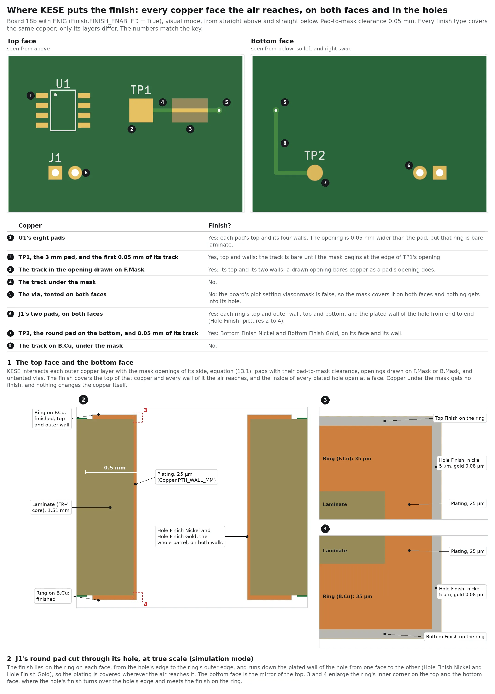
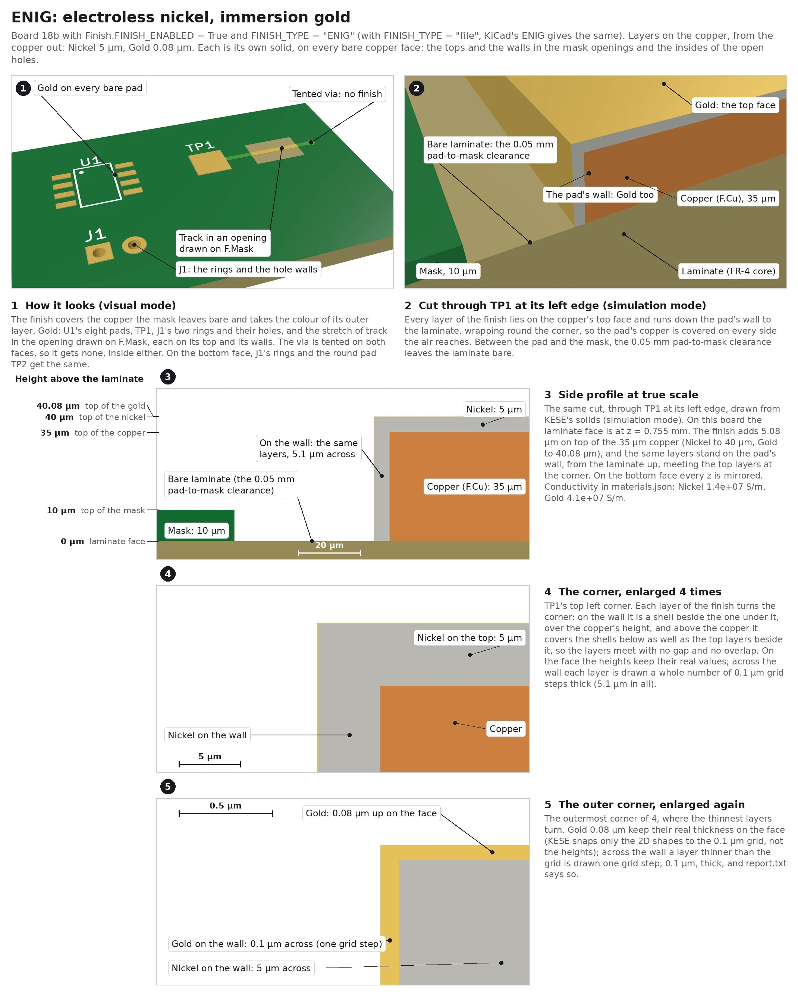
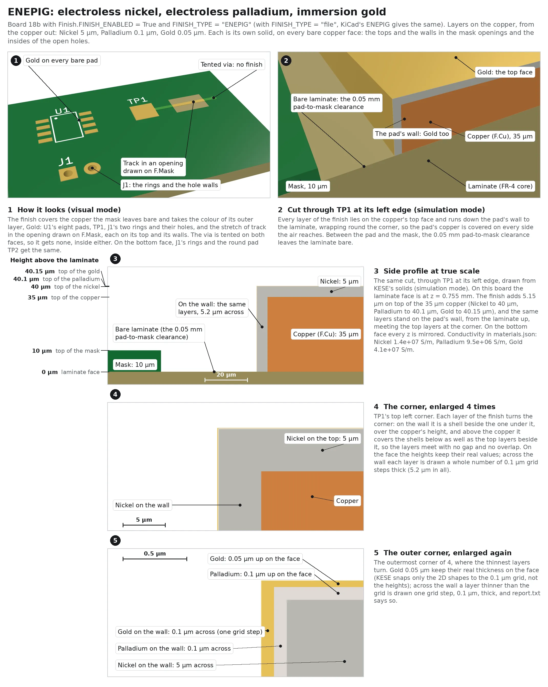
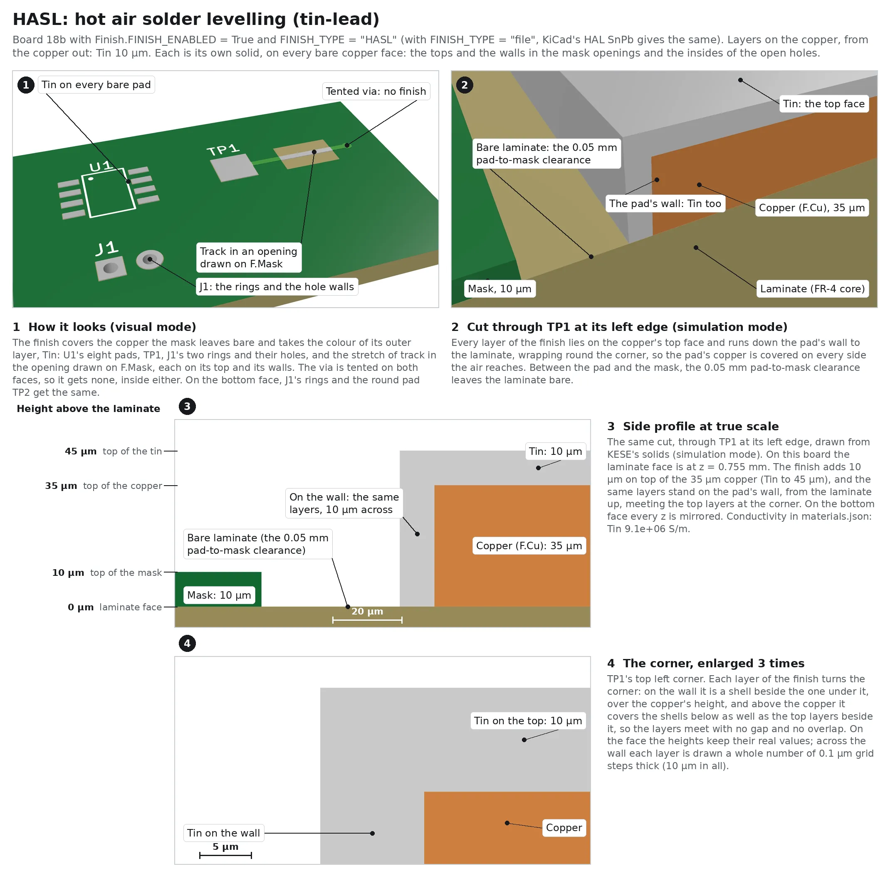
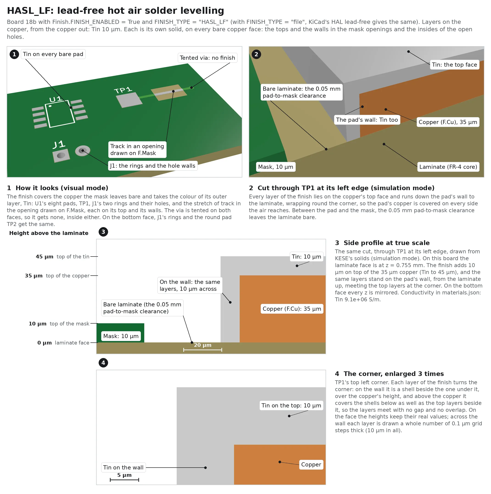
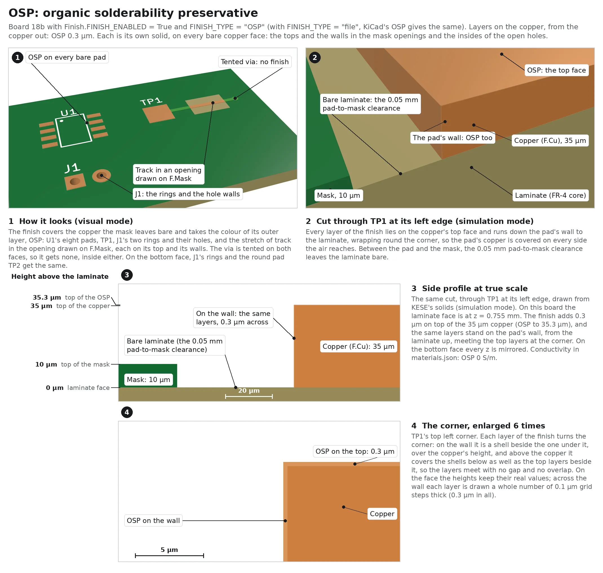
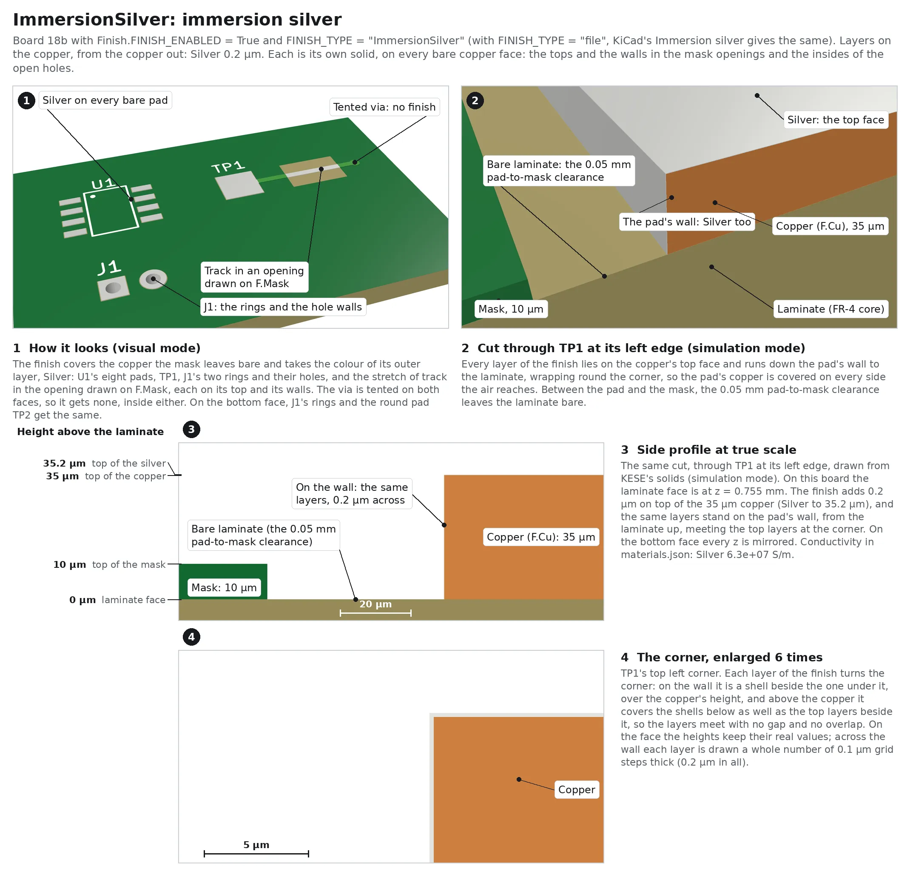
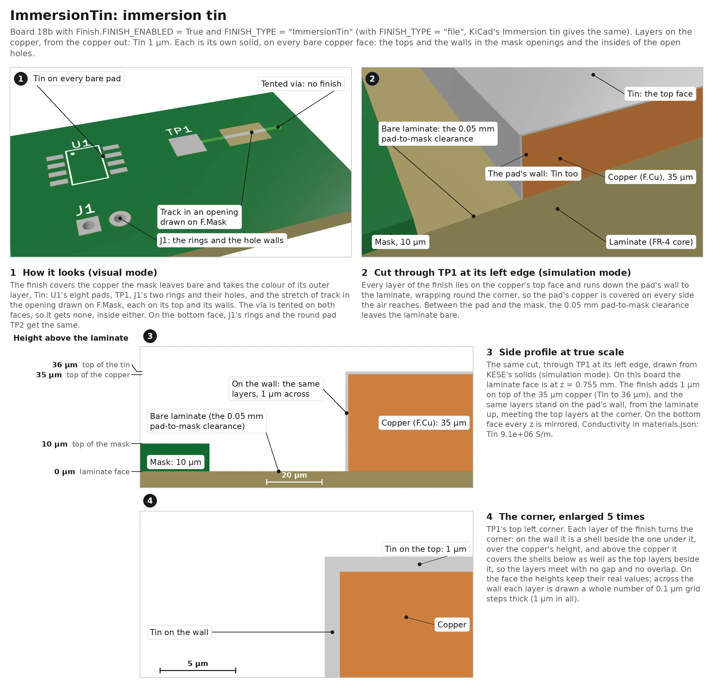
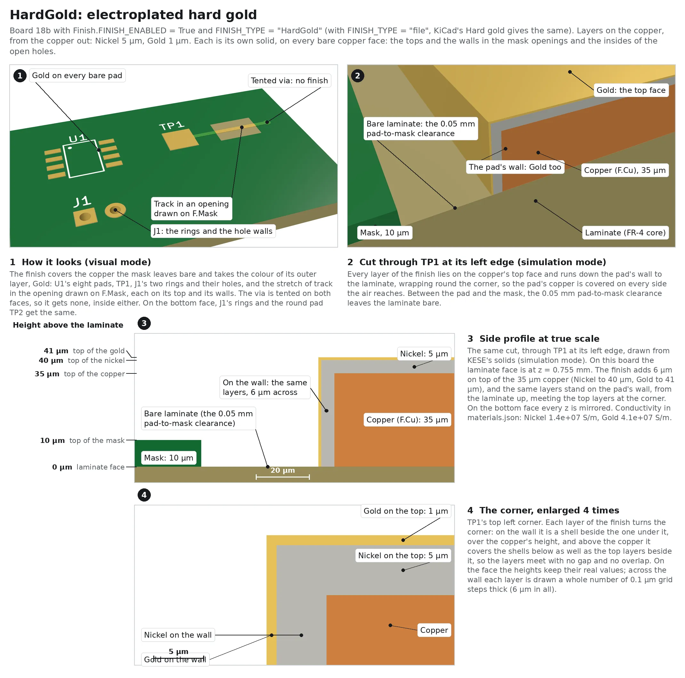

# 13. Finish

The surface finish is the metal a fabricator deposits on the bare copper of a board: pads,
exposed traces, test points, the walls of the plated holes, the plated board edge and the
castellations. `kese/s4_geometry/finish.py` builds it on the faces and `finish_shells.py` on the
walls, in the holes and on the edge (`shells.py` lays each shell); the settings are in
`parameters/finish.py`.

## 13.1 On By Default

`Finish.FINISH_ENABLED = True`: the finish adds its own thin solids on the copper, in every format
and both modes; it never changes the copper itself. `False` builds none, so the copper is bare as
KiCad draws it.

## 13.2 Where The Finish Goes



The finishes are deposited from baths (electroless nickel, immersion gold, silver and tin, OSP) or
by dipping in solder (HASL), and both coat every copper face the liquid reaches, not only the faces
seen from above. The solder mask goes on first and keeps the finish off the copper it covers ("solder
mask over bare copper"; no finish deposits through the cured mask). So KESE puts the finish on
**every copper face the air reaches**:

| Copper | Finish | Part |
|---|---|---|
| the top face of the outer copper in the mask openings (pads with their pad-to-mask clearance, drawn openings, untented vias) | stacked upward on the face, equation (13.2) | `Top Finish <metal>`, `Bottom Finish <metal>` |
| the side walls of that copper, where they meet the air: pads and traces in the openings, and the outer copper the board edge cuts | a shell beside the wall, equation (13.3), joined to the face's finish over the top corner | the same part as the face |
| the inner copper the board edge cuts (beside a castellation, say) | a shell beside the cut face, over the copper's height | `Edge Finish <metal>` |
| the plated board edge and the castellations' part-barrels (section 13.2.1) | a shell from the bottom of `B.Cu` to the top of `F.Cu` | `Edge Finish <metal>` |
| inside the bore of every plated hole open at a face | a shell over the barrel's whole length | `Hole Finish <metal>` |

Copper under the mask gets no finish, and a wall the mask touches none either. Neither does copper
under silkscreen ink kept in an opening (`Silkscreen.SILKSCREEN_OVER_COPPER = True`): the legend is
taken as printed before the finish. A hole closed at both faces gets no finish inside: a buried
hole, or a via tented on both faces (the mask closes it, so no liquid gets in); a via tented on one
face is finished from the other. On the face the finish layers are stacked from the top of the
outer copper outward, in the order the finish type lists them, each one its own solid:

```math
X_\sigma = \left( C_\sigma \cap Q_\sigma \right) \setminus S_\sigma \qquad (13.1)
```

```math
z_j \in \left[ \frac{L}{2} + t_{\mathrm{out}} + \sum_{i<j} \tau_i,\ \ \frac{L}{2} + t_{\mathrm{out}} + \sum_{i \le j} \tau_i \right] \qquad (13.2)
```

On the `B` side every z is mirrored.

| Symbol | Meaning | Parameter |
|---|---|---|
| $`X_\sigma`$ | finished face of side $`\sigma`$ (per net with `FINISH_GROUPING = "net"`) | |
| $`C_\sigma`$ | outer copper of side $`\sigma`$ | |
| $`Q_\sigma`$ | mask openings of side $`\sigma`$, equation (15.2) | |
| $`S_\sigma`$ | silkscreen ink of side $`\sigma`$ kept in the openings; empty unless `SILKSCREEN_OVER_COPPER = True` | `Silkscreen.SILKSCREEN_OVER_COPPER` |
| $`z_j`$ | z range of finish layer $`j`$ ($`j = 1`$ is the layer on the copper) | |
| $`\tau_i`$ | thickness of finish layer $`i`$ | `Finish.FINISH_TYPES` |
| $`L`$, $`t_{\mathrm{out}}`$ | laminate thickness and finished outer copper, equations (7.1) and (7.3) | |

For ENIG on `F.Cu` of a board with no stack-up and `(general (thickness 1.6))`, so
$`L = 1.6 - 2 \times 0.035 - 2 \times 0.010 = 1.51`$ mm, and 35 µm copper: nickel from 0.790 to
0.795 mm, gold from 0.795 to 0.79508 mm. With a stack-up the laminate is the stack-up's dielectrics
and the heights follow them: on board 18b below, a 1.51 mm core, the nickel also starts at 0.790 mm.

### 13.2.1 Walls, Holes, The Plated Edge And Castellations

Everywhere but the face, each finish metal is a shell in the air beside the copper $`E`$ it
covers: the walls of the outer or inner copper, a plated hole's barrel, the edge plating band
([`Copper.EDGE_PLATING`](Copper-And-Traces.md)) or a castellation's part-barrel. The metals are
laid outward from the copper in the order the finish type lists them, as they are laid upward on
the face: with $`o_j = \sum_{i \le j} \hat\tau_i`$, where $`\hat\tau_i`$ is $`\tau_i`$ drawn on the
grid (see below),

```math
R_j = \left( E \oplus o_j \right) \setminus \left( E \oplus o_{j-1} \right) \setminus B \qquad (13.3)
```

where $`\oplus`$ grows a region by a distance and $`B`$ is everything solid beside the copper (the
copper itself, the laminate, the mask, the ink, and for the edge and the holes the barrels and the
finish on the faces). The shell runs over the copper's height (a pad's wall: the outer copper; a
barrel or the plated edge: from the bottom of `B.Cu` to the top of `F.Cu`). Where the face next to
it takes the finish, it wraps over the corner: metal $`j`$ also fills $`R_j`$ between heights
$`z_t`$ and $`z_t + h_{j-1}`$, and everything within $`o_j`$ of the copper between $`z_t + h_{j-1}`$
and $`z_t + h_j`$, where $`z_t`$ is the top of the copper and $`h_j = \sum_{i \le j} \tau_i`$ the
heights of the face's finish; the bottom is the mirror image. So the
copper, the finish on the face and the shells meet with no gap and no overlap; where the mask
covers the copper next to it, the shell ends at the copper's top.

A plated board edge is routed and plated before the finish goes on, so the finish covers the edge
wall as it covers the pads; ENIG is the usual finish there, and an edge left under closed solder
mask is plated but never finished
([JLCPCB, PCB edge plating guide](https://jlcpcb.com/blog/pcb-edge-plating-guide);
[Sierra Circuits, side plating](https://www.protoexpress.com/kb/side-plating/)). Castellations are
plated holes cut through by the board edge; KESE finishes their part-barrels and their cut ends the
same way.

Across a wall the shells are 2D shapes, so each metal is drawn a whole number of grid steps
(`Geometry.SNAP_GRID_MM`, 0.1 µm) thick, at least one: ENIG's 0.08 µm gold is drawn 0.1 µm thick
across a wall (its height on the face stays 0.08 µm). `report.txt` says so, for example
`finish: also on the plated edge (Gold 8e-05 mm drawn 0.0001 mm thick across the edge, the snapping
grid)`, and `materials.json` gives each shell part both `thickness_mm` and `drawn_thickness_mm`.
The finish is on by default, so every board of `featureTest/` runs with it in the regression suite.

The air the shells fill, $`(E \oplus o_J) \setminus B`$ for the outermost metal $`J`$, is cut on the
grid once, and then split between the metals along their outer sides $`E \oplus o_j`$, each put on
the grid on its own (`kese/s4_geometry/shells.py`). The outer sides keep the copper's corners
mitred, out to `Finish.FINISH_MITRE_LIMIT` (2) times the thickness from the corner: a corner of 60°
or more keeps its point, and a sharper tip is cut straight across there. The split is done in floating point, which keeps
every vertex, so two metals side by side share their edge vertex for vertex; only where two outlines
cross is the new vertex rounded onto the grid. Each piece is then noded on the grid as stage 6 nodes
every slice: where a metal one grid step thick comes out thinner than that between two slanted
edges (on a 45° wall a 0.1 µm band can come out 0.07 µm across, the spacing of 45° lines through
the grid points), noding closes it and leaves a hairline of air, so the prisms hold the volume the
solids will. Cutting the solid once, not once per metal, is what keeps the shells quick on a big
board; the copper layers and the hole spans are worked on `Parallel.WORKERS` at a time, in threads.

### 13.2.2 Finish Before The Mask

`Finish.FINISH_BEFORE_SOLDER_MASK = False` is the usual order above: mask first, finish after it.
With `True` the finish goes on first, as on a board electroplated with hard gold all over: all the
outer copper takes the finish, its faces ($`X_\sigma = C_\sigma`$ in equation 13.1) and its walls,
every plated hole is finished inside, and the solder mask and the silkscreen on it lie on the
finish, raised over copper by its whole thickness $`\sum_i \tau_i`$ and wrapping round the finish on
the walls. `report.txt` notes it on the `finish:` and `solder mask:` lines. Board 18c
(`featureTest/18c_finish_before_mask.kicad_pcb`, ENEPIG) runs with it on in the regression suite.

## 13.3 Finish Types

`Finish.FINISH_TYPE` is a key of the table below, `"ENIG"` by default, or `"file"` to take the type
from the stack-up's `(copper_finish "...")`. With `"file"` the name is compared, ignoring case,
spaces, `-` and `_`, with the keys of `FINISH_TYPES` and with the KiCad names in
`Finish.FINISH_NAME_ALIASES`. `None` means the board has no finish: nothing is built and
`report.txt` notes `finish: the board's stackup says None, nothing applied`. A board that names no
finish (no stack-up, or the field left empty), or a name that matches nothing, stops the run with
an error (`FINISH ERROR: ... no finish was found in the KiCad file ...`): change `FINISH_TYPE` or
set the finish in KiCad (Board Setup > Physical Stackup > Copper finish).

With KiCad's own finish names (the list in Board Setup's stack-up) this gives:

| KiCad finish | KESE type |
|---|---|
| `ENIG` | `ENIG` |
| `ENEPIG` | `ENEPIG` |
| `HAL SnPb` | `HASL` |
| `HAL lead-free` | `HASL_LF` |
| `Hard gold` | `HardGold` |
| `Immersion tin` | `ImmersionTin` |
| `Immersion silver` | `ImmersionSilver` |
| `OSP`, `HT_OSP` | `OSP` |
| `None` | no finish |
| `Immersion nickel`, `Immersion gold`, `Not specified`, `User defined` | no match: the run stops with an error (or add the name to `FINISH_NAME_ALIASES`) |

| Key | Layers, bottom to top (mm) |
|---|---|
| `ENIG` | Nickel 0.005, Gold 0.00008 |
| `ENEPIG` | Nickel 0.005, Palladium 0.0001, Gold 0.00005 |
| `HASL` | Tin 0.010 |
| `HASL_LF` | Tin 0.010 |
| `OSP` | OSP 0.0003 |
| `ImmersionSilver` | Silver 0.0002 |
| `ImmersionTin` | Tin 0.001 |
| `HardGold` | Nickel 0.005, Gold 0.001 |

The table is `Finish.FINISH_TYPES` and can be edited: add a key or change a thickness to match a
datasheet. `report.txt` names the type it applied and its layers, for example
`finish: ENIG Nickel 0.005 mm + Gold 8e-05 mm`. A `FINISH_TYPE` that is neither `"file"` nor a
key stops the run with an error.

Each finish below is shown on board 18b (`featureTest/18b_finish_pads`) with `FINISH_ENABLED = True`
and its key in `FINISH_TYPE`: 1 how it looks (visual mode), 2 a cut-away of the 3 mm pad TP1 at its
left edge (simulation mode), 3 the side profile at true scale with the height of every surface above
the laminate, and 4 the thin layers enlarged (HASL and HASL_LF need no part 4). Board 18b has 35 µm
copper on a 1.51 mm core, so its laminate face is at z = 0.755 mm and its copper top at 0.790 mm.
The bottom face is the mirror image, with the parts named `Bottom Finish ...`.

### 13.3.1 ENIG



Electroless nickel, immersion gold; KiCad's `ENIG`.

| Layer, from the copper up | Thickness | Top above the copper | Part on the top face | Conductivity |
|---|---|---|---|---|
| Nickel | 5 µm | 5 µm | `Top Finish Nickel` | 1.4 × 10⁷ S/m |
| Gold | 0.08 µm | 5.08 µm | `Top Finish Gold` | 4.1 × 10⁷ S/m |

The pads take the gold's colour, `#E6C15A`. On board 18b the gold's top is 40.08 µm above the
laminate, at z = 0.79508 mm; at true scale the gold is under a pixel, so part 4 enlarges it.

### 13.3.2 ENEPIG



Electroless nickel, electroless palladium, immersion gold; KiCad's `ENEPIG`.

| Layer, from the copper up | Thickness | Top above the copper | Part on the top face | Conductivity |
|---|---|---|---|---|
| Nickel | 5 µm | 5 µm | `Top Finish Nickel` | 1.4 × 10⁷ S/m |
| Palladium | 0.1 µm | 5.1 µm | `Top Finish Palladium` | 9.5 × 10⁶ S/m |
| Gold | 0.05 µm | 5.15 µm | `Top Finish Gold` | 4.1 × 10⁷ S/m |

From the top it looks like ENIG (`#E6C15A`); the palladium shows only in a cut. On board 18b the
gold's top is 40.15 µm above the laminate.

### 13.3.3 HASL



Hot air solder levelling with tin-lead solder; KiCad's `HAL SnPb`.

| Layer, from the copper up | Thickness | Top above the copper | Part on the top face | Conductivity |
|---|---|---|---|---|
| Tin | 10 µm | 10 µm | `Top Finish Tin` | 9.1 × 10⁶ S/m |

KESE models the solder as one flat layer of tin, coloured `#C9C9C9`. With `HASL_LF` it is the
thickest finish, and the only one with no layer thin enough to need part 4; on board 18b its top is
45 µm above the laminate.

### 13.3.4 HASL_LF



Lead-free hot air solder levelling; KiCad's `HAL lead-free`.

| Layer, from the copper up | Thickness | Top above the copper | Part on the top face | Conductivity |
|---|---|---|---|---|
| Tin | 10 µm | 10 µm | `Top Finish Tin` | 9.1 × 10⁶ S/m |

KESE builds it exactly as `HASL`: the same layer of tin, the same part and the same colour.

### 13.3.5 OSP



Organic solderability preservative; KiCad's `OSP` and `HT_OSP`.

| Layer, from the copper up | Thickness | Top above the copper | Part on the top face | Conductivity |
|---|---|---|---|---|
| OSP | 0.3 µm | 0.3 µm | `Top Finish OSP` | 0 (organic) |

Coloured `#D9955A`, close to the copper under it. On board 18b its top is 35.3 µm above the
laminate.

### 13.3.6 ImmersionSilver



Immersion silver; KiCad's `Immersion silver`.

| Layer, from the copper up | Thickness | Top above the copper | Part on the top face | Conductivity |
|---|---|---|---|---|
| Silver | 0.2 µm | 0.2 µm | `Top Finish Silver` | 6.3 × 10⁷ S/m |

Coloured `#E4E4E0`. On board 18b its top is 35.2 µm above the laminate.

### 13.3.7 ImmersionTin



Immersion tin; KiCad's `Immersion tin`.

| Layer, from the copper up | Thickness | Top above the copper | Part on the top face | Conductivity |
|---|---|---|---|---|
| Tin | 1 µm | 1 µm | `Top Finish Tin` | 9.1 × 10⁶ S/m |

The metal of `HASL`, a tenth as thick, with the same part name and colour (`#C9C9C9`). On board 18b
its top is 36 µm above the laminate.

### 13.3.8 HardGold



Electroplated hard gold, the finish of edge-connector fingers; KiCad's `Hard gold`.

| Layer, from the copper up | Thickness | Top above the copper | Part on the top face | Conductivity |
|---|---|---|---|---|
| Nickel | 5 µm | 5 µm | `Top Finish Nickel` | 1.4 × 10⁷ S/m |
| Gold | 1 µm | 6 µm | `Top Finish Gold` | 4.1 × 10⁷ S/m |

The thickest gold of the eight finishes, 12.5 times ENIG's; the pads look gold (`#E6C15A`). On
board 18b the gold's top is 41 µm above the laminate.

## 13.4 Parts And Grouping

`Finish.FINISH_GROUPING`:

| Value | Parts | Example |
|---|---|---|
| `"metal"` (default) | one per side and metal | `Top Finish Nickel`, `Top Finish Gold`, `Bottom Finish Nickel`, `Edge Finish Nickel`, `Hole Finish Gold`, ... |
| `"net"` | one per side, metal and net | `Top Finish Gold_GND`, so a net's copper, nickel and gold can be picked together in the solver (`Copper_GND`, `Top Finish Nickel_GND`, `Top Finish Gold_GND`, `Edge Finish Gold_GND`, `Hole Finish Gold_GND`) |

In `materials.json` each finish part has the layer `F.Finish`, `B.Finish`, `Edge.Finish` or
`Hole.Finish`, its `z_range_mm`, and the properties `side` (`F`, `B`, `Edge` or `Hole`), `metal`,
`thickness_mm` and `conductivity_S_per_m`, and on the shells `drawn_thickness_mm` (section 13.2.1); the conductivities come
from `Finish.FINISH_CONDUCTIVITY_S_PER_M` (Nickel 1.4 × 10⁷, Gold 4.1 × 10⁷, Palladium 9.5 × 10⁶,
Tin 9.1 × 10⁶, Silver 6.3 × 10⁷ S/m, OSP 0 since it is organic). Colours come from the metal's entry
in `Color.MATERIALS` ([Colorizing](Colorizing.md)).

In STEP, finish parts are written as every other part, each as the closed solids stage 6 built,
one per connected piece.

> [!NOTE]
> The gold of ENIG is 80 nm thick and that of ENEPIG 50 nm. Heights are not snapped to the
> 0.1 µm grid (only the 2D shapes are), so in simulation mode each is built as a real solid, but
> an FDTD or FEM mesher may not resolve a body that thin. Solvers that struggle can take the finish
> as a surface impedance instead and leave `FINISH_ENABLED` off. In visual mode only the surface
> between material and air is kept ([Output Modes](Output-Modes.md)): the faces where two layers
> touch are dropped, so a pad's top and walls show the outermost layer alone, and the layers under
> it show only where a cut opens them.

## 13.5 Settings

| Name | Default | Range | Meaning |
|---|---|---|---|
| `FINISH_ENABLED` | `True` | bool | Build the finish and write it to every file |
| `FINISH_TYPE` | `"ENIG"` | `"file"` or a key of `FINISH_TYPES` | The type, or `"file"` for the stack-up's (an error when the file names none) |
| `FINISH_GROUPING` | `"metal"` | `"metal"` / `"net"` | Part per metal, or per metal and net |
| `FINISH_BEFORE_SOLDER_MASK` | `False` | bool | Finish on all the outer copper, under the mask (section 13.2.2), instead of only where the mask leaves it bare |
| `FINISH_TYPES` | table above | `{key: [(metal, mm), ...]}` | Layers of each finish |
| `FINISH_NAME_ALIASES` | `HAL SnPb` → `HASL`, `HAL lead-free` → `HASL_LF`, `Hard gold` → `HardGold`, `Immersion tin` → `ImmersionTin`, `Immersion silver` → `ImmersionSilver`, `HT_OSP` → `OSP` | `{KiCad name: key}` | KiCad's finish names that differ from a key |
| `FINISH_CONDUCTIVITY_S_PER_M` | table above | `{metal: S/m}` | Written to `materials.json` |

| Previous | Next |
|:---|---:|
| [Colorizing](Colorizing.md) | [Silkscreens](Silkscreens.md) |
