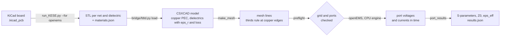

# 33. OpenEMS Implementation Introduction

[openEMS](https://github.com/thliebig/openEMS-Project) is an open-source FDTD (finite-difference
time-domain) solver of Maxwell's equations. The **openEMS bridge** turns a KiCad board into an
openEMS simulation: KESE exports the board as one STL per net and per dielectric, and the bridge
imports them into CSXCAD, places the mesh lines from the copper's edges, sets the ports, checks
the grid and the ports before running, runs openEMS and reads S-parameters and line data back. The
bridge lives on the `OpenEMS_Integration` branch; KESE stays a geometry exporter and is never
changed by it. The route it automates is the one [openEMS Workflow](OpenEMS-Workflow.md) describes
by hand.

> [!NOTE]
> This category describes work in progress. The bridge and its first proof board, a microstrip,
> are on the branch; see [OpenEMS Implementation Test Board Results](OpenEMS-Implementation-Test-Board-Results.md)
> for what it gave.

## 33.1 What openEMS Is Used For Here

FDTD marches the full Maxwell equations in time on a rectilinear grid, so it covers everything with
waves in it, where the quasi-static solve of [Elmer](Elmer-FEM-Introduction.md) does not:

| Quantity | How the bridge gets it |
|---|---|
| S-parameters of a board between its ports | the incident and reflected waves at each port, from one run per excited port |
| Characteristic impedance and effective permittivity of a line | each microstrip port's own voltage and current probes (no reference impedance needed) |
| Self-resonance and stray capacitance of a coil | the ring-down of the coil's impedance after a pulse (planned) |
| Crosstalk, TDR, resonances of a board | time signals and S-parameters (planned examples) |

## 33.2 How It Fits Together

## 33.3 Four Habits From SPIKE

[SPIKE](https://github.com/krishna-swaroop/SPIKE) (Apache-2.0) is an LLM-driven openEMS front end.
Four of its habits are part of every run of this bridge, because each one catches a wrong answer
before anyone reads it:

| Habit | What the bridge does |
|---|---|
| Grid preflight | Before running: the largest cell in the dielectric against λ/15 in the densest material, the largest cell in the air against λ₀/15, and the ratio of neighbouring cells (at most 2:1). A run that fails any of these stops with the reason |
| Port-copper check | Each port's strip must lie on copper of its own net (at least 90 % of its area) with its reference copper under the whole of it, and have at least three cells across it |
| Code hashes | The hash of the example's `simulation.py` and of every file of the bridge is written into `results.json`, so every number can be traced to the code that made it |
| No invented S columns | One run excites one port and gives one column of S, Si1. The bridge reports that column and never fills the others by symmetry |

## 33.4 The Pages Of This Category

| Page | What it covers |
|---|---|
| [OpenEMS Implementation Installation](OpenEMS-Implementation-Installation.md) | Building openEMS with its Python modules on Linux and Windows |
| [OpenEMS Implementation Workflow](OpenEMS-Implementation-Workflow.md) | Every step from the board file to the numbers |
| [OpenEMS Implementation Simulating Your Own Board](OpenEMS-Implementation-Simulating-Your-Own-Board.md) | Every setting of an example's `simulation.py` |
| [OpenEMS Implementation Test Boards](OpenEMS-Implementation-Test-Boards.md) | The boards, rendered by KESE, and which have run |
| [OpenEMS Implementation Test Board Results](OpenEMS-Implementation-Test-Board-Results.md) | What came out, against the references, with charts |
| [OpenEMS Implementation Accuracy](OpenEMS-Implementation-Accuracy.md) | Where the errors come from and how big they are |
| [OpenEMS Implementation Hardware](OpenEMS-Implementation-Hardware.md) | Memory and time, measured and estimated |
| [OpenEMS Implementation Troubleshooting](OpenEMS-Implementation-Troubleshooting.md) | What went wrong while building the bridge, and the fixes |

The two solvers are compared on [Elmer vs openEMS](Elmer-vs-OpenEMS.md).

## 33.5 Where The Code Is

| Folder on `OpenEMS_Integration` | What it holds |
|---|---|
| `bridge/` | `fdtd.py` (export, model, mesh, preflight, run, results) and `kicad_writer.py` |
| `Examples/O01_microstrip/` | The first proof board, with its board, `make_board.py`, `simulation.py`, `README.md` and `results.md` |
| `Solver_OpenEMS/` | Empty on purpose: openEMS is built here (see [OpenEMS Implementation Installation](OpenEMS-Implementation-Installation.md)) |
| `3D_Geometry/` | Empty on purpose: KESE's `Generator/` is copied here from `main`, or `KESE_PATH` points at it |

| Previous | Next |
|:---|---:|
| [Elmer FEM Troubleshooting](Elmer-FEM-Troubleshooting.md) | [OpenEMS Implementation Installation](OpenEMS-Implementation-Installation.md) |
