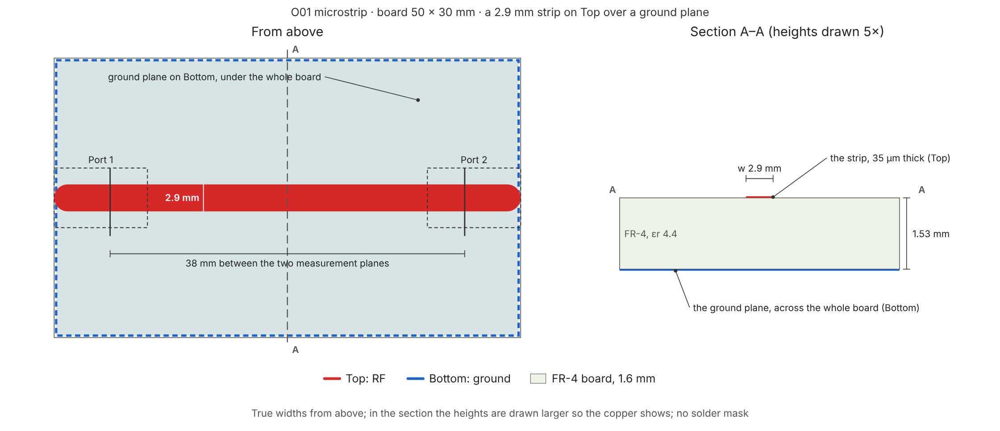
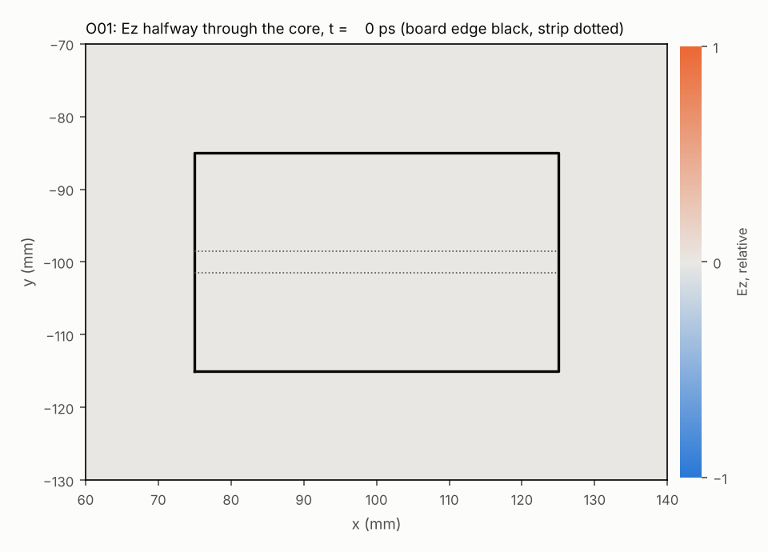

# 38. OpenEMS Implementation Test Board Results

What openEMS gave on each board of [OpenEMS Implementation Test Boards](OpenEMS-Implementation-Test-Boards.md),
against numbers known without any solver. Every chart and field picture here is drawn from openEMS's
own output by the example's `make_pictures.py`; nothing is drawn by hand. The board picture is drawn
from the board's KiCad file. The numbers are in each
example's `results.json` on the `OpenEMS_Integration` branch, with the versions and the hashes of
the code that made them, and each example's `results.md` has the full tables.

## 38.1 O01 Microstrip

### In Short

O01 is the simplest high-frequency test there is: one copper strip over a ground plane, 2.9 mm wide
on 1.53 mm of FR-4, which makes it a 50 Ω line. openEMS sends a signal in at port 1 on the left; the
signal runs along the strip to port 2 on the right, where a 50 Ω end takes it, and almost nothing
should come back. Textbook formulas say what the line's impedance is, how fast the signal travels and
how much of its power the FR-4 soaks up on the way. openEMS lands within 2 % of each:

| What | What it means | The formulas | openEMS |
|---|---|---|---|
| Z0, the line's impedance | the ratio of voltage to current in the travelling signal; a 50 Ω source and end must match it, or part of the signal bounces back | 49.83 Ω | 50.69 Ω at 1 GHz, +1.7 % |
| εeff, the effective permittivity | sets the signal's speed along the line, c/√εeff: about 0.54 times the speed of light here | 3.318 to 3.397 (1 to 4 GHz) | 3.364 to 3.421, +1.4 to +0.7 % |
| Power that reaches port 2 | what is left after the 38 mm between the two measurement planes | 92.4 to 92.3 % (the FR-4's loss) | 92.4 to 91.7 % |
| Power that comes back | what bounces off port 2 because the line is not exactly 50 Ω | almost none | under 0.08 % (S11 −31 to −53 dB) |

A wrong εr, a wrong core thickness, a port in the wrong place or a broken read-back would each move at
least one of these numbers well past 2 %: the five bugs O01 found ([What O01 Found](#what-o01-found))
showed as a Z0 of 76 Ω and an εeff 11 % high.

| Item | Value |
|---|---|
| Run | 16 November 2026, openEMS-Project master `e4cd015`, KESE 3.4.0 |
| Pulse | DC-free Gaussian, f0 3 GHz, fc 2 GHz: 1 to 5 GHz |
| Mesh | 411,424 cells: λ/30 in the FR-4 at 5 GHz, thirds rule with h 0.2 mm at the copper's edges, 6 cells through the core |
| Stop | the field energy 50 dB under its peak, after 23,048 time steps |
| Time and memory | 88 s and 0.15 GB on 4 cores, sharing the machine with an Elmer solve |
| Preflight | all 16 lines pass |

### What the Line Looks Like Inside

The signal is a wave of electric and magnetic field that travels along the strip. Across the line,
the electric field (top) runs from the strip down to the ground, packed into the FR-4 under the strip
and fringing out at its edges; the magnetic field (bottom) circles the strip. From openEMS's own field
in this picture, about nine tenths of the electric field's energy sits in the FR-4 and a tenth in the
air. The signal therefore travels at a speed between that in FR-4 (εr 4.4) and that in air (1): εeff
is 3.4. The width of the strip against the height of the FR-4 sets how much field crowds under it,
and so the line's impedance: a wider strip or a thinner core gives a lower Z0.

### Expected Against What Came Out

| f | Z0, openEMS | Z0, Hammerstad–Jensen | εeff from S21 | εeff, Kirschning–Jansen | Difference | S21 | S21 from the dielectric's loss alone | S11 |
|---|---|---|---|---|---|---|---|---|
| 1 GHz | 50.69 Ω | 49.83 Ω | 3.364 | 3.318 | +1.4 % | −0.344 dB | −0.342 dB | −53.4 dB |
| 2 GHz | 50.95 Ω | 49.83 Ω | 3.376 | 3.341 | +1.1 % | −0.360 dB | −0.344 dB | −37.3 dB |
| 3 GHz | 51.31 Ω | 49.83 Ω | 3.395 | 3.368 | +0.8 % | −0.368 dB | −0.347 dB | −31.2 dB |
| 4 GHz | 51.70 Ω | 49.83 Ω | 3.421 | 3.397 | +0.7 % | −0.376 dB | −0.349 dB | −31.0 dB |

S21 and S11 are the signal that arrives at port 2 and the signal that comes back to port 1, each as a
share of what went in, in decibels: −0.37 dB is 92 % of the power, −31 dB is 0.08 %. openEMS is within
2 % of the closed forms everywhere: Z0 +1.7 % at 1 GHz, εeff +0.7 to +1.4 %. That is more than the
formulas' own error (0.2 to 0.6 % for εeff, about 1 % for Z0), so the rest belongs to the FDTD model;
[OpenEMS Implementation Accuracy](OpenEMS-Implementation-Accuracy.md) takes it apart.

Z0 is what the line was drawn for. Hammerstad and Jensen's formula gives the static value, 49.83 Ω,
for this strip's width and thickness on this core. A real microstrip's impedance rises a little with
frequency as the field draws further into the FR-4, so the fair comparison is at the lowest
frequency: 50.7 Ω at 1 GHz, +1.7 %.

εeff is the line's speed: the signal covers 163 mm a nanosecond at 3 GHz, 0.54 times the speed of
light. openEMS gets it from the phase of S21 over the 38 mm between the measurement planes, and it
follows Kirschning and Jansen's formula with an offset that shrinks from 1.4 to 0.7 % across the band.
The finer mesh (points) lands on the standard one. Port 1's own probes, 1.8 mm apart, give a value 0.6
to 1.5 % higher, so the S21 value is the one to quote.

Of the power that crosses port 1's measurement plane, 92 % arrives at port 2's. About 8 % is lost on
the way, nearly all of it as heat in the FR-4 (tan δ 0.02): the black ticks are what that loss alone
would leave, by Pozar's formula. openEMS loses a further 0.3 to 0.6 % of the power from 2 to 4 GHz,
which is the line's ends and ports radiating a little into the air around the board; the copper is lossless
in this model. What comes back is too small to see on the bars: under 0.001 % at 1 GHz and under
0.08 % up to 4 GHz.

The same run seen from above: Ez halfway through the core, from openEMS's field dump (87 samples on its
own mesh). The pulse enters at port 1, stays under the strip as it runs along it, and the 50 Ω end at
port 2 takes it with almost no echo, which is the −31 to −53 dB of S11.

### The Mesh Study

| Mesh | Cells | Time steps | Time | Z0 at 1 GHz | εeff from S21 at 1 GHz | εeff from S21 at 4 GHz |
|---|---|---|---|---|---|---|
| h 0.2 mm, 6 cells through the core (standard) | 411,424 | 23,048 | 88 s | 50.69 Ω | 3.3644 | 3.4212 |
| h 0.1 mm at the copper's edges | 504,896 | 26,095 | 131 s | 50.46 Ω | 3.3642 | 3.4207 |
| 12 cells through the core | 438,256 | 22,780 | 111 s | 50.72 Ω | 3.3637 | 3.4202 |
| the standard mesh on openEMS's default engine | 411,424 | 23,316 | 97 s | 50.70 Ω | 3.3645 | 3.4212 |

Halving the spacing at the copper's edges moves εeff by 0.02 % at most and Z0 by 0.5 %; doubling the
cells through the core moves εeff by 0.03 % and Z0 by 0.06 %. The default engine agrees with the CPU
engine within 0.005 %. The mesh is converged well inside the 1 to 2 % that separates openEMS from
the formulas.

### What O01 Found

Five bugs gave wrong numbers that looked plausible, from a Z0 of 76 Ω to an εeff 11 % high, and each
is fixed in the bridge: the current probes of a thick strip, the wave S21 is taken from, the thirds
rule's direction, the 2:1 check's rounding, and the static charge of openEMS's default pulse.
[OpenEMS Implementation Troubleshooting](OpenEMS-Implementation-Troubleshooting.md#411-wrong-numbers-that-look-right)
lists what each looked like, and section 41.2 the chain of single runs that found the thirds rule.

| Previous | Next |
|:---|---:|
| [OpenEMS Implementation Test Boards](OpenEMS-Implementation-Test-Boards.md) | [OpenEMS Implementation Accuracy](OpenEMS-Implementation-Accuracy.md) |
