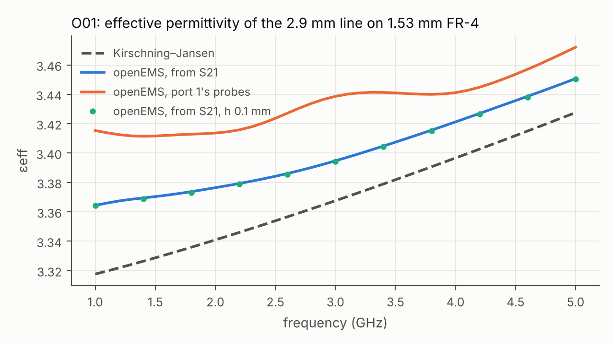
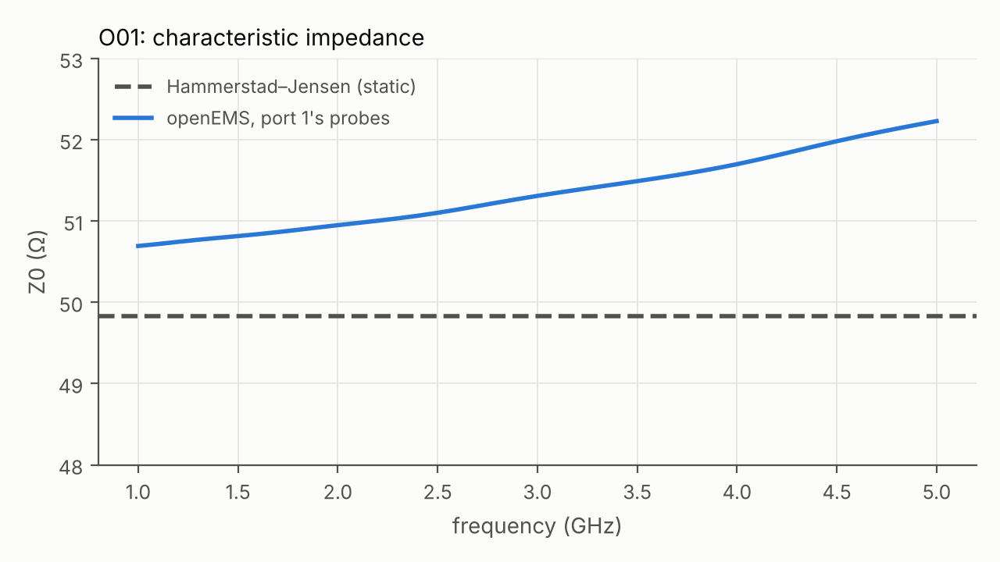

# 38. OpenEMS Implementation Test Board Results

What openEMS gave on each board of [OpenEMS Implementation Test Boards](OpenEMS-Implementation-Test-Boards.md),
against numbers known without any solver. Every chart and picture here is drawn from openEMS's own
output by the example's `make_pictures.py`; nothing is drawn by hand. The numbers are in each
example's `results.json` on the `OpenEMS_Integration` branch, with the versions and the hashes of
the code that made them, and each example's `results.md` has the full tables.

## 38.1 O01 Microstrip

One straight 2.9 mm microstrip on a 1.53 mm FR-4 core (εr 4.4) over a solid ground: a 50 Ω line by
Hammerstad and Jensen's formulas. Port 1 is excited and port 2 ends the line in 50 Ω, so one run
gives S11 and S21, and each port measures Z0 and the propagation constant from its own probes.

| Item | Value |
|---|---|
| Run | 16 November 2026, openEMS-Project master `e4cd015`, KESE 3.4.0 |
| Pulse | DC-free Gaussian, f0 3 GHz, fc 2 GHz: 1 to 5 GHz |
| Mesh | 411,424 cells: λ/30 in the FR-4 at 5 GHz, thirds rule with h 0.2 mm at the copper's edges, 6 cells through the core |
| Stop | the field energy 50 dB under its peak, after 23,048 time steps |
| Time and memory | 88 s and 0.15 GB on 4 cores, sharing the machine with an Elmer solve |
| Preflight | all 16 lines pass |

### Expected Against What Came Out

| f | Z0, openEMS | Z0, Hammerstad–Jensen | εeff from S21 | εeff, Kirschning–Jansen | Difference | S21 | S21 from the dielectric's loss alone | S11 |
|---|---|---|---|---|---|---|---|---|
| 1 GHz | 50.69 Ω | 49.83 Ω | 3.364 | 3.318 | +1.4 % | −0.344 dB | −0.342 dB | −53.4 dB |
| 2 GHz | 50.95 Ω | 49.83 Ω | 3.376 | 3.341 | +1.1 % | −0.360 dB | −0.344 dB | −37.3 dB |
| 3 GHz | 51.31 Ω | 49.83 Ω | 3.395 | 3.368 | +0.8 % | −0.368 dB | −0.347 dB | −31.2 dB |
| 4 GHz | 51.70 Ω | 49.83 Ω | 3.421 | 3.397 | +0.7 % | −0.376 dB | −0.349 dB | −31.0 dB |

openEMS is within 2 % of the closed forms everywhere: Z0 +1.7 % at 1 GHz, εeff +0.7 to +1.4 %. That
is more than the formulas' own error (0.2 to 0.6 % for εeff, about 1 % for Z0), so the rest belongs
to the FDTD model; [OpenEMS Implementation Accuracy](OpenEMS-Implementation-Accuracy.md) takes it
apart.

εeff from S21 follows Kirschning and Jansen's dispersion with an offset that shrinks from 1.4 to
0.7 % across the band. The finer mesh (points) lands on the standard one. εeff from port 1's own
probes is 0.6 to 1.5 % above the S21 value: the port takes its derivative over three probes 1.8 mm
apart, S21 its phase over 38 mm, so the S21 value is the one to quote.

Hammerstad and Jensen's Z0 is the static one. A microstrip's impedance does rise with frequency as
the field draws into the substrate, so the fair comparison is at 1 GHz, +1.7 %.

Ez halfway through the core, from openEMS's field dump of the same run (87 samples on its own mesh).
The field stays under the strip, the line's quasi-TEM mode, and the 50 Ω end at port 2 takes the
pulse with almost no echo, which is the −31 to −53 dB of S11.

### The Mesh Study

| Mesh | Cells | Time steps | Time | Z0 at 1 GHz | εeff from S21 at 1 GHz | εeff from S21 at 4 GHz |
|---|---|---|---|---|---|---|
| h 0.2 mm, 6 cells through the core (standard) | 411,424 | 23,048 | 88 s | 50.69 Ω | 3.3644 | 3.4212 |
| h 0.1 mm at the copper's edges | 504,896 | 26,095 | 131 s | 50.46 Ω | 3.3642 | 3.4207 |
| 12 cells through the core | 438,256 | 22,780 | 111 s | 50.72 Ω | 3.3637 | 3.4202 |
| the standard mesh on openEMS's default engine | 411,424 | 23,316 | 97 s | 50.70 Ω | 3.3645 | 3.4212 |

Halving the spacing at the copper's edges moves εeff by 0.02 % at most and Z0 by 0.5 %; doubling the
cells through the core moves εeff by 0.03 % and Z0 by 0.06 %. The default engine agrees with the CPU
engine within 0.005 %. The mesh is converged well inside the 1 to 2 % that separates openEMS from
the formulas.

### What O01 Found

Five bugs gave wrong numbers that looked plausible, from a Z0 of 76 Ω to an εeff 11 % high, and each
is fixed in the bridge: the current probes of a thick strip, the wave S21 is taken from, the thirds
rule's direction, the 2:1 check's rounding, and the static charge of openEMS's default pulse.
[OpenEMS Implementation Troubleshooting](OpenEMS-Implementation-Troubleshooting.md#411-wrong-numbers-that-look-right)
lists what each looked like, and section 41.2 the chain of single runs that found the thirds rule.

## 38.2 The Ten Inductive Encoder Boards

**YET TO BE RUN.** openEMS's job on these boards is each TX coil's self resonance (check C8), and
the inductance and coupling checks again on S2 and D2 as a cross-check of Elmer. A C8 run rings the
coil down for about 540,000 time steps, 7 to 45 hours on the 4-core test machine, so all ten wait
for a machine that can run unattended
([OpenEMS Implementation Test Boards](OpenEMS-Implementation-Test-Boards.md#372-the-ten-inductive-encoder-boards),
[OpenEMS Implementation Hardware](OpenEMS-Implementation-Hardware.md#404-what-fits-where)).

| Previous | Next |
|:---|---:|
| [OpenEMS Implementation Test Boards](OpenEMS-Implementation-Test-Boards.md) | [OpenEMS Implementation Accuracy](OpenEMS-Implementation-Accuracy.md) |
