# 61. Palace Introduction

[Palace](https://github.com/awslabs/palace) is an open-source finite element solver for electromagnetics from AWS
Labs, built on [MFEM](https://mfem.org) and [hypre](https://github.com/hypre-space/hypre) and released under the
Apache 2.0 licence. The **Palace bridge** turns a KiCad board into a Palace simulation: KESE exports the board's 3D
geometry, the bridge meshes it, writes Palace's input, runs Palace and reads the answer back. The bridge lives on the
`Palace_Integration` branch of the repository; KESE itself stays what it is, a geometry exporter, and is never changed
by the bridge.

> [!NOTE]
> This category describes work in progress. The coil board `S0d2_1x_OD23_2L_tiny_TX3top_Cut` is solved at every air
> gap (81 solves, every one converged and passing its checks; see
> [Palace Test Board Results](Palace-Test-Board-Results.md)). The two proof boards E01 and E02 are built and set up,
> and their solves are being finished.

## 61.1 What Palace Is Used For Here

Palace solves Maxwell's equations in full, in the frequency domain (its *driven* solve), for the electric field, with
Nédélec edge elements: the copper is a conducting region, the air round it is meshed out to a boundary, and each coil
is opened by a **lumped port**, a sheet across the place where it is opened with a resistance across it. At the
frequencies of inductive position sensors (3 to 5 MHz) a 23 mm board is about 1/2000 of a wavelength across, so the
fields are magneto-quasi-static, and the full-wave solve gives the same answer as an eddy-current one would.

| Quantity | How the bridge gets it |
|---|---|
| Impedance Z of a coil | V / I at its port: the port's voltage and the current the drive and the port's resistance give |
| Inductance L and AC resistance R of a coil, with skin and proximity effect | L = Im Z / ω and R = Re Z |
| Mutual inductance M from the driven coil to another | Im(Z[receiver][TX]) / ω, the receiver's port left open by 1 MΩ |
| The whole impedance matrix between the ports | every port driven in turn, Z = V I⁻¹ |
| The field energy, as a check on L | Palace's magnetic energy W gives L = 2W / \|I\|² |
| The effect of a conducting target (a rotor) | the same quantities with the rotor's copper present and away, at each angle and air gap |

The bridge reads no capacitance or self-resonance from Palace at present: each solve is one frequency, and the examples
read L, R and M only.

## 61.2 How It Fits Together

```mermaid
flowchart LR
    A[KiCad board<br>.kicad_pcb] -->|run_KESE.py --for elmer| B[STL per solid<br>+ materials.json]
    B -->|bridge/geometry.py| C[parts in model<br>coordinates]
    C -->|bridge/mesh25d.py| D[2.5D mesh<br>wedges + tetrahedra]
    D -->|bridge/ports.py| E[lumped port sheets<br>where each coil is opened]
    E -->|bridge/palace_case.py| F[config.json<br>+ Gmsh mesh]
    F -->|palace -np N| G[port-V.csv<br>domain-E.csv]
    G -->|bridge/palace_case.py| H[Z, R, L, M<br>results json]
```

Each step is described on [Palace Workflow](Palace-Workflow.md).

## 61.3 The Pages Of This Category

| Page | What it covers |
|---|---|
| [Palace Installation](Palace-Installation.md) | The committed Palace build, setting up a machine, and building Palace from source |
| [Palace Workflow](Palace-Workflow.md) | Every step from the board file to the numbers |
| [Palace Simulating Your Own Board](Palace-Simulating-Your-Own-Board.md) | Every setting of the examples' `simulation.py`, and how to set up a new coil board |
| [Palace Test Boards](Palace-Test-Boards.md) | The boards the bridge is proved on |
| [Palace Test Board Results](Palace-Test-Board-Results.md) | What came out, against the references, with charts |
| [Palace Accuracy](Palace-Accuracy.md) | Where the errors come from and how big they are |
| [Palace Hardware](Palace-Hardware.md) | Memory and time, measured, and what a board needs |
| [Palace Troubleshooting](Palace-Troubleshooting.md) | What went wrong while building the bridge, and the fixes |

How Palace compares with the project's other solvers is on [Solvers Comparison](Solvers-Comparison.md).

## 61.4 Where The Code Is

| Folder on `Palace_Integration` | What it holds |
|---|---|
| `bridge/` | The bridge, in Python, general to any board: `geometry.py`, `mesh25d.py`, `ports.py`, `palace_case.py`, `study.py`, and `setup_machine.sh` |
| `Solver_Palace/` | The Palace 0.19.0 build every simulation ran with (`install/`), the script and patch that build it from source, and the licences of Palace and of every library built into it |
| `Examples/E01_circular_loop/`, `Examples/E02_coaxial_loops/` | The proof boards, each with its board, `make_board.py`, `simulation.py` and its KESE export in `3D_Geometry/` |
| `Examples/Inductive Coils/` | Inductive encoder boards from the Sinusoidal Coil Generator, one folder each (non-commercial licence, see that folder's `LICENSE.md`), with `new_coil.py`, which sets up a new one |
| `Examples/kicad_writer.py`, `Examples/references.py` | Shared by the proof boards: a small KiCad board writer, and the textbook values they are checked against |
| `3D_Geometry/` | Empty on purpose: KESE's `Generator/` is copied here from `main`, or `KESE_PATH` points at it, only to export a board whose export is not committed |

| Previous | Next |
|:---|---:|
| [FastHenry Troubleshooting](FastHenry-Troubleshooting.md) | [Palace Installation](Palace-Installation.md) |
