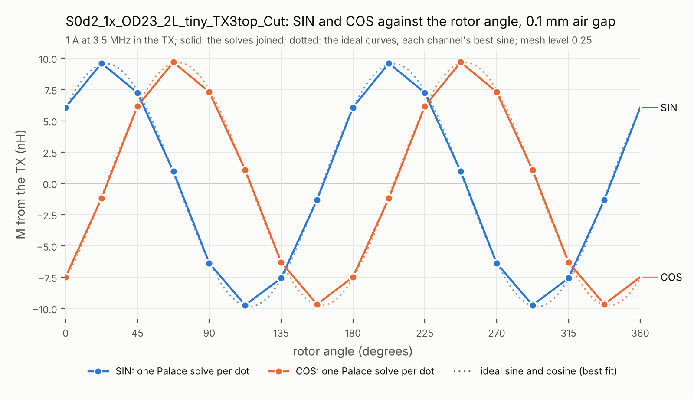

# 66. Palace Test Board Results

What Palace gave on each board of [Palace Test Boards](Palace-Test-Boards.md), against numbers known without any
solver where there are such numbers. Every chart here is drawn from Palace's own output by the examples' scripts;
nothing is drawn by hand. The numbers are in each example's results files on the `Palace_Integration` branch, with
the settings, the versions, the mesh's size, the time, the memory and the solver's iterations and residual of every
solve.

## 66.1 E01 Circular Loop

> [!NOTE]
> E01's solves (the mesh ladder at 10 kHz and 3.5 MHz) are being finished; this section is filled in from its
> results when they are on the branch.

## 66.2 E02 Coaxial Loops

> [!NOTE]
> E02's solves (M both ways and the TX's L, at 10 kHz and 3.5 MHz) are being finished; this section is filled in
> from its results when they are on the branch.

## 66.3 S0d2_1x_OD23_2L_tiny_TX3top_Cut

The coil board at five air gaps, 16 rotor angles each, and the rotor taken away once: 81 Palace solves at 3.5 MHz.

### In Short

The board is an angle sensor: as the rotor turns, the voltage the TX induces in SIN and in COS should follow a sine
and a cosine of twice the rotor's angle (two periods per turn), and the angle is read back from the two. The signal
is each receiver's mutual inductance M from the TX; with 1 A at 3.5 MHz in the TX, 1 nH of M is 22 mV of EMF.

| What | What it means | Palace |
|---|---|---|
| SIN's amplitude | how big the signal is | 9.71 nH at 0.1 mm, falling to 1.91 nH at 2 mm (213 to 42 mV) |
| SIN against COS | how well the two channels match | within 0.2 % in amplitude, 89.9° to 90.0° apart, at every gap |
| Angle error | how far the angle read from SIN and COS is from the true one, offset and gain calibrated out | 0.1° to 0.4° rms (electrical) from 0.5 to 2 mm, 0.9° rms at 0.1 mm |
| L TX | the TX's inductance | 281.0 nH with the rotor away; the rotor lowers it by 4.2 % at 2 mm and by about 22 % at 0.1 mm |
| The checks | L from the port against L from the field's energy; M from the TX against M back | within 0.005 % and 0.00026 % on every solve |

| Item | Value |
|---|---|
| Run | November 2026 (committed 18 November), Palace 0.19.0 (`0.19.0-dirty`), gmsh 4.15.2, KESE 3.4.0 |
| Solver | Palace's driven solve at 3.5 MHz, first-order Nédélec elements, GMRES with hypre's AMS to a residual of 1e-8, 4 MPI ranks |
| Mesh | level 0.25, the air graded four times as finely as the bridge's default and wedge layers up to 0.2 mm; 177,568 to 292,344 nodes, 12 to 21 element layers through the copper, board and gap |
| Air | a cylinder 35.1 mm in radius, reaching 35.1 mm above the rotor and below the stator, its outside a perfect conductor |

### Every Air Gap

| Air gap | Amplitude SIN / COS | Angle error (electrical) | Solves passing the checks | L TX over the turn | L TX below the rotor-away 281.0 nH |
|---|---|---|---|---|---|
| 2 mm | 1.91 / 1.92 nH (42 / 42 mV) | 0.1° rms, 0.2° peak | 16 of 16 | 269.0 to 269.2 nH | 4.2 to 4.3 % |
| 1.5 mm | 2.97 / 2.98 nH (65 / 65 mV) | 0.1° rms, 0.3° peak | 16 of 16 | 264.2 to 264.5 nH | 5.9 to 6.0 % |
| 1 mm | 4.65 / 4.66 nH (102 / 102 mV) | 0.2° rms, 0.4° peak | 16 of 16 | 256.2 to 256.7 nH | 8.6 to 8.8 % |
| 0.5 mm | 7.18 / 7.19 nH (158 / 158 mV) | 0.4° rms, 0.6° peak | 16 of 16 | 242.4 to 243.0 nH | 13.5 to 13.7 % |
| 0.1 mm | 9.71 / 9.71 nH (213 / 213 mV) | 0.9° rms, 1.2° peak | 16 of 16 | 219.3 to 220.1 nH | 21.7 to 22.0 % |

An electrical degree is half a mechanical one on this board. Going from 2 mm to 0.1 mm makes SIN 5.07 times and COS
5.06 times larger.

### At The 1 mm Air Gap

Best sine fit: SIN amplitude 4.652 nH, offset −0.101 nH, phase 42.5°; COS amplitude 4.657 nH, offset 0.017 nH,
phase −47.4°. With the rotor away SIN and COS read −0.100 and 0.029 nH, close to the fits' offsets: a small
direct coupling from the TX to each receiver that does not depend on the rotor.

| Rotor | M SIN (nH) | M COS (nH) | Angle error | L TX (nH) | R TX (mΩ) | Checks | Memory | Time |
|---|---|---|---|---|---|---|---|---|
| away | −0.1003 | 0.0288 | | 281.009 | 444.67 | L −0.004 % | 7.6 GB | 3 min |
| 0° | 3.0448 | −3.4023 | +0.11° | 256.246 | 468.44 | L −0.004 %, reciprocity 6.4e-05 % | 10.5 GB | 11 min |
| 22.5° | 4.5786 | −0.1960 | −0.14° | 256.470 | 468.05 | L −0.004 % | 7.6 GB | 3 min |
| 45° | 3.2994 | 3.1656 | +0.23° | 256.506 | 467.64 | L −0.004 % | 7.7 GB | 3 min |
| 67.5° | 0.1003 | 4.6948 | −0.01° | 256.569 | 467.34 | L −0.004 % | 7.6 GB | 3 min |
| 90° | −3.2432 | 3.4154 | +0.24° | 256.701 | 467.14 | L −0.004 % | 7.6 GB | 3 min |
| 112.5° | −4.7424 | 0.2310 | −0.18° | 256.599 | 466.97 | L −0.004 % | 7.5 GB | 3 min |
| 135° | −3.5191 | −3.1345 | +0.11° | 256.450 | 467.33 | L −0.004 % | 7.6 GB | 3 min |
| 157.5° | −0.3303 | −4.6390 | −0.36° | 256.377 | 467.57 | L −0.004 % | 8.0 GB | 4 min |

The other eight angles, 180° to 337.5°, repeat these to the fourth digit: a rotor of two sectors is the
same at θ and θ + 180°, and so is its mesh. Every gap's
full table is in `Results/SINCOS_Results.md` on the branch.

### At The 0.1 mm Air Gap

At 0.1 mm the angle error alternates in sign from one angle to the next (+0.68°, −0.86°, +0.90°, −0.64°, ...): a
ripple at four periods per electrical period, the fastest the 16 angles can show, which third or fifth harmonics of
the coupling would give. Those fade with the gap faster than the sine itself, and from 0.5 mm up the error is 0.4° rms
or less.

### Against The Expectation

The generator estimates the TX at 292 nH with the rotor away and 226 nH with it (its drop with the rotor is an upper
estimate), and 0.38 Ω DC. Palace gives 281.0 nH with the rotor away, 3.8 % under the estimate, and 219.3 to 269.2 nH
with the rotor from 0.1 to 2 mm. R TX at 3.5 MHz is 444.67 mΩ with the rotor away and rises to 515 to 519 mΩ at
0.1 mm, as the rotor's eddy currents add their loss. The generator gives no estimate of M.

### The Checks

| Check | Allowed | Worst on this board |
|---|---|---|
| The linear solve converged | | all 81, in 115 to 195 iterations, to a residual of 8e-9 to 1e-8 |
| L TX from its port against L from the field's energy | 1 % | 0.005 % |
| M from the TX against M back (the first angle of each gap, SIN and COS driven too) | 1 % | 0.00026 % |

The two checks show that Palace's solves reached a consistent answer on the mesh they had; how far that mesh is from
the true answer is on [Palace Accuracy](Palace-Accuracy.md).

| Previous | Next |
|:---|---:|
| [Palace Test Boards](Palace-Test-Boards.md) | [Palace Accuracy](Palace-Accuracy.md) |
