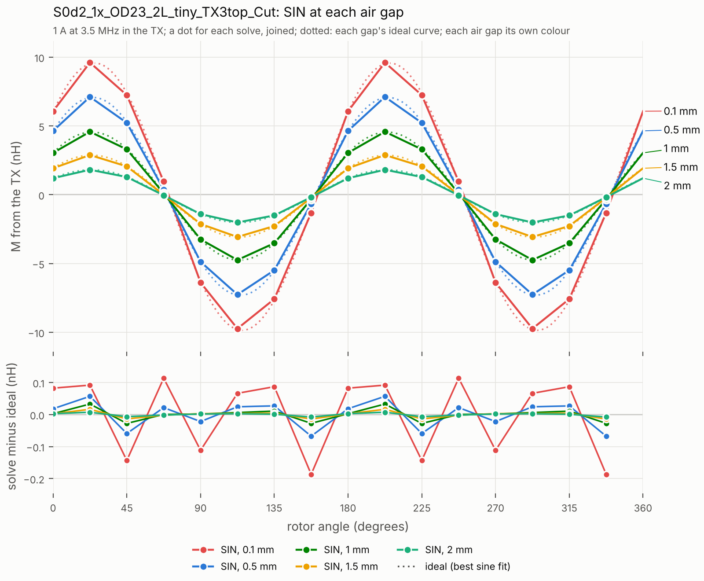
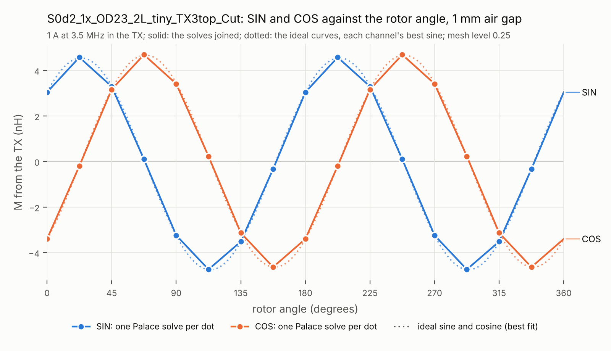

# 66. Palace Test Board Results

What Palace gave on each board of [Palace Test Boards](Palace-Test-Boards.md), against numbers known without any
solver where there are such numbers. Every chart here is drawn from Palace's own output by the examples' scripts;
nothing is drawn by hand. The numbers are in each example's results files on the `Palace_Integration` branch, with
the settings, the versions, the mesh's size, the time, the memory and the solver's iterations and residual of every
solve.

## 66.1 E01 Circular Loop

One circular trace, 10 mm in radius to its centre line, 0.5 mm wide and 35 µm thick, opened by a 0.2 mm gap where
the bridge puts its lumped port. Palace drives the port and reads the loop's impedance back.

### In Short

E01 is one copper loop on a board, the simplest coil there is, and its inductance L and resistance R have textbook
formulas. Palace's port sheet closes the loop across its gap, so its L should end above the open arc (55.590 nH)
and near the closed ring (56.622 nH):

| What | What it means | The formula | Palace |
|---|---|---|---|
| L at 10 kHz | the loop's inductance | open arc 55.590 nH, closed ring 56.622 nH | 55.857 nH with the coil board's air grading, +0.48 % on the open arc; 54.199 nH (−2.50 %) on the default ladder's finest level |
| R at 10 kHz | its resistance, the current spread evenly | 61.201 mΩ | 62.193 to 62.524 mΩ, 1.6 to 2.2 % above |
| R at 3.5 MHz | the current crowds to the copper's surface | no exact formula | 80.370 mΩ at level 1, 1.29 times its 10 kHz value |
| L, two ways | from the port and from the energy of the whole field | the two must agree | within 0.01 % at every level |

| Item | Value |
|---|---|
| Run | 18 November 2026, Palace 0.19.0, 4 MPI ranks (4 cores, 15 GB) |
| Solver | first-order Nédélec elements, GMRES with hypre's AMS, `AMSSingularOperator` below 100 kHz, at most 3,000 iterations at 10 kHz |
| Mesh | four levels, 18,677 to 68,808 nodes, and level 0.75 with the coil board's air (151,251 nodes) |
| Air | a cylinder 60 mm in radius, ±60 mm, its surface a perfect conductor |

### Expected Against What Came Out

| Mesh level | 0.25 | 0.5 | 0.75 | 1 | 0.75, the coil board's air |
|---|---|---|---|---|---|
| Nodes | 18,677 | 29,946 | 53,299 | 68,808 | 151,251 |
| L at 10 kHz (open arc 55.590 to 56.293 nH, closed ring 56.622 nH) | 51.946 nH (−6.55 %) | 53.184 nH (−4.33 %) | 53.993 nH (−2.87 %) | 54.199 nH (−2.50 %) | 55.857 nH (+0.48 %) |
| L from the energy at 10 kHz | 51.946 nH | 53.183 nH | 53.993 nH | 54.197 nH | 55.856 nH |
| R at 10 kHz (sector 61.201 mΩ) | 62.193 mΩ | 62.263 mΩ | 62.270 mΩ | 62.524 mΩ | 62.304 mΩ |
| L at 3.5 MHz | 50.670 nH | 52.038 nH | 53.013 nH | 53.295 nH | 54.878 nH |
| R at 3.5 MHz | 81.303 mΩ | 82.174 mΩ | 81.105 mΩ | 80.370 mΩ | 81.329 mΩ |
| R at 3.5 MHz over R at 10 kHz | 1.31 | 1.32 | 1.30 | 1.29 | 1.31 |

* **L is low and rises with the mesh**, as first-order edge elements driven at a port give it: 2.5 % under the open
  arc at level 1. The rise slows from 2.4 % (0.25 to 0.5) to 0.4 % (0.75 to 1), so refining the copper alone does not
  close the gap.
* **The air's mesh held the gap.** With the air graded as the coil board's is (`grade` 0.125, `tet_grade` 0.175,
  `dz_max` 0.2), L at level 0.75 moved by 3.5 %, nine times what refining the copper from level 0.75 to 1 did, to
  55.857 nH: 0.48 % above the open arc and 1.4 % under the closed ring.
* **R is 1.6 to 2.2 % above the sector's value.** The half-discs past the round ends' centres add a little, and the
  port's sheet meets each round end only along a line, where the current crowds.
* **At 3.5 MHz** L falls by 1.7 % and R rises by 29 % against 10 kHz at level 1, as the skin depth falls to the
  copper's thickness. In the graded run L at 3.5 MHz is 54.878 nH, 0.3 % under the thin strip's high-frequency
  estimate of 55.039 nH, which leaves out the copper's thickness and so is not a floor.
* **At 10 kHz GMRES stops at its 3,000 iteration limit in every run**, at a residual of 4e-8 to 4e-5. A check at
  100 kHz on level 0.5, where GMRES converged to 1e-8 in 79 iterations, gave L = 53.181 nH against 53.184 nH at
  10 kHz: the L read at the limit is right to 0.01 %.

## 66.2 E02 Coaxial Loops

E01's loop twice, the TX on F.Cu and the RX on B.Cu right under it, 1.565 mm apart. Both ports are driven in turn, so
Palace gives the whole impedance matrix: M from the TX to the RX, M back, and the TX beside the open RX.

### In Short

| What | What it means | The formula | Palace |
|---|---|---|---|
| M at low frequency | how much of the TX's field the RX catches | open arcs 23.886 nH, closed rings 24.400 nH | 24.166 nH with the coil board's air grading (at 100 kHz), +1.17 % on the open arcs; 23.355 nH (−2.22 %) on the default ladder's finest level |
| M back, RX to TX | reciprocity | the same M | within 0.03 % at every level, to the fourth decimal in the graded run |
| L TX beside the open RX | an open loop carries no current round it | E01's loop | 55.880 nH against E01's 55.857 nH (+0.04 %) with the graded air |
| M at 3.5 MHz | the current moves within each trace | close to the low-frequency M | 0.2 to 0.3 % under it at every mesh |

| Item | Value |
|---|---|
| Run | 18 November 2026, Palace 0.19.0, 4 MPI ranks (4 cores, 15 GB) |
| Mesh | four levels, 30,042 to 119,637 nodes, and level 0.75 with the coil board's air (303,129 nodes) |
| Low frequency | 10 kHz on the ladder; 100 kHz in the graded run (see below) |

### Expected Against What Came Out

| Mesh level | 0.25 | 0.5 | 0.75 | 1 | 0.75, the coil board's air |
|---|---|---|---|---|---|
| Nodes | 30,042 | 49,643 | 92,136 | 119,637 | 303,129 |
| M at 10 kHz (open arcs 23.886 nH, closed rings 24.400 nH) | 23.123 nH (−3.20 %) | 23.273 nH (−2.57 %) | 23.326 nH (−2.35 %) | 23.355 nH (−2.22 %) | 24.166 nH (+1.17 %) (100 kHz) |
| M back, RX to TX, at 10 kHz | 23.123 nH | 23.281 nH | 23.326 nH | 23.355 nH | 24.166 nH (100 kHz) |
| L TX at 10 kHz (E01's at the same level) | 52.597 nH (51.946) | 53.518 nH (53.184) | 54.187 nH (53.993) | 54.329 nH (54.199) | 55.880 nH (100 kHz) |
| R TX at 10 kHz | 62.193 mΩ | 62.263 mΩ | 62.269 mΩ | 62.523 mΩ | 62.344 mΩ (100 kHz) |
| M at 3.5 MHz | 23.047 nH (−3.51 %) | 23.203 nH (−2.86 %) | 23.266 nH (−2.60 %) | 23.299 nH (−2.46 %) | 24.104 nH (+0.91 %) |
| M back at 3.5 MHz | 23.047 nH | 23.203 nH | 23.266 nH | 23.299 nH | 24.104 nH |

* **M is low and settles with the mesh**, as E01's L does: 2.2 % under the open arcs at level 1, the rise slowing
  from 0.7 % (0.25 to 0.5) to 0.1 % (0.75 to 1).
* **Grading the air moved M by 3.6 %**, as it moved E01's L by 3.5 %, to 24.166 nH: 1.17 % above the open arcs and
  1.0 % under the closed rings, as it should be with the ports' sheets closing both loops.
* **The TX matches E01's loop once both have the graded air** (+0.04 %). On the default ladder it reads 0.2 to 1.3 %
  more, because E02's fine wedges run through the board to the RX, so the air under the TX is meshed finer than in
  E01. R at 10 kHz is E01's to 0.01 %.
* **At 3.5 MHz** M is 0.2 to 0.3 % under its low-frequency value and the TX's R is 1 to 3 % above E01's: eddy currents
  in the RX's copper take a little from the TX.
* **At 10 kHz GMRES stops at its 3,000 iteration limit** for both ports at every ladder level. On level 0.75's default
  mesh, where 100 kHz converged in 134 and 126 iterations, M is 23.3257 nH at 100 kHz against 23.3261 nH at 10 kHz
  (−0.002 %), and L TX 54.1847 against 54.1867 nH (−0.004 %): the numbers read at the limit are right.
* **The graded run is at 100 kHz and 3.5 MHz, not 10 kHz.** On its 303,129 node mesh GMRES had to restart every 100
  iterations (`--restart 100`) to fit in 15 GB, and at 10 kHz it did not converge: after 3,000 iterations the RX's
  solve had stalled at a residual of 0.65. At 100 kHz AMS needs no singular-operator flag and GMRES converged in 191
  and 183 iterations; the 100 kHz and 10 kHz Ms agree to 0.002 % on the default mesh.

## 66.3 S0d2_1x_OD23_2L_tiny_TX3top_Cut

The coil board at five air gaps, 16 rotor angles each, and the rotor taken away once: 81 Palace solves at 3.5 MHz.

### In Short

The board is an angle sensor: as the rotor turns, the voltage the TX induces in SIN and in COS should follow a sine
and a cosine of twice the rotor's angle (two periods per turn), and the angle is read back from the two. The signal
is each receiver's mutual inductance M from the TX; with 1 A at 3.5 MHz in the TX, 1 nH of M is 22 mV of EMF.

| What | What it means | Palace |
|---|---|---|
| SIN's amplitude | how big the signal is | 9.71 nH at 0.1 mm, falling to 1.91 nH at 2 mm (213 to 42 mV) |
| SIN against COS | how well the two channels match | within 0.2 % in amplitude, 89.9° to 90.0° apart, at every gap |
| Angle error | how far the angle read from SIN and COS is from the true one, offset and gain calibrated out | 0.1° to 0.4° rms (electrical) from 0.5 to 2 mm, 0.9° rms at 0.1 mm |
| L TX | the TX's inductance | 281.0 nH with the rotor away; the rotor lowers it by 4.2 % at 2 mm and by about 22 % at 0.1 mm |
| The checks | L from the port against L from the field's energy; M from the TX against M back | within 0.005 % and 0.00026 % on every solve |

| Item | Value |
|---|---|
| Run | November 2026 (committed 18 November), Palace 0.19.0 (`0.19.0-dirty`), gmsh 4.15.2, KESE 3.4.0 |
| Solver | Palace's driven solve at 3.5 MHz, first-order Nédélec elements, GMRES with hypre's AMS to a residual of 1e-8, 4 MPI ranks |
| Mesh | level 0.25, the air graded four times as finely as the bridge's default and wedge layers up to 0.2 mm; 177,568 to 292,344 nodes, 12 to 21 element layers through the copper, board and gap |
| Air | a cylinder 35.1 mm in radius, reaching 35.1 mm above the rotor and below the stator, its outside a perfect conductor |

### Every Air Gap

| Air gap | Amplitude SIN / COS | Angle error (electrical) | Solves passing the checks | L TX over the turn | L TX below the rotor-away 281.0 nH |
|---|---|---|---|---|---|
| 2 mm | 1.91 / 1.92 nH (42 / 42 mV) | 0.1° rms, 0.2° peak | 16 of 16 | 269.0 to 269.2 nH | 4.2 to 4.3 % |
| 1.5 mm | 2.97 / 2.98 nH (65 / 65 mV) | 0.1° rms, 0.3° peak | 16 of 16 | 264.2 to 264.5 nH | 5.9 to 6.0 % |
| 1 mm | 4.65 / 4.66 nH (102 / 102 mV) | 0.2° rms, 0.4° peak | 16 of 16 | 256.2 to 256.7 nH | 8.6 to 8.8 % |
| 0.5 mm | 7.18 / 7.19 nH (158 / 158 mV) | 0.4° rms, 0.6° peak | 16 of 16 | 242.4 to 243.0 nH | 13.5 to 13.7 % |
| 0.1 mm | 9.71 / 9.71 nH (213 / 213 mV) | 0.9° rms, 1.2° peak | 16 of 16 | 219.3 to 220.1 nH | 21.7 to 22.0 % |

An electrical degree is half a mechanical one on this board. Going from 2 mm to 0.1 mm makes SIN 5.07 times and COS
5.06 times larger.

### At The 1 mm Air Gap

Best sine fit: SIN amplitude 4.652 nH, offset −0.101 nH, phase 42.5°; COS amplitude 4.657 nH, offset 0.017 nH,
phase −47.4°. With the rotor away SIN and COS read −0.100 and 0.029 nH, close to the fits' offsets: a small
direct coupling from the TX to each receiver that does not depend on the rotor.

| Rotor | M SIN (nH) | M COS (nH) | Angle error | L TX (nH) | R TX (mΩ) | Checks | Memory | Time |
|---|---|---|---|---|---|---|---|---|
| away | −0.1003 | 0.0288 | | 281.009 | 444.67 | L −0.004 % | 7.6 GB | 3 min |
| 0° | 3.0448 | −3.4023 | +0.11° | 256.246 | 468.44 | L −0.004 %, reciprocity 6.4e-05 % | 10.5 GB | 11 min |
| 22.5° | 4.5786 | −0.1960 | −0.14° | 256.470 | 468.05 | L −0.004 % | 7.6 GB | 3 min |
| 45° | 3.2994 | 3.1656 | +0.23° | 256.506 | 467.64 | L −0.004 % | 7.7 GB | 3 min |
| 67.5° | 0.1003 | 4.6948 | −0.01° | 256.569 | 467.34 | L −0.004 % | 7.6 GB | 3 min |
| 90° | −3.2432 | 3.4154 | +0.24° | 256.701 | 467.14 | L −0.004 % | 7.6 GB | 3 min |
| 112.5° | −4.7424 | 0.2310 | −0.18° | 256.599 | 466.97 | L −0.004 % | 7.5 GB | 3 min |
| 135° | −3.5191 | −3.1345 | +0.11° | 256.450 | 467.33 | L −0.004 % | 7.6 GB | 3 min |
| 157.5° | −0.3303 | −4.6390 | −0.36° | 256.377 | 467.57 | L −0.004 % | 8.0 GB | 4 min |

The other eight angles, 180° to 337.5°, repeat these to the fourth digit: a rotor of two sectors is the
same at θ and θ + 180°, and so is its mesh. Every gap's
full table is in `Results/SINCOS_Results.md` on the branch.

### At The 0.1 mm Air Gap

At 0.1 mm the angle error alternates in sign from one angle to the next (+0.68°, −0.86°, +0.90°, −0.64°, ...): a
ripple at four periods per electrical period, the fastest the 16 angles can show, which third or fifth harmonics of
the coupling would give. Those fade with the gap faster than the sine itself, and from 0.5 mm up the error is 0.4° rms
or less.

### Against The Expectation

The generator estimates the TX at 292 nH with the rotor away and 226 nH with it (its drop with the rotor is an upper
estimate), and 0.38 Ω DC. Palace gives 281.0 nH with the rotor away, 3.8 % under the estimate, and 219.3 to 269.2 nH
with the rotor from 0.1 to 2 mm. R TX at 3.5 MHz is 444.67 mΩ with the rotor away and rises to 515 to 519 mΩ at
0.1 mm, as the rotor's eddy currents add their loss. The generator gives no estimate of M.

### The Checks

| Check | Allowed | Worst on this board |
|---|---|---|
| The linear solve converged | | all 81, in 115 to 195 iterations, to a residual of 8e-9 to 1e-8 |
| L TX from its port against L from the field's energy | 1 % | 0.005 % |
| M from the TX against M back (the first angle of each gap, SIN and COS driven too) | 1 % | 0.00026 % |

The two checks show that Palace's solves reached a consistent answer on the mesh they had; how far that mesh is from
the true answer is on [Palace Accuracy](Palace-Accuracy.md).

| Previous | Next |
|:---|---:|
| [Palace Test Boards](Palace-Test-Boards.md) | [Palace Accuracy](Palace-Accuracy.md) |
