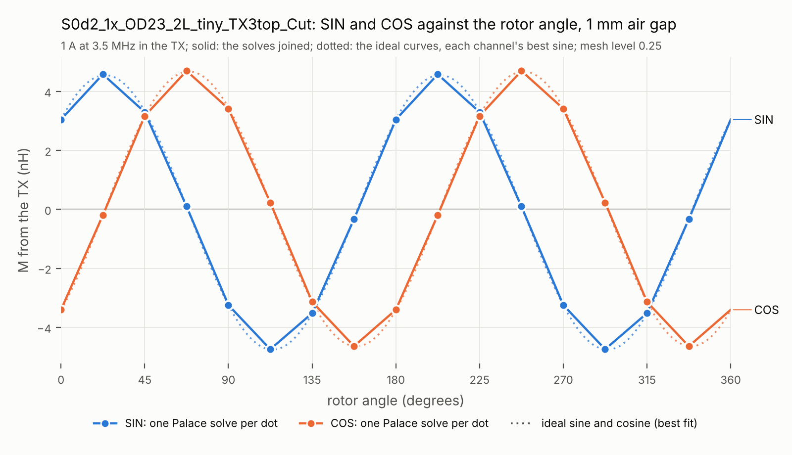

# 41. Palace Test Boards And Results

The three boards the Palace bridge is proved on, and what Palace gave on each: the proof boards in
`Examples/E01_circular_loop/` and `Examples/E02_coaxial_loops/`, and the coil board in
`Examples/Inductive Coils/S0d2_1x_OD23_2L_tiny_TX3top_Cut/` on the `Palace_Integration` branch, each with its results
files. The branch solves five more coil boards in the same way, in [`Examples/Inductive Coils/`](https://github.com/RolandThsive/KiCad-EM-Stackup-Exporter-KESE/tree/Palace_Integration/Examples/Inductive%20Coils).

## 41.1 E01 Circular Loop

One copper loop on F.Cu, 10 mm in radius to its centre line, 0.5 mm wide and 35 µm thick, opened by a 0.2 mm gap where
the bridge puts its lumped port.

| Top | Bottom |
|:---:|:---:|
|  |  |

| Mesh level | 0.25 | 0.5 | 0.75 | 1 | 0.75, the coil board's air |
|---|---|---|---|---|---|
| Nodes | 18,677 | 29,946 | 53,299 | 68,808 | 151,251 |
| L at 10 kHz (open arc 55.590 to 56.293 nH, closed ring 56.622 nH) | 51.946 nH (−6.55 %) | 53.184 nH (−4.33 %) | 53.993 nH (−2.87 %) | 54.199 nH (−2.50 %) | 55.857 nH (+0.48 %) |
| L from the energy at 10 kHz | 51.946 nH | 53.183 nH | 53.993 nH | 54.197 nH | 55.856 nH |
| R at 10 kHz (sector 61.201 mΩ) | 62.193 mΩ | 62.263 mΩ | 62.270 mΩ | 62.524 mΩ | 62.304 mΩ |
| L at 3.5 MHz | 50.670 nH | 52.038 nH | 53.013 nH | 53.295 nH | 54.878 nH |
| R at 3.5 MHz | 81.303 mΩ | 82.174 mΩ | 81.105 mΩ | 80.370 mΩ | 81.329 mΩ |
| R at 3.5 MHz over R at 10 kHz | 1.31 | 1.32 | 1.30 | 1.29 | 1.31 |

On the default mesh ladder L is low and rises as the mesh is refined, as first-order edge elements driven at a port
give it, ending 2.5 % under the open arc at level 1. Grading the air as the coil board's is moved L by 3.5 %, nine
times what refining the copper from level 0.75 to 1 did, to 55.857 nH: 0.48 % above the open arc and 1.4 % under the
closed ring, where a loop closed by its port sheet should lie. L from the port and from the field's energy agree within
0.01 % everywhere, and R sits 1.6 to 2.2 % above the annular sector, the half-discs past the round ends' centres adding
a little. At 10 kHz GMRES stops at its 3,000 iteration limit, but a converged check at 100 kHz gives the same L to
0.01 %.

## 41.2 E02 Coaxial Loops

E01's loop twice, the TX on F.Cu and the RX on B.Cu right under it, 1.565 mm apart, both ports driven in turn.

| Top | Bottom |
|:---:|:---:|
|  |  |

| Mesh level | 0.25 | 0.5 | 0.75 | 1 | 0.75, the coil board's air |
|---|---|---|---|---|---|
| Nodes | 30,042 | 49,643 | 92,136 | 119,637 | 303,129 |
| M at 10 kHz (open arcs 23.886 nH, closed rings 24.400 nH) | 23.123 nH (−3.20 %) | 23.273 nH (−2.57 %) | 23.326 nH (−2.35 %) | 23.355 nH (−2.22 %) | 24.166 nH (+1.17 %) (100 kHz) |
| M back, RX to TX, at 10 kHz | 23.123 nH | 23.281 nH | 23.326 nH | 23.355 nH | 24.166 nH (100 kHz) |
| L TX at 10 kHz (E01's at the same level) | 52.597 nH (51.946) | 53.518 nH (53.184) | 54.187 nH (53.993) | 54.329 nH (54.199) | 55.880 nH (100 kHz) |
| R TX at 10 kHz | 62.193 mΩ | 62.263 mΩ | 62.269 mΩ | 62.523 mΩ | 62.344 mΩ (100 kHz) |
| M at 3.5 MHz | 23.047 nH (−3.51 %) | 23.203 nH (−2.86 %) | 23.266 nH (−2.60 %) | 23.299 nH (−2.46 %) | 24.104 nH (+0.91 %) |
| M back at 3.5 MHz | 23.047 nH | 23.203 nH | 23.266 nH | 23.299 nH | 24.104 nH |

M is low on the default ladder and settles as the mesh is refined, 2.2 % under the open arcs at level 1, as E01's L
does. With the coil board's air grading M moves by 3.6 % to 24.166 nH, 1.17 % above the open arcs and 1.0 % under the
closed rings, and the TX's L matches E01's loop to 0.04 %. M from the TX to the RX and back agree within 0.03 % at
every level. The graded run's low frequency is 100 kHz, since at 10 kHz its restarted GMRES did not converge; on the
default mesh 100 kHz and 10 kHz agree to 0.002 %.

## 41.3 S0d2_1x_OD23_2L_tiny_TX3top_Cut

An inductive angle encoder from the
[Sinusoidal Coil Generator](https://github.com/RolandThsive/Sinusoidal-Inductive-Encoders-Coil-Generator): a stator
with a three-turn TX and two RX coils, SIN and COS, opened by 0.2 mm cuts, under a rotor of two copper sectors, solved
at 3.5 MHz at 16 angles and five air gaps (non-commercial licence, see that folder's `LICENSE.md`).

| Air gap | Amplitude SIN / COS | Angle error (electrical) | Solves passing the checks | L TX over the turn | L TX below the rotor-away 281.0 nH |
|---|---|---|---|---|---|
| 2 mm | 1.91 / 1.92 nH (42 / 42 mV) | 0.1° rms, 0.2° peak | 16 of 16 | 269.0 to 269.2 nH | 4.2 to 4.3 % |
| 1.5 mm | 2.97 / 2.98 nH (65 / 65 mV) | 0.1° rms, 0.3° peak | 16 of 16 | 264.2 to 264.5 nH | 5.9 to 6.0 % |
| 1 mm | 4.65 / 4.66 nH (102 / 102 mV) | 0.2° rms, 0.4° peak | 16 of 16 | 256.2 to 256.7 nH | 8.6 to 8.8 % |
| 0.5 mm | 7.18 / 7.19 nH (158 / 158 mV) | 0.4° rms, 0.6° peak | 16 of 16 | 242.4 to 243.0 nH | 13.5 to 13.7 % |
| 0.1 mm | 9.71 / 9.71 nH (213 / 213 mV) | 0.9° rms, 1.2° peak | 16 of 16 | 219.3 to 220.1 nH | 21.7 to 22.0 % |

All 81 solves converged and pass their checks, with L from the port and from the field's energy within 0.005 % and M
reciprocal within 0.00026 %. SIN and COS follow a sine and cosine of twice the rotor's angle, within 0.2 % of each
other in amplitude and 89.9° to 90.0° apart, and the signal grows 5.07 times from a 2 mm gap to 0.1 mm. The angle error
is 0.1° to 0.4° rms (electrical) from 0.5 to 2 mm and rises to 0.9° rms at 0.1 mm, where it alternates in sign from one
angle to the next, the ripple higher harmonics of the coupling give at a small gap. The TX's L is 281.0 nH with the
rotor away, 3.8 % under the generator's estimate of 292 nH, and the rotor lowers it by 4.2 % at 2 mm and by about 22 %
at 0.1 mm.

| Previous | Next |
|:---|---:|
| [Palace Simulating Your Own Board](Palace-Simulating-Your-Own-Board.md) | [Palace Accuracy](Palace-Accuracy.md) |
