> [!CAUTION]
> The bridge lives on the [`Palace_Integration`](https://github.com/RolandThsive/KiCad-EM-Stackup-Exporter-KESE/tree/Palace_Integration) branch.

# 39. Palace Walkthrough

[Palace](https://github.com/awslabs/palace) is an open-source finite element solver for electromagnetics from AWS
Labs, built on [MFEM](https://mfem.org) and [hypre](https://github.com/hypre-space/hypre) and released under the
Apache 2.0 licence. The **Palace bridge** turns a KiCad board into a Palace simulation: KESE exports the board's 3D
geometry, the bridge meshes it, writes Palace's input, runs Palace and reads the answer back. KESE itself stays what it is, a geometry exporter, and is never changed
by the bridge.

> [!NOTE]
> This category describes work in progress. The coil board `S0d2_1x_OD23_2L_tiny_TX3top_Cut` is solved at every air
> gap (81 solves, every one converged and passing its checks; see
> [Palace Test Boards And Results](Palace-Test-Boards-And-Results.md)), and the two proof boards E01 and E02 are solved on a
> mesh ladder and with the coil board's air grading: E01's L lands 0.48 % above the open-arc formula and E02's M
> 1.17 % above it, both under the closed rings, as they should.

## 39.1 What Palace Is Used For Here

Palace solves Maxwell's equations in full, in the frequency domain (its *driven* solve), for the electric field, with
Nédélec edge elements: the copper is a conducting region, the air round it is meshed out to a boundary, and each coil
is opened by a **lumped port**, a sheet across the place where it is opened with a resistance across it. At the
frequencies of inductive position sensors (3 to 5 MHz) a 23 mm board is about 1/2000 of a wavelength across, so the
fields are magneto-quasi-static, and the full-wave solve gives the same answer as an eddy-current one would.

| Quantity | How the bridge gets it |
|---|---|
| Impedance Z of a coil | V / I at its port: the port's voltage and the current the drive and the port's resistance give |
| Inductance L and AC resistance R of a coil, with skin and proximity effect | L = Im Z / ω and R = Re Z |
| Mutual inductance M from the driven coil to another | Im(Z[receiver][TX]) / ω, the receiver's port left open by 1 MΩ |
| The whole impedance matrix between the ports | every port driven in turn, Z = V I⁻¹ |
| The field energy, as a check on L | Palace's magnetic energy W gives L = 2W / \|I\|² |
| The effect of a conducting target (a rotor) | the same quantities with the rotor's copper present and away, at each angle and air gap |

The bridge reads no capacitance or self-resonance from Palace at present: each solve is one frequency, and the examples
read L, R and M only.

## 39.2 How It Fits Together

```mermaid
flowchart LR
    A[KiCad board<br>.kicad_pcb] -->|run_KESE.py --for elmer| B[STL per solid<br>+ materials.json]
    B -->|bridge/geometry.py| C[parts in model<br>coordinates]
    C -->|bridge/mesh25d.py| D[2.5D mesh<br>wedges + tetrahedra]
    D -->|bridge/ports.py| E[lumped port sheets<br>where each coil is opened]
    E -->|bridge/palace_case.py| F[config.json<br>+ Gmsh mesh]
    F -->|palace -np N| G[port-V.csv<br>domain-E.csv]
    G -->|bridge/palace_case.py| H[Z, R, L, M<br>results json]
```



Each step is described from [39.11](#3911-export-the-board-with-kese) on.

## 39.3 The Pages Of This Category

| Page | What it covers |
|---|---|
| Palace Walkthrough (this page) | What Palace does here, installing it ([39.5](#395-the-committed-build) on), and every step from the board file to the numbers ([39.11](#3911-export-the-board-with-kese) on) |
| [Palace Simulating Your Own Board](Palace-Simulating-Your-Own-Board.md) | Every setting of the examples' `simulation.py`, and how to set up a new coil board |
| [Palace Test Boards And Results](Palace-Test-Boards-And-Results.md) | The boards the bridge is proved on, and what came out on each |
| [Palace Accuracy](Palace-Accuracy.md) | Where the errors come from and how big they are |
| [Palace Troubleshooting](Palace-Troubleshooting.md) | What went wrong while building the bridge, and the fixes |

How Palace compares with the project's other solvers is on [Solvers Comparison](Solvers-Comparison.md).

## 39.4 Where The Code Is

| Folder on `Palace_Integration` | What it holds |
|---|---|
| `bridge/` | The bridge, in Python, general to any board: `geometry.py`, `mesh25d.py`, `ports.py`, `palace_case.py`, `study.py`, and `setup_machine.sh` |
| `Solver_Palace/` | The Palace 0.19.0 build every simulation ran with (`install/`), the script and patch that build it from source, and the licences of Palace and of every library built into it |
| `Examples/E01_circular_loop/`, `Examples/E02_coaxial_loops/` | The proof boards, each with its board, `make_board.py`, `simulation.py` and its KESE export in `3D_Geometry/` |
| `Examples/Inductive Coils/` | Inductive encoder boards from the Sinusoidal Coil Generator, one folder each (non-commercial licence, see that folder's `LICENSE.md`), with `new_coil.py`, which sets up a new one |
| `Examples/kicad_writer.py`, `Examples/references.py` | Shared by the proof boards: a small KiCad board writer, and the textbook values they are checked against |
| `3D_Geometry/` | Empty on purpose: KESE's `Generator/` is copied here from `main`, or `KESE_PATH` points at it, only to export a board whose export is not committed |

## 39.5 The Committed Build

The bridge needs three things: Palace, a Python environment with the bridge's packages, and, only to export a board
whose export is not committed, a copy of KESE. Unlike the other solvers' branches, `Palace_Integration` carries Palace
itself: `Solver_Palace/install/` holds the build every simulation on the branch ran with, so a fresh copy of the branch
runs without building anything, and every machine solves with the same program.

| Item | Value |
|---|---|
| Program | Palace 0.19.0, AWS Labs' release (tag `v0.19.0`, commit `ca9a6a2`); it prints `v0.19.0-dirty` because a patch is applied to the release's source (see [39.8](#398-why-it-is-built-without-parmetis)) |
| Build | Palace's own CMake superbuild, which builds MFEM 4.10, hypre 3.2.0, libCEED 1.0.1, METIS 5.1.0, ARPACK-NG, GSLIB and the rest at the versions Palace 0.19.0 pins; GCC 13.3 and Open MPI 4.1.6 on Ubuntu 24.04, release build, double precision, no OpenMP and no GPU |
| Solvers in it | hypre's AMS (the auxiliary-space Maxwell preconditioner) under GMRES. No sparse direct solver |
| Files | `install/bin/palace` (the launcher script, which starts the program under `mpirun`), `install/bin/palace-x86_64.bin` (the program, 36.5 MB, statically linked but for the system libraries below) and `install/lib/libceed.so` |
| Runs on | 64-bit Linux with glibc 2.38 or newer (Ubuntu 24.04 and up), with Open MPI 4.1, OpenBLAS, gfortran's runtime and zlib from the system |
| Licence | Apache 2.0 for Palace; every library built into it is open source (BSD, MIT, Apache 2.0, MPL 2.0), with its licence text in `Solver_Palace/licenses/` |

The SHA-256 of each of the three files is listed in `Solver_Palace/README.md`. Check the program with:

```bash
Solver_Palace/install/bin/palace --version
```

The bridge finds Palace by itself: `$PALACE` if it is set, else `Solver_Palace/install/bin/palace`, else `palace` on
the `PATH` (`palace_exe` in `bridge/palace_case.py`).

## 39.6 Linux (Ubuntu 24.04)

One script sets up a fresh machine, from the branch's root:

```bash
bash bridge/setup_machine.sh
```

It installs the system libraries the committed Palace runs with (`openmpi-bin`, `libopenmpi3t64`, `libopenblas0`,
`libgfortran5`, `zlib1g`), the libraries gmsh's wheel needs even without a display, makes `.venv` at the branch's root
with the packages of `requirements.txt`, and prints Palace's version and the Python packages'. Where the committed
Palace does not run, it builds Palace from source instead (below). It needs Python 3.12 or newer and is safe to run
again.

| Package (`requirements.txt`) | Version | Used by |
|---|---|---|
| numpy, scipy | 2.5.3, 1.18.1 | the bridge and the references |
| shapely, trimesh, mapbox_earcut | 2.2.0, 5.2.1, 2.1.0 | sectioning KESE's solids and the 2D outlines |
| gmsh | 4.15.2 | the triangle mesh and the tetrahedra |
| matplotlib, pillow | 3.11.2, 13.0.0 | the coil examples' charts and pictures |

**KESE** is needed only for a board whose `3D_Geometry/` export is not committed (every example's is). Copy main's
`Generator/` into `3D_Geometry/`, or set `KESE_PATH` to `run_KESE.py` or its folder. KESE's own packages
(`Generator/requirements.txt` on `main`) go into the same `.venv`.

## 39.7 Building Palace From Source

About an hour on four cores and 3 GB of disk while it builds:

```bash
sudo apt install git cmake build-essential gfortran openmpi-bin libopenmpi-dev libopenblas-dev zlib1g-dev \
                 pkg-config patchelf
bash Solver_Palace/build_palace.sh
```

The script clones Palace at `v0.19.0`, checks the commit, applies `no_parmetis.patch`, runs Palace's superbuild and
puts the program in `Solver_Palace/install/`, with its run path set so that it finds `libceed.so` beside it wherever the
folder is.

| Variable | What it does |
|---|---|
| `JOBS=8` | Parallel build jobs (default: every core) |
| `WORK=/data/palace` | Keeps the source and the build there (default: a temporary folder, removed afterwards) |
| `LOCAL_PATCHES=1` | Makes the patches the superbuild would download from github.com's commit and compare links with git from MFEM's and hypre's own repositories instead; the committed program was built this way, and the diffs are the same files, byte for byte |
| `WITH_MUMPS=1` | Adds MUMPS, ordered by METIS; not tried, since MUMPS's source comes from mumps-solver.org, which the test machine's network refused |

The script refuses to install a program in which any ParMETIS symbol is found.

## 39.8 Why It Is Built Without ParMETIS

Palace's release build links ParMETIS for the orderings of its direct solvers. ParMETIS is not open source: its
licence limits use to non-profit research and education and forbids redistribution without the University of
Minnesota's approval. A program with ParMETIS in it could not be committed or used freely, so `no_parmetis.patch`
makes it optional:

* ParMETIS is built and linked only with SuperLU_DIST or STRUMPACK, which are both left out;
* MUMPS, where it is built, is ordered by METIS alone (METIS is Apache 2.0 since 5.0.2);
* Palace's version report leaves ParMETIS out when it is not linked;
* MFEM is given hypre's BLAS and LAPACK (OpenBLAS) to link with, which a build with no direct solver otherwise lacks.

MFEM still partitions the mesh between the MPI ranks with METIS. The price is that the build has no direct solver,
so every solve is checked instead ([Palace Accuracy](Palace-Accuracy.md)).

## 39.9 Windows

The committed program and the build script are for 64-bit Linux, and every solve on the branch ran on Linux.
Windows has not been tried.

## 39.10 What The Test Machine Had

| Item | Version |
|---|---|
| OS | Ubuntu 24.04, 4 cores, 15 GB of memory |
| Palace | 0.19.0 (`0.19.0-dirty`), the committed build |
| KESE | 3.4.0 (made the exports) |
| Python | 3.13 |
| gmsh | 4.15.2 |
| numpy, scipy, shapely, trimesh, mapbox_earcut | 2.5.3, 1.18.1, 2.2.0, 5.2.1, 2.1.0 |

Every results file on the branch records the versions it ran with, so each number on
[Palace Test Boards And Results](Palace-Test-Boards-And-Results.md) names the software that made it.

## 39.11 Export The Board With KESE

What happens between `python simulation.py` and the numbers in the results file, step by step. Every step is one
function of the bridge on the `Palace_Integration` branch; the file is named with each. The bridge is general: nothing
in it names a board, a coil or an example. Each example adds only what belongs to its own board: which nets are coils,
where each coil is opened, what to sweep, and what to compare the answer with.

`bridge/geometry.py` runs KESE as a program, never as a library:

```bash
python run_KESE.py board.kicad_pcb --for elmer --format step stl --out <folder> \
    --set Stackup.solder_mask=True --set SolderMask.USE_STACKUP_MASK_THICKNESS=False \
    --set SolderMask.MASK_OVER_COPPER_MM=0.020 --set SolderMask.MASK_OVER_LAMINATE_MM=0.020 \
    --set SolderMask.VIA_TENTING=tented
```

KESE's solver preset writes one STL per solid and a `materials.json` with each part's role, net, layer and height
([Choosing An Export](Choosing-An-Export.md)); the bridge reads the STL files with `trimesh`. `bridge/study.py` keeps
the export in one of two ways, and either way an unchanged board is not exported twice:

| Call | Where the export goes |
|---|---|
| `kese_geometry(board, folder)` | a folder meant to be committed beside the board (the examples use `3D_Geometry/`), with a `source.json` holding the board file's hash, KESE's version and the settings |
| `kese_export(board, cache)` | a scratch cache named by the board file's hash |

Because every example's `3D_Geometry/` is committed, the examples run without KESE installed.

## 39.12 Place The Parts

`geometry.load_parts` turns each solid into a part in model coordinates: x and y as KESE's (y up, so
y_model = −y_KiCad), z shifted so that the top face of the top copper is z = 0. A part's body is its net for copper,
`MASK` or `FR4` otherwise, or whatever the example's `body_of` names it. A second board can be flipped copper side
down without mirroring its pattern, lifted by an air gap and turned about an axis the caller gives: that is how a rotor
is placed over a stator, at KiCad's point (100, 100).

## 39.13 Build The 2.5D Mesh

`bridge/mesh25d.py` builds a **2.5D mesh**, the shape a printed board has:

| Step | What happens |
|---|---|
| Slabs (`Layout.build`) | Every height at which some part starts or ends splits the model into slabs; each part is sectioned in the middle of each slab it spans. With `insulators=False` (every example) FR-4 and mask are left out: to these fields an insulator with μr 1 is air |
| Triangles (`build_mesh`) | One triangle mesh, made by gmsh, covers the domain's disc, with every copper edge of every slab drawn into it as a line, and any line the caller adds (`extra_lines`: port lines, cut outlines). Every point is snapped to a 0.5 µm grid, so a given line lands exactly on mesh edges. The size is `h_edge` at copper edges, growing by `grade` per mm away from them, at most `h_in` inside copper and `h_max` far away |
| Wedges | The triangle mesh is swept through the slabs as prisms: layers at most `dz_copper` thick in a copper foil, at most `dz_max` elsewhere, and two thin air layers (`pads`) above and below. Each wedge takes the body of the part of highest priority whose section holds its triangle; a `void` part (air of priority 4) takes copper out, which is how a cut or a left-out via barrel is made |
| Tetrahedra (`tet_fill`) | gmsh fills the air above and below the wedges out to the domain's top and bottom, growing by `tet_grade` per mm up to `tet_max`, then Netgen's optimiser removes slivers, which stall the iterative solve |

No 3D Booleans: the wedges follow the layers exactly, so 35 µm copper on a 0.8 mm board stays a few hundred thousand
nodes. `write_gmsh` writes the mesh in Gmsh's format 2.2, in millimetres, each body a physical volume and each boundary
a physical surface.

## 39.14 Open Each Coil At Its Port

A lumped port in Palace must be a rectangle with its two ends on conductors, its direction along one of its sides.
`bridge/ports.py` and `mesh25d.vertical_faces` build it from a straight line drawn into the triangle mesh: the port is
the stack of vertical mesh faces along that line between two heights.

| Coil opened at | Port | Direction |
|---|---|---|
| Two stacked trace ends on two layers (the TX of the coil boards) | a sheet standing across the board between the two copper faces, 0.16 mm wide | `+Z` |
| A gap between two round trace ends on one layer (E01, E02) | a sheet across the gap through the copper's thickness, from tip to tip (`ports.facing_vertices` finds the two facing outline vertices) | along the line, `+Y` |
| A 0.2 mm cut across a top trace (SIN and COS of `S0d2_1x_OD23_2L_tiny_TX3top_Cut`) | the copper inside the cut box made air, the box's outline drawn into the mesh, and a sheet across the cut through the copper's thickness, from one cut face to the other | along the trace |
| A layer-change via left out | the barrel made air, its two pads filled over the drill hole, and a sheet standing between the pads | `+Z` |

`ports.electrodes` checks that the coil's copper meets the opening in exactly two places, so that the coil is one
open conductor.

![How S0d2_1x_OD23_2L_tiny_TX3top_Cut is set up in Palace, drawn by rig_picture.py from the geometry the mesh is built from. Left, seen from above: the TX's three turns in dark grey on F.Cu round SIN in blue and COS in orange, the rotor's two copper sectors in grey 1 mm above, the SIN and COS ports ringed at their 0.2 mm cuts across a top trace and the TX port ringed at its two stacked ends at x = 111 mm. Top right, a section through the stack with heights stretched: the rotor copper 1 mm over the stator's top copper, FR-4 and mask drawn as air. Bottom right, the SIN port as a hatched sheet across the cut, through the 35 µm copper, along the trace, and the TX port as a hatched sheet standing between its two ends, direction +z, driven through 50 Ω at 3.5 MHz](https://raw.githubusercontent.com/RolandThsive/KiCad-EM-Stackup-Exporter-KESE/main/docs/images/Palace-Workflow/S0d2_1x_OD23_2L_tiny_TX3top_Cut/S0d2_1x_OD23_2L_tiny_TX3top_Cut_palace_setup.webp)

## 39.15 Write Palace's Input

`bridge/palace_case.py` (`config`) writes one `config.json` per solve:

| Section | What it holds |
|---|---|
| `Problem` | `Driven`: the frequency-domain solve |
| `Model` | the Gmsh mesh, with `L0 = 1e-3` (millimetres) |
| `Domains` | air everywhere (εr = μr = 1, FR-4 and mask included) and the copper with σ = 5.8e7 S/m |
| `Boundaries` | the outside as `PEC` (tangential E = 0), and one `LumpedPort` per coil: the driven one with 50 Ω and an excitation, the receivers with 1 MΩ, so they are open to a few parts in a million; or every port driven in turn, for the whole impedance matrix |
| `Solver` | Nédélec elements of order 1, one frequency point, and the linear solver: GMRES preconditioned by hypre's AMS |

The domain is a cylinder: 60 mm in radius and half height round E01 and E02, and three board radii (35.1 mm) round
`S0d2_1x_OD23_2L_tiny_TX3top_Cut`, reaching as far above the rotor and below the stator.

## 39.16 Solve And Read Back

`palace_case.run` runs `palace -np N config.json` on N MPI ranks, writing `palace.log` as it goes, and reads back
the CSV files Palace writes:

| Result | From |
|---|---|
| Each port's V | `port-V.csv`: the field's line integral across the sheet, along the port's direction |
| Each port's current I | (2 V_inc − V) / R at the driven port, with the source taken as 2 V_inc behind R; −V / R at an undriven one |
| Z | V I⁻¹ with every port driven, or the driven column Z[k][TX] = V_k / I_TX |
| R, L of a coil | Re Z, Im Z / ω (`coil_rows`) |
| M to a receiver, and M back | Im(Z[rx][TX]) / ω, and Im(Z[TX][rx]) / ω where the receiver was driven too |
| L from the field's energy | 2W / \|I\|², with W = ½ Re ∫ H*·B from `domain-E.csv` (`energy_check`) |
| Iterations, residual, converged, peak memory | Palace's log |

All of it, with the mesh's size, the run's time and the software versions, goes into the example's results file
(`results.json` for E01 and E02; `Results/<gap>_AirGap/results_gap<gap>mm.json` for the coil board, which also writes
a `.csv`, a chart and `SINCOS_Results.md`).

| Previous | Next |
|:---|---:|
| [FastHenry Troubleshooting](FastHenry-Troubleshooting.md) | [Palace Simulating Your Own Board](Palace-Simulating-Your-Own-Board.md) |
