# 43. PyPEEC Introduction

[PyPEEC](https://github.com/otvam/pypeec) is an open-source magneto-quasi-static solver by Thomas
Guillod (Dartmouth College, MPL-2.0) that uses the PEEC method (partial element equivalent circuits) on
voxels. The **PyPEEC bridge** turns a KiCad board into a PyPEEC simulation: KESE exports the board's
3D geometry, the bridge draws its copper onto PyPEEC's uniform voxel grid, writes PyPEEC's input, runs
it and reads the answer back. The bridge lives on the `PyPEEC_Integration` branch of the repository;
KESE itself stays what it is, a geometry exporter, and is never changed by the bridge.

> [!NOTE]
> This category uses three boards: the two proof boards E01 and E02, and one inductive encoder board,
> `S0d2_1x_OD23_2L_tiny_TX3top_Cut`. All three have run (see
> [PyPEEC Test Board Results](PyPEEC-Test-Board-Results.md)). The branch solves five more coil boards
> in the same way; they are listed in its
> [`Examples/Inductive Coils/README.md`](https://github.com/RolandThsive/KiCad-EM-Stackup-Exporter-KESE/blob/PyPEEC_Integration/Examples/Inductive%20Coils/README.md).

## 43.1 What PyPEEC Is Used For Here

At the frequencies of inductive position sensors (3 to 5 MHz) a coil board is about 1/2000 of a
wavelength across, so the physics is **magneto-quasi-static**: currents, magnetic fields and eddy
currents, with no wave propagation. PyPEEC solves exactly this. In the PEEC method only the copper
carries unknowns: the air needs no mesh and no outer boundary, since the field of every voxel reaches
every other, and the couplings between voxels are products with FFTs over the grid.

| Quantity | How the bridge gets it |
|---|---|
| Inductance L of a coil | Im(V / I) / ω of the coil, 1 A driven between its two terminals |
| AC resistance R of a coil | Re(V / I) |
| Mutual inductance M between two coils | the open-circuit voltage of an undriven coil (0 A) over the driving current: Im(V_RX / I_TX) / ω |
| L and R, a second way | from PyPEEC's stored magnetic energy (L = 4W / \|I\|²) and its losses (R = 2P / \|I\|²) |
| The effect of a conducting target (a rotor) | the same quantities with the rotor's eddy currents, at each rotor angle and air gap |

What PyPEEC does **not** give here: capacitance (PyPEEC has no charges on the surfaces), and so no
self-resonance; and no temperature or stress. Which solver of the project gives what is set out on
[Solvers Comparison](Solvers-Comparison.md).

## 43.2 How It Fits Together

```mermaid
flowchart LR
    A[KiCad board<br>.kicad_pcb] -->|bridge/geometry.py<br>run_KESE.py --for elmer| B[STL per solid<br>+ materials.json]
    B -->|bridge/layers.py| C[slabs and<br>sections]
    C -->|bridge/voxels.py| D[copper on one<br>uniform voxel grid]
    D -->|bridge/ports.py| E[two terminals<br>per coil]
    E -->|bridge/pypeec_case.py| F[PyPEEC mesher<br>and solver]
    F -->|bridge/study.py| G[L, R, M<br>results .json]
```

KESE's solver preset is named `elmer` in KESE: simulation-mode solids, one STL per solid, and a
`materials.json`. Each step is described on [PyPEEC Workflow](PyPEEC-Workflow.md).

## 43.3 The Pages Of This Category

| Page | What it covers |
|---|---|
| [PyPEEC Installation](PyPEEC-Installation.md) | Installing PyPEEC from the committed wheels, or from PyPI, on Linux and Windows |
| [PyPEEC Workflow](PyPEEC-Workflow.md) | Every step from the board file to the numbers |
| [PyPEEC Simulating Your Own Board](PyPEEC-Simulating-Your-Own-Board.md) | Every setting of the examples' `simulation.py`, and how to set up a new coil board |
| [PyPEEC Test Boards](PyPEEC-Test-Boards.md) | E01, E02 and S0d2_1x_OD23_2L_tiny_TX3top_Cut, and how each is opened for its terminals |
| [PyPEEC Test Board Results](PyPEEC-Test-Board-Results.md) | What came out, against the references, with charts |
| [PyPEEC Accuracy](PyPEEC-Accuracy.md) | Where the errors come from and how big they are |
| [PyPEEC Hardware](PyPEEC-Hardware.md) | Memory and time, measured, and how to estimate a board |
| [PyPEEC Troubleshooting](PyPEEC-Troubleshooting.md) | What went wrong while building the bridge, and the fixes |

## 43.4 Where The Code Is

| Folder on `PyPEEC_Integration` | What it holds |
|---|---|
| `bridge/` | The bridge, in Python, general to any board: `geometry.py`, `layers.py`, `voxels.py`, `ports.py`, `pypeec_case.py`, `study.py`, with `tolerance.yaml` (PyPEEC's own default tolerances) and `setup_machine.sh` |
| `Solver_PyPEEC/` | The PyPEEC build every simulation ran with: PyPEEC 5.8.0 and all 56 packages under it as committed wheels for 64-bit Linux and Python 3.13, with `install.sh` |
| `Examples/E01_circular_loop/`, `Examples/E02_coaxial_loops/` | The proof boards, each with its board, `make_board.py`, `simulation.py`, `README.md` and `results.md` |
| `Examples/Inductive Coils/S0d2_1x_OD23_2L_tiny_TX3top_Cut/` | The coil board of this category: `Boards/`, `3D_Geometry/`, `PyPEEC Simulation/`, `Results/` (non-commercial licence, see `Examples/Inductive Coils/LICENSE.md`) |
| `Examples/kicad_writer.py`, `Examples/references.py` | Shared by the proof boards: a small KiCad 7 board writer, and the textbook values they are checked against |
| `3D_Geometry/` | Empty on purpose: KESE's `Generator/` is copied here from `main`, or `KESE_PATH` points at it, only to export a board whose `3D_Geometry/` is not committed |

The branch's code is GPL-3.0, as KESE; PyPEEC itself is MPL-2.0, and every wheel in `Solver_PyPEEC/`
keeps its own licence.

| Previous | Next |
|:---|---:|
| [Elmer vs openEMS](Elmer-vs-OpenEMS.md) | [PyPEEC Installation](PyPEEC-Installation.md) |
