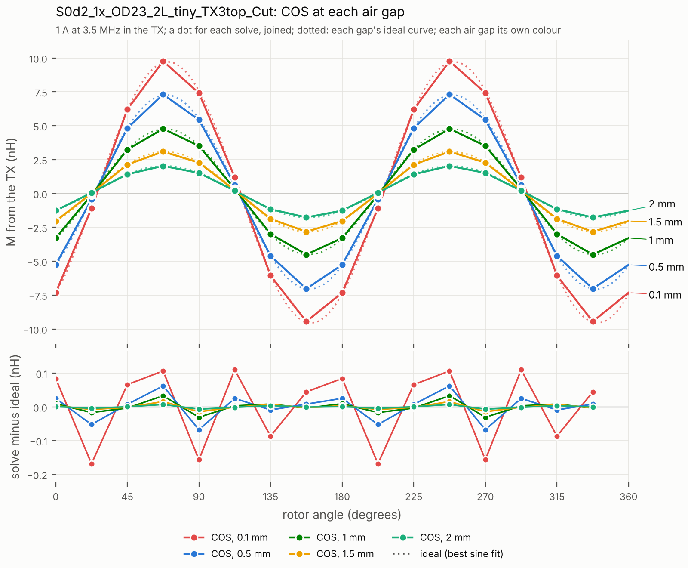
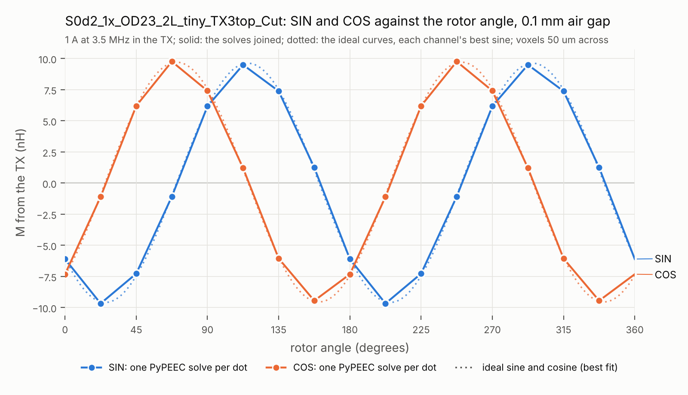

# 48. PyPEEC Test Board Results

What PyPEEC gave on each board of [PyPEEC Test Boards](PyPEEC-Test-Boards.md), against numbers known
without any solver, or against the coil generator's own estimates. Every number here is in the results
files on the `PyPEEC_Integration` branch, with the settings, the versions, the grid, the time, the
memory, the iterative solver's iterations and residual, and PyPEEC's own checks of every solve. Every
chart is drawn from PyPEEC's output by the board's `make_charts.py`; nothing is drawn by hand. How
PyPEEC's answers compare with the other solvers' is on [Solvers Comparison](Solvers-Comparison.md).

## 48.1 E01 Circular Loop

One circular trace, 10 mm in radius to its centre line, 0.5 mm wide and 35 µm thick, opened by a
0.2 mm gap where the bridge puts its two terminals. PyPEEC drives 1 A through it.

### In Short

E01 is one copper loop on a board, the simplest coil there is. Its inductance L (how much magnetic
field 1 A makes) and its resistance R have textbook formulas. PyPEEC drives 1 A through the loop and
reads both back:

| What | What it means | The formula | PyPEEC |
|---|---|---|---|
| L at 10 kHz | the loop's inductance | 55.99 to 56.44 nH (the open loop lies between the two) | 56.09 nH at 12.5 µm voxels, inside the band and settling towards its lower end |
| R at 10 kHz | its resistance, the current spread evenly through the copper | 61.20 mΩ | 62.30 mΩ, +1.8 %, the excess halving with each halving of the voxels |
| R at 3.5 MHz | the current crowds to the trace's edges, so R rises | no exact formula | 79.79 mΩ, 1.28 times the 10 kHz value |
| L and R, two ways | from the terminals' voltage, and from the stored energy and the losses | the two must agree | to the last digit, at every voxel size |

| Item | Value |
|---|---|
| Run | 17 November 2026, PyPEEC 5.8.0 (SciPy 1.18.1, NumPy 2.5.5), Python 3.13, KESE 3.4.0 |
| Solver | PyPEEC's defaults: GMRES with its own preconditioner, SciPy's FFT and SuperLU, 4 threads |
| Voxels | 100, 50, 25 and 12.5 µm in the plane, one layer of 35 µm through the copper |
| Air | none: PyPEEC needs no air and no outer boundary |

### Expected Against What Came Out

| Quantity | Reference | 100 µm | 50 µm | 25 µm | 12.5 µm |
|---|---|---|---|---|---|
| Grid (one voxel layer, 35 µm) | | 208 × 208 | 412 × 412 | 822 × 822 | 1642 × 1642 |
| Copper voxels | | 3,102 | 12,467 | 49,979 | 199,997 |
| L at 10 kHz | 55.99 to 56.44 nH | 57.00 nH (+1.8 %) | 56.59 nH (+1.1 %) | 56.24 nH (+0.44 %) | 56.09 nH (+0.18 %) |
| L from the stored energy at 10 kHz | the same | 57.00 nH | 56.59 nH | 56.24 nH | 56.09 nH |
| R at 10 kHz | 61.20 mΩ | 69.25 mΩ (+13 %) | 65.23 mΩ (+6.6 %) | 63.20 mΩ (+3.3 %) | 62.30 mΩ (+1.8 %) |
| R from the losses at 10 kHz | the same | 69.25 mΩ | 65.23 mΩ | 63.20 mΩ | 62.30 mΩ |
| L at 3.5 MHz | about 55.44 nH (an estimate) | 56.14 nH | 55.61 nH | 55.16 nH | 54.99 nH (−0.8 %) |
| R at 3.5 MHz | | 83.37 mΩ | 81.93 mΩ | 80.53 mΩ | 79.79 mΩ |
| R at 3.5 MHz over R at 10 kHz | | 1.20 | 1.26 | 1.27 | 1.28 |

The percentages of L are against 55.99 nH, the lower end of the reference's band. The reference L is
Grover's ring formula μ0 R (ln(8R / g) − 2), with the rectangle's geometric mean distance
g = 0.2235 (w + t), times the share of the circle the copper covers (0.989). That share stops the
current at the round ends' centres; taken on to the gap's faces it gives 56.44 nH, so the open loop's
L lies between the two. The reference R is the annular sector's DC resistance, θ / (σ t ln(r_out /
r_in)). At 3.5 MHz the skin depth (35 µm) equals the copper's thickness, and no formula is exact there:
Grover's formula with the thin strip's high-frequency GMD w / 4 gives 55.44 nH, an estimate.

* **L settles from above, into the reference's band.** A voxel is copper when its centre is in the
  trace, so the trace's round edges are drawn as steps, and its width is right only on average; the
  steps' error in L falls as the voxels shrink. The last step (−0.15 nH, half the one before) puts the
  limit at about 55.9 to 56.0 nH, the band's lower end.
* **The terminals and the stored energy agree** to the last digit, for L and for R, at every voxel
  size and both frequencies: the two terminals, PyPEEC's sources and the read-back give the inductance
  and the resistance that the field and the losses hold.
* **R converges at first order**: its excess over the annular sector is 8.05, 4.03, 2.00 and 1.10 mΩ.
  Taken to zero voxel size, the last two give 61.4 mΩ, 0.3 % over the sector, which is what the two
  half-discs past the sector's ends add.
* **At 3.5 MHz** L falls by 2 % and R rises by 28 % against 10 kHz at 12.5 µm: the current crowds to
  the trace's edges. With one voxel layer through the copper only the crowding across the width is
  drawn, and the finer the voxels across the trace, the more of it shows.

Every solve took one GMRES iteration (PyPEEC's preconditioner is all but exact for a single loop),
with a residual of 1e-10 at 10 kHz and below 1e-8 at 3.5 MHz, and passed PyPEEC's own checks.

## 48.2 E02 Coaxial Loops

E01's loop twice, TX on F.Cu and RX on B.Cu, 1.565 mm apart. TX carries 1 A, RX is open (0 A), so the
voltage across RX's gap gives M.

### In Short

E02 puts a second loop right under the first. A current in the top loop (TX) induces a voltage in the
bottom one (RX), and the ratio is their mutual inductance M: the same coupling that carries the coil
board's signal from the TX to SIN and COS.

| What | What it means | The formula | PyPEEC |
|---|---|---|---|
| M at 10 kHz | how strongly the two loops couple | 24.13 nH (Maxwell) | 24.09 nH at 50 µm, −0.17 %, and rising towards it as the voxels shrink |
| TX's L beside the open RX | an open loop carries no current, so it must leave L alone | E01's 56.59 nH at 50 µm | 56.60 nH (+0.01 %) |
| TX's R at 3.5 MHz | eddy currents in the RX trace take a little power from the TX | a little above E01's 81.93 mΩ | 82.56 mΩ (+0.8 %) |

### Expected Against What Came Out

| Quantity | Reference | 100 µm | 50 µm |
|---|---|---|---|
| Grid | | 208 × 208 × 46 | 412 × 412 × 46 |
| M at 10 kHz | 24.13 nH | 24.01 nH (−0.51 %) | 24.09 nH (−0.17 %) |
| M at 3.5 MHz | about 24.13 nH | 23.78 nH | 23.84 nH |
| TX's L at 10 kHz | E01's: 57.00 and 56.59 nH | 57.00 nH | 56.60 nH (+0.01 %) |
| TX's L from the stored energy at 10 kHz | the same | 57.00 nH | 56.60 nH |
| TX's R at 10 kHz | E01's: 69.25 and 65.23 mΩ | 69.25 mΩ | 65.23 mΩ |
| TX's L at 3.5 MHz | E01's: 56.14 and 55.61 nH | 56.09 nH (−0.08 %) | 55.55 nH (−0.09 %) |
| TX's R at 3.5 MHz | E01's: 83.37 and 81.93 mΩ | 83.88 mΩ (+0.6 %) | 82.56 mΩ (+0.8 %) |

The reference M is Maxwell's formula for two coaxial circular filaments,
μ0 √(ab) ((2/k − k) K(k) − (2/k) E(k)), averaged over 41 × 41 filaments across both traces' widths,
times the share of the circle the TX's copper covers (0.989).

* **M is 0.17 % under Maxwell's formula at 50 µm**, and the error went from 0.51 % to 0.17 % when the
  voxels halved, so the limit is at or a little over 24.13 nH. The reference carries the open loop's
  share of the circle, uncertain by up to 0.8 % as E01's L is, so this board cannot tell PyPEEC's M
  from it more finely than that.
* **The open RX leaves the TX alone at 10 kHz**: the TX's L and R are E01's at the same voxels to
  0.01 %.
* **At 3.5 MHz the RX takes a little from the TX**: the TX's L falls by 0.09 % and its R rises by
  0.8 % against E01's, and M by 1 % against 10 kHz. The RX carries no net current, but eddy currents
  circulate across its trace, driven by the TX's field: the proximity effect. Their loss shows in the
  TX's R and in the real part of the mutual impedance, 3.2 mΩ at 50 µm.

Every solve took one GMRES iteration, with a residual of 1e-10 at 10 kHz and below 1e-8 at 3.5 MHz,
and passed PyPEEC's own checks.

## 48.3 S0d2_1x_OD23_2L_tiny_TX3top_Cut

The encoder board: the TX carries 1 A at 3.5 MHz, SIN and COS are open at their cuts, and the rotor
turns over the stator. Every angle at every gap is one PyPEEC solve: 16 angles over the whole turn at
each of 5 gaps, and the rotor taken away once, 81 solves in all.

### In Short

An inductive encoder reads an angle from two signals, SIN and COS, that follow the sine and cosine of
the rotor's angle. The closer the rotor (the smaller the air gap), the bigger the signals. The angle
error says how far the angle read back from SIN and COS is from the true one.

| What | What it means | PyPEEC |
|---|---|---|
| The signal | the swing of M from the TX to SIN and COS | from 9.60 nH at 0.1 mm to 1.89 nH at 2 mm (211 to 42 mV of EMF) |
| SIN against COS | equal swings, a quarter period apart | within 0.4 % of each other in amplitude, 89.9° to 90.1° apart at every gap |
| The angle error | the angle read back less the true one | 0.2° rms from 1 to 2 mm, 0.4° at 0.5 mm, 0.9° at 0.1 mm (electrical degrees; half that in mechanical degrees) |
| L TX | the TX's inductance, which the rotor lowers | 296.4 nH with the rotor away; 284.2 nH at 2 mm down to 236.1 nH at 0.1 mm |
| The checks | L and R from the TX's voltage against L from the stored energy and R from the losses | within 0.001 % on all 81 solves, where 1 % is allowed |

| Item | Value |
|---|---|
| Run | 17 November 2026, PyPEEC 5.8.0, Python 3.13.18, on the committed export of KESE 3.4.0; the solves of each gap were shared over several machines and merged (`--merge`) |
| Voxels | 50 µm in the plane, one layer through each copper sheet (dz 26.9 to 38.2 µm, by gap) |
| Solver | PyPEEC's default tolerances, GMRES in 2 to 4 iterations, 4 threads |

### Results At Each Air Gap

| Air gap | Amplitude SIN / COS | Angle error (electrical) | Solves passing both checks | L TX over the turn |
|---|---|---|---|---|
| 2 mm | 1.89 / 1.90 nH (42 / 42 mV) | 0.2° rms, 0.3° peak | 16 of 16 | 284.1 to 284.3 nH |
| 1.5 mm | 2.94 / 2.95 nH (65 / 65 mV) | 0.2° rms, 0.4° peak | 16 of 16 | 280.1 to 280.4 nH |
| 1 mm | 4.61 / 4.63 nH (101 / 102 mV) | 0.2° rms, 0.4° peak | 16 of 16 | 271.5 to 272.0 nH |
| 0.5 mm | 7.14 / 7.16 nH (157 / 157 mV) | 0.4° rms, 0.7° peak | 16 of 16 | 257.1 to 257.7 nH |
| 0.1 mm | 9.60 / 9.62 nH (211 / 212 mV) | 0.9° rms, 1.3° peak | 16 of 16 | 235.7 to 236.6 nH |

At the default 1 mm gap, SIN swings ±4.61 nH and COS ±4.63 nH (±101 and ±102 mV of EMF), with offsets
of 0.012 and 0.122 nH. The curves repeat every 180°: two electrical periods per mechanical turn. The
second half turn repeats the first exactly, every solve from 180° on giving the same M, to the last
digit, as the one 180° before it, because the rotor's two sectors, turned by 180°, fall on the very
same voxels.

Going from 2 to 0.1 mm makes SIN 5.08 times and COS 5.07 times larger. The lower panels show each
solve less its ideal sine: what is left is the angle error's source.

### The Angle Error

Each channel gets its best sine over the rotor's period, M = offset + amplitude × sin(θ + phase); its
offset is taken out and it is divided by its amplitude, as a decoder chip's offset and gain calibration
does. The angle is read back as atan2(SIN, COS), and the error at each angle is that reading less the
true angle, less the average of all of them. `angle_error.py` does it.

The angle error is 0.9° rms at 0.1 mm, 0.4° at 0.5 mm and 0.2° from 1 to 2 mm, in electrical degrees;
with two periods per turn, a mechanical degree is two electrical ones, so in mechanical degrees it is
half that, from 0.45° down to 0.08° rms. At 0.1 mm it alternates in sign from one angle to the next: a
ripple at four periods per electrical period, the fastest that eight angles a period can show. It is
the fourth harmonic that sensors with two receiver coils typically show, which the third and fifth
harmonics of the sine and cosine both give (Kuntz, Gerlach and Fella,
[arXiv 2503.14627](https://arxiv.org/abs/2503.14627)), and those fade with the gap faster than the sine
itself.

### Against The Generator's Estimate

| | The generator | PyPEEC |
|---|---|---|
| L TX, rotor away | 292 nH | 296.4 nH (+1.5 %) |
| L TX, rotor over the stator | 226 nH (an upper estimate of the drop) | 284.2 nH at 2 mm, 271.8 nH at 1 mm, 236.1 nH at 0.1 mm (means over the turn) |
| R TX | 0.38 Ω at DC | 475 mΩ at 3.5 MHz with the rotor away, 486 to 544 mΩ with it, the closer the rotor the higher |

L TX moves by 0.9 nH at most over the turn. The rotor lowers it by 8.3 % at 1 mm and by 20 % at 0.1 mm;
the generator's 226 nH, 23 % under its own rotor-away value, is the larger drop it calls an upper
estimate. PyPEEC's R TX is read at least 5 % high at 50 µm voxels
([PyPEEC Accuracy](PyPEEC-Accuracy.md#493-the-coil-board)).

The full tables, every solve with its M, L, R, iterations, residual, checks, memory and time, are in
the board's
[`Results/SINCOS_Results.md`](https://github.com/RolandThsive/KiCad-EM-Stackup-Exporter-KESE/blob/PyPEEC_Integration/Examples/Inductive%20Coils/S0d2_1x_OD23_2L_tiny_TX3top_Cut/Results/SINCOS_Results.md).

| Previous | Next |
|:---|---:|
| [PyPEEC Test Boards](PyPEEC-Test-Boards.md) | [PyPEEC Accuracy](PyPEEC-Accuracy.md) |
