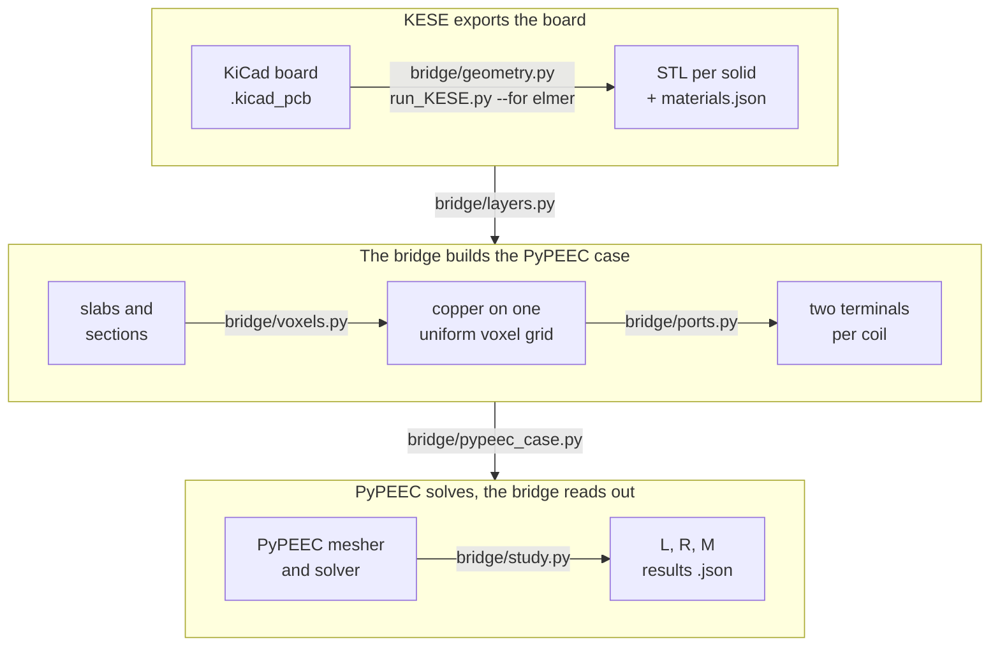

> [!CAUTION]
> The bridge lives on the [`PyPEEC_Integration`](https://github.com/RolandThsive/KiCad-EM-Stackup-Exporter-KESE/tree/PyPEEC_Integration) branch.

# 19.2 PyPEEC Walkthrough

[PyPEEC](https://github.com/otvam/pypeec) is an open-source magneto-quasi-static solver by Thomas
Guillod (Dartmouth College, MPL-2.0) that uses the PEEC method (partial element equivalent circuits) on
voxels. The **PyPEEC bridge** turns a KiCad board into a PyPEEC simulation: KESE exports the board's
3D geometry, the bridge draws its copper onto PyPEEC's uniform voxel grid, writes PyPEEC's input, runs
it and reads the answer back. KESE itself stays what it is, a geometry exporter, and is never changed by the bridge.

> [!NOTE]
> The PyPEEC pages use three boards: the two proof boards E01 and E02, and one inductive encoder board,
> `S0d2_1x_OD23_2L_tiny_TX3top_Cut`. All three have run (see
> [PyPEEC Test Boards And Results](PyPEEC-Test-Boards-And-Results.md)). The branch solves five more coil boards
> in the same way; they are listed in its
> [`Examples/Inductive Coils/README.md`](https://github.com/RolandThsive/KiCad-EM-Stackup-Exporter-KESE/blob/PyPEEC_Integration/Examples/Inductive%20Coils/README.md).

## 19.2.1 What PyPEEC Is Used For Here

At the frequencies of inductive position sensors (3 to 5 MHz) a coil board is about 1/2000 of a
wavelength across, so the physics is **magneto-quasi-static**: currents, magnetic fields and eddy
currents, with no wave propagation. PyPEEC solves exactly this. In the PEEC method only the copper
carries unknowns: the air needs no mesh and no outer boundary, since the field of every voxel reaches
every other, and the couplings between voxels are products with FFTs over the grid.

| Quantity | How the bridge gets it |
|---|---|
| Inductance L of a coil | Im(V / I) / ω of the coil, 1 A driven between its two terminals |
| AC resistance R of a coil | Re(V / I) |
| Mutual inductance M between two coils | the open-circuit voltage of an undriven coil (0 A) over the driving current: Im(V_RX / I_TX) / ω |
| L and R, a second way | from PyPEEC's stored magnetic energy (L = 4W / \|I\|²) and its losses (R = 2P / \|I\|²) |
| The effect of a conducting target (a rotor) | the same quantities with the rotor's eddy currents, at each rotor angle and air gap |

What PyPEEC does **not** give here: capacitance (PyPEEC has no charges on the surfaces), and so no
self-resonance; and no temperature or stress. Which solver of the project gives what is set out on
[Solvers Comparison](Solvers-Comparison.md).

## 19.2.2 How It Fits Together



KESE's solver preset is named `elmer` in KESE: simulation-mode solids, one STL per solid, and a
`materials.json`. Each step is described below, from [19.2.8](#1928-export-the-board-with-kese) on.

## 19.2.3 The PyPEEC Pages

| Page | What it covers |
|---|---|
| PyPEEC Walkthrough (this page) | What PyPEEC does here, installing it, and every step from the board file to the numbers |
| [PyPEEC Simulating Your Own Board](PyPEEC-Simulating-Your-Own-Board.md) | Every setting of the examples' `simulation.py`, how to set up a new coil board, and what a solve needs |
| [PyPEEC Test Boards And Results](PyPEEC-Test-Boards-And-Results.md) | E01, E02 and S0d2_1x_OD23_2L_tiny_TX3top_Cut, and what came out on each |
| [PyPEEC Accuracy](PyPEEC-Accuracy.md) | Where the errors come from and how big they are |
| [PyPEEC Troubleshooting](PyPEEC-Troubleshooting.md) | What went wrong while building the bridge, and the fixes |

## 19.2.4 Where The Code Is

| Folder on `PyPEEC_Integration` | What it holds |
|---|---|
| `bridge/` | The bridge, in Python, general to any board: `geometry.py`, `layers.py`, `voxels.py`, `ports.py`, `pypeec_case.py`, `study.py`, with `tolerance.yaml` (PyPEEC's own default tolerances) and `setup_machine.sh` |
| `Solver_PyPEEC/` | The PyPEEC build every simulation ran with: PyPEEC 5.8.0 and all 56 packages under it as committed wheels for 64-bit Linux and Python 3.13, with `install.sh` |
| `Examples/E01_circular_loop/`, `Examples/E02_coaxial_loops/` | The proof boards, each with its board, `make_board.py`, `simulation.py`, `README.md` and `results.md` |
| `Examples/Inductive Coils/S0d2_1x_OD23_2L_tiny_TX3top_Cut/` | The coil board of the PyPEEC pages: `Boards/`, `3D_Geometry/`, `PyPEEC Simulation/`, `Results/` (non-commercial licence, see `Examples/Inductive Coils/LICENSE.md`) |
| `Examples/kicad_writer.py`, `Examples/references.py` | Shared by the proof boards: a small KiCad 7 board writer, and the textbook values they are checked against |
| `3D_Geometry/` | Empty on purpose: KESE's `Generator/` is copied here from `main`, or `KESE_PATH` points at it, only to export a board whose `3D_Geometry/` is not committed |

The branch's code is GPL-3.0, as KESE; PyPEEC itself is MPL-2.0, and every wheel in `Solver_PyPEEC/`
keeps its own licence.

## 19.2.5 Installing On Linux (Ubuntu 24.04)

The bridge needs two things: a Python environment with PyPEEC and the bridge's packages, and, only to
export a board whose geometry is not committed, a copy of KESE. PyPEEC is pure Python, so nothing is
compiled for it, but it runs on numpy, scipy, VTK, Qt and others that are. The branch commits the very
build every simulation ran with, in `Solver_PyPEEC/`.

This is the route the test boards ran on, with Python 3.13 and PyPEEC 5.8.0.

**PyPEEC, from the committed wheels**, with no internet, from the branch's root:

```bash
bash Solver_PyPEEC/install.sh
.venv/bin/python -c "import pypeec; print(pypeec.__version__)"      # 5.8.0
```

`install.sh` makes `.venv` and installs every wheel of `Solver_PyPEEC/wheels/` into it at exactly the
versions of `requirements-lock.txt`. Two wheels are over GitHub's 100 MB limit (VTK and Qt WebEngine)
and are kept in two parts each, `.part0` and `.part1`; the script joins them, checks every wheel
against `SHA256SUMS`, and only then installs. `PYTHON=...` picks the Python 3.13 to use, `VENV=...`
where the environment goes.

| | |
|---|---|
| Package | `pypeec==5.8.0`, with `scisave==1.6.0` (its file formats) and everything under them: 56 packages, 514 MB of wheels |
| Wheels | from PyPI on 17 November 2026, unmodified: `manylinux` builds for x86_64, CPython 3.13 (or abi3 for 3.10 and up) |
| Needs | 64-bit Linux, Python 3.13, glibc 2.34 or newer (Ubuntu 22.04 and up) |
| Speed-ups | none: PyPEEC's defaults, SciPy's FFT and SuperLU. PyPEEC's optional FFTW, PARDISO and CuPy are not used, since MKL and CUDA are not free software |

**Or in one step:** `bash bridge/setup_machine.sh` does the same where it finds Python 3.13, and
otherwise installs the same versions from PyPI with the system's Python 3 (Ubuntu 24.04's is 3.12).
It installs `python3-venv` when the system lacks it and is safe to run again.

**KESE**, only for a board whose `3D_Geometry/` is not committed (E01 and E02 export their board on
the first run; the coil board's export is committed). Copy `main`'s `Generator/` so that
`run_KESE.py` sits directly in `3D_Geometry/`:

```bash
git -C <your KESE clone> archive main Generator | tar -x --strip-components=1 -C 3D_Geometry
.venv/bin/python 3D_Geometry/run_KESE.py --help
```

or point the bridge at any KESE with `KESE_PATH`. KESE runs in the bridge's Python, so its own
packages (`Generator/requirements.txt` on `main`) go into the same environment.

**Check the whole chain** with the first proof board at 50 µm voxels (with KESE in place, for its
export), written to its own results file so the committed `results.json` stays as it is:

```bash
cd Examples/E01_circular_loop
../../.venv/bin/python simulation.py --voxels 0.05 --results check.json
```

It should print L 56.59 nH and R 65.23 mΩ at 10 kHz, and L 55.61 nH and R 81.93 mΩ at 3.5 MHz, the
50 µm values of [PyPEEC Test Boards And Results](PyPEEC-Test-Boards-And-Results.md#2121-e01-circular-loop),
in about 3 and 8 seconds. To check without KESE, solve the coil board, whose export is committed:
`python simulation.py --angles 0 --no-away --trial check` in its `PyPEEC Simulation/` folder (about
4 minutes and 2.4 GB at the default 1 mm air gap; `--trial` keeps the results in `case/`, away from the
committed ones). It should give L TX 271.54 nH and M SIN −3.0957 nH.

## 19.2.6 Installing On Windows And macOS

The committed wheels are for 64-bit Linux only. PyPEEC itself runs on Linux, Windows and macOS, so
install the same versions from PyPI instead (Python 3.12 or 3.13: numpy 2.5 and scipy 1.18 need 3.12;
PyPEEC itself runs from 3.10):

| Route | Steps | Notes |
|---|---|---|
| **WSL 2 (recommended on Windows)** | Install Ubuntu 24.04 from the Microsoft Store, then follow [19.2.5](#1925-installing-on-linux-ubuntu-2404) inside it | The committed wheels then fit as on Linux. Keep the repository inside the WSL file system, not under `/mnt/c` |
| **Native** | `py -m venv .venv`, then `.venv\Scripts\pip install -r Solver_PyPEEC/requirements-lock.txt` (macOS: `.venv/bin/pip install ...`) | The same versions, from PyPI. Not yet run on the test boards |

`requirements.txt` at the branch's root lists only the packages the bridge asks for by name (PyPEEC,
scisave, numpy, scipy, shapely, trimesh, mapbox_earcut, and matplotlib and pillow for the charts);
`Solver_PyPEEC/requirements-lock.txt` lists every package of the environment, as `pip freeze` wrote
it.

## 19.2.7 What The Test Machine Had

| Item | Version |
|---|---|
| OS | Ubuntu 24.04, 4 cores, 15 GB of memory |
| Python | 3.13.18 |
| PyPEEC | 5.8.0, with scisave 1.6.0 |
| numpy, scipy, shapely, trimesh | 2.5.5, 1.18.1, 2.2.0, 5.2.1 |
| KESE | 3.4.0, which made every export |

Each example writes the versions it ran with into its results files, so every number on
[PyPEEC Test Boards And Results](PyPEEC-Test-Boards-And-Results.md) names the software that made it. Where the
machine that solved a coil board had no KESE, the results name the KESE that made the committed export
(`kese 3.4.0 (made the export; not installed where this ran)`).

## 19.2.8 Export The Board With KESE

What happens between `python simulation.py` and the numbers in the results files, step by step, in
this and the next six sections. Every step is one module of the bridge on the `PyPEEC_Integration` branch; the file is named with each. The
bridge is general: nothing in it names a board, a coil or an example. Each example adds only what
belongs to its own board: which nets are coils, where each coil is opened, what to sweep, and what to
compare the answer with.


`bridge/geometry.py` runs KESE as a program, never as a library, with its solver preset (named
`elmer` in KESE): simulation-mode solids, one STL per solid, a `materials.json` with each part's role,
net, layer and height, plus a STEP and KESE's report. `bridge/study.py` keeps the export in one of two
places:

| Function | Where the export goes | Used by |
|---|---|---|
| `kese_geometry` | a folder of its own, meant to be committed beside the board, with a `source.json` holding the board file's hash | the coil board (`3D_Geometry/Stator/`, `3D_Geometry/Rotor/`) |
| `kese_export` | a scratch cache under `case/`, named by that hash | E01 and E02 |

Either way an unchanged board is not exported twice, and a board with a committed export runs with no
KESE at all.

## 19.2.9 Place The Parts

`geometry.load_parts` turns each solid into a part in model coordinates: x and y as KiCad's with y up
(KiCad's (x, y) becomes (x, −y)), and z = 0 at the top face of the top copper. A board can be flipped
copper side down, moved up by an air gap and turned about an axis: that is how the rotor is placed over
the stator. On the coil board the axis is KiCad's (100, 100), and the air gap is measured from the
stator's F.Cu top face to the rotor's copper face, copper to copper.

## 19.2.10 Section The Parts Into Slabs

`layers.Layout` cuts the model into slabs at every height any part starts or ends, and sections each
part in the middle of each slab. FR-4 and solder mask are left out (`insulators=False`): to a
magneto-quasi-static solve an insulator with μr 1 is air, so they would add heights and nothing else.

## 19.2.11 Draw The Copper As Voxels

`voxels.build` draws every conductor onto one uniform grid:

| Direction | Voxel size | How it is chosen |
|---|---|---|
| In the board's plane | d (50 µm on the coil board; 100 to 12.5 µm on E01's ladder) | given by the example. A voxel is copper when its centre lies in the part's section, so a trace's edges are drawn as steps |
| Through the board | dz, close to the copper's 35 µm | each copper sheet is one voxel layer thick (or `n_cu`), centred on its own height, and dz is chosen so that the distance between any two sheets is a whole number of voxels to within a micron or so |

Each sheet's resistivity is scaled by its voxels' thickness over the copper's, so it keeps its sheet
resistance: on E02, 45 steps of 34.8 µm put the two sheets within 1 µm of where they are, and the
resistivity is scaled by 0.994. A via's barrel is drawn as a solid column of its outer diameter. The
voxel layers between the sheets that hold no copper add no unknowns, only grid to the FFTs; there is
no air box and no outer boundary.

![How S0d2_1x_OD23_2L_tiny_TX3top_Cut sits in PyPEEC, drawn from the voxels it is solved with. Left, seen from above: the stator's TX (three grey turns), SIN (blue) and COS (orange) on F.Cu and B.Cu, with the rotor's two quarter-ring copper sectors in grey at 0°, 1 mm above and copper face down, on a grid of 405 × 364 × 52, 7.7 million voxels of 50 µm; the SIN and COS ports are circled where a 0.2 mm cut crosses each top trace, the TX port where its two ends stack at the right. Top right, a section through the axis: one voxel layer of 34.5 µm through each copper sheet, the stator's FR-4 and mask drawn as air with no voxels, the rotor copper 1 mm above. Bottom right: SIN's cut voxel by voxel, terminal 1 (green, where the current goes in) and terminal 2 (purple, held at 0 V) on the two faces of the grey gap; and the TX port between its two stacked ends, terminal 1 on B.Cu and terminal 2 on F.Cu](https://raw.githubusercontent.com/RolandThsive/KiCad-EM-Stackup-Exporter-KESE/main/docs/images/PyPEEC-Workflow/S0d2_1x_OD23_2L_tiny_TX3top_Cut/S0d2_1x_OD23_2L_tiny_TX3top_Cut_pypeec_setup.webp)

The coil board as PyPEEC solves it, drawn by its `rig_picture.py` from the very voxels
`simulation.py` builds.

## 19.2.12 Open Each Coil At Its Port

A coil needs two terminals, so it must be **open**. `bridge/ports.py` opens it where the real board
gets its leads, and the caller says where: the bridge never guesses.

| Coil opened at | How (`ports.cut`, `ports.terminals`) | Used on |
|---|---|---|
| A gap between two trace ends on one layer | the gap is in the board already | E01's loop, E02's two loops (a 0.2 mm gap) |
| A cut across a trace | the coil's voxels inside a box (0.2 mm along the trace, 0.4 mm across) are taken out of the top copper | SIN and COS of the coil board |
| Two trace ends stacked on two layers | the gap is the board between them, inside a small disc round the ends (0.1 mm radius) | the coil board's TX |
| A via left out | the barrel is taken out; each pad is filled over its drill hole and its terminal is the one voxel on the via's axis | not used on the boards of the PyPEEC pages |

The two terminals are the coil's voxels that share a face with the gap, one group on each side,
grouped with their edge and corner neighbours so that there are exactly two.

On the coil board, SIN and COS are opened by a 0.2 mm cut across a top trace, because that is how the
real board is opened and routed to the IC. The cut is made in the model; the board files are as the
generator wrote them, and the receivers' layer-change vias all stay in.

![Where SIN and COS are opened on S0d2_1x_OD23_2L_tiny_TX3top_Cut. Left: the whole stator, TX in grey, SIN in blue and COS in orange, with the SIN cut and the COS cut circled near the inner edge of the receivers and the TX port at its stacked ends on the right, unchanged. Right, zoomed: SIN's cut at KiCad (96.59, 100.50) and COS's at (97.24, 97.94), each a white 0.2 mm box across the top trace, 0.86 mm from the via that stays, 0.46 mm clear of other copper; and the TX's two ends, F.Cu over B.Cu, at (111.00, 100.00)](https://raw.githubusercontent.com/RolandThsive/KiCad-EM-Stackup-Exporter-KESE/main/docs/images/PyPEEC-Test-Boards/S0d2_1x_OD23_2L_tiny_TX3top_Cut/S0d2_1x_OD23_2L_tiny_TX3top_Cut_cuts.webp)

*Each cut is the spot on the receiver's top trace nearest its layer-change via where a 0.2 mm cut has
at least 0.45 mm of free board round it and sits at least 0.75 mm from any via centre: 0.86 mm from the
via on both receivers. The two spots are 45° apart about the axis, a quarter of the electrical period,
as SIN and COS are.*

| Coil | Net | Opened at (KiCad mm) | How |
|---|---|---|---|
| TX | `TX` | (111, 100), F.Cu and B.Cu | between its two stacked ends; 1 A driven |
| SIN | `2` | cut at (96.591, 100.496), F.Cu | a 0.2 mm gap across the top trace, running (−0.60, −0.80); the via at (97.044, 101.225) stays; 0 A |
| COS | `1` | cut at (97.239, 97.940), F.Cu | a 0.2 mm gap across the top trace, running (0.14, −0.99); the via at (97.044, 98.775) stays; 0 A |

The voltage across each cut is the receiver's open-circuit EMF, reported as the mutual inductance
M = V / (jωI) with 1 A in the TX: 1 nH is 22 mV of EMF at 3.5 MHz.

## 19.2.13 Write PyPEEC's Case

`bridge/pypeec_case.py` writes PyPEEC's two inputs, the geometry (its voxel mesher, given the voxels'
indices directly) and the problem:

| Part | What it is |
|---|---|
| Each coil's copper | a domain of copper's resistivity (σ = 5.8 × 10⁷ S/m), scaled per sheet as above |
| A coil's first terminal | a current source: 1 A in the driven coil, 0 A in a receiver, whose voltage is then its open-circuit EMF |
| A coil's second terminal | a 0 V source |
| A conductor with no terminals (the rotor) | eddy currents only. PyPEEC needs a source on every piece of copper, so one voxel of each separate piece is held at 0 V; that is the piece's only connection, so no current flows in or out |
| PyPEEC's integrity checks | every coil in one piece, and no two conductors touching |
| Tolerances | `bridge/tolerance.yaml`, PyPEEC's own defaults, unchanged: GMRES with its own preconditioner, SciPy's FFT and SuperLU |

## 19.2.14 Solve And Read Back

`study.solve` runs PyPEEC's mesher and solver once per frequency, in a process of its own, so that
its peak memory is measured. Per coil it reads back:

| Result | From |
|---|---|
| V, I, Z = V / I | the sources' values: V across the two terminals, I into the first |
| R = Re Z, L = Im Z / ω | Z |
| M and the mutual resistance, for a coil with no current | Im(V_RX / I_TX) / ω and Re(V_RX / I_TX) |
| L from the stored energy, R from the losses | 4W / \|I\|² and 2P / \|I\|², with one coil driven: a check that does not go through the terminals |
| The solve itself | iterations, residual, PyPEEC's own checks (solver, condition, solution), peak memory, time |

All of it, with the grid, the settings and the software versions, goes into the example's results
file: `results.json` for E01 and E02, `Results/<gap>_AirGap/results_gap<gap>mm.json` (with a `.csv`
and a chart) for the coil board. A coil-board solve is read only when the TX's L and R from its voltage
agree with the L from the energy and the R from the losses within 1 %.

| Previous | Next |
|:---|---:|
| [Elmer FEM Walkthrough](Elmer-FEM-Walkthrough.md) | [FastHenry Walkthrough](FastHenry-Walkthrough.md) |
