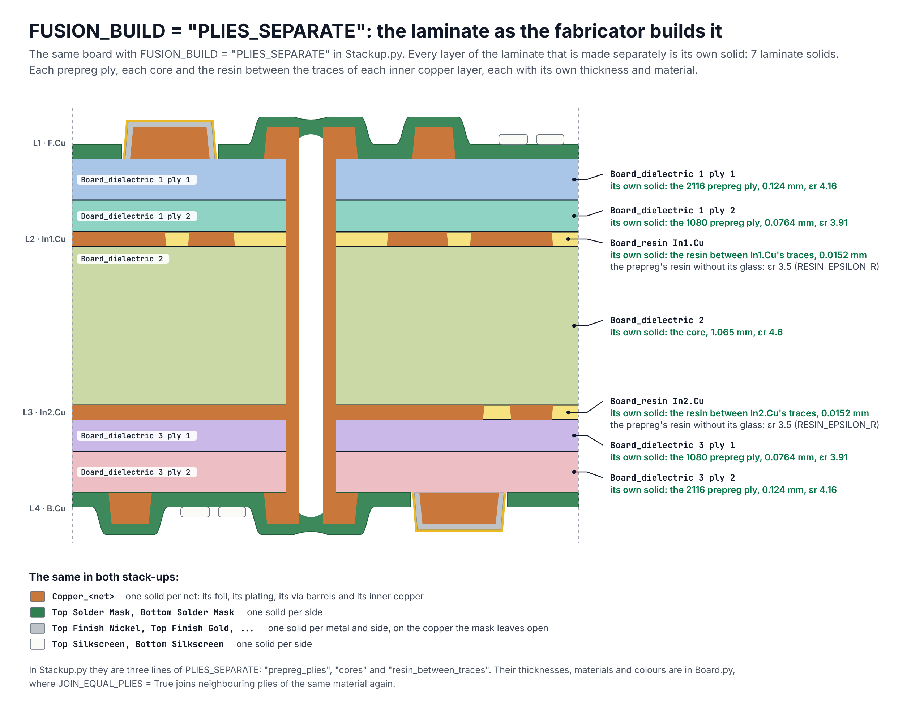

# 26. Real PCB Stackup

What a fabricated rigid board is made of, from the top legend to the bottom legend, for 2, 4, 6,
8, 10, 12 and 16 copper layers. Each board is drawn from a stack-up that a fabricator publishes,
and every layer that is made separately is drawn separately.

KiCad's stack-up lists only some of these layers, and KESE builds its solids from KiCad's
stack-up ([Stack-Up Model](Stack-Up-Model.md)). This page shows what stands behind those numbers;
[26.13](#2613-what-kese-builds-from-these-layers) says which of the layers a KESE model holds.

| Copper layers | Stack-up drawn | Section |
|---:|---|---|
| 2 | OSH Park, 2 Layer Prototype Service, 1.6 mm | [26.5](#265-two-layers) |
| 4 | JLCPCB, JLC04161H-2116C, 1.6 mm | [26.6](#266-four-layers) |
| 6 | JLCPCB, JLC06161H-3313, 1.6 mm | [26.7](#267-six-layers) |
| 8 | JLCPCB, JLC08161H-2116, 1.6 mm | [26.8](#268-eight-layers) |
| 10 | JLCPCB, JLC10161H-2116, 1.6 mm | [26.9](#269-ten-layers) |
| 12 | JLCPCB, JLC12161H-2313, 1.6 mm | [26.10](#2610-twelve-layers) |
| 16 | JLCPCB, JLC16161H-2313, 1.6 mm | [26.11](#2611-sixteen-layers) |

Each picture opens at full size when it is clicked.

## 26.1 What A Board Is Made Of

From the outside in. The thicknesses are typical values; a fabricator's own stack-up sheet gives
the real ones for a board.

| Layer | In KiCad | What it is | Thickness |
|---|---|---|---|
| **Legend ink** | `F.SilkS`, `B.SilkS` | Ink printed on top of the solder mask, by ink-jet or as a photo-imaged coat, then cured. | about 15 µm (10 to 20 µm) |
| **Solder mask** | `F.Mask`, `B.Mask` | One photo-imageable coat (LPI) per side. It follows the surface, is thinner over copper than on the laminate, and is opened at the pads. | 30 µm on the laminate and 15 µm on copper (JLCPCB); 15 µm (OSH Park) |
| **Gold** | the copper finish | Immersion gold, the top of the ENIG finish. Only on copper that the mask leaves open. | 0.05 to 0.1 µm |
| **Nickel** | the copper finish | Electroless nickel under the gold, on the top and the sides of the open copper. | 3 to 6 µm |
| **Plated copper** | part of `F.Cu`, `B.Cu` | Electroplated after drilling: one deposit that lines every hole (the via barrel) and covers the outer foil. | about 20 to 25 µm |
| **Seed** | not listed | A film that makes the drilled hole wall conductive, so that copper can be plated on it: carbon, or electroless copper. | nanometres (carbon), or a thin copper film |
| **Outer copper foil** | part of `F.Cu`, `B.Cu` | Copper foil pressed onto the prepreg, its rough treated side down, and etched together with the plating on it. On a two-layer board it is the laminate's own foil. | 12, 18 or 35 µm before plating |
| **Prepreg ply** | a dielectric sub-layer | A sheet of woven glass cloth carrying epoxy resin that is not yet cured. Its glass style sets its thickness and its share of resin, and with that its εr. | about 0.05 mm (106 glass) to 0.2 mm (7628 glass) |
| **Resin between traces** | not listed | Resin that flowed out of the prepreg in the press and filled the gaps in the inner copper. There is no glass in it. | as high as the inner copper |
| **Inner copper** | `In1.Cu`, `In2.Cu`, ... | The core's own copper foil, etched before pressing. It is not plated. Its open faces are treated so that the resin grips. | 15.2 µm (half-ounce foil, JLCPCB) or 30.5 µm (one ounce) |
| **Core** | a dielectric of type core | Glass cloths in resin, pressed and fully cured by the laminate maker, and sold with copper on both faces. | 0.075 to 1.5 mm in the boards below |
| **Hole** | the drill of a via or pad | Drilled through the pressed board, then plated. It stays open, is covered by the mask, or is filled. | 0.2 mm and up for a via |

The glass style of a ply is a number that names its cloth. The finer the cloth, the thinner the
ply and the more of it is resin; glass has an εr of about 6 and the resin of about 3, so a ply
with more resin has a lower εr. The same cloth also has another εr in another maker's resin:
JLCPCB's calculator assumes Nan Ya NP-155F laminate for four to eight layers and Shengyi S1000-2M
from ten layers up.

| Glass style | Cloth | Resin by weight (Kingboard KB-6167F) | As a ply in the boards below |
|---|---|---|---|
| 1080 | fine | 62 to 70 % | 0.0764 mm, εr 3.91 (NP-155F) |
| 2313, 3313 | medium-fine | 52 to 58 % (3313) | 3313: 0.0994 mm, εr 4.1 (NP-155F); 2313: 0.0964 mm, εr 4.31 (S1000-2M) |
| 2116 | medium | 50 to 58 % | 0.1088 to 0.124 mm, εr 4.16 (NP-155F); 0.1194 mm, εr 4.29 (S1000-2M) |
| 7628 | the heaviest common cloth | 42 to 50 % | Drawn in the cores; JLCPCB's default four-layer build has it as a ply of 0.2104 mm |

A ply is pressed thinner where it lies on inner copper, because part of its resin goes into the
gaps between the traces. In JLCPCB's tables a ply with one face on inner copper is 7.6 µm thinner
than the same ply with none, half of the copper's 15.2 µm: the 2116 ply is 0.124 mm between an
outer foil and another ply, and 0.1164 mm with one face on inner copper. For a ply between two
inner copper layers its tables give both: the six-layer build below is listed with its 2116 ply at
0.1088 mm, both faces taken off, and also at 0.1164 mm.

## 26.2 How A Board Is Put Together

A board of four layers or more:

1. **Cores.** Each core arrives cured, with copper on both faces, and the inner layers are etched
   from that copper: L2 and L3 of a four-layer board come from its one core.
2. **Lay-up.** Prepreg plies go between the cores, and on each outer face prepreg plies and a
   copper foil.
3. **Press.** Under heat and pressure the resin of the prepreg melts, fills the gaps between the
   inner traces, and cures.
4. **Drill.** The holes go through the whole pressed board.
5. **Plate.** A seed makes the hole walls conductive; then copper is electroplated in the holes
   and on the outer foil, in one go.
6. **Etch.** The outer copper is cut to shape. That makes L1 and the last layer.
7. **Coat.** The solder mask, then the finish on the copper the mask leaves open (nickel and gold
   for ENIG), and the legend ink.

A two-layer board has no cores to etch, no lay-up and no press at the fabricator: it starts as one
cured laminate of the board's thickness with copper foil on both faces, and goes on at step 4.

## 26.3 What Ends Up As One Piece

- **All the copper of one connection is one piece of metal.** The plating grows on the outer foil
  and on the hole wall, and joins the inner copper that the hole cuts through.
- **The resin of the prepreg melts together and cures as one mass.** Each ply still keeps its own
  glass cloth, so its mix of glass and resin and its εr stay its own.
- **Each core stays its own layer.** It was cured before the board was pressed; the prepreg bonds
  onto it, and it keeps its own glass and εr.
- **Nickel, gold, solder mask and legend ink are separate coats.** Different materials, put on one
  after the other, each only where it is wanted.

## 26.4 The Seven Boards Side By Side

All seven are sold as 1.6 mm boards. The last three columns are each material's share of the
thickness from copper to copper, taken where every layer has copper.

| Copper layers | Cores | Prepreg plies | Copper to copper | Copper share | Prepreg share | Core share |
|---:|---|---|---:|---:|---:|---:|
| 2 | 1 of 1.524 mm | none | 1.595 mm | 4.5 % | 0.0 % | 95.5 % |
| 4 | 1 of 1.065 mm | 4 (2116, 1080 glass) | 1.566 mm | 6.4 % | 25.6 % | 68.0 % |
| 6 | 2 of 0.55 mm | 3 (3313, 2116 glass) | 1.538 mm | 8.5 % | 20.0 % | 71.5 % |
| 8 | 3 of 0.3 mm | 6 (2116, 1080 glass) | 1.600 mm | 10.1 % | 33.7 % | 56.3 % |
| 10 | 4 of 0.2 mm | 5 (2116 glass) | 1.589 mm | 12.1 % | 37.6 % | 50.4 % |
| 12 | 5 of 0.15 mm | 6 (2313, 2116 glass) | 1.642 mm | 13.5 % | 40.8 % | 45.7 % |
| 16 | 7 of 0.075 mm | 8 (2313 glass) | 1.579 mm | 17.9 % | 48.8 % | 33.2 % |

With more layers the cores get thinner, and from six layers up less and less of the thickness is
core. The cores of the sixteen-layer board are thinner than its prepreg plies, and copper is 18 %
of its thickness.

## 26.5 Two Layers

The board of OSH Park's 2 Layer Prototype Service, sold as 1.6 mm (63 mil): one cured laminate of
1.524 mm (60 mil), Kingboard KB-6167F, with copper on both faces. OSH Park gives the copper as one
figure, 35.6 µm (1.4 mil); the picture shows it as the laminate's foil with the plating on it.
Kingboard lists its 1.6 mm laminate as eight 7628 glass cloths, as drawn.

| Layer | Made of | Thickness | εr |
|---|---|---:|---:|
| L1 · `F.Cu` | Copper: foil and plating | 0.0356 mm | |
| | Core | 1.524 mm | 4.5 at 10 MHz |
| L2 · `B.Cu` | Copper: foil and plating | 0.0356 mm | |

Copper to copper the board is 1.595 mm thick; with 15 µm of solder mask on the copper of
each side, 1.63 mm.

## 26.6 Four Layers

JLCPCB's JLC04161H-2116C, one of the builds it publishes for a 1.6 mm four-layer board: one core
of 1.065 mm, and on each side of it a 1080 ply against the inner copper and a 2116 ply under the
outer foil. The two plies of a side have different cloths, so each has its own εr: 4.16 for the
2116 ply and 3.91 for the 1080 ply. JLCPCB's default four-layer build is JLC04161H-7628, with one
7628 ply of 0.2104 mm on each side of the same core.

| Layer | Made of | Thickness | εr |
|---|---|---:|---:|
| L1 · `F.Cu` | Copper: foil and plating | 0.035 mm | |
| | Prepreg ply, 2116 glass | 0.124 mm | 4.16 |
| | Prepreg ply, 1080 glass | 0.0764 mm | 3.91 |
| L2 · `In1.Cu` | Copper: the core's foil | 0.0152 mm | |
| | Core | 1.065 mm | 4.6 |
| L3 · `In2.Cu` | Copper: the core's foil | 0.0152 mm | |
| | Prepreg ply, 1080 glass | 0.0764 mm | 3.91 |
| | Prepreg ply, 2116 glass | 0.124 mm | 4.16 |
| L4 · `B.Cu` | Copper: foil and plating | 0.035 mm | |

Copper to copper the board is 1.566 mm thick; with 15 µm of solder mask on the copper of
each side, 1.60 mm.

## 26.7 Six Layers

JLCPCB's JLC06161H-3313, its default build for a 1.6 mm six-layer board: two cores of 0.55 mm, one
2116 ply between them and one 3313 ply on each side. The 2116 ply lies between two inner copper
layers and gives resin to both. JLCPCB's page lists the build twice: as JLC06161H-3313 with that
ply at 0.1088 mm, as drawn, and as "No requirement" with it at 0.1164 mm.

| Layer | Made of | Thickness | εr |
|---|---|---:|---:|
| L1 · `F.Cu` | Copper: foil and plating | 0.035 mm | |
| | Prepreg ply, 3313 glass | 0.0994 mm | 4.1 |
| L2 · `In1.Cu` | Copper: the core's foil | 0.0152 mm | |
| | Core | 0.55 mm | 4.6 |
| L3 · `In2.Cu` | Copper: the core's foil | 0.0152 mm | |
| | Prepreg ply, 2116 glass | 0.1088 mm | 4.16 |
| L4 · `In3.Cu` | Copper: the core's foil | 0.0152 mm | |
| | Core | 0.55 mm | 4.6 |
| L5 · `In4.Cu` | Copper: the core's foil | 0.0152 mm | |
| | Prepreg ply, 3313 glass | 0.0994 mm | 4.1 |
| L6 · `B.Cu` | Copper: foil and plating | 0.035 mm | |

Copper to copper the board is 1.538 mm thick; with 15 µm of solder mask on the copper of
each side, 1.57 mm.

## 26.8 Eight Layers

JLCPCB's JLC08161H-2116, its default build for a 1.6 mm eight-layer board: three cores of 0.3 mm,
two 1080 plies between neighbouring cores, and one 2116 ply on each side.
[26.12](#2612-how-to-read-the-pictures) says where the numbers of this board and of the three
after it come from.

| Layer | Made of | Thickness | εr |
|---|---|---:|---:|
| L1 · `F.Cu` | Copper: foil and plating | 0.035 mm | |
| | Prepreg ply, 2116 glass | 0.1164 mm | 4.16 |
| L2 · `In1.Cu` | Copper: the core's foil | 0.0152 mm | |
| | Core | 0.3 mm | not listed |
| L3 · `In2.Cu` | Copper: the core's foil | 0.0152 mm | |
| | Prepreg ply, 1080 glass | 0.0764 mm | 3.91 |
| | Prepreg ply, 1080 glass | 0.0764 mm | 3.91 |
| L4 · `In3.Cu` | Copper: the core's foil | 0.0152 mm | |
| | Core | 0.3 mm | not listed |
| L5 · `In4.Cu` | Copper: the core's foil | 0.0152 mm | |
| | Prepreg ply, 1080 glass | 0.0764 mm | 3.91 |
| | Prepreg ply, 1080 glass | 0.0764 mm | 3.91 |
| L6 · `In5.Cu` | Copper: the core's foil | 0.0152 mm | |
| | Core | 0.3 mm | not listed |
| L7 · `In6.Cu` | Copper: the core's foil | 0.0152 mm | |
| | Prepreg ply, 2116 glass | 0.1164 mm | 4.16 |
| L8 · `B.Cu` | Copper: foil and plating | 0.035 mm | |

Copper to copper the board is 1.600 mm thick; with 15 µm of solder mask on the copper of
each side, 1.63 mm.

## 26.9 Ten Layers

JLCPCB's JLC10161H-2116, its default build for a 1.6 mm ten-layer board: four cores of 0.2 mm, one
2116 ply between neighbouring cores and one on each side. This is the first of the builds on
Shengyi S1000-2M: its 2116 ply has an εr of 4.29, where the 2116 ply of the eight-layer board has
4.16.

| Layer | Made of | Thickness | εr |
|---|---|---:|---:|
| L1 · `F.Cu` | Copper: foil and plating | 0.035 mm | |
| | Prepreg ply, 2116 glass | 0.1194 mm | 4.29 |
| L2 · `In1.Cu` | Copper: the core's foil | 0.0152 mm | |
| | Core | 0.2 mm | not listed |
| L3 · `In2.Cu` | Copper: the core's foil | 0.0152 mm | |
| | Prepreg ply, 2116 glass | 0.1194 mm | 4.29 |
| L4 · `In3.Cu` | Copper: the core's foil | 0.0152 mm | |
| | Core | 0.2 mm | not listed |
| L5 · `In4.Cu` | Copper: the core's foil | 0.0152 mm | |
| | Prepreg ply, 2116 glass | 0.1194 mm | 4.29 |
| L6 · `In5.Cu` | Copper: the core's foil | 0.0152 mm | |
| | Core | 0.2 mm | not listed |
| L7 · `In6.Cu` | Copper: the core's foil | 0.0152 mm | |
| | Prepreg ply, 2116 glass | 0.1194 mm | 4.29 |
| L8 · `In7.Cu` | Copper: the core's foil | 0.0152 mm | |
| | Core | 0.2 mm | not listed |
| L9 · `In8.Cu` | Copper: the core's foil | 0.0152 mm | |
| | Prepreg ply, 2116 glass | 0.1194 mm | 4.29 |
| L10 · `B.Cu` | Copper: foil and plating | 0.035 mm | |

Copper to copper the board is 1.589 mm thick; with 15 µm of solder mask on the copper of
each side, 1.62 mm.

## 26.10 Twelve Layers

JLCPCB's JLC12161H-2313, its default build for a 1.6 mm twelve-layer board: five cores of 0.15 mm,
one 2116 ply between neighbouring cores, and one 2313 ply on each side.

| Layer | Made of | Thickness | εr |
|---|---|---:|---:|
| L1 · `F.Cu` | Copper: foil and plating | 0.035 mm | |
| | Prepreg ply, 2313 glass | 0.0964 mm | 4.31 |
| L2 · `In1.Cu` | Copper: the core's foil | 0.0152 mm | |
| | Core | 0.15 mm | not listed |
| L3 · `In2.Cu` | Copper: the core's foil | 0.0152 mm | |
| | Prepreg ply, 2116 glass | 0.1194 mm | 4.29 |
| L4 · `In3.Cu` | Copper: the core's foil | 0.0152 mm | |
| | Core | 0.15 mm | not listed |
| L5 · `In4.Cu` | Copper: the core's foil | 0.0152 mm | |
| | Prepreg ply, 2116 glass | 0.1194 mm | 4.29 |
| L6 · `In5.Cu` | Copper: the core's foil | 0.0152 mm | |
| | Core | 0.15 mm | not listed |
| L7 · `In6.Cu` | Copper: the core's foil | 0.0152 mm | |
| | Prepreg ply, 2116 glass | 0.1194 mm | 4.29 |
| L8 · `In7.Cu` | Copper: the core's foil | 0.0152 mm | |
| | Core | 0.15 mm | not listed |
| L9 · `In8.Cu` | Copper: the core's foil | 0.0152 mm | |
| | Prepreg ply, 2116 glass | 0.1194 mm | 4.29 |
| L10 · `In9.Cu` | Copper: the core's foil | 0.0152 mm | |
| | Core | 0.15 mm | not listed |
| L11 · `In10.Cu` | Copper: the core's foil | 0.0152 mm | |
| | Prepreg ply, 2313 glass | 0.0964 mm | 4.31 |
| L12 · `B.Cu` | Copper: foil and plating | 0.035 mm | |

Copper to copper the board is 1.642 mm thick; with 15 µm of solder mask on the copper of
each side, 1.67 mm.

## 26.11 Sixteen Layers

JLCPCB's JLC16161H-2313, its default build for a 1.6 mm sixteen-layer board: seven cores of
0.075 mm, one 2313 ply between neighbouring cores and one on each side. Its default for a 2.0 mm
sixteen-layer board is the same build with cores of 0.13 mm.

| Layer | Made of | Thickness | εr |
|---|---|---:|---:|
| L1 · `F.Cu` | Copper: foil and plating | 0.035 mm | |
| | Prepreg ply, 2313 glass | 0.0964 mm | 4.31 |
| L2 · `In1.Cu` | Copper: the core's foil | 0.0152 mm | |
| | Core | 0.075 mm | not listed |
| L3 · `In2.Cu` | Copper: the core's foil | 0.0152 mm | |
| | Prepreg ply, 2313 glass | 0.0964 mm | 4.31 |
| L4 · `In3.Cu` | Copper: the core's foil | 0.0152 mm | |
| | Core | 0.075 mm | not listed |
| L5 · `In4.Cu` | Copper: the core's foil | 0.0152 mm | |
| | Prepreg ply, 2313 glass | 0.0964 mm | 4.31 |
| L6 · `In5.Cu` | Copper: the core's foil | 0.0152 mm | |
| | Core | 0.075 mm | not listed |
| L7 · `In6.Cu` | Copper: the core's foil | 0.0152 mm | |
| | Prepreg ply, 2313 glass | 0.0964 mm | 4.31 |
| L8 · `In7.Cu` | Copper: the core's foil | 0.0152 mm | |
| | Core | 0.075 mm | not listed |
| L9 · `In8.Cu` | Copper: the core's foil | 0.0152 mm | |
| | Prepreg ply, 2313 glass | 0.0964 mm | 4.31 |
| L10 · `In9.Cu` | Copper: the core's foil | 0.0152 mm | |
| | Core | 0.075 mm | not listed |
| L11 · `In10.Cu` | Copper: the core's foil | 0.0152 mm | |
| | Prepreg ply, 2313 glass | 0.0964 mm | 4.31 |
| L12 · `In11.Cu` | Copper: the core's foil | 0.0152 mm | |
| | Core | 0.075 mm | not listed |
| L13 · `In12.Cu` | Copper: the core's foil | 0.0152 mm | |
| | Prepreg ply, 2313 glass | 0.0964 mm | 4.31 |
| L14 · `In13.Cu` | Copper: the core's foil | 0.0152 mm | |
| | Core | 0.075 mm | not listed |
| L15 · `In14.Cu` | Copper: the core's foil | 0.0152 mm | |
| | Prepreg ply, 2313 glass | 0.0964 mm | 4.31 |
| L16 · `B.Cu` | Copper: foil and plating | 0.035 mm | |

Copper to copper the board is 1.579 mm thick; with 15 µm of solder mask on the copper of
each side, 1.61 mm.

## 26.12 How To Read The Pictures

- **Scale.** The big drawing has its thin layers thickened so that they can be seen. The narrow
  strip at its left is the same board to scale, cut where every layer has copper.
- **Typical values.** The nickel and the gold are as IPC-4552 gives them; the plating, the solder
  mask and the legend ink as JLCPCB, Eurocircuits and OSH Park publish them. The finish drawn is
  ENIG; with HASL, tin, silver or OSP that one coat takes the place of the nickel and the gold.
- **The cloths in a core.** A fabricator's sheet does not list them. They are drawn as Kingboard
  lists the make-up of its KB-6167F laminate of the nearest thickness.
- **The via.** It is drawn open, with the solder mask over its ends.
- **The 2, 4 and 6 layer boards** are as OSH Park's and JLCPCB's pages gave them in November 2026.
- **The 8, 10, 12 and 16 layer boards** are the builds JLCPCB's order page calls "No requirement".
  JLCPCB's page lists its builds for four and six layers only; the others are inside its impedance
  calculator, so they are taken from a public project,
  [jlcpcb_autogenerated_stackups](https://github.com/gsuberland/jlcpcb_autogenerated_stackups),
  which read the calculator on 9 May 2025. Three limits follow:
  - A fabricator changes its builds; the calculator may give other values today.
  - A ply between two inner copper layers is drawn with one face's 7.6 µm taken off, as that
    project has it. JLCPCB lists such a ply both ways ([26.7](#267-six-layers)), so the inner
    plies of the 10, 12 and 16 layer boards may be listed 7.6 µm thinner than drawn.
  - No εr is given for the cores. JLCPCB's page gives 4.6 for the cores of its four- and
    six-layer builds; for eight layers and more no table of JLCPCB's could be read.

## 26.13 What KESE Builds From These Layers

KESE builds the laminate one of two ways, chosen with `Stackup.FUSION_BUILD` in
`parameters/PCB_elements/Stackup.py`. The same file lists the layers of a board from the top
legend to the bottom legend, one line each, and a line set to `False` is left out of the model
([Stack-Up Model](Stack-Up-Model.md#84-what-is-built-the-lines-of-stackuppy)).

| Real layer | Plies fused (the default) | Plies separate | Line of `Stackup.py` |
|---|---|---|---|
| Legend ink | One part per side, off by default ([Silkscreens](Silkscreens.md)) | The same | `top_silkscreen`, `bottom_silkscreen` |
| Solder mask | One part per side that follows the copper, with one thickness on the laminate and one on copper; off by default ([Solder Masks](Solder-Masks.md)) | The same | `top_solder_mask`, `bottom_solder_mask` |
| Nickel, gold | One part per side and metal, on the copper the mask leaves open ([Finish](Finish.md)) | The same | `top_finish`, `bottom_finish`, `hole_finish` |
| Outer foil, plated copper, via barrels, inner copper | One solid per net by default; `materials.json` gives the foil and the plating of each layer ([Copper And Traces](Copper-And-Traces.md)) | The same | `top_copper`, `inner_copper`, `bottom_copper`, `plated_holes` |
| Seed | Not built | Not built | |
| The prepreg plies of one gap between two copper layers | One solid, with the first ply's material, εr and tanδ, or with the plies in series (`Board.FUSED_PROPERTIES`); `materials.json` lists the plies under it | One solid for each ply, with its own thickness, material, εr and tanδ | `board`; `prepreg_plies` |
| Resin between traces | Part of the dielectric solid beside it: the prepreg's, where one of the two is a prepreg | One solid for each inner copper layer, `Board_resin In1.Cu`, with the εr and tanδ of the resin without its glass | `resin_between_traces` |
| Core | One solid | One solid | `board`; `cores` |
| The glass cloth inside a ply or a core | Not built: each dielectric solid is one uniform material | Not built | |

The four-layer board of [26.6](#266-four-layers), built both ways:

That board is in the feature tests as `featureTest/29d_stackup_real`
([Feature Test Collection](Feature-Test-Collection.md)); [Board](Board.md#121-dielectric-solids)
describes the two builds in full.

## 26.14 Sources

Read in November 2026.

| Source | Used for |
|---|---|
| OSH Park, [2 Layer Prototype Service](https://docs.oshpark.com/services/two-layer/) | The two-layer stack-up; legend and solder mask of 0.6 mil |
| Kingboard, [KB-6167F datasheet](https://docs.oshpark.com/resources/two-layer-substrate-Kingboard-KB6167F.pdf) | The glass cloths of a laminate of each thickness; the resin content of each prepreg |
| JLCPCB, [Controlled Impedance PCB Layer Stackup](https://jlcpcb.com/impedance) | The four- and six-layer builds and which of them is the default; solder mask of 1.2 mil on the laminate and 0.6 mil on copper |
| JLCPCB, [User Guide to the JLCPCB Impedance Calculator](https://jlcpcb.com/help/article/User-Guide-to-the-JLCPCB-Impedance-Calculator) | Inner copper of 15.2 µm; NP-155F for four to eight layers and S1000-2M from ten; 3313 in place of 2313 |
| [jlcpcb_autogenerated_stackups](https://github.com/gsuberland/jlcpcb_autogenerated_stackups), normalised JSON (public domain), data of 9 May 2025 | The 8, 10, 12 and 16 layer builds |
| JLCPCB, [Choose Right Prepreg for Reliable Multilayer PCB](https://jlcpcb.com/blog/how-to-choose-prepreg-material) | The resin of the prepreg melts, flows around the copper and fills the gaps |
| JLCPCB, [Optimize PCB Plating Thickness](https://jlcpcb.com/blog/pcb-plating-thickness) | Hole wall copper of about 20 to 25 µm |
| JLCPCB, [High-Speed PCB Routing Guidelines](https://jlcpcb.com/blog/high-speed-pcb-routing-guidelines-techniques-examples) | Glass with an εr of about 6, resin of about 3 |
| NCAB Group, [PCB stackups: What designers need to know about prepregs](https://www.ncabgroup.com/blog/pcb-stackups-prepregs/) | A prepreg is pressed thinner where its resin fills the etched copper |
| Eurocircuits, [Making a PCB, step by step](https://www.eurocircuits.com/technical-guidelines/pcb-manufacturing-technology/making-a-pcb-pcb-manufacture-step-by-step/) | The order of the steps; the carbon film on the hole walls; about 20 µm of plating; nickel and gold |
| IPC-4552 with Amendments 1 and 2, [table of contents and scope](https://www.electronics.org/TOC/IPC-4552wAm-1-2.pdf) | Nickel of 3 to 6 µm; gold of 0.05 µm at the least |

| Previous | Next |
|:---|---:|
| [Future Upgrades And Planning](Future-Upgrades-And-Planning.md) | [License](License.md) |
