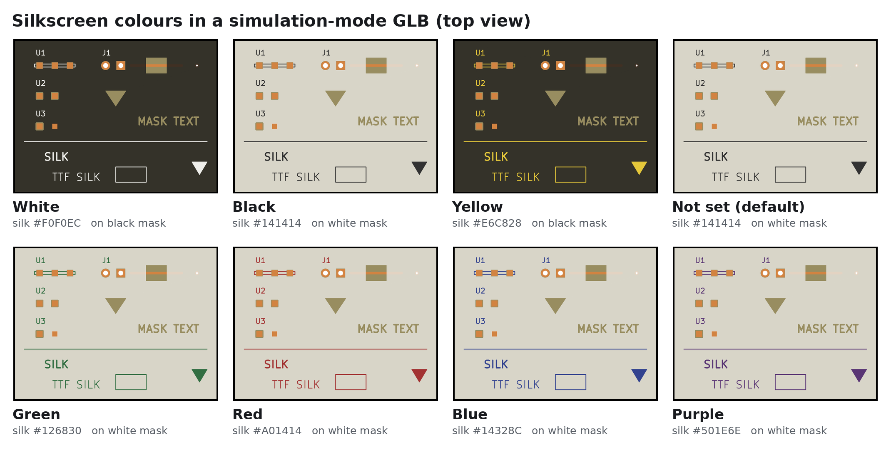
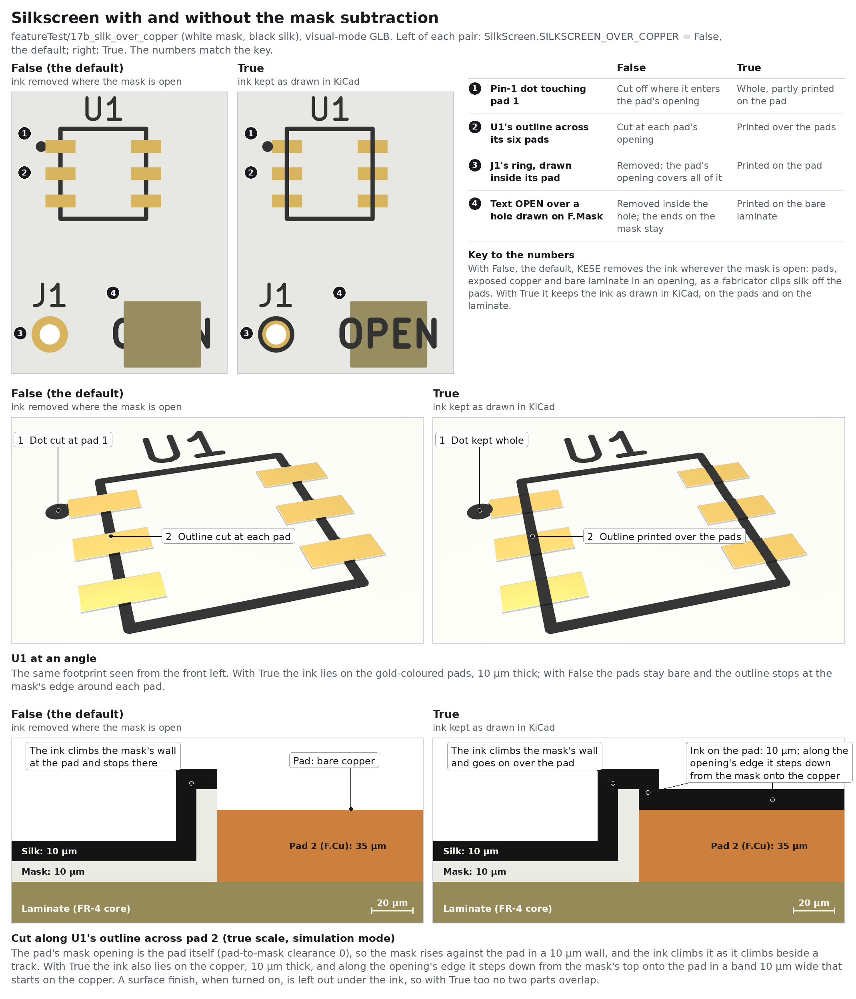
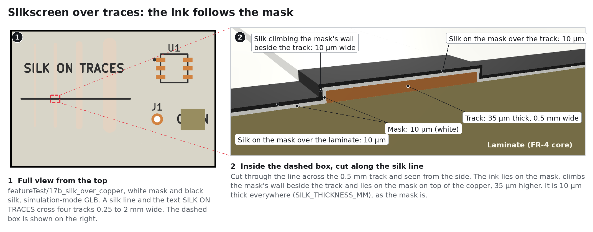
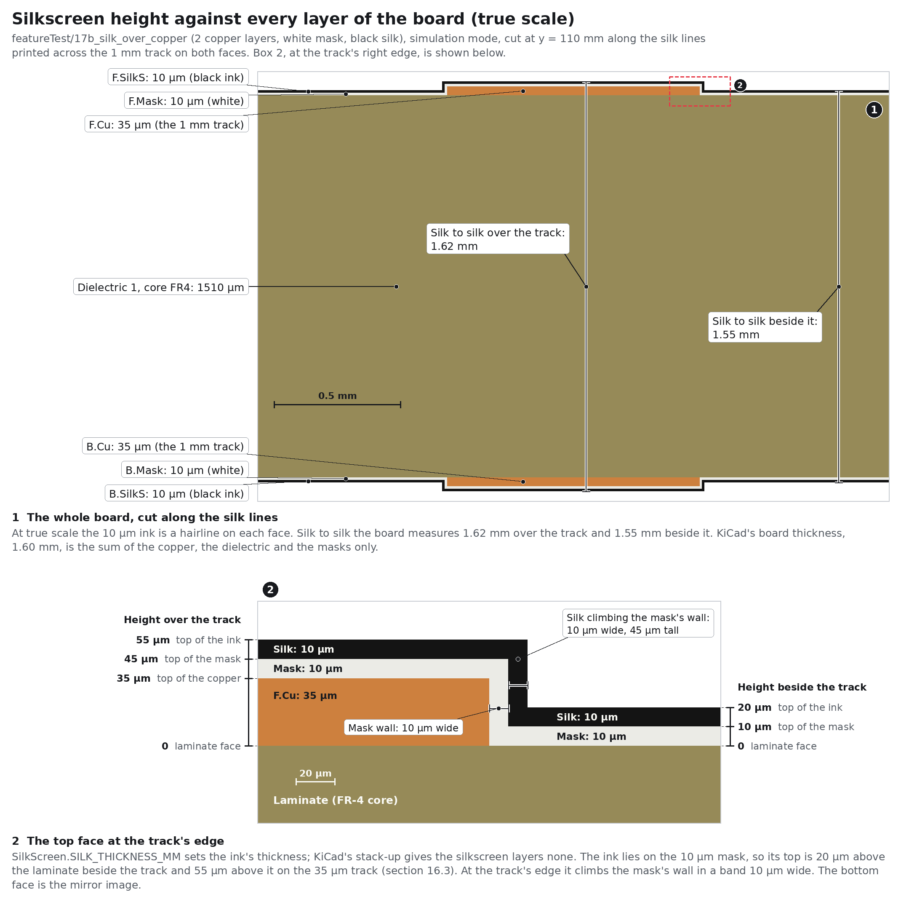

# 16. Silkscreens

The silkscreen is the legend ink printed on top of the solder mask: reference designators,
values, logos and outlines. `kese/s4_geometry/silkscreen.py` builds it from the ink that
`kese/s3_resolve/silk.py` clips off the pads, and `kese/core/font.py` renders the text; the
settings are in `parameters/PCB_elements/SilkScreen.py`. Whether it is built is not in that file:
it is the two lines `top_silkscreen` and `bottom_silkscreen` of `parameters/PCB_elements/Stackup.py`
([Stack-Up Model](Stack-Up-Model.md)), and both are `False` by default, like the solder mask's.
Turn them on to have the ink in the files:

```bash
python run_KESE.py board.kicad_pcb --set Stackup.silkscreen=True           # both faces
python run_KESE.py board.kicad_pcb --set Stackup.top_silkscreen=True       # the top face only
```

The ink is printed on the mask, so a silkscreen without its solder mask stands where the mask
would be, at the mask's height: turn the mask of that face on with it
(`--set Stackup.solder_mask=True`) for a model with no gap under the ink.



## 16.1 What Is Drawn

Items on the layers in `SilkScreen.SILK_LAYERS` (`F.SilkS` and `B.SilkS` by default):

| Item | Shape |
|---|---|
| graphics (`gr_line`, `gr_arc`, `gr_circle`, `gr_rect`, `gr_poly`, `gr_curve`, and the `fp_*` versions inside footprints) | the stroke thickened by its width; filled shapes filled; hatched ones (KiCad 10) hatched as on copper ([Copper And Traces](Copper-And-Traces.md#1312-hatched-fills)) |
| text (`gr_text`, `fp_text`, footprint `property` fields such as Reference and Value) | glyphs of the stroke font, laid out as KiCad lays them out |
| zone fills on a silk layer | the stored polygons |

Graphics on `F.Fab`, `B.Fab`, courtyard and user layers are not physical and are counted under
`skipped` in `report.txt`. Text on those layers (including the footprints' Value fields, which
usually sit on `F.Fab`) and hidden text are ignored without a count. Text is drawn only on
`F.SilkS` and `B.SilkS` (and copper and mask layers), even if another layer is added to
`SILK_LAYERS`; graphics follow `SILK_LAYERS`, each drawn on the top or bottom side by the first
letter of its layer name. Text boxes and dimensions on those layers are not
modelled and are counted under `skipped`.

Everything is clipped to the outline, pulled back from the edge by the same
`SolderMask.MASK_EDGE_PULLBACK_MM` as the mask, and cut away over open hole bores. Then, with
`SilkScreen.SILKSCREEN_OVER_COPPER = False` (the default), the ink is removed wherever the mask
is open (pads, exposed copper, bare laminate in openings), which is what fabricators do: silk is
clipped off the pads. With `True` the ink is kept there as drawn in KiCad. Either way no ink is
left on the slivers of mask on the copper the mask leaves out, where an opening's outline follows a
pad's edge with other points ([Solder Masks](Solder-Masks.md#172-conformal-mask)): it would stand on
mask that is not there.



## 16.2 Text Rendering

KESE ships KiCad's own stroke font, **newstroke**, converted to JSON Lines, one glyph per line
(`kese/assets/fonts/kicad_newstroke.json.gz`, with its notice in `LICENSE_fonts.txt`), and parses
each glyph the first time a text needs it (`kese/core/font_file.py`): a board draws a few dozen of
its 65,487 glyphs, and a board without text never reads the font. Text is laid
out following KiCad's `STROKE_FONT` and `FONT::getLinePositions` code (`kese/core/font.py`), which
KiCad 7, 8 and 9 share, so it lands where KiCad plots it: `tests/test_text_layout.py` checks
sixteen texts against KiCad 7.0.11's plot to 5 µm, and the two references below agree with it to
2 µm.


### 16.2.1 Layout Of One Line

Each character moves the pen on by its glyph width, which takes in the glyph's side bearings, and
a tab moves it to the next tab stop, one every four columns of width $`W`$:

```math
x_{j+1} = x_j + a_j W, \qquad a_j = \begin{cases} w_{g} & \text{a glyph } g \\ w_{\mathrm{sp}} & \text{a space} \end{cases} \qquad (16.1)
```

```math
x_{j+1} = \left( 4m - 1 + w_{\mathrm{sp}} \right) W \ \text{after a tab}, \quad m \ \text{the least with} \ 4m - 1 \ge c_j \ \text{and} \ \left( 4m - 1 + w_{\mathrm{sp}} \right) W > x_j \qquad (16.2)
```

$`c_j`$ counts the columns before character $`j`$: one for each glyph or space, and a tab counts
up to its stop ($`c_{j+1} = 4m`$). A line is as wide as its pen's advance,
$`\lambda = x_{\mathrm{end}}`$, the bearing after the last glyph included: KiCad justifies a line
by this advance (`FONT::getLinePositions`); only the text's bounding box, which plays no part in
the layout, leaves out $`0.2 W`$ of it.

A stroke point $`(u, v)`$ of a glyph (in units of the text size, $`v`$ down) is placed at

```math
x = x_j + \left( u - \tau v \right) W, \qquad y = v H \qquad (16.3)
```

### 16.2.2 Lines And Justification

```math
p = H \cdot \pi_\ell \cdot \kappa_\ell \qquad (16.4)
```

This is the pitch of KiCad 8 to 10, $`1.6099 H`$; KiCad 7 writes it $`1.61 H`$, which puts each
further line 0.06 µm lower per millimetre of text height. A text's own `(line_spacing ...)` is
left out, as KiCad 7 to 10 leave it out of their plots and so of the Gerbers: they space a text's
lines by this pitch alone (`EDA_TEXT::GetInterline`).

```math
\hat{H} = 1.17 H + (n_\ell - 1) p \qquad (16.5)
```

```math
o_x = \frac{T}{1.52}, \qquad o_y = H - 0.052 T - \begin{cases} 0 & \text{top} \\ \hat{H} & \text{bottom} \\ \hat{H}/2 & \text{centre} \end{cases} \qquad (16.6)
```

```math
x_{\mathrm{start},i} = \begin{cases} o_x & \text{left} \\ -\left( \lambda_i + o_x \right) & \text{right} \\ -\lambda_i / 2 & \text{centre} \end{cases}, \qquad y_{\mathrm{start},i} = o_y + i p \qquad (16.7)
```

A centred line is centred on its advance alone: KiCad sets the offset to $`-\lambda_i / 2`$ there
instead of adding it to $`o_x`$.

### 16.2.3 Placement And Stroke

Every local point $`(x, y)`$ is mirrored when the text is marked `(justify mirror)` in the file
($`x \to -x`$; KiCad sets this on back-side text), then rotated by the
text angle $`\theta`$ about the anchor $`(X_0, Y_0)`$, in KiCad's frame (Y down):

```math
X = X_0 + x \cos\theta + y \sin\theta, \qquad Y = Y_0 - x \sin\theta + y \cos\theta \qquad (16.8)
```

$`\theta`$ is the angle in the file, which KiCad stores absolute, also for the text of a turned
footprint. KiCad keeps a footprint's text upright unless the file unlocks it (`(unlocked yes)`
from KiCad 8, a bare `unlocked` in its `(at ...)` before), and KESE does the same: such an angle is
turned by half turns into $`-90° < \theta \le 90°`$, so that the text never reads upside down.

The strokes are then thickened to the stroke width:

```math
T = \min\left( \begin{cases} T_{\mathrm{file}} & \text{if the file gives one} \\ \rho_b W & \text{bold} \\ \rho_n W & \text{normal} \end{cases},\ 0.25 \min(W, H) \right), \qquad \text{glyph region} = \bigcup \text{strokes} \oplus \frac{T}{2} \qquad (16.9)
```

| Symbol | Meaning | Parameter |
|---|---|---|
| $`H`$, $`W`$ | text height and width | the file's `(size h w)` |
| $`x_j`$ | pen position before character $`j`$ ($`x_0 = 0`$) | |
| $`w_g`$, $`w_{\mathrm{sp}}`$ | width of glyph $`g`$ and of a space, in units of $`W`$ (from the font file) | |
| $`c_j`$ | columns before character $`j`$ ($`c_0 = 0`$) | |
| $`m`$ | the tab stop a tab moves to | |
| $`\lambda`$, $`\lambda_i`$ | width of a line, of line $`i`$ | |
| $`\tau`$ | italic tilt (0 for upright text) | `SilkScreen.ITALIC_TILT` (0.125) |
| $`p`$ | line pitch | |
| $`\pi_\ell`$, $`\kappa_\ell`$ | interline pitch and legacy factor | `SilkScreen.INTERLINE_PITCH` (1.68), `SilkScreen.INTERLINE_LEGACY_FACTOR` (0.9583) |
| $`n_\ell`$ | number of lines (`\n` breaks) | |
| $`\hat{H}`$ | block height | |
| $`o_x`$, $`o_y`$ | KiCad's stroke-font offsets | |
| $`T`$ | stroke width | the file's `(thickness ...)`, else $`\rho_b W`$ for bold text or $`\rho_n W`$ otherwise, with `SilkScreen.BOLD_THICKNESS_RATIO` $`\rho_b`$ (0.2) and `SilkScreen.NORMAL_THICKNESS_RATIO` $`\rho_n`$ (0.125); either way at most $`0.25 \min(W, H)`$ (`SilkScreen.MAX_PEN_RATIO`), as KiCad clamps it (`ClampTextPenSize`) |
| $`\theta`$, $`(X_0, Y_0)`$ | text angle and anchor | the file's `(at x y angle)` |

Stroke ends are round with `TEXT_STROKE_QUAD_SEGS` segments per quarter circle.

KiCad's markup is drawn, not printed (`kese/core/markup.py`, after KiCad's `markup_parser.h`):
`~{...}` draws a bar over its text, $`1.23 H`$ above the line's baseline ($`v = 0`$ in (16.3)) and
trimmed by $`0.1 W`$ at each end; `^{...}` and `_{...}` draw their text at 0.8 of the size, raised
by 0.35 or lowered by 0.15 of that smaller height (a subscript wins where the two are nested). A marker whose closing `}` never comes is
plain text, as in KiCad. Files older than format 20210606 (KiCad 5 and early 6) wrote an overbar
as text between two `~`; it is read as `~{...}`, as KiCad reads it. A KiCad 4 text that gives no
size is 1.524 mm (60 mils). KiCad 7 wrote a locked text as `(gr_text locked "PWR" ...)` or
`(fp_text reference locked "R1" ...)`: the bare `locked` is a flag, not the words, and is passed
over as KiCad's parser passes it (`PCB_IO_KICAD_SEXPR_PARSER::parsePCB_TEXT`). Older files wrote a
footprint's value and reference as `%V` and `%R`; they are read as `${VALUE}` and `${REFERENCE}`,
as KiCad reads them. The file's text
is read with KiCad's escapes (`\n` starts a new line, `\"` and `\\` stand for a quote and a
backslash; a tab is written as it is; the escapes KiCad reads but does not write, `\t`, `\x41` and
the like, are read too, and a backslash before any other character stays). Words an old file
wrote without quotes may hold a double quote, such as the inch mark in `(gr_text 0.062" ...)`;
it is a character of the text, as in KiCad. Text variables are resolved before layout, in the order
KiCad's `PCB_TEXT::GetShownText` uses:

| Variable | Value |
|---|---|
| `${LAYER}` | the text's layer, by the name the board shows (`F.Silkscreen` in KiCad 7+) |
| `${REFERENCE}`, `${VALUE}`, any other field, `${FOOTPRINT_LIBRARY}`, `${FOOTPRINT_NAME}` | in a footprint, that footprint's |
| `${TITLE}`, `${REVISION}`, `${ISSUE_DATE}`, `${COMPANY}`, `${COMMENT1}` ... `${COMMENT9}` | the board's title block |
| `${FILENAME}`, `${FILEPATH}`, `${CURRENT_DATE}` | the board file's name and path, today's date |
| any name in the board's own `(property "name" "value")` | that value |
| `${R1:VALUE}` (saved by KiCad as `${<uuid>:VALUE}`) | that field of the other footprint, or `<Unresolved: R1:VALUE>` as KiCad shows it |

A variable only the project file defines (`.kicad_pro` text variables, `${PROJECTNAME}`) is
left as written, as KiCad shows an unknown one. KiCad 8 and 9 look a name up in the board's
properties before its title block, the others after it, and KESE follows the KiCad that saved the
board (`BOARD::ResolveTextVar`).

A value can hold variables of its own, as on boards whose title block says `(date "${DATE}")` and
whose project defines `DATE`. KESE expands it as the KiCad that saved the board expands it:

| Value | Its own variables |
|---|---|
| a title block value | expanded once by the project's variables, for which KESE reads the board's properties, since KiCad keeps them as its copy of the project's (`BOARD::SynchronizeProperties`); `${CURRENT_DATE}` in it from KiCad 9 (`TITLE_BLOCK::TextVarResolver`) |
| a footprint's reference or value, before KiCad 10 | expanded in that footprint while the depth stays under KiCad's limit: one level in KiCad 8 and 9 for the footprint's own text and none for another text's `${R1:VALUE}`, up to four in KiCad 6 and 7 (`FOOTPRINT::ResolveTextVar`) |
| any other value, before KiCad 10: a board property, another field | left as written, as KiCad shows it |
| any value, KiCad 10 | expanded again, as KiCad 10 expands a text up to six times while it holds a variable (`ResolveTextVars`); a field in its own footprint |

Text the file marks hidden (`(hide yes)`) is skipped unless `DRAW_HIDDEN_TEXT = True`.

### 16.2.4 Fonts And Faces

A board's text is in one of three kinds of font, and for none of them does KESE need a font file
from the user:

| Text | How KESE draws it | What it needs |
|---|---|---|
| KiCad's stroke font: no face, or `(face "KiCad Font")` as KiCad 10 can write it | with newstroke, laid out as above | nothing: KESE ships the font |
| a TrueType or OpenType face, `(font (face "..."))`, KiCad 7 and later | from the letters KiCad saves with it, `(render_cache "text" angle (polygon (pts ...) ...))`: the filled outlines exactly as KiCad draws them in that face (`PCB_TEXT::TransformTextToPolySet`) | nothing: the board file holds the letters, so any face works, even one only the designer has installed |
| the same, with no render cache, or one made for other words or another angle | with the stroke font when `DRAW_TRUETYPE_TEXT_WITH_STROKE_FONT = True` (the default), in its place and size but in other letter shapes, with a warning; left out when `False` | open the board in KiCad 7 or later and save it, which stores the cache |

KiCad gives the stroke font for a face whose name is empty or starts with `KiCad Font`
(`FONT::GetFont` in `common/font/font.cpp`), and saves a render cache only for an outline font
(`PCB_IO_KICAD_SEXPR::formatRenderCache`); KESE does the same. A cache made for another text or
angle is stale, as KiCad would draw the text anew, with one exception: where the text uses a
variable whose value when KiCad saved the board KESE cannot know (one only the project file defines,
or `${CURRENT_DATE}`, also where a value's own variables bring it in), a cache whose words differ
only there is drawn, since its words are the ones KiCad showed then, and `report.txt` counts that
text apart. A cache with no polygons, as KiCad saves for an empty text or for letters the face
lacks, draws nothing, as KiCad draws nothing. KiCad 9's embedded fonts (`embedded_fonts`,
`embedded_files`) are not read, since the render cache already holds every letter. `report.txt`
counts the text of each kind.

A different stroke font can replace newstroke for the first kind: copy it into
`kese/assets/fonts/` and set `FONT_FILE` to its name. It can be this project's stroke-font JSON,
either one document or JSON Lines (a header line, then one glyph per line from `first_codepoint`
on, read glyph by glyph; `python tools/font_lines.py` turns the first into the second), or a
Hershey `.jhf` file. If the file is missing, newstroke is used and `report.txt` says so on its
`font:` note.

## 16.3 Ink Geometry





The ink follows the mask surface, which is flat over laminate and raised over copper. First the
silk region $`S`$ is split against the mask region $`M`$ of equation (17.1), then the part on the
mask is split against the raised mask over copper, $`K = C \oplus m_L`$:

```math
S^{\mathrm{off}} = S \setminus \left( M \oplus s \right), \qquad S^{\mathrm{on}} = S \cap M, \qquad S^{\mathrm{step}} = S \cap \left( \left( M \oplus s \right) \setminus M \right) \qquad (16.10)
```

```math
S^{\mathrm{flat}} = S^{\mathrm{on}} \setminus \left( K \oplus s \right), \qquad S^{\mathrm{top}} = S^{\mathrm{on}} \cap K, \qquad S^{\mathrm{wall}} = S^{\mathrm{on}} \cap \left( \left( K \oplus s \right) \setminus K \right) \qquad (16.11)
```

On the `F` side, with $`h = L/2`$ the laminate face, these are extruded over:

| Region | z range | Where |
|---|---|---|
| $`S^{\mathrm{flat}}`$ | $`[h + m_L,\ h + m_L + s]`$ | on the mask over laminate |
| $`S^{\mathrm{top}}`$ | $`[h + t + m_C,\ h + t + m_C + s]`$ | on the mask over copper |
| $`S^{\mathrm{wall}}`$ | $`[h + m_L,\ h + t + m_C + s]`$ | climbing the mask step beside a trace |
| $`S^{\mathrm{step}} \cap C`$ | $`[h + t,\ h + t + m_C + s]`$ | stepping down the edge of a mask opening onto copper |
| $`(S^{\mathrm{step}} \setminus C) \cap K`$ | $`[h,\ h + t + m_C + s]`$ | stepping down to the laminate from the raised mask beside copper |
| $`S^{\mathrm{step}} \setminus K`$ | $`[h,\ h + m_L + s]`$ | stepping down the edge of a mask opening onto the laminate |
| $`S^{\mathrm{off}} \setminus C`$ | $`[h,\ h + s]`$ | on bare laminate in an opening |
| $`S^{\mathrm{off}} \cap C`$ | $`[h + t,\ h + t + s]`$ | on bare copper in an opening |

The last five exist only with `SILKSCREEN_OVER_COPPER = True`; otherwise the ink was already
removed from every opening. On the `B` side every z is mirrored. Each piece of the step starts on
what lies under it, the copper or the laminate, and rises to the top of the ink on the mask beside
it.

> [!NOTE]
> With `SILKSCREEN_OVER_COPPER = True` the ink in an opening lies on the bare copper, and a
> surface finish (the finish lines of `Stackup.py`, on by default) is left out under it, as when the legend is
> printed before the finish. So the ink overlaps no other part with either setting.

| Symbol | Meaning | Parameter |
|---|---|---|
| $`S`$ | silk region after clipping to the outline, the edge pull-back and the bores | |
| $`M`$ | mask region, equation (17.1) | |
| $`C`$ | outer copper of that side, every net | |
| $`s`$ | ink thickness | `SilkScreen.SILK_THICKNESS_MM` (0.010) |
| $`m_L`$, $`m_C`$ | mask thickness over laminate and over copper | `SolderMask.MASK_OVER_LAMINATE_MM`, `SolderMask.MASK_OVER_COPPER_MM` |
| $`t`$ | finished outer copper thickness, equation (8.3) | |

Each side is one part, `Top Silkscreen` or `Bottom Silkscreen`.

## 16.4 Material For The Solver

`materials.json` gives each silkscreen part its side, its thickness and a material
([Material Properties](Material-Properties.md#212-properties-per-role)):

```json
"Top Silkscreen": {
  "role": "silk",
  "layer": "F.SilkS",
  "z_range_mm": [0.765, 0.775],
  "properties": {
    "side": "F",
    "thickness_mm": 0.01,
    "material": "epoxy ink",
    "epsilon_r": 5.0,
    "loss_tangent": 0.03
  }
}
```

A board file gives the silkscreen no material (KiCad's own default εr for it is 1.0, as if it
were air), so the three values are always the settings `SILK_MATERIAL`, `SILK_EPSILON_R` and
`SILK_LOSS_TANGENT`. Neither number is a maker's figure: no data sheet of a legend ink that
states εr and tan δ has been read yet. 5.0 is a best guess for white ink, whose pigment lifts
εr above the mask's 3.8, and 0.03 is the solder mask's value. The ink is thin and covers little
of a board, so it changes a field solution far less than the mask does; give your own values
when a line runs under a large printed area.

## 16.5 Settings

All in `parameters/PCB_elements/SilkScreen.py`, by the file's sections. The two silkscreen lines of
`Stackup.py` say whether the ink is built. Section 5, Color, is on the [Colorizing](Colorizing.md)
page.

| Name | Default | Range | Meaning |
|---|---|---|---|
| **1. Parts** | | | |
| `SILK_LAYERS` | `["F.SilkS", "B.SilkS"]` | list of `F.*` / `B.*` layer names | Layers drawn as silkscreen, on the side their first letter names; any other name stops the run with a `KeyError` when the board has graphics on that layer |
| `DRAW_HIDDEN_TEXT` | `False` | bool | Draw text marked hidden |
| **2. Thickness** | | | |
| `SILK_THICKNESS_MM` | `0.010` | mm > 0 | Ink thickness (typical 0.010 to 0.020) |
| **3. Shape** | | | |
| `SILKSCREEN_OVER_COPPER` | `False` | bool | Keep ink where the mask is open, on the pads and the bare laminate (the finish is left out under it); `False` clips it off as fabricators do |
| `FONT_FILE` | `None` | None or a file name in `kese/assets/fonts/` | Custom stroke font ([16.2.4](#1624-fonts-and-faces)); `None` = KiCad newstroke |
| `DRAW_TRUETYPE_TEXT_WITH_STROKE_FONT` | `True` | bool | Draw TrueType-face text that has no usable render cache with the stroke font, with a warning; `False` leaves it out |
| `INTERLINE_PITCH`, `INTERLINE_LEGACY_FACTOR` | `1.68`, `0.9583` | > 0 | KiCad's line pitch and stroke-font correction |
| `ITALIC_TILT` | `0.125` | ≥ 0 | x shift per unit of y for italic text |
| `BOLD_THICKNESS_RATIO`, `NORMAL_THICKNESS_RATIO` | `0.2`, `0.125` | > 0 | Stroke = ratio × text width when the file gives none |
| `MAX_PEN_RATIO` | `0.25` | > 0 | A stroke is at most this × the smaller of the text's width and height |
| `TEXT_STROKE_QUAD_SEGS` | `4` | int ≥ 1 | Roundness of stroke ends |
| **4. Material** | | | |
| `SILK_MATERIAL` | `"epoxy ink"` | text | The ink's material name in `materials.json` |
| `SILK_EPSILON_R` | `5.0` | ≥ 1 | The ink's εr, a best guess |
| `SILK_LOSS_TANGENT` | `0.03` | ≥ 0 | The ink's tan δ, a best guess |

| Previous | Next |
|:---|---:|
| [Finish](Finish.md) | [Solder Masks](Solder-Masks.md) |
