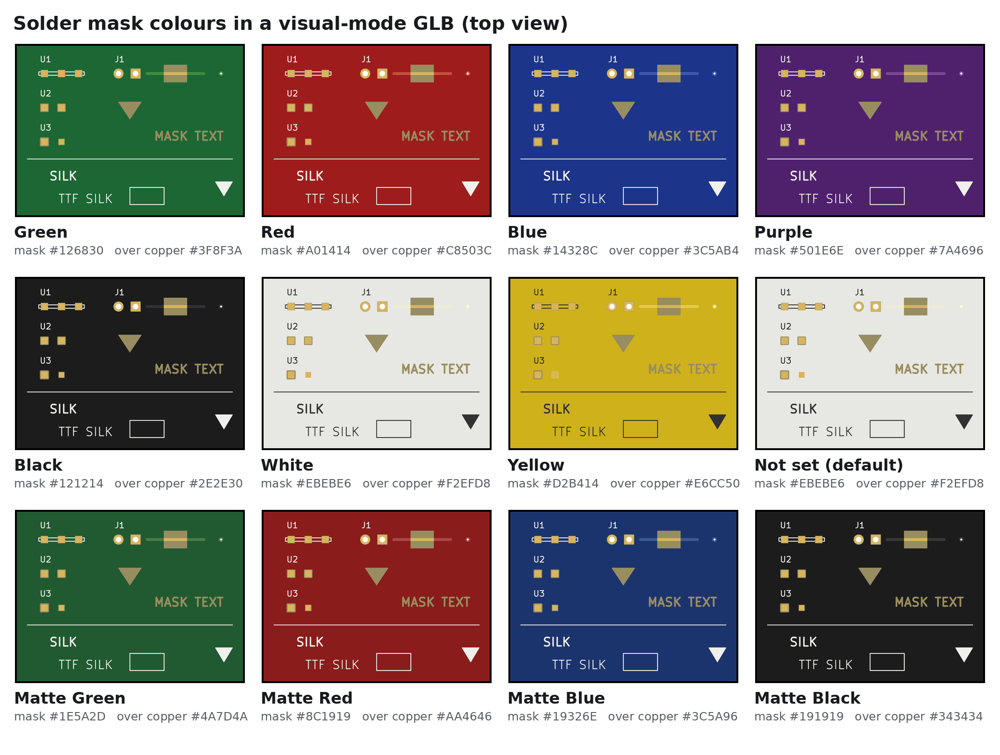
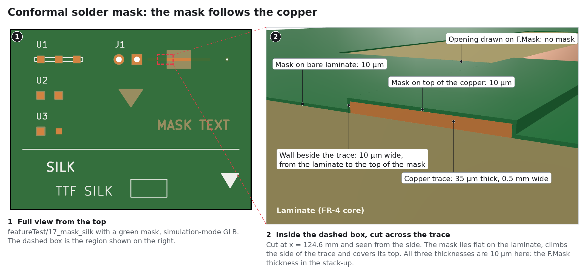
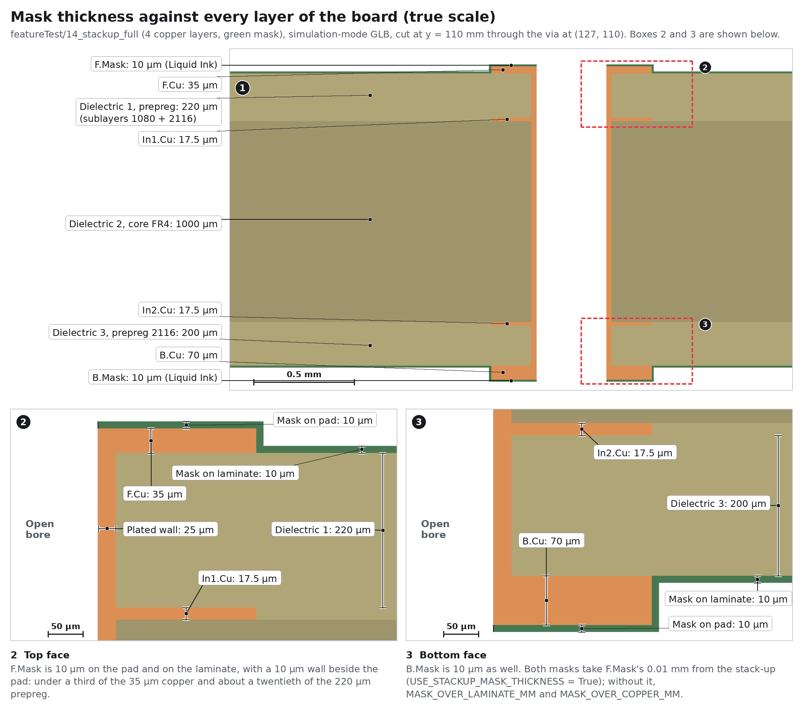
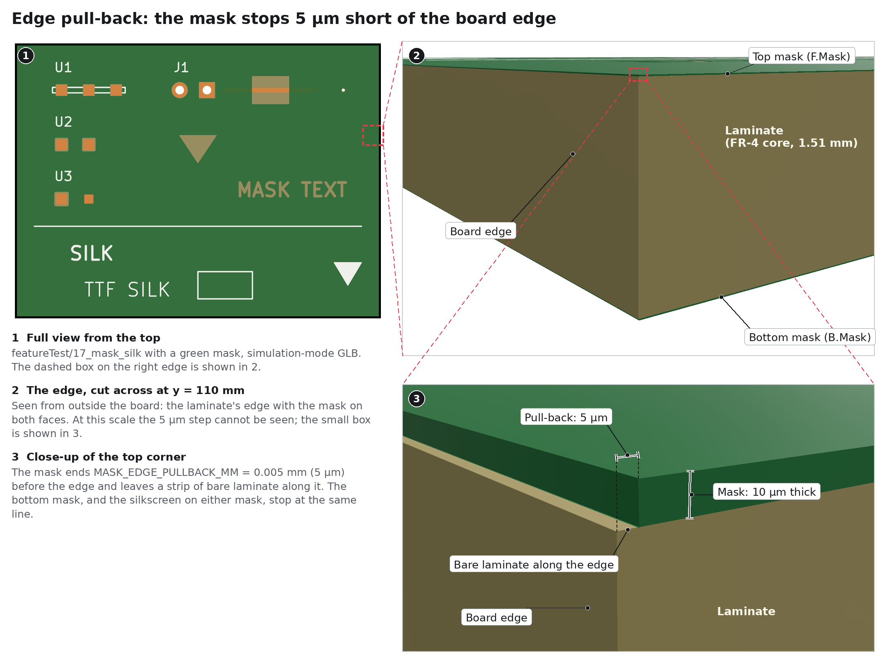
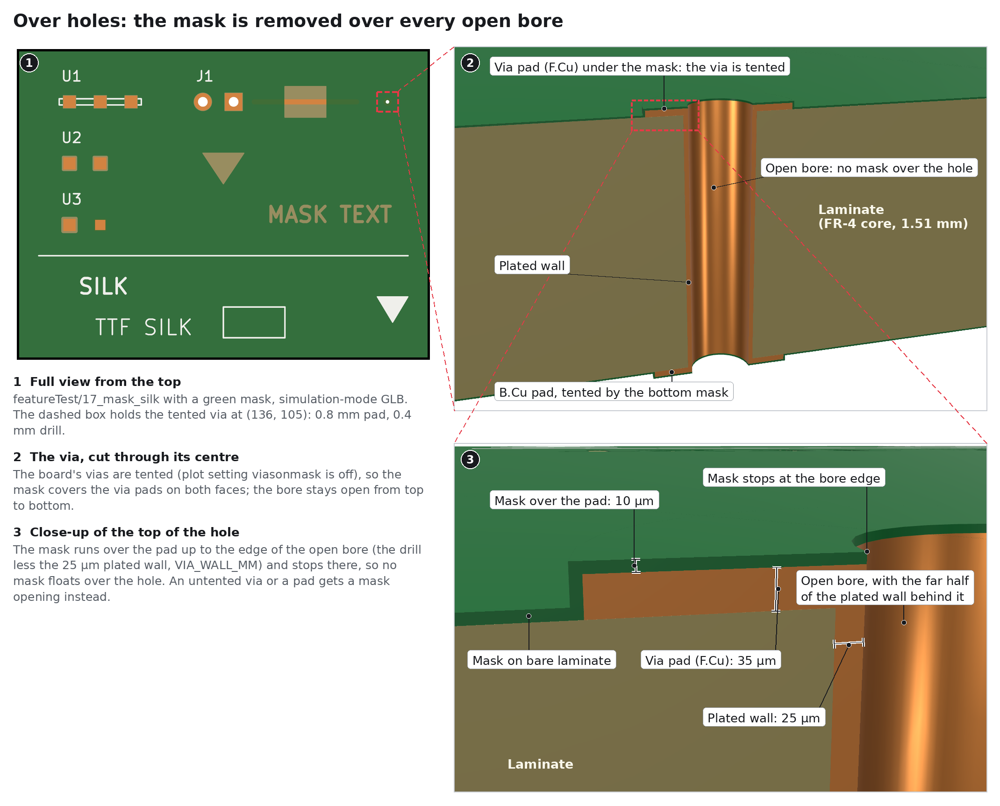

# 16. Solder Masks

The solder mask is the lacquer (LPI) over both faces of the board. `kese/s4_geometry/solder_mask.py`
builds it around the openings that `kese/s3_resolve/mask.py` works out; the settings are in
`parameters/solder_mask.py`. It is off by default (`SolderMask.SOLDER_MASK_ENABLED = False`): turn
it on to have it in the files. The openings still decide where the finish goes either way.




## 16.1 KiCad's Mask Layers Are Negative

Whatever is drawn on `F.Mask` / `B.Mask` is an **opening**, not mask. KESE builds, per side:

```math
M_\sigma = \left( \left( O \setminus B_\sigma \right) \setminus Q_\sigma \right) \cap \left( O \ominus p \right) \qquad (16.1)
```

| Symbol | Meaning | Parameter |
|---|---|---|
| $`M_\sigma`$ | mask region on side $`\sigma`$ (`F` or `B`) | |
| $`O`$ | board outline, equation (11.3) | |
| $`B_\sigma`$ | bores of every hole that reaches side $`\sigma`$, equation (12.4), except those a via's protection shuts there (16.4) | |
| $`Q_\sigma`$ | the mask openings on side $`\sigma`$, equation (16.2) | |
| $`p`$ | edge pull-back | `SolderMask.MASK_EDGE_PULLBACK_MM` |

The openings are:

| Opening | Size |
|---|---|
| every pad that lists the mask layer (`F.Mask`, `B.Mask`, `*.Mask`) | the pad shape grown by its mask margin: the pad's own `solder_mask_margin`, else the footprint's, else the board's pad-to-mask clearance, or `SolderMask.PAD_TO_MASK_CLEARANCE_MM` when set; a negative margin shrinks it at most to nothing (half its smaller side); a pad on no copper layer (a mask-only opening) is used as drawn, with no margin, as KiCad's `PAD::GetSolderMaskExpansion` does |
| every untented via (see [via tenting](Copper-And-Traces.md#1232-via-tenting)) | the via pad grown by the same clearance: the board's, or `SolderMask.PAD_TO_MASK_CLEARANCE_MM` when set |
| every track, arc track and copper drawing that the mask leaves bare (KiCad 9 and later: it lists both layers, `(layers "F.Cu" "F.Mask")`; only `F.Cu` is bared by `F.Mask` and `B.Cu` by `B.Mask`) | its copper shape grown by its mask margin: its own `solder_mask_margin`, else the board's pad-to-mask clearance, or `SolderMask.PAD_TO_MASK_CLEARANCE_MM` when set. As in KiCad, a negative margin narrows a stroke at most to nothing; the opening of a filled polygon or square-cornered rectangle is never smaller than its inside, while a filled circle or rounded rectangle shrinks by the part of the margin past half its stroke (KiCad's `EDA_SHAPE::TransformShapeToPolygon`) |
| graphics, text and zone fills drawn on the mask layer | as drawn |

Together:

```math
Q_\sigma = \left( \bigcup_{\text{pads}} \left( P \oplus m_P \right) \cup \bigcup_{\text{open vias}} \left( V \oplus c \right) \cup \bigcup_{\text{bare}} \left( T \oplus m_T \right) \cup \bigcup_{\text{drawn}} G \right) \cap O \qquad (16.2)
```

```math
m_P = \begin{cases} m_{\mathrm{pad}} & \text{if the pad gives one} \\ m_{\mathrm{fp}} & \text{else if the footprint gives one} \\ c & \text{otherwise} \end{cases} \qquad (16.3)
```

| Symbol | Meaning | Parameter |
|---|---|---|
| $`P`$, $`V`$, $`G`$ | a pad shape, a via pad, a shape drawn on the mask layer | |
| $`T`$, $`m_T`$ | the copper of a track or drawing the mask leaves bare, and its `solder_mask_margin` ($`c`$ when it gives none) | the board file |
| $`\oplus m`$ | grows a region outward by $`m`$ (a buffer) | |
| $`m_{\mathrm{pad}}`$, $`m_{\mathrm{fp}}`$ | the pad's and the footprint's `solder_mask_margin` | the board file |
| $`c`$ | pad-to-mask clearance | board setup, or `SolderMask.PAD_TO_MASK_CLEARANCE_MM` when set |

Openings are clipped to the outline. `report.txt` counts `pad mask openings on F.Mask`, the bare
copper's openings (`track mask openings on F.Mask`, `arc track ...`, `graphic ...`, `footprint graphic ...`)
and the clearance used on its `vias:` line.

When the board sets a solder mask minimum width (Board Setup, `(setup (solder_mask_min_width w))`,
or `SolderMask.MASK_MIN_WIDTH_MM`), no web of mask narrower than $`w`$ stays between two
openings, as KiCad plots the mask for the fab (`plot_board_layers.cpp`, `GenerateLayerPoly`): the
openings are grown by $`w/2`$ (less 1 nm), joined, shrunk back with chamfered corners, and the
exact openings added back:

```math
Q'_\sigma = Q_\sigma \cup \left( \left( Q_\sigma \oplus \tfrac{w}{2} \right) \ominus \tfrac{w}{2} \right) \qquad (16.2b)
```

Only the webs this fills are added; the hairlines where the grown and shrunk curves miss the exact
ones (narrower than 2 µm, twice `SolderMask.MASK_WEB_HAIRLINE_MM`) are left out, so the openings
keep their exact outlines. `report.txt` counts them as
`mask webs under the min width (w mm) removed on F.Mask`.

The openings are worked on in groups: two openings within $`w`$ of each other are in one group,
and so is every opening linked to them by a chain of such neighbours (two openings grown by less
than $`w/2`$ meet only when they are less than $`w`$ apart, so no web closes between two groups),
`Parallel.WORKERS` groups at a time in threads. The webs are the ones
the whole layer at once gives, with the same vertices, and the openings close the same region; on
CIAA ACC the front takes 4.3 s where the whole layer took 9.8 s.

## 16.2 Conformal Mask



LPI mask follows the copper: it is thin on top of a trace and thicker on the bare laminate
beside it, and it climbs the side of every trace. KESE splits the mask region of equation (16.1)
into three regions with the outer copper $`C_\sigma`$ of that side:

```math
M^{\mathrm{flat}} = M_\sigma \setminus \left( C_\sigma \oplus m_L \right) \qquad (16.4)
```

```math
M^{\mathrm{top}} = M_\sigma \cap C_\sigma \qquad (16.5)
```

```math
M^{\mathrm{wall}} = M_\sigma \cap \left( \left( C_\sigma \oplus m_L \right) \setminus C_\sigma \right) \qquad (16.6)
```

and extrudes them, on the `F` side, over

```math
z^{\mathrm{flat}} \in \left[ \frac{L}{2},\ \frac{L}{2} + m_L \right], \qquad z^{\mathrm{top}} \in \left[ \frac{L}{2} + t_{\mathrm{out}},\ \frac{L}{2} + t_{\mathrm{out}} + m_C \right], \qquad z^{\mathrm{wall}} \in \left[ \frac{L}{2},\ \frac{L}{2} + t_{\mathrm{out}} + m_C \right] \qquad (16.7)
```

On the `B` side every z is mirrored ($`z \to -z`$).

| Symbol | Meaning | Parameter |
|---|---|---|
| $`M^{\mathrm{flat}}`$ | mask on bare laminate, farther than $`m_L`$ from any copper | |
| $`M^{\mathrm{top}}`$ | mask on top of copper | |
| $`M^{\mathrm{wall}}`$ | the band $`m_L`$ wide beside copper where the mask climbs | |
| $`C_\sigma`$ | all outer copper of side $`\sigma`$, every net | |
| $`m_L`$ | mask thickness over laminate | `SolderMask.MASK_OVER_LAMINATE_MM` |
| $`m_C`$ | mask thickness over copper | `SolderMask.MASK_OVER_COPPER_MM` |
| $`t_{\mathrm{out}}`$ | finished outer copper thickness, equation (8.3) | |
| $`L`$ | laminate thickness, equation (8.1) | |

The wall's outer edge is rounded with `MASK_WALL_QUAD_SEGS` segments per quarter circle.

Where an opening's outline follows the copper's, as for a pad with no mask margin, the two seldom
match point for point: the opening's arc has other points than the pad's, or an edge rounds onto
the grid a step off. $`M^{\mathrm{top}}`$ then holds slivers between the two outlines, most of
them under a tenth of a micrometre wide (NE_Delta's front had 8,895 of its 9,775 pieces), which no
fab makes and which stage 6 could not always close: one, a needle beside the wall's tip, traded
vertices with the wall round after round. A piece of $`M^{\mathrm{top}}`$ narrower than twice
`MASK_OVER_COPPER_HAIRLINE_MM` (1 µm) everywhere is left out, and `report.txt` counts them:
`solder mask: 8895 slivers on the copper narrower than 0.002 mm left out (F.Mask)`. Each is added
to the opening beside it, so the finish covers it as it covers the rest of the pad
([Finish](Finish.md#142-where-the-finish-goes)), and no ink is printed on it
([Silkscreens](Silkscreens.md#151-what-is-drawn)), which would stand on mask that is not there.
The mask is worked out with its switch off too, so the finish reaches those pads' edges either way.

In simulation mode all three go into one part per side, `Top Solder Mask` / `Bottom Solder Mask`.
In visual mode the **top** region becomes its own part,
`Top Mask over Copper` / `Bottom Mask over Copper`, with its own colour
([Output Modes](Output-Modes.md)).

### 16.2.1 Thickness



Two values, `MASK_OVER_LAMINATE_MM` and `MASK_OVER_COPPER_MM`, both 10 µm by default (KiCad's own
value). Typical production is 10 to 15 µm over copper and 20 to 30 µm over laminate. When the
stack-up gives a mask thickness and `USE_STACKUP_MASK_THICKNESS = True`, the first one in the
stack-up (normally `F.Mask`) is used for both values on both faces; a different `B.Mask`
thickness is ignored. `report.txt` notes the values and their source:
`solder mask: 0.01 mm over laminate, 0.01 mm over copper (stackup)`.

## 16.3 Edge Pull-Back



The mask, and the silkscreen on it, stop `MASK_EDGE_PULLBACK_MM` (5 µm) short of the board edge:
the $`\cap (O \ominus p)`$ term of equation (16.1).
Fabricators pull both back from routed edges, and the small step also keeps `<model-viewer>`
from treating a translucent mask flush with the board edge as a baked shadow.

## 16.4 Over Holes



The mask is removed over the open bore of every hole that reaches that side (the drill minus the
plated wall, or the whole drill of an NPTH), so no mask floats over a hole. A tented via keeps its
mask over the annular ring; its bore is still open.

KiCad 10's via protection changes that ([Copper And Traces](Copper-And-Traces.md#1234-via-protection)):
where a cap, a fill or a plug on that side shuts the bore, the mask of a tented via spans it; a
covered via has the mask over its bore on that side even when its ring is left open, the opening
then a ring around it. An end that a backdrill, counterbore or countersink opens stays open, and
the copper a counterbore or countersink knocks out is a hole like any other.

## 16.5 Settings

| Name | Default | Range | Meaning |
|---|---|---|---|
| `MASK_OVER_LAMINATE_MM` | `0.010` | mm > 0 | Mask thickness over bare laminate |
| `MASK_OVER_COPPER_MM` | `0.010` | mm > 0 | Mask thickness on top of copper |
| `USE_STACKUP_MASK_THICKNESS` | `True` | bool | The first mask thickness found in the stack-up (normally `F.Mask`'s) wins, for both values on both faces |
| `MASK_EDGE_PULLBACK_MM` | `0.005` | mm ≥ 0 | Mask and silk stop this far from the edge |
| `PAD_TO_MASK_CLEARANCE_MM` | `None` | None or mm ≥ 0 | Board-wide clearance around pads; `None` follows Board Setup. A pad's or footprint's own `solder_mask_margin` still wins |
| `MASK_MIN_WIDTH_MM` | `None` | None or mm ≥ 0 | Narrowest web of mask kept between two openings, equation (16.2b); `None` follows Board Setup (`solder_mask_min_width`), 0 keeps every web |
| `MASK_WEB_HAIRLINE_MM` | `1e-3` | mm ≥ 0 | A web the minimum width adds that is narrower than twice this is dropped (16.2b) |
| `MASK_WALL_QUAD_SEGS` | `4` | int ≥ 1 | Curve quality of the walls beside traces |
| `MASK_OVER_COPPER_HAIRLINE_MM` | `1e-3` | mm ≥ 0 | A piece of mask on top of copper narrower than twice this is left out, and the finish covers it instead (16.2); 0 keeps every one |

| Previous | Next |
|:---|---:|
| [Silkscreens](Silkscreens.md) | [Parameter Reference](Parameter-Reference.md) |
