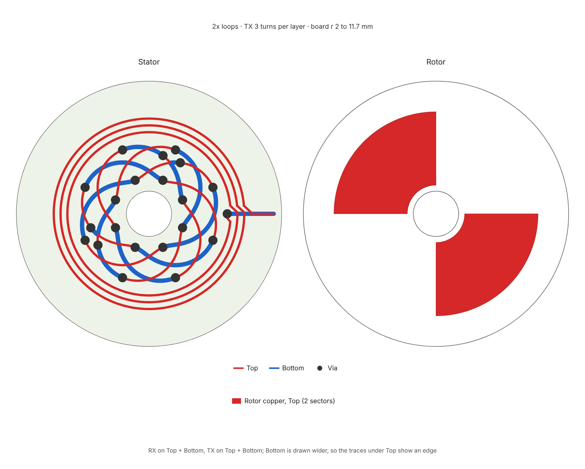
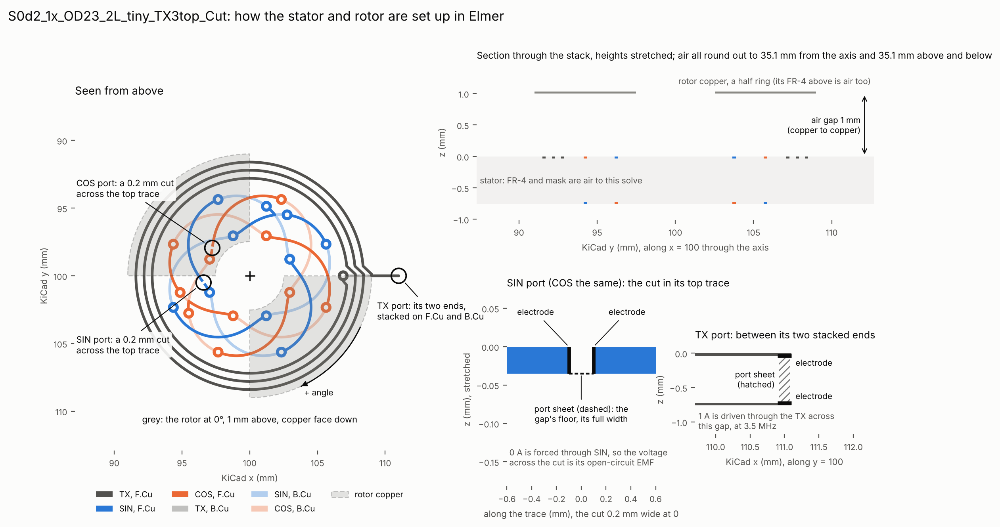
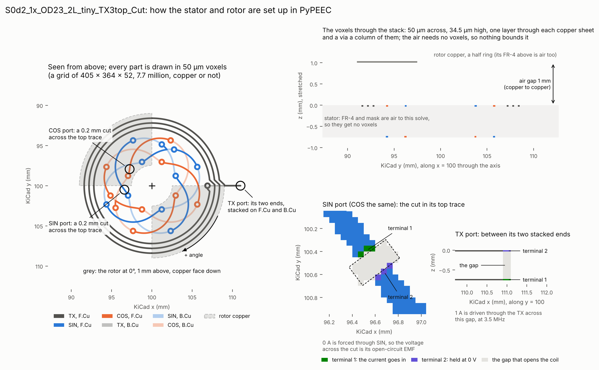
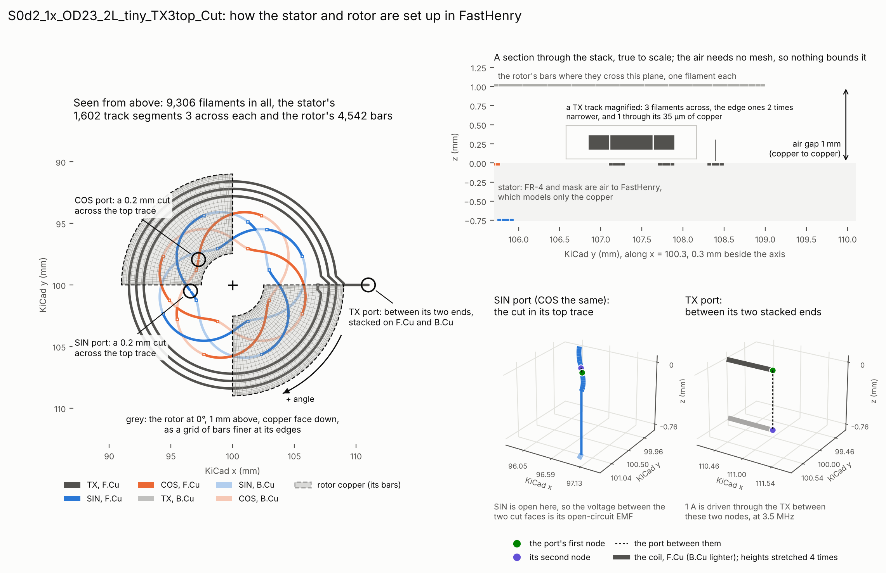
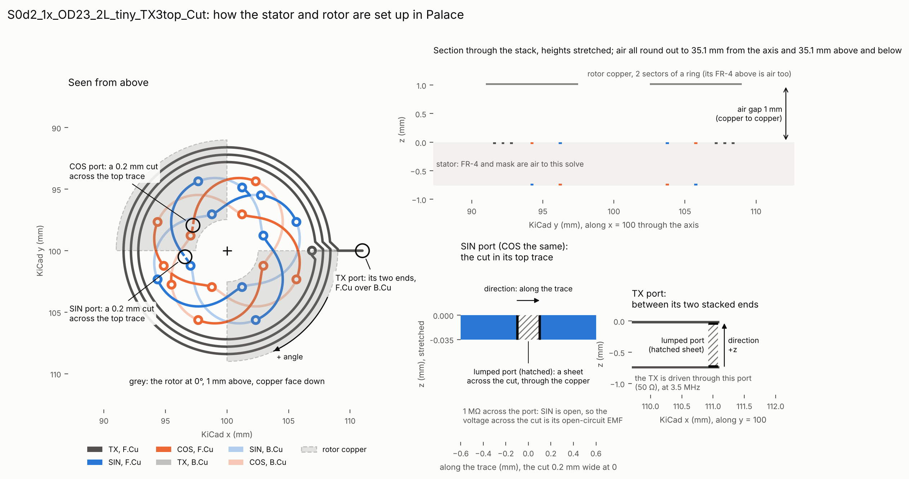
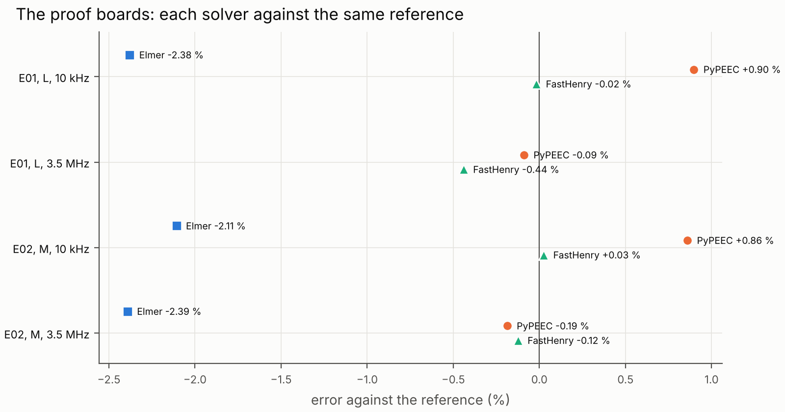
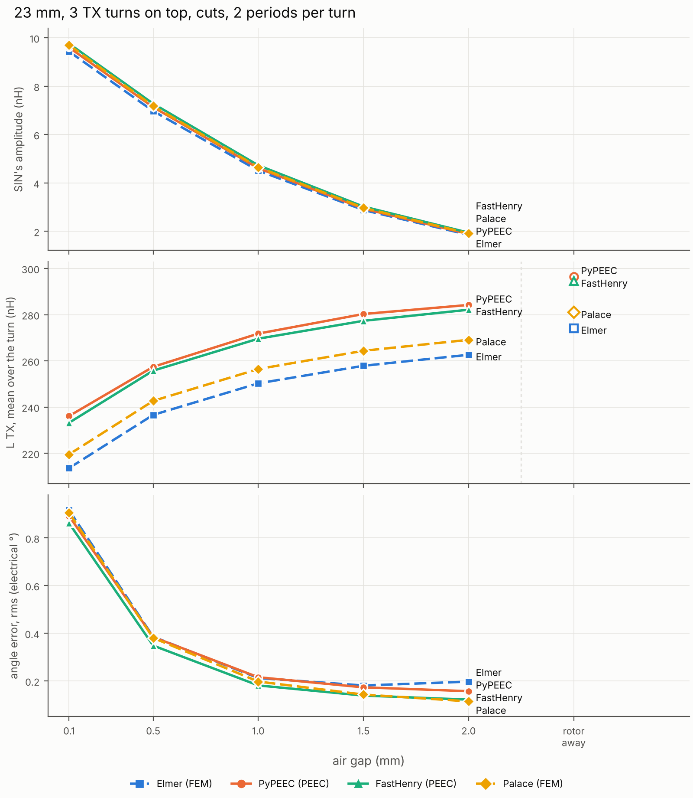
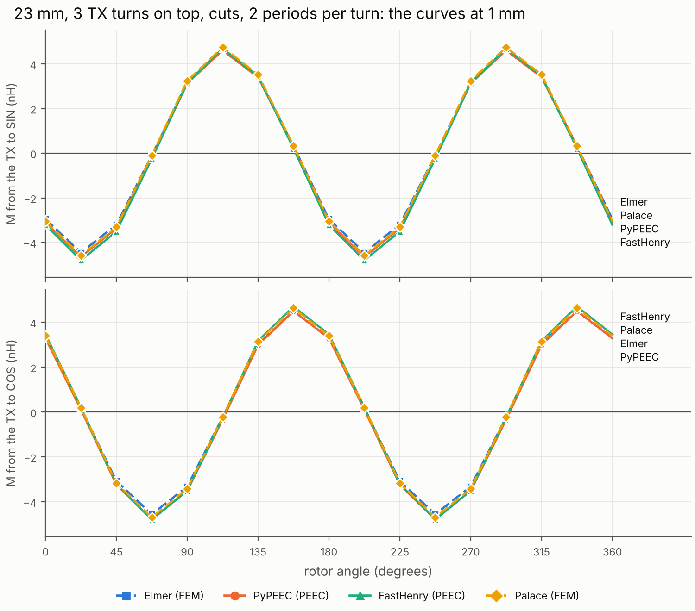

# 70. Solvers Comparison

Four free, open-source electromagnetic solvers were run on the same KESE exports: the same boards, the same air gaps, the same rotor angles and the same frequency (3.5 MHz, copper at 58 MS/m). Each has its own category in this wiki and its own branch, and none of the branches knows of the others; the [`Solvers_Comparison`](https://github.com/RolandThsive/KiCad-EM-Stackup-Exporter-KESE/tree/Solvers_Comparison) branch reads their results unchanged and sets them side by side, with values worked out by hand where a formula exists. This page shows three of the boards: the coil board `S0d2_1x_OD23_2L_tiny_TX3top_Cut` and the two proof boards, `E01_circular_loop` and `E02_coaxial_loops`.

> [!NOTE]
> Every number here comes from the `Solvers_Comparison` branch's `data/` folder. Its README and its
> `Comparisons/` folder compare all six coil boards the branches solved; this page keeps to one.

## 70.1 The Four Solvers

| Solver | Method | What it models | Branch | Category |
|---|---|---|---|---|
| Elmer | FEM (finite elements, the A-V eddy-current formulation) | the copper, the board and the air around them, in finite elements; the field from the A-V eddy-current formulation | `Elmer_Integration` | [Elmer FEM](Elmer-FEM-Introduction.md) |
| PyPEEC | PEEC (partial elements on voxels, FFT-accelerated) | only the copper, as a grid of voxels; the air from the free-space formulas | `PyPEEC_Integration` | [PyPEEC](PyPEEC-Introduction.md) |
| FastHenry | PEEC (partial elements on filaments, direct solve) | only the copper, as straight filaments along each track's centre line; the air from the free-space formulas | `FastHenry_Integration` | [FastHenry](FastHenry-Introduction.md) |
| Palace | FEM (finite elements, the frequency-domain Maxwell solver) | the copper, the board and the air around them, in finite elements; the field from Maxwell's equations in the frequency domain | `Palace_Integration` | [Palace](Palace-Introduction.md) |
| Theory | hand formulas | the TX copper alone: Neumann's integral and the DC resistance | `Solvers_Comparison` | [below](#709-the-hand-values) |

The two finite-element (FEM) solvers mesh the air and close it at an outer boundary. The two partial-element (PEEC) solvers model only the copper, with no mesh of the air and no boundary. That difference explains most of what follows.

## 70.2 The Boards



**S0d2_1x_OD23_2L_tiny_TX3top_Cut** is an inductive position sensor 23 mm across, made by the Sinusoidal Coil Generator: a TX coil of three turns on the top layer drives the rotor, and two receivers, SIN and COS, read it. The receivers have two electrical periods per turn and the rotor two copper sectors, so the curves repeat every 180°. Each receiver is opened by a 0.2 mm cut in a top trace, as the real board is. It was solved at 16 rotor angles over the whole turn, at air gaps of 0.1, 0.5, 1, 1.5 and 2 mm, and once with the rotor taken away.

**E01_circular_loop** is one circular trace 20 mm across, 0.5 mm wide, opened by a 0.2 mm gap: its inductance is known from a formula. **E02_coaxial_loops** is two such loops, one on each side of a board 1.565 mm apart: their mutual inductance is known the same way. Both were solved at 10 kHz, where the current fills the copper evenly, and at 3.5 MHz, the coil board's frequency.

Each solver sets up `S0d2_1x_OD23_2L_tiny_TX3top_Cut` its own way, from the same KESE export. The two FEM solvers mesh the air out to 35 mm all round; PyPEEC fills the copper with voxels and FastHenry with filaments, and neither meshes any air. All four drive the TX between its two stacked ends and read each receiver's open-circuit voltage across its cut.

<table>
<tr><td></td><td></td></tr>
<tr><td align="center">Elmer</td><td align="center">PyPEEC</td></tr>
<tr><td></td><td></td></tr>
<tr><td align="center">FastHenry</td><td align="center">Palace</td></tr>
</table>

## 70.3 E01 And E02: Against The Formula



| Solver | E01, L, 10 kHz | E01, L, 3.5 MHz | E02, M, 10 kHz | E02, M, 3.5 MHz | Run |
|---|---|---|---|---|---|
| Elmer | 54.267 nH (−2.38 %) | — | 23.383 nH (−2.11 %) | 23.315 nH (−2.39 %) | as its branch solves it |
| Elmer | 55.731 nH (+0.25 %) | — | 23.866 nH (−0.08 %) | — | a finer air mesh, kept by the branch |
| PyPEEC | 56.089 nH (+0.90 %) | 54.990 nH (−0.09 %) | 24.091 nH (+0.86 %) | 23.841 nH (−0.19 %) | as its branch solves it |
| FastHenry | 55.580 nH (−0.02 %) | 54.797 nH (−0.44 %) | 23.892 nH (+0.03 %) | 23.856 nH (−0.12 %) | as its branch solves it |
| Palace | 54.199 nH (−2.50 %) | 53.295 nH (−3.17 %) | 23.355 nH (−2.22 %) | 23.299 nH (−2.46 %) | as its branch solves it |
| Palace | 55.857 nH (+0.48 %) | 54.878 nH (−0.29 %) | 24.166 nH (+1.17 %) at 100 kHz | 24.104 nH (+0.91 %) | a finer air mesh, kept by the branch |
| **Theory** | 55.590 nH | 53.37 to 55.59 nH | 23.886 nH | 23.886 nH | Neumann's integral |

The percentages are against the references the branches share: Neumann's double integral over the open arcs, 55.590 nH for E01 at 10 kHz and 23.886 nH for E02, and for E01 at 3.5 MHz 55.039 nH, the value for a strip of no thickness with its current at the edges. At 3.5 MHz the skin depth equals the copper's thickness, so the true value lies between the surface-current limit, 53.37 nH, and the DC value: the Theory row.

- **FastHenry is within a few hundredths of a percent at 10 kHz**, on both boards.
- **PyPEEC is 0.9 % high at 10 kHz** on its 12.5 µm (E01) and 50 µm (E02) voxels, and close at 3.5 MHz.
- **Elmer is 2.4 % low at its default mesh** and within 0.3 % once the air is graded finely: the FEM solvers' error is in the air mesh.
- **Palace is above the open arcs once its air is graded as on the coil boards**: E01 +0.48 % and E02 +1.17 %, against −2.5 % and −2.2 % on its default mesh. Its lumped port is a sheet across each gap that carries the TX's current across it and takes the RX's EMF across it, so its loops are closed, and its L and M should end above the open arcs and near the closed rings (56.622 and 24.400 nH). Its graded E02 is solved at 100 kHz: at 10 kHz GMRES does not converge on that mesh within 15 GB, and on the default mesh the two frequencies agree to 0.002 %.

## 70.4 S0d2_1x_OD23_2L_tiny_TX3top_Cut: The Signal Over The Air Gap



The signal is each receiver's mutual inductance from the TX, M = V / (jωI): with 1 A at 3.5 MHz in the TX, 1 nH is 22 mV at the receiver. Its amplitude is the best sine through the 16 angles.

**SIN's amplitude (nH)**

| Air gap | Elmer | PyPEEC | FastHenry | Palace | Theory |
|---|---|---|---|---|---|
| 0.1 mm | 9.436 | 9.604 | 9.762 | 9.706 | no hand formula |
| 0.5 mm | 6.974 | 7.137 | 7.279 | 7.183 | no hand formula |
| 1 mm | 4.511 | 4.613 | 4.730 | 4.652 | no hand formula |
| 1.5 mm | 2.882 | 2.940 | 3.026 | 2.973 | no hand formula |
| 2 mm | 1.856 | 1.891 | 1.946 | 1.915 | no hand formula |

All four agree on the shape: the signal falls from about 9.4 to 9.8 nH at 0.1 mm to about 1.86 to 1.95 nH at 2 mm, SIN and COS within 0.5 % of each other. Against FastHenry's, the highest:

- **Elmer** (FEM): 4.3 % under FastHenry's on average (−4.8 to −3.3 % over the five gaps).
- **PyPEEC** (PEEC): 2.2 % under FastHenry's on average (−2.8 to −1.4 % over the five gaps).
- **Palace** (FEM): 1.4 % under FastHenry's on average (−1.7 to −0.6 % over the five gaps).

The two FEM solvers read low because a coarse air mesh stores too little magnetic energy; PyPEEC reads low because its voxels turn every arc into a staircase (see [Why They Differ](#708-why-they-differ)). There is no hand formula for the amplitude: it depends on the eddy currents in the rotor's copper, which only a field solve gives.



*SIN and COS against the rotor angle at 1 mm. Where a receiver's plus terminal sits on the other side in one branch, its curve is turned back to match FastHenry's; the amplitude and the angle error are the same either way.*

## 70.5 S0d2_1x_OD23_2L_tiny_TX3top_Cut: The TX Coil Against The Hand Values

The TX coil's inductance with the rotor away has a hand value: Neumann's integral over its copper ([70.9](#709-the-hand-values)). At DC it is 295.6 nH, the most L TX can be at any frequency and air gap; with all the current at the copper's surface it is about 289.2 nH. At 3.5 MHz, with the rotor away, L TX lies between the two. Its resistance can be no less than the DC resistance, 379.4 mΩ.

| | L TX, rotor away (nH) | Against the hand values | L TX at 1 mm (nH) | R TX, rotor away (mΩ) | Over the DC resistance |
|---|---|---|---|---|---|
| **Theory** | 289.2 to 295.6 | — | ≤ 295.6 | ≥ 379.4 | — |
| Generator's estimate | 292 | — | 226 (it says the true value is above) | 380 (DC) | — |
| Elmer | 274.2 | 5.2 % under the high-frequency limit | 250.3 | 438 | +15.3 % |
| PyPEEC | 296.4 | 0.3 % over the DC value, the most it can be | 271.8 | 475 | +25.2 % |
| FastHenry | 294.6 | inside the hand values | 269.6 | 413 | +8.9 % |
| Palace | 281.0 | 2.8 % under the high-frequency limit | 256.5 | 445 | +17.2 % |

- **FastHenry lands inside the hand values; PyPEEC just above the DC value**, by the staircase of its voxels.
- **Palace and Elmer are under the high-frequency limit**, which no correct answer can be: their air meshes store too little energy. Palace's mesh study on another board shows L TX rising towards FastHenry's as the air is refined.
- **Every solver's R TX is above the DC resistance**, as it has to be; at 3.5 MHz it depends on how finely each resolves the current inside the 35 µm copper, and is the least settled number here.

## 70.6 S0d2_1x_OD23_2L_tiny_TX3top_Cut: The Angle Error

The angle error is how far the angle read from SIN and COS is from the rotor's true angle, in electrical degrees (two electrical periods per turn here, so 1° electrical is 0.5° of the shaft). An ideal sensor's is zero.

| Air gap | Elmer | PyPEEC | FastHenry | Palace | Theory |
|---|---|---|---|---|---|
| 0.1 mm | 0.92° rms | 0.89° rms | 0.86° rms | 0.91° rms | 0 (ideal) |
| 0.5 mm | 0.39° rms | 0.38° rms | 0.35° rms | 0.38° rms | 0 (ideal) |
| 1 mm | 0.21° rms | 0.22° rms | 0.18° rms | 0.20° rms | 0 (ideal) |
| 1.5 mm | 0.18° rms | 0.17° rms | 0.14° rms | 0.14° rms | 0 (ideal) |
| 2 mm | 0.20° rms | 0.16° rms | 0.12° rms | 0.11° rms | 0 (ideal) |

The four agree within 0.08° rms at every gap: the angle error is a property of the board, which every solver sees alike, even where their amplitudes differ by a few percent. It is largest at 0.1 mm, where the rotor is close enough for the coupling's harmonics to show.

## 70.7 Time And Memory

Each branch records the wall time and the peak memory of every solve, on machines of the same size (4 cores, 15 GB), each with its own process layout; read these as rough.

| Solver | Seconds per solve, median over the gaps | Range | Peak memory of a solve (GB) |
|---|---|---|---|
| Elmer | 382 | 217 to 583 | 13.3 |
| PyPEEC | 305 | 184 to 678 | 1.7 to 3.5 |
| FastHenry | 245 | 212 to 269 | 1.1 |
| Palace | 214 | 141 to 253 | 8.0 to 12.9 |
| Theory | 44, once for the board | — | 2.0 |

The PEEC solvers need far less memory, since they mesh no air; Elmer's direct solve (MUMPS) needs the most. Palace solved this board's five air gaps on five machines at once.

## 70.8 Why They Differ

**FEM against PEEC.** A FEM solver meshes the air and closes it at an outer boundary. On a coarse air mesh it stores too little magnetic energy, so L and M come out low and rise as the mesh is refined; the boundary lowers them a little more. With the rotor away, Palace's L TX is 4.6 % under FastHenry's and Elmer's 6.9 %, both under the high-frequency limit ([70.5](#705-s0d2_1x_od23_2l_tiny_tx3top_cut-the-tx-coil-against-the-hand-values)). Palace grades its air four times as finely as Elmer (a grade of 0.125 against 0.5) and stacks its wedge layers half as thick, and it lands closer. E01 shows where the error lies: Elmer is −2.4 % on its default mesh and +0.25 % once the air is graded finely, Palace −2.5 % and +0.48 %.

**PyPEEC against FastHenry.** Both model only the copper, so the difference is how they cut it up. PyPEEC draws the tracks onto a grid of 50 µm voxels, which turns every arc into a staircase; FastHenry follows each track's centre line with straight filaments, three across the width and one through the thickness. On this board PyPEEC's signal is 2.2 % under FastHenry's and its L TX 0.6 % over; on E01 at 10 kHz PyPEEC is 0.9 % high and FastHenry 0.02 % low.

**R TX is the least settled number.** At 3.5 MHz the skin depth is the copper's own thickness, so R depends on how finely a solver resolves the current inside each track: FastHenry has one filament through the thickness, PyPEEC one voxel layer, the FEM meshes two element layers. With the rotor away FastHenry's R TX is the lowest, 413 mΩ; Elmer's 6 % higher, Palace's 8 % higher, PyPEEC's 15 % higher. R does not enter M or the angle error.

## 70.9 The Hand Values

Worked out from the TX copper in the board's `Stator.kicad_pcb` and KESE's stack-up by `scripts/theory.py` on the `Solvers_Comparison` branch.

**L TX with the rotor away**, by Neumann's formula over the copper's centre line, 154.0 mm of 0.2 mm × 35 µm trace from one terminal end to the other:

```math
L = \frac{\mu_0}{4\pi} \oint \oint \frac{d\mathbf{l} \cdot d\mathbf{l}'}{r}
```

Along one stretch of trace, r becomes √(r² + g²), g being the geometric mean distance (GMD) of the trace's cross-section; between separate stretches, 1/r is averaged over both cross-sections. At DC g = 0.2235 (w + t) = 0.0525 mm (Grover), giving 295.6 nH; with the current all at the surface g is the rectangle's logarithmic capacity, 0.0653 mm, giving 289.2 nH. The same code gives E01's loop 55.571 nH against the textbook 55.590 nH.

**Why they bound the solvers.** With no magnetic material near, a coil's inductance can only fall and its resistance only rise as the frequency goes up, and copper brought near it (the rotor) only lowers L and adds loss. The skin depth at 3.5 MHz,

```math
\delta = \frac{1}{\sqrt{\pi f \mu_0 \sigma}} = 35.3\ \mu\mathrm{m},
```

is the copper's own thickness, so the true value lies between the two ends, not at either.

**R TX at DC**:

```math
R = \frac{\ell}{\sigma w t} = \frac{154.0\ \mathrm{mm}}{58\ \mathrm{MS/m} \times 0.2\ \mathrm{mm} \times 35\ \mu\mathrm{m}} = 379.4\ \mathrm{m}\Omega
```

**The angle error's 0** is the design's target: the receivers are drawn so that SIN and COS follow the sine and cosine of the angle exactly. **The amplitudes** have no hand value.

## 70.10 Running It Again

On the [`Solvers_Comparison`](https://github.com/RolandThsive/KiCad-EM-Stackup-Exporter-KESE/tree/Solvers_Comparison) branch:

```
git fetch origin Elmer_Integration PyPEEC_Integration FastHenry_Integration Palace_Integration
python scripts/collect.py          # reads every branch into data/
python scripts/theory.py --check   # the hand values
python scripts/charts.py           # the charts
python scripts/report.py           # its README and Comparisons/
```

The boards are the Sinusoidal Coil Generator's and keep its non-commercial terms; see the branch's `LICENSE.md`.

| Previous | Next |
|:---|---:|
| [Palace Troubleshooting](Palace-Troubleshooting.md) | [Glossary](Glossary.md) |
