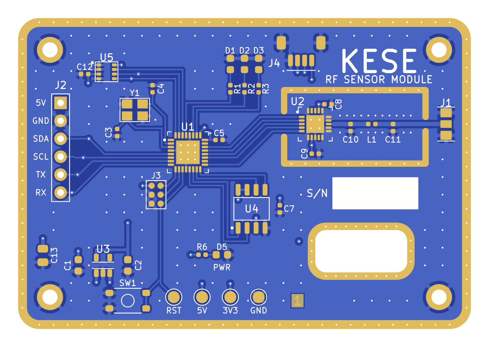
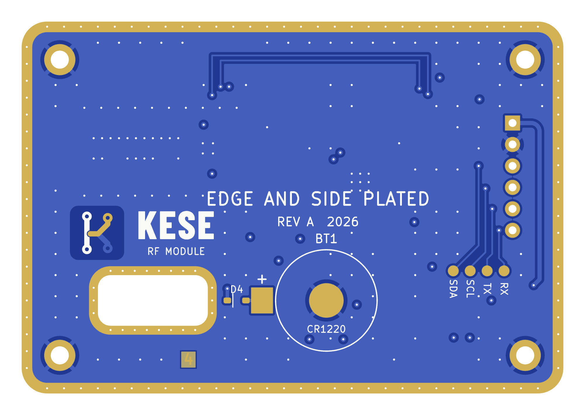
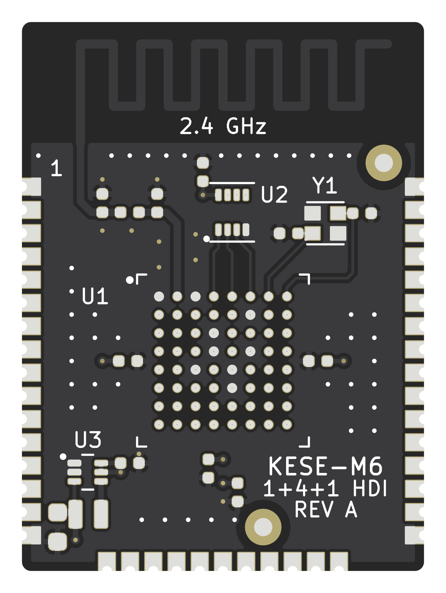
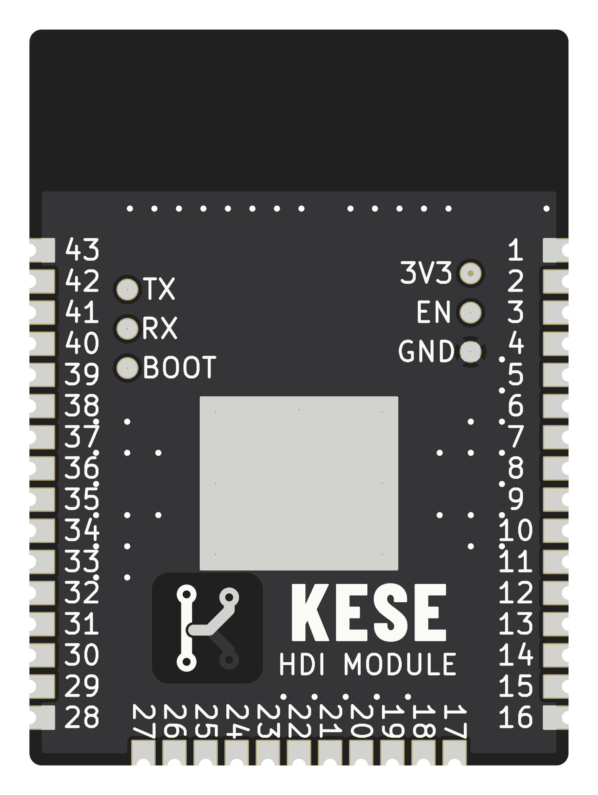
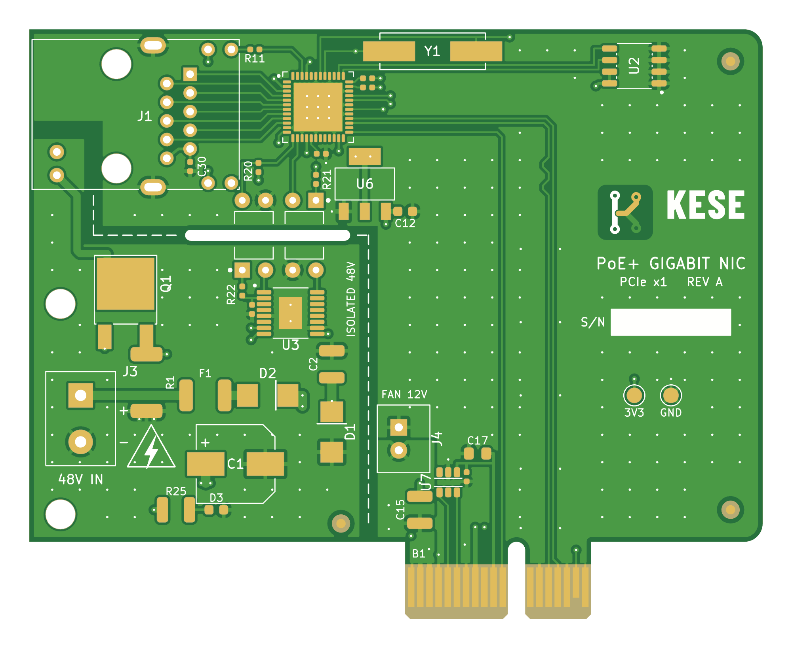
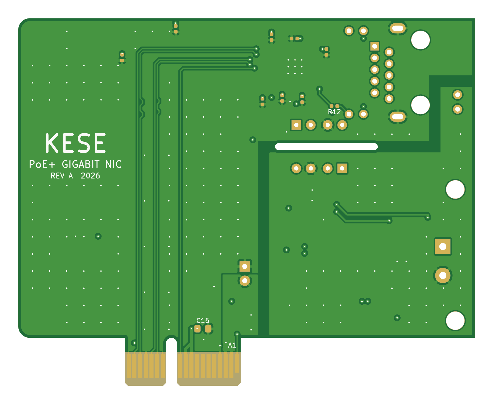

# 6. Time Distribution

Where the time of a run goes, stage by stage, for the three example boards of `Generator/Input/`
([Examples](Examples.md)). Each board was exported three times in each mode, with the Verifier
on, and each bar is the median of the three runs for that stage, read from the `timing` block of
[`report.txt`](Project-Output-Organization.md#2022-reporttxt):

```text
python run_KESE.py Input/rf_module.kicad_pcb --mode simulation --format glb step --verify
python run_KESE.py Input/rf_module.kicad_pcb --mode visual --format glb --verify
```

All 18 runs passed the Verifier. Beside each board's facts, a second table gives the size of each
model file the runs write and the most memory a run used at once: the proportional set size (PSS)
of KESE's process and its workers, summed and sampled every 10 ms, the median of three more runs.
MB is a million bytes.

**The runs used the default parameters on one Linux machine with 4 cores (an Intel Xeon at 2.1 GHz)
and 16 GB of RAM, so `Parallel.WORKERS = 0` gave four workers
([Work Done In Parallel](Working-Principle.md#74-work-done-in-parallel)). On another machine the
seconds differ.**

| Bar | Stages | What runs in it |
|---|---|---|
| 1–2 read | 1 read, 2 collect | The file parsed; every track, pad, zone, graphic and text as a flat shape; the stroke font unpacked and split into lines (about 0.06 s), and the glyphs the text uses parsed |
| 3 resolve | 3 | The copper joined per layer and net, clipped and drilled; barrels, edge plating, mask openings and silkscreen |
| 4 geometry | 4 | Every part as prisms, between the heights of the stack-up |
| 5 materials | 5 | A material for every part, from `parameters/color.py` and the stack-up's colours: 0.2 to 0.3 ms |
| 6 assemble | 6 | Closed solids in simulation mode, the visible skin in visual mode; with `--verify`, each solid is also checked here by the worker that built it |
| 7 write | 7 | The files. In simulation mode nearly all of it is the STEP file: the HDI module takes 1.7 s with STEP alone and 0.1 s with GLB alone. The visual GLB takes 30 to 51 ms |
| 8 verify | 8 | The Verifier's checks of the written files ([Checks, Errors And Warnings](Checks-Errors-And-Warnings.md)) |
| start-up and exit | none | The wall-clock time less the stages, about 0.2 s: Python starting (13 ms), KESE and the libraries it uses imported (0.12 s), the run set up and closed around the stages (13 ms), stage 9 writing `report.txt` and `parameters.txt` (1 to 4 ms), and Python freeing the run's memory as it ends (0.05 s) |

Under each chart a table gives the same numbers, in seconds unless marked ms. A stage too thin to
see at this scale is marked with a line and a label.

## 6.1 RF Sensor Module

<p align="center">


</p>


| Mode | 1–2 read | 3 resolve | 4 geometry | 5 materials | 6 assemble | 7 write | 8 verify | start-up and exit | Total |
|---|---:|---:|---:|---:|---:|---:|---:|---:|---:|
| Simulation, GLB + STEP | 0.3 | 1.6 | 6.7 | 0.3 ms | 5.0 | 2.6 | 0.4 | 0.2 | 16.8 |
| Visual, GLB | 0.3 | 1.6 | 6.8 | 0.3 ms | 6.9 | 51 ms | 0.4 | 0.3 | 16.2 |

<table>
<tr>
<td valign="top">

| Board | `Input/rf_module.kicad_pcb`<br>([5.1](Examples.md#51-rf-sensor-module)) |
|---|---|
| Outline | 64 × 44 mm, a cut-out |
| Thickness | 1.6 mm |
| Copper layers | 4 |
| Vias | 307 through |
| Board edge | Plated all round<br>and in the cut-out |
| Mask, silkscreen,<br>finish | Blue, white, ENIG |

</td>
<td valign="top">

<table>
<tr><th>File type</th><th>File size</th><th>Peak memory used</th></tr>
<tr><th colspan="3" align="left">Simulation</th></tr>
<tr><td>GLB</td><td align="right">37.3 MB</td><td rowspan="2" align="right">640 MB</td></tr>
<tr><td>STEP</td><td align="right">114.7 MB</td></tr>
<tr><th colspan="3" align="left">Visual</th></tr>
<tr><td>GLB</td><td align="right">10.3 MB</td><td align="right">396 MB</td></tr>
</table>

</td>
</tr>
</table>

## 6.2 HDI Radio Module

<p align="center">


</p>


| Mode | 1–2 read | 3 resolve | 4 geometry | 5 materials | 6 assemble | 7 write | 8 verify | start-up and exit | Total |
|---|---:|---:|---:|---:|---:|---:|---:|---:|---:|
| Simulation, GLB + STEP | 0.3 | 1.0 | 3.1 | 0.3 ms | 2.3 | 1.8 | 0.4 | 0.2 | 9.2 |
| Visual, GLB | 0.2 | 1.1 | 3.1 | 0.3 ms | 3.4 | 30 ms | 0.2 | 0.2 | 8.3 |

<table>
<tr>
<td valign="top">

| Board | `Input/hdi_module.kicad_pcb`<br>([5.2](Examples.md#52-hdi-radio-module)) |
|---|---|
| Outline | 22 × 30 mm |
| Thickness | 0.925 mm |
| Copper layers | 6, built 1+4+1 |
| Vias | 150: 71 micro,<br>34 blind and buried, 45 through |
| Board edge | 43 castellated pads |
| Mask, silkscreen,<br>finish | Black, white, immersion silver |

</td>
<td valign="top">

<table>
<tr><th>File type</th><th>File size</th><th>Peak memory used</th></tr>
<tr><th colspan="3" align="left">Simulation</th></tr>
<tr><td>GLB</td><td align="right">20.4 MB</td><td rowspan="2" align="right">378 MB</td></tr>
<tr><td>STEP</td><td align="right">72.7 MB</td></tr>
<tr><th colspan="3" align="left">Visual</th></tr>
<tr><td>GLB</td><td align="right">5.6 MB</td><td align="right">249 MB</td></tr>
</table>

</td>
</tr>
</table>

## 6.3 PCIe x1 Card

<p align="center">


</p>


| Mode | 1–2 read | 3 resolve | 4 geometry | 5 materials | 6 assemble | 7 write | 8 verify | start-up and exit | Total |
|---|---:|---:|---:|---:|---:|---:|---:|---:|---:|
| Simulation, GLB + STEP | 0.3 | 1.2 | 4.4 | 0.2 ms | 2.7 | 2.3 | 0.4 | 0.2 | 11.5 |
| Visual, GLB | 0.3 | 1.2 | 4.5 | 0.2 ms | 4.4 | 43 ms | 0.3 | 0.2 | 11.0 |

<table>
<tr>
<td valign="top">

| Board | `Input/pcie_card.kicad_pcb`<br>([5.3](Examples.md#53-pcie-x1-card)) |
|---|---|
| Outline | 80 × 64.4 mm with the fingers' tongue,<br>a slot |
| Thickness | 1.57 mm |
| Copper layers | 4 |
| Vias | 239 through |
| Board edge | 36 gold fingers |
| Mask, silkscreen,<br>finish | Green, white, hard gold |

</td>
<td valign="top">

<table>
<tr><th>File type</th><th>File size</th><th>Peak memory used</th></tr>
<tr><th colspan="3" align="left">Simulation</th></tr>
<tr><td>GLB</td><td align="right">29.0 MB</td><td rowspan="2" align="right">501 MB</td></tr>
<tr><td>STEP</td><td align="right">80.1 MB</td></tr>
<tr><th colspan="3" align="left">Visual</th></tr>
<tr><td>GLB</td><td align="right">8.8 MB</td><td align="right">317 MB</td></tr>
</table>

</td>
</tr>
</table>

## 6.4 Timing Your Own Board

Every run writes the same block at the end of its `report.txt`, so the time of any board can be
read the same way. The HDI module's third simulation run:

```text
timing
  read              0.0548 s
  collect           0.2258 s
  resolve           1.2156 s
  geometry          2.9874 s
  materials         0.0003 s
  assemble          2.2985 s
  write             1.7396 s
  verify            0.3867 s
```

`verify` is there only when the Verifier ran. Each value is in seconds, to 0.1 ms.

| Previous | Next |
|:---|---:|
| [Examples](Examples.md) | [Working Principle](Working-Principle.md) |
